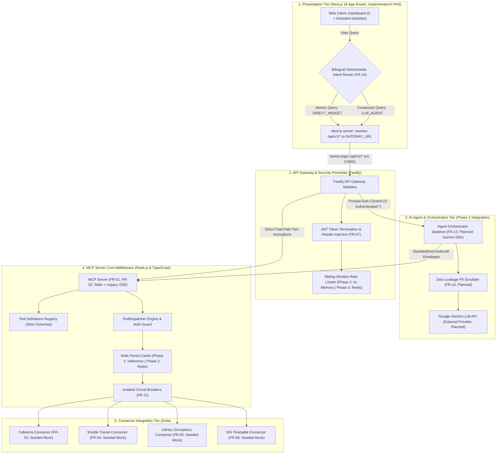
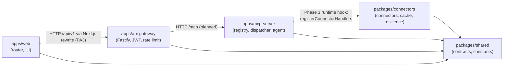
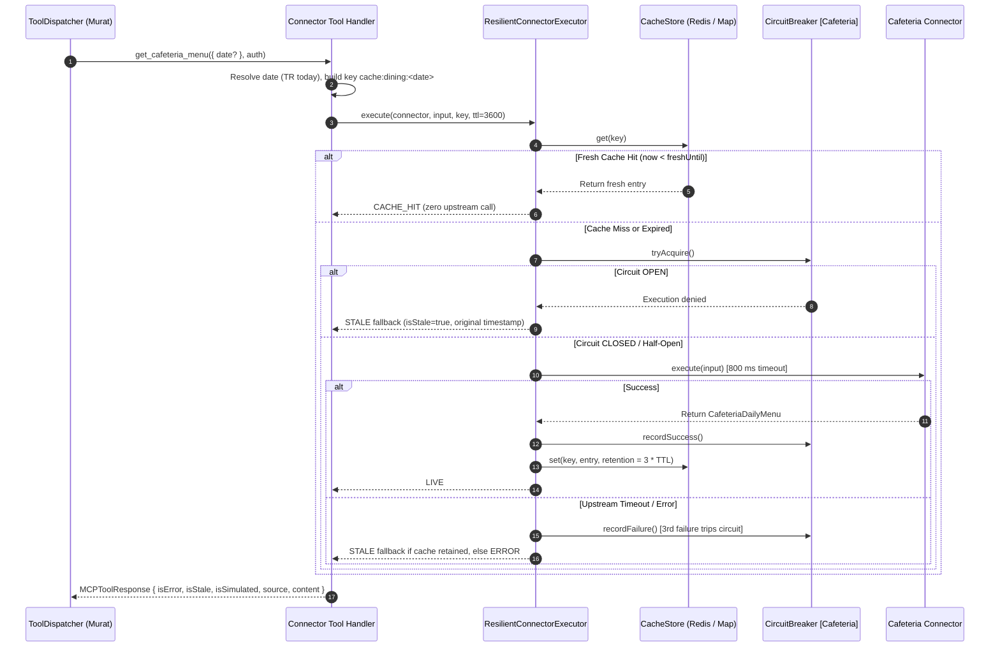
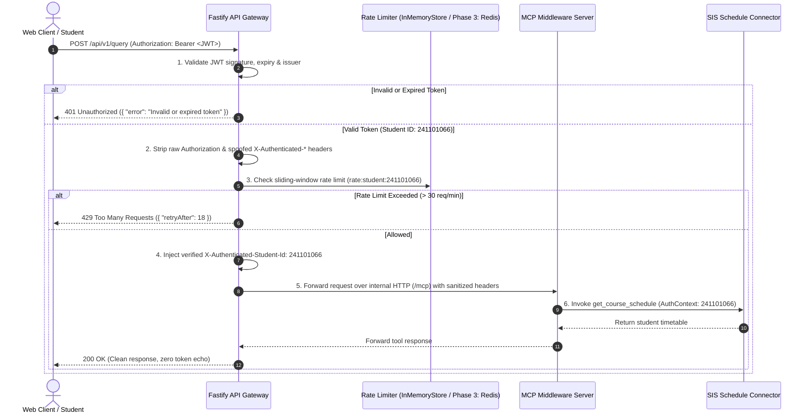
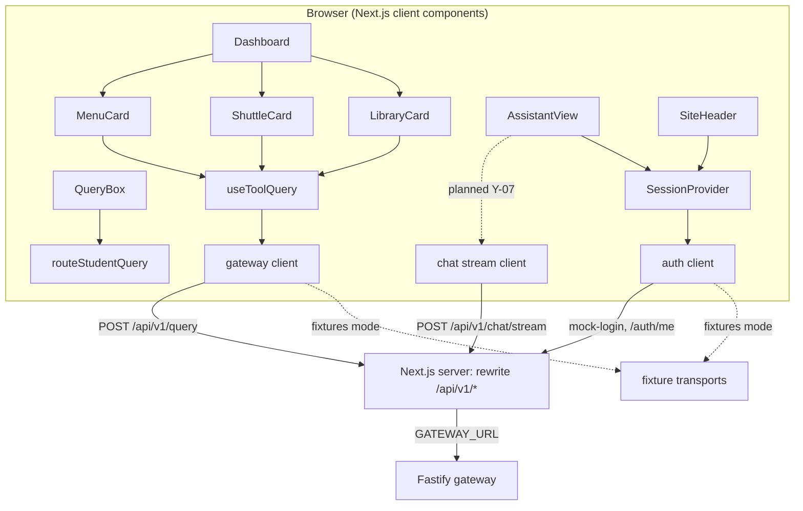
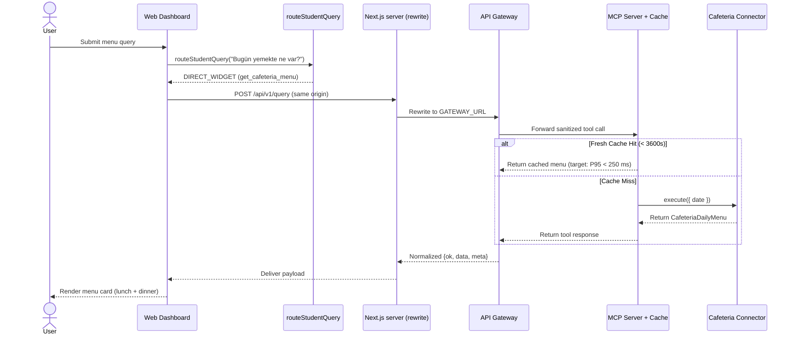
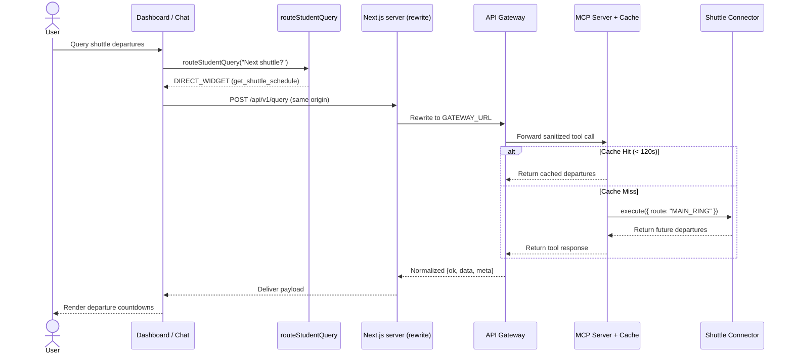
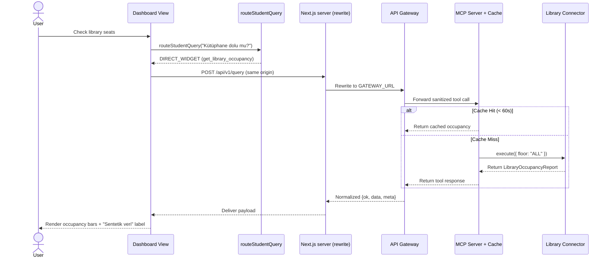
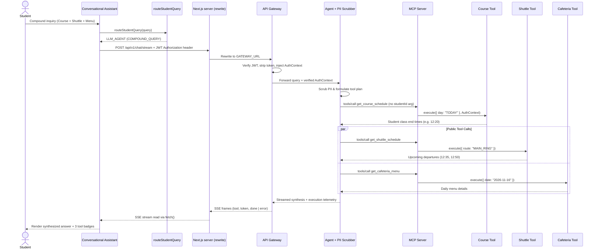

# Design Document

**Campus Data Orchestrator — An MCP-Based Campus Data Orchestrator**

| Field | Detail |
| :--- | :--- |
| **Course** | BIL 481 Software Engineering, Fall 2026, TOBB University of Economics and Technology |
| **Assignment** | Project Assignment 2 (Design & Skeleton); updated during Project Assignment 3 (Implementation & Deployment) |
| **Group Name** | Group-ASYM |
| **Document Version / Date** | Version 1.1 (PA3 working update — web client), 20 November 2026. Version 1.0 (PA2 final deliverable, 15 November 2026) is preserved in the Git history of `main`; see the [Change Record](#change-record). |
| **Repository Filepath** | `docs/Design_Document.md` |
| **Related Baseline Documents** | `docs/Project_Definition_Document.md`, `docs/Project_Plan_Document.md`, `docs/Requirements_Document.md`, `docs/QA_Plan.md` |

---

## Document Authorship & Team Attribution

In compliance with the BIL 481 Project Assignment 2 specification, each team member's role, student identity, and specific authoring contributions to this Design Document are detailed below:

| Member Name | Student ID | GitHub Account | Primary Project Role | Specific Contribution to this Design Document |
| :--- | :--- | :--- | :--- | :--- |
| **Murat Can Işık** | 241101013 | [`@cmuratt`](https://github.com/cmuratt) | Lead Developer & MCP Architect | **Document Lead & Editor:** Compiled and structured the final Design Document; authored Section 1 (System Overview, Architecture, Tech Stack), Section 2.2.1 & 2.3.1–2 (MCP Server Core, ToolDispatcher, AI Agent Skeleton), Section 2.3.6 (MCP Tool Contracts & Security Boundary), Section 5, and Section 6. |
| **Yunus Emre Biçer** | 241101009 | [`@YunusEmre113`](https://github.com/YunusEmre113) | Frontend & Intent Router Lead | **Presentation & Use Case Lead:** Authored Section 2.2.2 & 2.3.3 (Web Client Architecture, Bilingual Deterministic Intent Router), Section 2.4 (Visual Interfaces, Responsive Layouts, SVG Wireframes), and Section 3 (Four Selected Use Cases UC-01–UC-04, Sequence Diagrams, Demo Criteria). |
| **Arda Çelik** | 241101065 | [`@ardacelik11`](https://github.com/ardacelik11) | Connector & Data Resilience Lead | **Data & Decisions Lead:** Authored Section 2.1 (Codebase Structure, Monorepo Layout, Packaging), Section 2.2.3 & 2.3.4 (Campus Connectors, Deterministic Mock Data, TTL Caching, Circuit Breaking), Section 4 (Design Decisions: 4.1 Redis vs Memory Map, 4.2 Fastify vs Express editing). |
| **Ahmet Sefa Efendioğlu** | 241101066 | [`@Sefa-Efendioglu`](https://github.com/Sefa-Efendioglu) | QA, Security & Gateway Lead | **Security & QA Verification:** Authored Section 2.2.4 & 2.3.5 (API Gateway Architecture, Perimeter Token Termination, Sliding-Window Rate Limiting), drafted Section 4.2 evaluation material (Fastify vs Express), and performed cross-document QA audit against the QA Plan. |

**PA3 update (Version 1.1):** The web client sections (1.2, 1.3, 2.1, 2.2.2, 2.3.3, 2.4, 3.2–3.6, 5) were updated by Murat Can Işık (document lead, M-11) from the web client handover written by Yunus Emre Biçer ([`docs/assignment3/handovers/yunus.md`](assignment3/handovers/yunus.md), Y-13). The facts come from that handover and were checked against `dev` at `6cc1d07`; the wording is Murat's. The gateway, MCP/agent and connector sections are updated in later PA3 revisions.

---

## Change Record

| Version | Date | Updated Sections | Description of Changes | Updated By |
| :--- | :--- | :--- | :--- | :--- |
| 1.0 | 15 Nov 2026 | All | PA2 final deliverable (design and skeleton). | All members (see attribution above) |
| 1.1 | 20 Nov 2026 | Header, 1.2, 1.3, 2.1.1, 2.1.2, 2.2.2, 2.3.3, 2.4, 3.2–3.6, 5, 6 | Web client moved from *Planned* to *Implemented* (Next.js 16 App Router, React 19, CSS Modules); three dashboard cards instead of four; router step for personal-timetable words and held-out measurement; current web interfaces; implemented UI vs. wireframe differences; Next.js rewrite of `/api/v1/*` in the sequence diagrams; **design decision: no automatic SSE reconnect** (API Contract v1.1 §3.3). Source: web client handover (Y-13). | Murat Can Işık (source: Yunus Emre Biçer) |

---

## Table of Contents

- [Change Record](#change-record)
- [1. System Overview](#1-system-overview)
  - [1.1 Brief Project Description](#11-brief-project-description)
  - [1.2 System Architecture](#12-system-architecture)
  - [1.3 Technology Stack](#13-technology-stack)
- [2. Implementation Details](#2-implementation-details)
  - [2.1 Codebase Structure](#21-codebase-structure)
    - [2.1.1 Monorepo Layout and Ownership](#211-monorepo-layout-and-ownership)
    - [2.1.2 Package Dependencies](#212-package-dependencies)
    - [2.1.3 Build, Test, and Branch Conventions](#213-build-test-and-branch-conventions)
    - [2.1.4 Inside packages/connectors](#214-inside-packagesconnectors)
  - [2.2 Key Implementations](#22-key-implementations)
    - [2.2.1 MCP Server & AI Agent Middleware](#221-mcp-server--ai-agent-middleware)
    - [2.2.2 Frontend & Bilingual Deterministic Intent Router](#222-frontend--bilingual-deterministic-intent-router)
    - [2.2.3 Campus Connectors, TTL Caching & Data Resilience](#223-campus-connectors-ttl-caching--data-resilience)
    - [2.2.4 API Gateway, Identity Perimeter & Rate Limiting](#224-api-gateway-identity-perimeter--rate-limiting)
  - [2.3 Component Interfaces](#23-component-interfaces)
    - [2.3.1 Shared Domain & Protocol Contracts (packages/shared)](#231-shared-domain--protocol-contracts-packagesshared)
    - [2.3.2 MCP Server & ToolDispatcher Signatures (apps/mcp-server)](#232-mcp-server--tooldispatcher-signatures-appsmcp-server)
    - [2.3.3 Frontend Router & View State Contracts (apps/web)](#233-frontend-router--view-state-contracts-appsweb)
    - [2.3.4 Connector, Cache & Resilience Signatures (packages/connectors)](#234-connector-cache--resilience-signatures-packagesconnectors)
    - [2.3.5 API Gateway & Perimeter Security Signatures (apps/api-gateway)](#235-api-gateway--perimeter-security-signatures-appsapi-gateway)
    - [2.3.6 MCP Registered Tool Contracts & Zero-Trust Identity Boundary](#236-mcp-registered-tool-contracts--zero-trust-identity-boundary)
  - [2.4 Visual Interfaces](#24-visual-interfaces)
    - [2.4.1 Campus at a Glance Dashboard Layout](#241-campus-at-a-glance-dashboard-layout)
    - [2.4.2 Conversational Assistant Layout](#242-conversational-assistant-layout)
    - [2.4.3 Responsive Viewport Compatibility (NFR-07)](#243-responsive-viewport-compatibility-nfr-07)
- [3. Use Case Support in Design](#3-use-case-support-in-design)
  - [3.1 Selected Use Cases and Requirements Traceability](#31-selected-use-cases-and-requirements-traceability)
  - [3.2 UC-01 — View Cafeteria Menu](#32-uc-01--view-cafeteria-menu)
  - [3.3 UC-02 — View Shuttle Schedule](#33-uc-02--view-shuttle-schedule)
  - [3.4 UC-03 — View Library Occupancy](#34-uc-03--view-library-occupancy)
  - [3.5 UC-04 — Ask a Combined Course, Shuttle, and Menu Question](#35-uc-04--ask-a-combined-course-shuttle-and-menu-question)
  - [3.6 Cross-Use-Case UI State Rules](#36-cross-use-case-ui-state-rules)
  - [3.7 Final Demonstration Obligations](#37-final-demonstration-obligations)
- [4. Design Decisions (Technology Comparisons)](#4-design-decisions-technology-comparisons)
  - [4.1 Redis vs. Process In-Memory Map](#41-redis-vs-process-in-memory-map)
  - [4.2 Fastify vs. Express](#42-fastify-vs-express)
- [5. GitHub Commit Requirement & Repository Artifacts](#5-github-commit-requirement--repository-artifacts)
- [6. Document-Specific Task Matrix](#6-document-specific-task-matrix)

---

## 1. System Overview

### 1.1 Brief Project Description

**Campus Data Orchestrator** is an open-standard integration platform built on the **Model Context Protocol (MCP)** over JSON-RPC 2.0. In modern universities, everyday student operations are digitally fragmented across isolated silos: cafeteria menus reside on external catering web portals, course schedules are locked inside proprietary Student Information Systems (SIS), campus shuttle ("ring") schedules are hosted on transit trackers, and study space availability is recorded on disconnected turnstile IoT hardware feeds. Answering simple everyday inquiries (such as *"What is for lunch today, and can I catch a ring after my 10:30 class?"*) forces students to switch between multiple portals and manually synthesize contradictory information.

The Campus Data Orchestrator solves this fragmentation by placing a stateless, high-throughput MCP middleware server between campus data feeds and end users. It exposes four core campus services as strictly validated MCP tools, providing two complementary consumption pathways: a **Campus at a Glance Dashboard** that serves frequently requested telemetry (menus, shuttles, library occupancy) instantly from cache without invoking an AI model, and an **Autonomous Conversational Assistant** powered by a Large Language Model (Google Gemini) that plans multi-tool reasoning sequences and synthesizes unified responses. The system enforces strict perimeter identity isolation to prevent student credentials from leaking to external LLM providers and maintains fault isolation through multi-tiered caching (in-memory in Phase 2; Redis in Phase 3), circuit breaking, and synthetic mock fallback.

### 1.2 System Architecture

The system is organized into a **5-tier decoupled architecture**, separating presentation, security perimeter enforcement, agentic reasoning, protocol dispatching, and upstream campus connectors:

1. **Presentation Tier:** Hosts the dual-view web experience (Fast-Access Dashboard and Streaming Conversational Assistant) paired with a client-side **Bilingual Deterministic Intent Router (FR-16)** that classifies incoming natural language queries into either direct widget or agent paths.
2. **API Gateway & Security Tier (Fastify):** Enforces zero-trust perimeter security, verifies JWTs issued by a local mock SSO authority, strips raw credentials to ensure 100% token isolation, enforces per-identity sliding-window rate limiting (FR-07, FR-08), and injects verified internal identity headers (`X-Authenticated-Student-Id`, `X-Authenticated-User-Role`).
3. **AI Agent & MCP Client Tier:** Orchestrates multi-step reasoning plans using Google Gemini (behind a Provider Adapter), applies an in-memory regex pipeline to scrub student Personally Identifiable Information (PII) before external prompt dispatch (FR-14), and invokes MCP tools via standardized JSON-RPC envelopes (FR-13).
4. **MCP Server Core Middleware (Node.js & TypeScript):** The central stateless coordination engine developed by Murat. It implements the Model Context Protocol specification over stdio, legacy HTTP+SSE (`SSEServerTransport`), and direct JSON-RPC HTTP transports (with true Streamable HTTP transport planned for Phase 3) (FR-01, FR-02), registers four strictly validated tools, executes input validation via Zod schemas, enforces perimeter authorization context, and coordinates multi-tiered caching (FR-09), stale-if-error fallback (FR-10), and circuit breaking (FR-11).
5. **Connector Integration Tier (`ICampusConnector`):** Implements pluggable data adapters developed by Arda. Each connector implements a unified interface supporting both live scraping/APIs and deterministic synthetic mock fixtures (FR-12) for air-gapped automated testing.

#### Implementation Maturity Separation

To ensure absolute engineering transparency, the system architecture distinguishes clearly between components operational in the current Phase 2 milestone and components planned for Phase 3 integration:

- **Implemented in Phase 2 (Active Repository Codebase):**
  - **Language & Runtime:** Node.js (v24 / v20), TypeScript (v5.4.5 strict mode), and npm workspaces monorepo structure.
  - **Bilingual Deterministic Intent Router (`apps/web`):** Pure TypeScript regex-based intent classification engine (`routeStudentQuery.ts`) supporting Turkish and English query analysis with zero external runtime dependencies (FR-16).
  - **API Gateway Skeleton (`apps/api-gateway`):** Fastify 4.28 server skeleton, custom mock-SSO JWT verification, token termination/stripping, trusted header injection, and in-memory sliding-window rate limiting store (`InMemoryRateLimiterStore`) (FR-07, FR-08).
  - **MCP Server Core (`apps/mcp-server`):** `@modelcontextprotocol/sdk` (v1.32.2) protocol implementation, Zod 3.23.8 strict schema validation, `ToolDispatcher` pipeline with auth guarding, `StdioServerTransport`, `SSEServerTransport` (legacy HTTP+SSE), custom JSON-RPC 2.0 `POST /mcp` endpoint, `/health` heartbeat, and deterministic sample mock flows (FR-01, FR-02, FR-03–06).
  - **Campus Connectors & Resilience (`packages/connectors`):** Pluggable `ICampusConnector` contracts, deterministic seeded synthetic mock data generators (Mulberry32 PRNG), `InMemoryCacheStore`, 3-state circuit breaker state machine, and stale-if-error fallback executor (FR-03–06, FR-09–12).
  - **Test Infrastructure:** Vitest 5.1.0 test runner executing 146 offline unit and integration tests across 10 test files with zero external service dependencies (NFR-08). *(PA2 baseline. On `dev` at `6cc1d07`, 20 Nov 2026: 230 tests in 20 files, of which 111 are web tests.)*

- **Implemented in Phase 3 (PA3, state of `dev` at `6cc1d07`, 20 November 2026) — web client only in this revision:**
  - **Presentation UI (`apps/web`):** Next.js 16.4.6 (App Router), React 19.3.1 and CSS Modules (no Tailwind; team decision, 19 Nov 2026), Turkish UI. Pages: dashboard `/`, assistant `/asistan`, login `/giris`, health check `/healthz` (FR-18, NFR-09 web part).
  - **Dashboard cards and gateway client:** three cards (cafeteria, shuttle, library) using a typed client for `POST /api/v1/query` (API Contract v1.1 §3.2, §3.4) and a fixture mode with a visible "Örnek veri modu" (sample data mode) banner (FR-18, FR-19).
  - **Mock-SSO login and sign-out (FR-15):** two fixed synthetic personas; JWT kept only in `sessionStorage`.
  - **Chat stream client (FR-17):** `fetch()`-based SSE parser and turn-state reducer for `POST /api/v1/chat/stream`. **The chat screen that uses it is still planned (Y-07).**
  - **Web Docker image** with standalone Next.js output and `/healthz` (NFR-09, web part).

- **Planned for Phase 3 (Core Development Roadmap):**
  - **Presentation UI (remaining):** chat screen with streamed answer and one badge per tool (Y-07), remaining chat states (Y-08) and cross-browser/viewport checks (Y-10).
  - **AI Agent Integration:** Google Gemini API/SDK client integration (`@google/genai` or `@google/generative-ai`), live multi-tool function calling, and automated prompt PII scrubber (FR-13, FR-14; Phase 2 provides `IAgentOrchestrator` skeleton).
  - **Centralized Infrastructure & Caching:** Live Redis 7.2 containerized service (replacing in-memory stores for multi-instance cache and atomic sliding-window rate limiting) via Docker Compose (FR-08–11).
  - **Production Gateway Plugins:** Ecosystem plugins (`@fastify/jwt`, `@fastify/rate-limit`, `@fastify/http-proxy`) and official MCP Streamable HTTP transport integration.
  - **Persistence & Telemetry:** PostgreSQL 16 database and Prisma ORM for cryptographically hashed student audit records, tool execution latency telemetry, and error logging (FR-20).

#### Dual Data Flow Pathways

The architecture supports two distinct execution paths based on query complexity:

- **Path A: Direct Fast-Path (`DIRECT_WIDGET`):** Simple, single-domain queries (e.g., *"yemekte ne var"*, *"next ring to metro"*, *"library floor 2 occupancy"*) contain no conjunctions or inter-service dependencies. The client-side intent router identifies the target service and bypasses the AI Agent tier entirely, dispatching a direct query to the MCP tool endpoint through the gateway. Responses resolve directly from cache, consuming zero LLM tokens and comfortably satisfying the overall P95 < 250 ms (target) response time requirement (NFR-01).
- **Path B: Agentic Orchestration Path (`LLM_AGENT`):** Compound, multi-service, or ambiguous inquiries (e.g., *"Can I eat lunch and catch the ring after my morning lecture?"*) are routed to the AI Agent. The agent extracts temporal constraints, plans multiple tool invocations (`get_course_schedule` → `get_cafeteria_menu` → `get_shuttle_schedule`), invokes the MCP Server via `tools/call`, and synthesizes a unified Markdown response with live execution telemetry badges.



### 1.3 Technology Stack

The system distinguishes between technologies actively implemented and executed within the Phase 2 skeleton and external production services planned for Phase 3 containerization:

| Architectural Tier | Technology / Library | Version / Baseline | Status | Justification & Responsibility |
| :--- | :--- | :--- | :--- | :--- |
| **Language & Runtime** | Node.js, TypeScript | Node.js v24 / v20, TS 5.4.5 | **Implemented (Phase 2)** | Foundation execution environment, strict compiler rules (`strict: true`, `NodeNext`), npm workspaces monorepo. |
| **MCP Server Core** | `@modelcontextprotocol/sdk` | SDK 1.32.2 | **Implemented (Phase 2)** | Stateless JSON-RPC 2.0 protocol implementation, Stdio and legacy HTTP+SSE (`SSEServerTransport`) transports, `/mcp` and `/health` endpoints (FR-01, FR-02). |
| **Schema Validation** | Zod | Zod 3.23.8 | **Implemented (Phase 2)** | Runtime parameter validation enforcing strict JSON Schema schemas (`additionalProperties: false`, `.strict()`) across all MCP tools. |
| **Intent Routing** | TypeScript RegExp Engine (`apps/web`) | TS 5.4.5 | **Implemented (Phase 2)** | Client-side bilingual (Turkish/English) deterministic intent classification (`routeStudentQuery`) with zero external runtime dependencies (FR-16). |
| **API Gateway Core** | Fastify | Fastify 4.28.1 | **Implemented (Phase 2)** | High-throughput gateway skeleton, custom mock-SSO JWT verification, token stripping, header injection, and in-memory rate limiting (FR-07, FR-08). |
| **Connector Resilience** | In-Memory Cache & Circuit Breaker | Native TypeScript | **Implemented (Phase 2)** | Seeded synthetic mock generators (Mulberry32 PRNG), `InMemoryCacheStore`, 3-state circuit breaker, and stale-if-error fallback executor (FR-03–06, FR-09–12). |
| **Testing & Verification** | Vitest | Vitest 5.1.0 | **Implemented (Phase 2)** | Offline/mock unit and integration testing suite (146 tests, 10 files in PA2; 230 tests, 20 files on `dev` at `6cc1d07`) for air-gapped CI/CD compliance (NFR-08). |
| **Presentation UI** | Next.js (App Router), React, CSS Modules | Next.js 16.4.6, React 19.3.1 | **Implemented (Phase 3)** | Dashboard with three cards, mock-SSO login/sign-out and the SSE chat stream client (FR-15, FR-17, FR-18). The chat screen is planned (Y-07). Tailwind CSS was dropped in favour of CSS Modules (fewer dependencies; team decision, 19 Nov 2026). |
| **AI / LLM Integration** | Google Gemini API, Google Gen AI SDK | Gemini 1.5 Flash / 2.0 | **Planned (Phase 3)** | Autonomous multi-tool reasoning, function calling, contextual synthesis, and prompt PII scrubber (FR-13, FR-14; Phase 2 provides `IAgentOrchestrator` skeleton). |
| **Centralized Caching** | Redis | Redis 7.2 (Alpine) | **Planned (Phase 3)** | Shared multi-instance TTL cache (replacing `InMemoryCacheStore`) and distributed atomic sliding-window rate limiting (replacing `InMemoryRateLimiterStore`) (FR-08–11). |
| **Gateway Production Plugins** | `@fastify/jwt`, `@fastify/rate-limit`, `@fastify/http-proxy` | Latest Fastify 4.x Plugins | **Planned (Phase 3)** | Ecosystem plugins for production JWT verification, reverse proxy routing to MCP server, and Redis cluster rate limiting. |
| **Persistence & Telemetry** | PostgreSQL, Prisma ORM | PostgreSQL 16, Prisma 5.x | **Planned (Phase 3)** | Cryptographically hashed student audit records, tool execution latency telemetry, and error logging (FR-20). |

---

## 2. Implementation Details

### 2.1 Codebase Structure

#### 2.1.1 Monorepo Layout and Ownership

The repository is organized as a single **npm workspaces** monorepo written in **TypeScript (strict mode, `module: NodeNext`)**. The layout maps directly to the team task assignments defined in Project Plan §11.1:

```text
BIL481-2026-Project/
├── README.md                  # Project overview, team members, quickstart guide
├── package.json               # Monorepo root: workspaces [apps/*, packages/*], scripts
├── package-lock.json          # Locked dependency tree
├── tsconfig.base.json         # Shared strict compiler configuration (NodeNext, ES2022)
├── vitest.config.mts          # Unified test configuration across monorepo workspaces
├── .env.example               # Full template of environment variables (zero committed secrets)
├── .gitignore                 # Exclusion rules: node_modules/, dist/, .env, .env.local
├── f26_assignment1.pdf        # Course assignment specification
├── packages/
│   ├── shared/                # Core contracts, domain types, tool inputs, constants (Murat)
│   └── connectors/            # 4 campus connectors, mock fixtures, cache & resilience (Arda)
├── apps/
│   ├── mcp-server/            # MCP server, ToolDispatcher, stdio/HTTP transports (Murat)
│   ├── web/                   # Next.js web client, bilingual deterministic intent router (Yunus)
│   │   ├── src/app/           # Pages: / (dashboard), /asistan, /giris, /healthz
│   │   ├── src/components/    # Dashboard, cards/, QueryBox, SessionProvider, SiteHeader, LoginForm
│   │   ├── src/lib/           # gateway/ (query client), chat/ (SSE stream client), auth/ (mock-SSO)
│   │   ├── src/router/        # routeStudentQuery (FR-16)
│   │   ├── tests/             # Web unit tests and fixtures
│   │   └── Dockerfile         # Standalone Next.js image (PA3)
│   └── api-gateway/           # Fastify gateway, JWT termination, rate limiter (Sefa)
├── tests/
│   ├── mcp-server/            # Unit tests for ToolDispatcher, registry, mock flow (Murat)
│   └── connectors/            # Unit & integration tests for connectors, cache, circuit breaker (Arda)
├── comparisons/
│   ├── Redis-vs-memory/       # Design Decision 4.1 code, benchmarks, README (Arda)
│   └── Fastify-vs-Express/    # Design Decision 4.2 code, benchmarks, README (Sefa)
└── docs/
    ├── Concept Notes.pdf      # Assignment 0 concept proposal
    ├── Project_Definition_Document.md, Project_Plan_Document.md, Requirements_Document.md
    ├── Design_Document.md     # Consolidated Project Assignment 2 deliverable
    ├── QA_Plan.md             # Quality Assurance and verification plan (Sefa)
    ├── _sections/             # Individual component design drafts (Murat, Yunus, Arda, Sefa)
    ├── wireframes/            # Low-fidelity SVG visual interface wireframes (Yunus)
    └── assignment3/           # PA3: contracts/, acceptance tests, deployment plan, test results, evidence/, handovers/
```

**Ownership Rule:** Each team member commits primarily within their designated subsystem. Shared interfaces change exclusively in `packages/shared` under Murat's coordination. All features merge into `dev` through peer-reviewed pull requests.

#### 2.1.2 Package Dependencies



- Solid lines indicate compile-time TypeScript package dependencies.
- `packages/connectors` depends only on `packages/shared`. It accepts any handler registry adhering to `{ registerHandler(name, handler) }` (structural typing), eliminating circular dependencies with `apps/mcp-server`.

#### 2.1.3 Build, Test, and Branch Conventions

| Topic | Monorepo Convention |
| :--- | :--- |
| **Compiler Standard** | TypeScript 5.4+, `strict: true`, `noImplicitAny: true`, `noUncheckedIndexedAccess: true`, `NodeNext` module resolution (explicit `.js` extensions). |
| **Workspace Build** | `tsc` per package into `dist/` (git-ignored); `packages/shared` compiles before dependent packages. |
| **Testing Strategy** | Vitest 5.1.0 with root configuration; all suites execute in offline mock mode (NFR-08). |
| **Secret Management** | Credentials reside strictly in `.env`; template keys with placeholders are maintained in `.env.example`. |
| **Git Workflow** | Named feature branches (`feat/*`, `docs/*`) → Pull Request into `dev` → Peer review → Promotion to stable `main`. |

#### 2.1.4 Inside `packages/connectors`

```text
packages/connectors/src/
├── index.ts                     # Public API barrel exports
├── types.ts                     # ConnectorMode, ManagedCampusConnector, ConnectorHealth
├── errors.ts                    # Hierarchical errors: caller errors vs upstream errors
├── config.ts                    # Environment parser, TTLs, seed, upstream timeouts
├── factory.ts                   # createCampusConnectors(), checkConnectorHealth()
├── runtime.ts                   # createConnectorRuntime(): bootstrap bundle for MCP server
├── handlers.ts                  # MCP tool handlers & registerConnectorHandlers()
├── connectors/                  # MockCafeteria, MockShuttle, MockLibrary, MockCourseSchedule, UnavailableLive
├── mock/                        # seededRandom (Mulberry32), turkeyTime (UTC+3), fixtures/
├── cache/                       # CacheStore, InMemoryCacheStore, RedisCacheStore, cacheKeys
├── resilience/                  # CircuitBreaker, withTimeout, ResilientConnectorExecutor
└── testing/                     # FaultInjectingConnector (for failure injection tests)
```

---

### 2.2 Key Implementations

#### 2.2.1 MCP Server & AI Agent Middleware

*Lead: Murat Can Işık (`apps/mcp-server`)*

The core middleware server coordinates tool discovery, validation, dispatching, and agent planning:

1. **Tool Registry & Strict Schemas (`src/registry/toolDefinitions.ts`):** Registers the four authoritative tools (`get_cafeteria_menu`, `get_shuttle_schedule`, `get_library_occupancy`, `get_course_schedule`). Every tool declares an `inputSchema` enforcing `additionalProperties: false`. A companion Zod schema (`.strict()`) validates incoming parameters at runtime. Crucially, `studentId` is excluded from `get_course_schedule`.
2. **Tool Dispatcher (`src/dispatcher/ToolDispatcher.ts`):** Serves as the central execution engine through a 5-step pipeline:
   - *Resolution:* Matches tool name; returns `-32601 (Method not found)` if unrecognized.
   - *Identity Perimeter Guard:* Halts `get_course_schedule` with `AuthenticationRequiredError` if `auth.studentId` is absent.
   - *Strict Validation:* Runs Zod schema check; returns JSON-RPC `-32602 (Invalid params)` on validation failure.
   - *Handler Lookup:* Returns a structured `NOT_IMPLEMENTED` error if no handler is attached.
   - *Execution:* Invokes the handler and wraps output in an `MCPToolResponse` envelope.
3. **Dual Transport Layers (`src/server.ts`, `src/index.ts`):**
   - *HTTP Transport (Legacy HTTP+SSE & Custom JSON-RPC Endpoint):* In Phase 2, HTTP connectivity is implemented using `@modelcontextprotocol/sdk`'s `SSEServerTransport` (the legacy MCP HTTP-with-SSE protocol exposing `GET /mcp` for SSE stream initialization and `POST /mcp/messages` for incoming messages) alongside a custom JSON-RPC 2.0 `POST /mcp` endpoint for direct gateway invocations with `X-Authenticated-*` perimeter identity extraction, and `GET /health` for service heartbeat. The current codebase does not implement the newly standardized official MCP Streamable HTTP transport; integration of true MCP Streamable HTTP transport is planned for Phase 3.
   - *Stdio Transport:* Implemented via `@modelcontextprotocol/sdk`'s `StdioServerTransport` for CLI-based clients (such as Claude Desktop or the MCP Inspector CLI), strictly routing diagnostic logs to `stderr` and reserving `stdout` exclusively for clean JSON-RPC messaging.
4. **Temporary Sample Mock Handlers (`src/mocks/sampleMockHandlers.ts`):** Provides deterministic Phase 2 data fixtures for end-to-end verification. `sampleCafeteriaHandler` separates weekdays (nutritional menu) from weekends (`available: false`); `sampleLibraryHandler` flags responses with `isSimulated: true`. The source file explicitly documents that these are temporary mock fixtures to be superseded in Phase 3 by `packages/connectors` and Redis caching (FR-09, FR-10, FR-11).
5. **AI Agent Orchestrator Skeleton (`src/agent/AgentOrchestrator.ts`):** Establishes the `IAgentOrchestrator` contract and plan structures (`AgentPlanStep`, `AgentTelemetryBadge`, `AgentSynthesisResult`). Its `executePlan` method honestly throws `NOT_IMPLEMENTED`, documenting the Phase 3 roadmap for Google Gemini API integration.

##### Implementation Status (Murat)

| Subsystem | FR / NFR | Phase 2 Skeleton Status (**Implemented**) | Phase 3 Core Development Status (**Planned**) |
| :--- | :--- | :--- | :--- |
| **MCP Tool Registry** | FR-01 | **Implemented:** Strict JSON & Zod schemas with `additionalProperties: false`. | Schema discovery via live frontend widgets. |
| **Transports (HTTP & Stdio)** | FR-02 | **Implemented:** `StdioServerTransport`, `SSEServerTransport` (legacy HTTP+SSE), custom `POST /mcp`, `/health` endpoint. | True MCP Streamable HTTP transport integration & TLS termination. |
| **Tool Dispatcher** | FR-01, FR-06 | **Implemented:** Pipeline, `-32602` error handling, auth guard. | Connection to official `packages/connectors`. |
| **Sample Mocks** | FR-03–06 | **Implemented:** Deterministic mock handlers in `apps/mcp-server`. | Replaced by Arda's connector package. |
| **AI Agent Orchestrator** | FR-13 | **Implemented:** TypeScript interfaces, skeleton class. | Live Google Gemini API client integration. |
| **Prompt PII Scrubber** | FR-14 | **Planned:** Architectural boundary defined. | Regex pipeline sanitizing names, IDs, and emails. |

---

#### 2.2.2 Frontend & Bilingual Deterministic Intent Router

*Lead: Yunus Emre Biçer (`apps/web`)*

The presentation tier hosts the user-facing web client and lightweight deterministic routing:

1. **Dual-View UX Strategy:**
   - *Campus at a Glance Dashboard:* Renders **three** responsive cards (Cafeteria, Shuttles, Library) loaded concurrently through the gateway without LLM latency (FR-18). The fourth card of the PA2 design (Service Health / connector telemetry) is **not implemented in PA3**: API Contract v1.1 defines no gateway endpoint for it and AT-01..AT-04 do not cover it. `checkConnectorHealth()` remains available in `packages/connectors` for later use.
   - *Conversational Assistant:* Renders streaming responses over SSE, displaying one status/duration badge per invoked tool (FR-17) and resilient error notices (FR-19). *PA3 status: the stream client is implemented; the chat screen is planned (Y-07).*
2. **Bilingual Deterministic Intent Router (FR-16):** Implemented in `apps/web/src/router/routeStudentQuery.ts`. Evaluates natural language queries without network or LLM dependencies:
   - *Step 1:* Normalizes Unicode diacritics, Turkish characters (ç, ğ, ı, ö, ş, ü), case, and whitespace.
   - *Step 2:* If empty, routes to `LLM_AGENT (EMPTY_QUERY)`.
   - *Step 3:* Inspects compound conjunctions (`and`, `then`, `after`, `ve`, `sonra`, commas, `before`, `with`, `ile`, `önce`). If present, routes to `LLM_AGENT (COMPOUND_QUERY)`.
   - *Step 3b (added in PA3):* If the query contains a personal-timetable word (`ders…`, `sınav…`, `laboratuvar…`, `class(es)`, `lecture(s)`, `course(s)`, `exam(s)`), routes to `LLM_AGENT (PERSONAL_QUERY)`, even if it also names a cafeteria, shuttle or library keyword.
   - *Step 4:* Evaluates regex keyword groups for Cafeteria, Shuttle, and Library. Turkish keywords accept suffixes (`servis\w*`, `kutuphane\w*`, `ring\w*`, `metro\w*`, …); English plurals and the words `bus` and `eat` are included (PA3).
   - *Step 5:* If 0 domains match → `LLM_AGENT (UNMATCHED_QUERY)`; if > 1 match → `LLM_AGENT (AMBIGUOUS_QUERY)`.
   - *Step 6:* If exactly 1 domain matches → returns `DIRECT_WIDGET` mapped to the corresponding MCP tool name (`get_cafeteria_menu`, `get_shuttle_schedule`, `get_library_occupancy`).
   - *Identity Protection:* Course queries are never routed directly; they require authenticated session context and route to `LLM_AGENT`.
3. **Router Verification (updated in PA3):** The original 40-query benchmark (20 Turkish, 20 English, written together with the patterns) still passes. On a **held-out set of 40 unseen queries** the PA2 router scored **82.5 %** (compound → agent 7/10) and on a further **20-query validation set 65 %** (compound 3/4) — below the FR-16 targets. After a category-based fix (suffixes, plurals, personal-timetable words) both sets reach 100 % (compound 10/10 and 4/4). The validation result is optimistic because that set was written after the error categories were known. Evidence: [`docs/assignment3/evidence/fr16-router/`](assignment3/evidence/fr16-router/).

##### Implementation Status (Yunus)

| Subsystem | FR / NFR | Phase 2 Skeleton Status (**Implemented**) | Phase 3 Core Development Status (**Planned**) |
| :--- | :--- | :--- | :--- |
| **Query Normalization** | FR-16 | **Implemented:** Turkish diacritic & case normalization. | Expand colloquial slang dictionary. |
| **Intent Router** | FR-16 | **Implemented:** Deterministic regex classification algorithm. | Telemetry tracking for misclassifications. |
| **Shared Tool Mapping** | FR-16 | **Implemented:** Binds directly to `packages/shared`. | Direct UI widget auto-triggering. |
| **Dashboard UI** | FR-18 | **Planned:** Low-fidelity SVG wireframe defined. | **Implemented (PA3):** three cards, gateway client, fixture mode. |
| **SSE Chat Stream** | FR-17, FR-19 | **Planned:** State model & retry backoff designed. | **Client implemented (PA3):** `fetch()` stream + incremental SSE parser, no automatic reconnect. Chat screen **planned** (Y-07). |
| **Login / Sign-out** | FR-15 | — | **Implemented (PA3):** mock-SSO login with two synthetic personas, `sessionStorage` session, sign-out. |

---

#### 2.2.3 Campus Connectors, TTL Caching & Data Resilience

*Lead: Arda Çelik (`packages/connectors`)*

The connector tier wraps campus services, enforcing caching and failure isolation:

1. **Unified Connector Interface & Mode Switching (FR-12):** Connectors implement `ICampusConnector<TInput, TOutput>` alongside `ManagedCampusConnector` metadata (`name`, `mode`, `isMock`, `healthCheck()`). Connectors read environment variables (`CAFETERIA_CONNECTOR_MODE=mock|live`, etc.) at startup. Missing values default to `mock`; invalid strings fail fast with `ConnectorConfigError`. When set to `live`, `UnavailableLiveConnector` is bound, returning structured unavailable errors until real campus endpoints are approved (Project Definition §4.3).
2. **Deterministic Synthetic Data Generation (FR-03–FR-06):** Employs an FNV-1a seeded **Mulberry32 PRNG** (`CONNECTOR_MOCK_SEED=481-FALL-2026`). Turkey Local Time (UTC+3) is enforced to ensure reproducibility across time zones:
   - *Cafeteria (FR-03):* Weekdays return realistic 4-course lunch and 3-course dinner with calorie sums and allergen tags; weekends return `available: false` with explanatory message.
   - *Shuttle (FR-04):* Generates chronological future departure slots strictly greater than current system time (second precision); returns active vehicle counts.
   - *Library (FR-05):* Generates floor-level seat counts conforming to hourly bell curves with `isSimulated: true`; floor sums strictly equal total occupancy.
   - *Course Schedule (FR-06):* Binds synthetic schedules to `auth.studentId`. Every student is assigned BIL 481 (Tue 08:30–10:20, Thu 13:30–15:20) ensuring consistent demonstration conditions.
3. **Multi-Tiered TTL Caching (FR-09):** Implements cache-aside via `CacheStore` (`InMemoryCacheStore` for tests; `RedisCacheStore` for production). Values are cached for standard TTLs (Dining: 3600s, Shuttle: 120s, Library: 60s, Schedule: 300s) and physically retained for **3 × TTL** to serve as stale fallback data.
4. **Stale-If-Error Fallback (FR-10):** Upstream queries enforce an **800 ms timeout** (`UPSTREAM_TIMEOUT_MS`). Upon timeout, connector error, or circuit trip, the executor returns the retained expired cache entry marked with `isStale: true` and the original `timestamp`. If no cache exists, a structured error is returned.
5. **Connector-Level Circuit Breaking (FR-11):** An isolated `CircuitBreaker` protects each connector. Tripping threshold: 3 consecutive failures; cooldown: 60,000 ms. While open, calls immediately return stale cache or error without generating network traffic. A single probe request is permitted in half-open state.



##### Implementation Status (Arda)

| Subsystem | FR / NFR | Phase 2 Skeleton Status (**Implemented**) | Phase 3 Core Development Status (**Planned**) |
| :--- | :--- | :--- | :--- |
| **Connector Contracts** | FR-12 | **Implemented:** `ManagedCampusConnector` & factory. | Live scraping adapter for cafeteria menu. |
| **Deterministic Mocks** | FR-03–06 | **Implemented:** Seeded PRNG mock generators. | Maintained for air-gapped CI/CD. |
| **TTL Cache-Aside** | FR-09 | **Implemented:** `InMemoryCacheStore` & Redis adapter. | Live Redis container wiring in Docker. |
| **Stale-If-Error** | FR-10 | **Implemented:** 800ms timeout & 3×TTL fallback. | Telemetry capture of stale events. |
| **Circuit Breakers** | FR-11 | **Implemented:** State machine, 3-fail threshold, 60s cooldown. | Production dashboard circuit state gauge. |

---

#### 2.2.4 API Gateway, Identity Perimeter & Rate Limiting

*Lead: Ahmet Sefa Efendioğlu (`apps/api-gateway`)*

The API Gateway acts as the zero-trust perimeter security enforcement tier:

1. **Perimeter Threat Model:** External requests carry varying sensitivity. While dining and shuttle queries are public, academic timetables contain private educational records. The gateway ensures external tokens never propagate downstream and external LLM providers never receive auth tokens or raw PII (FR-14, NFR-05).
2. **JWT Authentication & Mock-SSO Verification (FR-07):** Inbound requests pass through a Fastify pre-handler hook (`onRequest` / `preHandler`). Unauthenticated requests are assigned `role: GUEST`. If an `Authorization: Bearer <token>` header is present, the gateway verifies signature and expiry. Upon validation, the gateway:
   - Deletes the raw `Authorization` header (`delete req.headers['authorization']`).
   - Strips any inbound `X-Authenticated-*` headers to defeat header spoofing attacks.
   - Injects verified internal headers: `X-Authenticated-Student-Id: <claims.sub>` and `X-Authenticated-User-Role: <claims.role>`.
3. **Sliding-Window Rate Limiting Engine (FR-08):** In the current Phase 2 implementation, rate limiting is executed via an in-memory sliding-window store (`InMemoryRateLimiterStore` in `apps/api-gateway/src/rate-limiter/slidingWindowRateLimiter.ts`). The store tracks millisecond-precision request timestamps per key within Node.js process memory, ensuring deterministic behavior for automated testing and air-gapped CI without external infrastructure dependencies. Transitioning to a distributed, Redis-based atomic sliding-window rate limiter (using Redis sorted sets and Lua scripts) is planned for Phase 3 containerization:
   - Partition keys: `rate:student:<studentId>` for authenticated users; `rate:ip:<clientIp>` for guests.
   - Sliding window: 60 seconds; ceiling: 30 requests per minute.
   - Rejections return HTTP `429 Too Many Requests` with a standard `Retry-After: <seconds>` header.



##### Implementation Status (Sefa)

| Subsystem | FR / NFR | Phase 2 Skeleton Status (**Implemented**) | Phase 3 Core Development Status (**Planned**) |
| :--- | :--- | :--- | :--- |
| **Fastify Gateway** | FR-07 | **Implemented:** Server skeleton, CORS, health probe. | Reverse proxy pipe (`@fastify/http-proxy`) to MCP. |
| **JWT Verification** | FR-07 | **Implemented:** Mock SSO signer and token verifier. | Public-key rotation endpoint. |
| **Token Termination** | FR-07 | **Implemented:** Header stripping and verified context injection. | Production audit logging integration. |
| **Rate Limiter** | FR-08 | **Implemented:** In-memory sliding-window store for tests. | Production Redis cluster client integration. |

---

### 2.3 Component Interfaces

#### 2.3.1 Shared Domain & Protocol Contracts (`packages/shared`)

*Source: `packages/shared/src/types/`*

```typescript
// packages/shared/src/types/domain.ts
export interface CafeteriaLunchMenu {
  soup: string;
  mainDish: string;
  vegOption: string;
  sideDish: string;
  calories: number;
  allergens?: string[];
}

export interface CafeteriaDinnerMenu {
  soup: string;
  mainDish: string;
  sideDish: string;
  calories: number;
}

export interface CafeteriaDailyMenu {
  date: string;
  lunch: CafeteriaLunchMenu | null;
  dinner: CafeteriaDinnerMenu | null;
  available: boolean;
  unavailableReason?: string;
}

export interface ShuttleRouteData {
  routeId: string;
  routeName: string;
  nextDepartures: string[];
  activeVehicles: number;
  lastUpdated: string;
}

export interface LibraryFloorOccupancy {
  floorId: string;
  name: string;
  occupiedSeats: number;
  maxSeats: number;
  isQuietArea: boolean;
}

export interface LibraryOccupancyReport {
  timestamp: string;
  isSimulated: boolean;
  totalCapacity: number;
  totalOccupied: number;
  floors: LibraryFloorOccupancy[];
}

export interface StudentClassEntry {
  courseCode: string;
  courseTitle: string;
  instructor: string;
  classroom: string;
  day?: string;
  startTime: string;
  endTime: string;
}

// packages/shared/src/types/mcp.ts
export type UserRole = 'STUDENT' | 'FACULTY' | 'GUEST';

export interface AuthContext {
  studentId?: string;
  role: 'STUDENT' | 'FACULTY' | 'GUEST';
}

export interface MCPContentBlock {
  type: string;
  text?: string;
  data?: unknown;
  [key: string]: unknown;
}

export interface MCPToolResponse<T = unknown> {
  isError: boolean;
  content: MCPContentBlock[] | T;
  isStale?: boolean;
  timestamp?: string;
}

export interface ICampusConnector<TInput = unknown, TOutput = unknown> {
  readonly isMock?: boolean;
  execute(input: TInput, context?: AuthContext): Promise<TOutput>;
}
```

---

#### 2.3.2 MCP Server & ToolDispatcher Signatures (`apps/mcp-server`)

*Source: `apps/mcp-server/src/`*

```typescript
// apps/mcp-server/src/dispatcher/ToolDispatcher.ts
export type ToolHandler<TInput = any, TOutput = any> = (
  args: TInput,
  auth: AuthContext
) => Promise<TOutput>;

export interface DispatcherResult<T = unknown> {
  isError: boolean;
  code?: number | string;
  message?: string;
  error?: {
    code: number | string;
    message: string;
    data?: unknown;
  };
  content: Array<{ type: string; text?: string; data?: unknown; [key: string]: unknown }> | T;
  isStale?: boolean;
  timestamp?: string;
}

export class ToolDispatcher {
  public registerHandler<TInput = any, TOutput = any>(
    name: string,
    handler: ToolHandler<TInput, TOutput>
  ): void;

  public hasHandler(name: string): boolean;

  public async dispatch(
    name: string,
    args: unknown,
    auth: AuthContext
  ): Promise<DispatcherResult>;
}

// apps/mcp-server/src/agent/AgentOrchestrator.ts
export interface AgentPlanStep {
  toolName: string;
  parameters: Record<string, unknown>;
  reasoning?: string;
}

export interface AgentTelemetryBadge {
  toolName: string;
  status: 'CACHE_HIT' | 'LIVE' | 'STALE' | 'ERROR';
  durationMs: number;
}

export interface AgentSynthesisResult {
  text: string;
  toolsInvoked: string[];
  badges: AgentTelemetryBadge[];
  isComplete: boolean;
}

export interface IAgentOrchestrator {
  executePlan(query: string, auth: AuthContext): Promise<AgentSynthesisResult>;
}

export class AgentOrchestrator implements IAgentOrchestrator {
  constructor(dispatcher: ToolDispatcher);
  public getDispatcher(): ToolDispatcher;
  public async executePlan(query: string, auth: AuthContext): Promise<AgentSynthesisResult>;
}
```

---

#### 2.3.3 Frontend Router & View State Contracts (`apps/web`)

*Source: `apps/web/src/`*

```typescript
// apps/web/src/router/routeStudentQuery.ts
export type QueryRoute = 'DIRECT_WIDGET' | 'LLM_AGENT';
export type DirectIntent = 'CAFETERIA' | 'SHUTTLE' | 'LIBRARY';

export interface DirectWidgetRoute {
  route: 'DIRECT_WIDGET';
  intent: DirectIntent;
  toolName: 'get_cafeteria_menu' | 'get_shuttle_schedule' | 'get_library_occupancy';
  normalizedQuery: string;
}

export type AgentRoutingReason =
  | 'EMPTY_QUERY' | 'COMPOUND_QUERY' | 'PERSONAL_QUERY' | 'AMBIGUOUS_QUERY' | 'UNMATCHED_QUERY'; // PERSONAL_QUERY added in PA3

export interface AgentRoute {
  route: 'LLM_AGENT';
  reason: AgentRoutingReason;
  normalizedQuery: string;
}

export type StudentQueryRoute = DirectWidgetRoute | AgentRoute;

export function normalizeStudentQuery(query: string): string;
export function routeStudentQuery(query: string): StudentQueryRoute;
```

The following interfaces were added in PA3 (summarised; full definitions in the source files):

```typescript
// apps/web/src/lib/gateway/client.ts — POST /api/v1/query (API Contract v1.1 §3.2, §3.4)
export function createGatewayClient(options: { transport: Transport; baseUrl?: string; timeoutMs?: number }): GatewayClient;
interface GatewayClient {
  query<T extends ToolName>(toolName: T, parameters: ToolParams<T>,
    options?: { token?: string | null; signal?: AbortSignal }): Promise<QueryResult<T>>;
}
type QueryResult<T> =
  | { ok: true; toolName: T; data: ToolData<T>; meta: ResponseMeta }   // meta: isSimulated, isStale, source, timestamp, durationMs?
  | { ok: false; code: GatewayErrorCode | ClientErrorCode; message: string; status?: number; retryAfterSeconds?: number };
// A studentId parameter is refused before any request is sent (identity comes only from the JWT).

// apps/web/src/lib/chat/chatStreamClient.ts — POST /api/v1/chat/stream (API Contract v1.1 §3.3)
export function createChatStreamClient(options: {
  transport: ChatTransport; baseUrl?: string; processingNoticeMs?: number /* 5000 */; idleTimeoutMs?: number /* 20000 */;
}): { send(message: string, options: { token: string | null | undefined; signal?: AbortSignal;
        onUpdate?: (state: ChatTurnState) => void }): Promise<ChatTurnState> };
interface ChatTurnState {
  phase: 'connecting' | 'streaming' | 'done' | 'error';
  text: string;                    // streamed chunks, then the authoritative done.answer
  tools: { toolName: string; status: 'LIVE' | 'CACHE_HIT' | 'STALE' | 'ERROR'; durationMs: number }[]; // one per tool event
  toolsInvoked: string[] | null; isComplete: boolean; slow: boolean; error: ChatError | null;
}

// apps/web/src/lib/auth/authClient.ts and src/components/SessionProvider.tsx — mock-SSO session (FR-15)
export function createAuthClient(options: { transport: AuthTransport }): {
  login(user: SessionUser): Promise<LoginResult>;                        // POST /api/v1/auth/mock-login
  verify(token: string): Promise<'valid' | 'invalid' | 'unreachable'>;   // GET /api/v1/auth/me
};
export function useSession(): {
  state: { status: 'loading' } | { status: 'guest'; endReason: 'expired' | 'invalid' | null }
       | { status: 'authenticated'; session: { token: string; user: SessionUser; expiresAt: number } };
  login(personaId: string): Promise<LoginResult>; logout(): void; reportUnauthorized(): void;
};
```

**Component structure (PA3):**



---

#### 2.3.4 Connector, Cache & Resilience Signatures (`packages/connectors`)

*Source: `packages/connectors/src/`*

```typescript
// packages/connectors/src/types.ts
export type ConnectorMode = 'mock' | 'live';
export type ConnectorName = 'cafeteria' | 'shuttle' | 'library' | 'courseSchedule';
export type Clock = () => Date;

export interface ConnectorHealth {
  connector: ConnectorName;
  mode: ConnectorMode;
  status: 'UP' | 'DOWN';
  checkedAt: string;
  detail?: string;
}

export interface ManagedCampusConnector<TInput = unknown, TOutput = unknown>
  extends ICampusConnector<TInput, TOutput> {
  readonly name: ConnectorName;
  readonly mode: ConnectorMode;
  readonly isMock: boolean;
  healthCheck(): Promise<ConnectorHealth>;
}

// packages/connectors/src/cache/
export interface CacheEntry<T> {
  value: T;
  cachedAt: string;
  freshUntil: string;
}

export interface CacheStore {
  get<T>(key: string): Promise<CacheEntry<T> | null>;
  set<T>(key: string, entry: CacheEntry<T>, retentionSeconds: number): Promise<void>;
  delete(key: string): Promise<void>;
}

// packages/connectors/src/resilience/
export class CircuitBreaker {
  constructor(name: string, options?: { failureThreshold?: number; cooldownMs?: number; clock?: Clock });
  tryAcquire(): boolean;
  recordSuccess(): void;
  recordFailure(): void;
  releaseWithoutResult(): void;
  snapshot(): { state: 'CLOSED' | 'OPEN' | 'HALF_OPEN'; consecutiveFailures: number; retryAt: string | null };
}

export class ResilientConnectorExecutor {
  constructor(options: { cache: CacheStore; clock?: Clock; timeoutMs?: number; retentionMultiplier?: number });
  execute<TInput, TOutput>(request: ResilientExecuteRequest<TInput, TOutput>): Promise<ResilientResult<TOutput>>;
}
```

---

#### 2.3.5 API Gateway & Perimeter Security Signatures (`apps/api-gateway`)

*Source: `apps/api-gateway/src/`*

```typescript
// apps/api-gateway/src/types/auth.ts
export interface JWTPayload {
  sub: string;
  name: string;
  email: string;
  role: 'STUDENT' | 'FACULTY' | 'GUEST' | 'ADMIN';
  iat: number;
  exp: number;
  iss: string;
}

export interface AuthenticatedRequestContext {
  studentId: string | null;
  role: 'STUDENT' | 'FACULTY' | 'GUEST' | 'ADMIN';
  isAuthenticated: boolean;
  verifiedAt: string;
  clientIp: string;
}

// apps/api-gateway/src/server.ts
export function buildGateway(options?: BuildGatewayOptions): FastifyInstance;
export function authenticateAndTerminateToken(request: FastifyRequest, reply: FastifyReply): Promise<void>;
export function createRateLimiterMiddleware(limit?: number, windowSeconds?: number): (req: FastifyRequest, reply: FastifyReply) => Promise<void>;
```

---

#### 2.3.6 MCP Registered Tool Contracts & Zero-Trust Identity Boundary

The four registered MCP tools are governed by the specifications below:

| Tool Identifier | Input Parameters | Strict Schema Constraints | Cache TTL | Linked Requirements | Functional Scope |
| :--- | :--- | :--- | :--- | :--- | :--- |
| **`get_cafeteria_menu`** | `date?: string` | `pattern: ^\d{4}-\d{2}-\d{2}$`, `additionalProperties: false` | **3600 s** (1 hour) | FR-01, FR-03, FR-09 | Daily lunch/dinner menu, calorie counts, allergen tags, weekend/holiday status. |
| **`get_shuttle_schedule`**| `route?: string` | `enum: [MAIN_RING, METRO_LINE, DORMITORY_LINE]`, `additionalProperties: false` | **120 s** (2 minutes) | FR-01, FR-04, FR-09 | Upcoming chronological future departures, route identifiers, active vehicle fleet. |
| **`get_library_occupancy`**| `floor?: string` | `enum: [FLOOR_1, FLOOR_2, FLOOR_3, ALL]`, `additionalProperties: false` | **60 s** (1 minute) | FR-01, FR-05, FR-09 | Real-time seat occupancy and capacity by study floor (`isSimulated: true`). |
| **`get_course_schedule`** | `day?: string` | Free string day filter (`TODAY`, `MONDAY`…), `additionalProperties: false` | **300 s** (5 minutes) | FR-01, FR-06, FR-07 | Personal student class timetable sorted by `startTime`. Accessible only with verified student ID. |

> [!CAUTION]
> **Zero-Trust Identity Isolation Rule (FR-06, FR-07, FR-14):**
> 1. `studentId` is **strictly excluded** from `GetCourseScheduleInput` and the MCP tool's JSON Schema.
> 2. The client application and external LLM provider have zero authority to specify or alter student identity parameters.
> 3. Student identity is extracted exclusively by the API Gateway from verified JWT claims and injected into internal `X-Authenticated-Student-Id` headers.
> 4. Any attempt by a client or LLM to inject `studentId` into tool arguments (`{ "day": "MONDAY", "studentId": "241101999" }`) is rejected immediately with JSON-RPC error `-32602 (Invalid params)` by Zod schema enforcement.

---

### 2.4 Visual Interfaces

The visual presentation tier is designed around two committed low-fidelity SVG wireframes:

1. [Campus at a Glance Dashboard wireframe](wireframes/dashboard-wireframe.svg)
2. [Conversational Assistant wireframe](wireframes/conversational-assistant-wireframe.svg)

```
       +-----------------------------------------------------------------------+
       | [Logo] Campus Data Orchestrator               [Murat Can Isik - Auth] |
       +-----------------------------------------------------------------------+
       | [DASHBOARD VIEW]                                  [CONVERSATIONAL UI] |
       |                                                                       |
       | +--------------------------------+ +--------------------------------+ |
       | | CARD A: TODAY'S DINING MENU    | | CARD B: NEXT SHUTTLE RINGS     | |
       | | Lunch: Orman Kebabi (820 kcal) | | Main Ring: 12:35 (in 5 mins)   | |
       | | Dinner: Firin Tavuk (740 kcal) | | Metro Line: 12:50 (in 20 mins) | |
       | | [Fresh: Cached at 11:30]       | | [Buffer: 3 min walk to ring]   | |
       | +--------------------------------+ +--------------------------------+ |
       |                                                                       |
       | +--------------------------------+ +--------------------------------+ |
       | | CARD C: LIBRARY OCCUPANCY      | | CARD D: CONNECTOR HEALTH       | |
       | | Total: 190 / 300 Seats (63%)   | | SIS: UP | Dining: UP           | |
       | | Floor 1: 48/100 | Fl 3: 60/80  | | Shuttle: UP | Library: MOCK    | |
       | | [Simulated Data Notice]        | | [All Connectors Operational]   | |
       | +--------------------------------+ +--------------------------------+ |
       +-----------------------------------------------------------------------+
```

*The wireframes and the layout descriptions in 2.4.1–2.4.3 are the PA2 design. The implemented PA3 web client differs as recorded in the table below; where they differ, the table describes the implemented system.*

**Implemented UI vs. PA2 design (PA3, `dev` at `6cc1d07`):**

| PA2 design says | Implemented in PA3 | Reason |
| :--- | :--- | :--- |
| Card A: *tabbed* Lunch/Dinner | Lunch and dinner shown **together**, plus a **date picker** (default: today in Türkiye time) | Both meals fit on the card; the date picker lets AT-01 check weekends through the UI |
| Card B: countdowns *with walking-time buffer* | Countdowns (e.g. "12 dk sonra" — "in 12 min") and a route selector (Ana Ring / Metro / Yurtlar); **no walking buffer** | The shuttle contract carries no walking-time data |
| Card C: *circular gauge* | Large percentage plus per-floor **bars**, floor selector | Simpler and accessible (`role="meter"`) |
| Card D: connector telemetry | **Not implemented** | No gateway endpoint in API Contract v1.1; not covered by AT-01..AT-04 |
| Clicking a card pre-fills the assistant input | **Not implemented**; the dashboard query box offers example questions instead | Not needed by AT-01..AT-04; recorded as a gap |
| Header "[Name – Auth]" | Guest with "Giriş yap" (sign in), or name + student number + "Çıkış" (sign out) | FR-15 |
| Badges for simulated / cache / stale data | Every card shows a "Sentetik veri" (synthetic data) badge from `meta.isSimulated`, **separately** from the source badge from `meta.source`; a stale warning with the original cache time; an error state with retry; last-updated time and refresh | API Contract v1.1 §1 (source and simulation are not conflated) |
| Mobile: collapsed chat drawer; desktop > 1440 px: side-by-side assistant | Dashboard and assistant are **separate pages** (`/` and `/asistan`); cards use a responsive grid (one column on phones) | Simpler navigation for PA3 |
| — | A **fixture-mode banner** ("Örnek veri modu" — sample data mode) | Screenshots taken with fixtures can never be mistaken for end-to-end evidence |

#### 2.4.1 Campus at a Glance Dashboard Layout

The dashboard organizes essential campus metrics to be reachable within **one click** from landing without scrolling (NFR-06):
- **Card A (Cafeteria Menu):** Tabbed Lunch/Dinner view displaying menu items, calorie counts, and allergen chips.
- **Card B (Campus Shuttles):** Chronological departure countdowns partitioned by route with walking-time buffer indicators.
- **Card C (Library Occupancy):** Circular gauge for total building capacity alongside per-floor occupied/available seat counts.
- **Card D (Connector Telemetry):** Real-time service health indicators (`UP` / `DOWN`) and cache latency badges.
- **Interactive Action:** Clicking any card pre-fills a contextual inquiry into the assistant prompt input (e.g., clicking the shuttle card prefills *"When is the next Main Ring shuttle?"*).

#### 2.4.2 Conversational Assistant Layout

The assistant provides full operational transparency into the agentic reasoning pipeline:
- **Streaming Tokens:** Assistant responses stream character-by-character over SSE frames (FR-17).
- **Execution Badges:** Displays dynamic badges above the text indicating tool execution status: `[Tool: get_cafeteria_menu | Cache Hit (target: P95 < 250 ms)]`.
- **Status Banners:** Visual banners indicate degraded operational states:
  - Amber banner for stale cache fallback: *"Serving cached menu from 10:15 — Dining service unavailable"*.
  - Blue banner for synthetic stubs: *"Simulated library turnstile feed"*.
  - ~~Reconnecting banner with retry countdowns during SSE drops (FR-19).~~ **Superseded in PA3:** when the stream drops, the partial answer is kept and an explicit "Tekrar dene" (retry) action is offered; there is **no automatic reconnect** (see §3.5, API Contract v1.1 §3.3).
- **Draft Preservation:** Typed input is never cleared during query retries.
- *PA3 status:* the assistant page exists; the streamed chat screen with badges is planned (Y-07) on top of the implemented stream client.

#### 2.4.3 Responsive Viewport Compatibility (NFR-07)

| Target Viewport | Breakpoint | Responsive Presentation Layout |
| :--- | :--- | :--- |
| **Mobile Displays** | 375 px – 767 px | Single-column stacked cards; collapsed full-screen chat drawer; compact header; wrapping tool badges. |
| **Tablet Displays** | 768 px – 1023 px | 2-column dashboard card grid; tabbed navigation between Dashboard and Conversational views. |
| **Desktop Displays**| 1024 px – 1920 px| 2-column dashboard grid; persistent side-by-side assistant view on wide displays (>1440px) without horizontal scrolling. |

*PA3 status (NFR-07):* the implemented client uses separate dashboard and assistant pages and a responsive card grid. It has been checked at 375 px and on desktop in Chrome with no horizontal scrolling; 768 px, 1440 px and other browsers are not checked yet (Y-10).

---

## 3. Use Case Support in Design

### 3.1 Selected Use Cases and Requirements Traceability

The team selected four core use cases as the formal architectural baseline for Assignment 2 and final demonstration verification:

| Use Case ID | Name | Primary User Goal | Linked Functional Requirements |
| :--- | :--- | :--- | :--- |
| **UC-01** | View Cafeteria Menu | Retrieve today's daily lunch or dinner menu with nutritional details. | FR-01, FR-03, FR-09, FR-12, FR-16, FR-18 |
| **UC-02** | View Shuttle Schedule | Retrieve upcoming chronological departures for a campus ring route. | FR-01, FR-04, FR-09, FR-12, FR-16, FR-18 |
| **UC-03** | View Library Occupancy | Check real-time seat availability across library study floors. | FR-01, FR-05, FR-09, FR-12, FR-16, FR-18 |
| **UC-04** | Ask Combined Course, Shuttle & Menu Question | Receive a single synthesized answer coordinating personal timetable and public feeds. | FR-01, FR-06, FR-07, FR-13, FR-14, FR-16, FR-17, FR-19 |

---

### 3.2 UC-01 — View Cafeteria Menu

- **Primary Actor:** Student, Faculty/Staff, or Guest User.
- **Trigger:** User opens the dining dashboard card or submits *"Bugün yemekte ne var?"*.
- **Preconditions:** Web client reachable; public route (no authentication required).
- **Postconditions:** Daily menu rendered with calorie counts and freshness status; zero LLM token consumption.
- **Main Flow:**
  1. User submits menu query.
  2. Router classifies query as `DIRECT_WIDGET` mapped to `get_cafeteria_menu`.
  3. Client dispatches direct query to `/api/v1/query` on the web app's own origin, bypassing AI Agent; the Next.js server rewrites it to the Gateway (`GATEWAY_URL`, API Contract v1.1 §1, §7).
  4. Gateway forwards request to MCP Server.
  5. MCP Server evaluates 3600s cache (`cache:dining:<date>`).
  6. On cache hit, returns cached menu. On miss, connector retrieves data, populating cache.
  7. Client renders the menu card (lunch and dinner together, date picker) with calorie metrics.
- **Alternative / Error Flows:**
  - *Weekend/Holiday:* Returns `available: false` with explanatory message; UI renders clear closed notice.
  - *Upstream Outage with Retained Cache:* Serves 3×TTL expired cache with amber stale banner and original timestamp (FR-10).
  - *Outage with Empty Cache:* Renders retryable error card without crashing.



---

### 3.3 UC-02 — View Shuttle Schedule

- **Primary Actor:** Student, Faculty/Staff, or Guest User.
- **Trigger:** User selects a shuttle route or asks *"Metro servisi ne zaman?"*.
- **Preconditions:** Web client reachable; valid route identifier (`MAIN_RING`, `METRO_LINE`, `DORMITORY_LINE`).
- **Postconditions:** Upcoming departures displayed in chronological order; past times filtered out.
- **Main Flow:**
  1. User queries shuttle times.
  2. Router returns `DIRECT_WIDGET` mapped to `get_shuttle_schedule`.
  3. Client dispatches request to `/api/v1/query` on its own origin; the Next.js server rewrites it to the Gateway, which forwards it to the MCP Server.
  4. MCP Server checks 120s cache (`cache:shuttle:<route>`).
  5. Connector evaluates scheduled timetable against UTC+3 clock, filtering out past departures.
  6. UI renders upcoming departures as countdowns with a route selector and active vehicle count (no walking buffer in PA3, see §2.4).
- **Alternative / Error Flows:**
  - *End of Service:* Returns empty departures array; UI renders "No more departures today".
  - *Invalid Route Argument:* Schema validator rejects input with `-32602 (Invalid params)`.



---

### 3.4 UC-03 — View Library Occupancy

- **Primary Actor:** Student, Faculty/Staff, or Guest User.
- **Trigger:** User opens library widget or asks *"Kütüphanede boş yer var mı?"*.
- **Preconditions:** Web client reachable; floor is `FLOOR_1`, `FLOOR_2`, `FLOOR_3`, `ALL`, or omitted.
- **Postconditions:** Building capacity and floor breakdown rendered with prominent simulation tag.
- **Main Flow:**
  1. User queries occupancy.
  2. Router returns `DIRECT_WIDGET` mapped to `get_library_occupancy`.
  3. Request goes to `/api/v1/query` on the web app's origin, is rewritten by the Next.js server to the Gateway and passed to the MCP Server without LLM call.
  4. MCP Server queries 60s cache (`cache:library:<floor>`).
  5. Synthetic mock connector calculates occupancy based on time-of-day bell curves.
  6. UI renders the total percentage and per-floor bars (floor selector), tagged "Sentetik veri" (synthetic data) from `isSimulated: true`.
- **Alternative / Error Flows:**
  - *Invalid Floor Selection:* Local form validation rejects input or returns `-32602`.
  - *Connector Outage:* Circuit breaker trips; stale cache served with amber warning banner.



---

### 3.5 UC-04 — Ask a Combined Course, Shuttle, and Menu Question

- **Primary Actor:** Authenticated Student.
- **Trigger:** Student submits compound inquiry: *"10:30 dersimden sonra ringe yetişir miyim, bugün yemekte ne var?"*.
- **Preconditions:** Student holds valid mock-SSO JWT; Gateway and AI Agent operational. *(PA3, API Contract v1.1 §1 "Chat access": the chat always requires login, for every compound question; a guest is asked to sign in before a chat message can be sent, while the dashboard cards stay public.)*
- **Postconditions:** Unified natural language response streamed to user; exactly one telemetry badge displayed per tool call; zero raw tokens or student PII transmitted to Gemini.
- **Main Flow:**
  1. Student enters compound question.
  2. Router detects conjunctions (`sonra`, commas) and multiple domains, returning `LLM_AGENT`.
  3. Client sends `POST /api/v1/chat/stream` with the query and the JWT (`Authorization: Bearer`) to its own origin; the Next.js server rewrites it to the Gateway. The browser reads the SSE response from the `fetch()` response stream (an `EventSource` cannot send a POST body or an `Authorization` header).
  4. Gateway validates token, strips raw credentials, and creates trusted `AuthContext`.
  5. Gateway forwards query and context to AI Agent.
  6. Agent scrubs PII (FR-14) and formulates multi-tool execution plan.
  7. Agent invokes `get_course_schedule` via MCP Server (using verified `AuthContext`; `studentId` is not an argument).
  8. Agent concurrently invokes `get_shuttle_schedule` and `get_cafeteria_menu`.
  9. Agent synthesizes unified response matching class end time against shuttle departures and menu.
  10. UI streams response tokens over SSE, appending three telemetry badges.
- **Alternative / Error Flows:**
  - *Expired Token:* Gateway rejects with HTTP 401; UI prompts login while keeping draft text.
  - *Slow LLM Response (> 5s):* UI displays "Still processing..." notice when no answer text has arrived after 5 s; the request is cancelled with a retry option after **20 s without any data** (idle timeout), so a long answer that keeps streaming is not cut off.
  - *SSE Connection Drop (design decision revised in PA3):* the partial answer and the typed draft are kept, the turn ends with `STREAM_INTERRUPTED`, and the user retries explicitly with "Tekrar dene" (retry). There is **no automatic reconnect or resend**, because without server-side replay a reconnect would run the tool chain a second time (API Contract v1.1 §3.3). This replaces the PA2 rule "automatic retry with backoff (1s, 2s, 4s)" (FR-19).



---

### 3.6 Cross-Use-Case UI State Rules

| Operational State | UI Rendering Behavior | Linked Requirements |
| :--- | :--- | :--- |
| **Simulated Data** | Visible blue badge indicating simulated data; never presented as live campus feed. | FR-12, FR-18 |
| **Stale Cache Fallback** | Amber warning notice displaying original cache timestamp and failed service. | FR-10, FR-19 |
| **Empty State** | Structured explanatory message (e.g., *"No classes scheduled for today"*). | FR-19 |
| **High Latency (> 5s)** | Pulsing "Still processing..." status indicator while no answer text has arrived. | FR-19 |
| **Request Timeout (20s)**| Cancellation after 20 s without any data (idle timeout) paired with a one-click retry button. | FR-19 |
| **SSE Disconnection** | *(Revised in PA3)* The partial answer and the user draft are kept; an explicit "Tekrar dene" (retry) action is offered. No automatic reconnect, so the tool chain never runs twice silently (API Contract v1.1 §3.3). | FR-19 |
| **Tool Telemetry** | Exactly one badge rendered per invoked tool displaying status and duration in milliseconds. | FR-17 |
| **Unauthenticated Route**| Sign-in prompt for private endpoints and for the chat (every compound question) while public widgets remain accessible. | FR-15 |
| **Fixture Mode** *(PA3)* | "Örnek veri modu" (sample data mode) banner whenever the web client runs on local fixtures instead of the gateway. | FR-12, FR-18 |

---

### 3.7 Final Demonstration Obligations

Assignment 2 establishes these four use cases as the immutable demonstration contract for final project closure (15 January 2027). All four workflows will be demonstrated live under both nominal conditions and simulated fault scenarios (stale cache fallback, network disconnection, and invalid parameter rejection).

---

## 4. Design Decisions (Technology Comparisons)

### 4.1 Redis vs. Process In-Memory Map

*Author: Arda Çelik. Reference Code: [`comparisons/Redis-vs-memory/`](../comparisons/Redis-vs-memory/README.md), Demonstration Test: [`tests/connectors/redisVsMemory.demo.test.ts`](../tests/connectors/redisVsMemory.demo.test.ts).*

#### Problem Statement
Where should cached MCP tool responses reside? The caching layer must:
- Enforce per-tool granular TTLs (60s to 3600s, FR-09).
- Retain expired data for 3×TTL to serve as stale-if-error fallback (FR-10).
- Support horizontal scaling across multiple stateless container instances (NFR-04).
- Sustain a minimum 90% cache hit ratio under normal campus loads (NFR-02).

#### Evaluation Matrix

| Evaluation Criterion | Process In-Memory `Map` | Redis 7 (Alpine) — **Selected** |
| :--- | :--- | :--- |
| **Multi-Instance Sharing (NFR-04)** | ✗ Cache fragmented across Node processes; duplicate upstream queries. | ✓ Shared centralized cache; instant hit sharing across all instances. |
| **Restart Survivability (FR-10)** | ✗ Cache completely lost upon container restart or crash. | ✓ Persisted independently; stale fallback data survives restarts. |
| **Automated Expiry Handling** | ✗ Requires manual interval timers or lazy sweeping in Node event loop. | ✓ Native millisecond-precision key expiry (`PX` parameter). |
| **Memory Isolation** | ✗ Contends with Node.js heap limit (`--max-old-space-size`). | ✓ Dedicated container with isolated memory allocation. |
| **Infrastructure Overhead** | ✓ Zero operational overhead; standard JavaScript data structure. | ✗ Requires dedicated container and internal network hop (Docker Compose). |
| **Offline Testability (NFR-08)** | ✓ Trivial execution in test suites. | ✓ Supported via in-memory mock store (`InMemoryCacheStore`). |

#### Trade-Off Analysis & Architectural Decision
While a local JavaScript `Map` offers sub-millisecond retrieval, it fails the fundamental scalability (NFR-04) and resilience (FR-10) requirements. If an MCP server container crashes during an upstream campus portal outage, an in-memory cache loses all retained fallback data, causing immediate customer-facing failures.

**Decision:** **Redis 7** is selected as the production caching store. An abstract `CacheStore` interface allows seamless switching to `InMemoryCacheStore` during offline unit tests, ensuring compliance with NFR-08.

---

### 4.2 Fastify vs. Express

*Author: Ahmet Sefa Efendioğlu. Reference Code: [`comparisons/Fastify-vs-Express/`](../comparisons/Fastify-vs-Express/README.md). Edited by: Arda Çelik.*

#### Problem Statement
The API Gateway sits on the critical path of every client interaction. It must:
- Terminate external JWT tokens and sanitize inbound headers (FR-07).
- Execute sliding-window rate limiting on every transaction (FR-08).
- Introduce minimal middleware latency to satisfy the P95 < 250 ms (target) constraint (NFR-01).

#### Evaluation Matrix

| Evaluation Criterion | Fastify 4.28.x — **Selected** | Express 4.19.x |
| :--- | :--- | :--- |
| **Framework Overhead (Synthetic)** | Higher throughput baseline (`≈ 77,193 req/sec` in published benchmarks). | Lower throughput baseline (`≈ 14,200 req/sec` in published benchmarks). |
| **Schema Validation Pipeline** | Native JSON Schema compilation via Ajv at server startup. | Requires third-party middleware (e.g., celebrate/joi) per route. |
| **Lifecycle Hooks for Security** | Strongly-typed lifecycle hooks (`onRequest`, `preHandler`, `onSend`). | Linear middleware chaining relying on mutable `next()` calls. |
| **Asynchronous Error Handling** | First-class `Promise` / async-await error propagation without wrapping. | Unhandled rejections require explicit `try/catch` or monkey-patching. |
| **Testing Harness** | Built-in `app.inject()` for socket-less HTTP injection in CI pipelines. | Requires binding ephemeral TCP ports via `supertest`. |

*Source Benchmark Citation:* Published synthetic HTTP benchmark metrics cited from Fastify Official Documentation (*Benchmarks*, autocannon `-c 100 -d 40 -p 10`): <https://cdn.jsdelivr.net/npm/fastify@5.12.5/README.md>. These figures represent framework overhead baselines; project-specific gateway latencies are measured under Phase 4 load testing.

#### Trade-Off Analysis & Architectural Decision
Fastify's compiled schema architecture and strongly-typed lifecycle hooks (`onRequest` / `preHandler`) perfectly match the perimeter token termination pipeline: the gateway strips the raw bearer token and injects verified internal headers before route handlers execute.

**Decision:** **Fastify** is selected for `apps/api-gateway`. The comparative implementation in `comparisons/Fastify-vs-Express/` demonstrates the structural advantages of Fastify's lifecycle hooks over Express's untyped middleware chain.

---

## 5. GitHub Commit Requirement & Repository Artifacts

In compliance with the BIL 481 Project Assignment 2 guidelines, all design decisions, architectural contracts, wireframes, and comparison implementations are committed in the repository with verified relative links:

### 1. Concrete Source Code Implementations
- **Shared Contracts & Domain Models:** [`packages/shared/src/index.ts`](../packages/shared/src/index.ts)
  - Domain Types: [`packages/shared/src/types/domain.ts`](../packages/shared/src/types/domain.ts)
  - Tool Inputs & Strict Schemas: [`packages/shared/src/types/tools.ts`](../packages/shared/src/types/tools.ts)
  - Protocol Contracts & Connector Interface: [`packages/shared/src/types/mcp.ts`](../packages/shared/src/types/mcp.ts)
  - Registered Tool Names & Cache Constants: [`packages/shared/src/constants.ts`](../packages/shared/src/constants.ts)
- **MCP Server Core Middleware:** [`apps/mcp-server/src/index.ts`](../apps/mcp-server/src/index.ts)
  - Tool Registry & Schemas: [`apps/mcp-server/src/registry/toolDefinitions.ts`](../apps/mcp-server/src/registry/toolDefinitions.ts)
  - Tool Dispatcher Engine: [`apps/mcp-server/src/dispatcher/ToolDispatcher.ts`](../apps/mcp-server/src/dispatcher/ToolDispatcher.ts)
  - Server & SSE Handlers: [`apps/mcp-server/src/server.ts`](../apps/mcp-server/src/server.ts)
  - AI Agent Orchestrator Skeleton: [`apps/mcp-server/src/agent/AgentOrchestrator.ts`](../apps/mcp-server/src/agent/AgentOrchestrator.ts)
  - Temporary Sample Mocks: [`apps/mcp-server/src/mocks/sampleMockHandlers.ts`](../apps/mcp-server/src/mocks/sampleMockHandlers.ts)
- **Web Client & Bilingual Intent Router:** [`apps/web/src/index.ts`](../apps/web/src/index.ts)
  - Deterministic Intent Router: [`apps/web/src/router/routeStudentQuery.ts`](../apps/web/src/router/routeStudentQuery.ts)
  - *(PA3)* Next.js pages: [`apps/web/src/app/`](../apps/web/src/app/); dashboard cards: [`apps/web/src/components/cards/`](../apps/web/src/components/cards/)
  - *(PA3)* Gateway client: [`apps/web/src/lib/gateway/`](../apps/web/src/lib/gateway/); chat stream client: [`apps/web/src/lib/chat/`](../apps/web/src/lib/chat/); mock-SSO session: [`apps/web/src/lib/auth/`](../apps/web/src/lib/auth/)
  - *(PA3)* Web Docker image: [`apps/web/Dockerfile`](../apps/web/Dockerfile)
- **Campus Connectors & Data Resilience:** [`packages/connectors/src/index.ts`](../packages/connectors/src/index.ts)
  - Resilient Connector Executor: [`packages/connectors/src/resilience/ResilientConnectorExecutor.ts`](../packages/connectors/src/resilience/ResilientConnectorExecutor.ts)
  - Circuit Breaker State Machine: [`packages/connectors/src/resilience/CircuitBreaker.ts`](../packages/connectors/src/resilience/CircuitBreaker.ts)
  - Seeded Synthetic Mock Connectors: [`packages/connectors/src/connectors/`](../packages/connectors/src/connectors/)
- **API Gateway & Perimeter Security:** [`apps/api-gateway/src/index.ts`](../apps/api-gateway/src/index.ts)
  - Token Termination Middleware: [`apps/api-gateway/src/auth/tokenTermination.ts`](../apps/api-gateway/src/auth/tokenTermination.ts)
  - Sliding-Window Rate Limiter: [`apps/api-gateway/src/rate-limiter/slidingWindowRateLimiter.ts`](../apps/api-gateway/src/rate-limiter/slidingWindowRateLimiter.ts)

### 2. Visual Interfaces & Wireframes
- **Campus at a Glance Dashboard Wireframe:** [`docs/wireframes/dashboard-wireframe.svg`](wireframes/dashboard-wireframe.svg)
- **Conversational Assistant View Wireframe:** [`docs/wireframes/conversational-assistant-wireframe.svg`](wireframes/conversational-assistant-wireframe.svg)

### 3. Technology Comparison Code Snippets
- **Redis vs. In-Memory Cache Comparison:** [`comparisons/Redis-vs-memory/README.md`](../comparisons/Redis-vs-memory/README.md)
  - In-Memory Implementation: [`comparisons/Redis-vs-memory/in-memory-map-cache.ts`](../comparisons/Redis-vs-memory/in-memory-map-cache.ts)
  - Redis Implementation: [`comparisons/Redis-vs-memory/redis-cache.ts`](../comparisons/Redis-vs-memory/redis-cache.ts)
- **Fastify vs. Express Gateway Comparison:** [`comparisons/Fastify-vs-Express/README.md`](../comparisons/Fastify-vs-Express/README.md)
  - Fastify Gateway Sample: [`comparisons/Fastify-vs-Express/fastify-gateway-sample.ts`](../comparisons/Fastify-vs-Express/fastify-gateway-sample.ts)
  - Express Gateway Sample: [`comparisons/Fastify-vs-Express/express-gateway-sample.ts`](../comparisons/Fastify-vs-Express/express-gateway-sample.ts)

### 4. Automated Offline Test Suites
The repository contains a 100% offline-executable, zero-network test suite executed via Vitest (`npm test` / `vitest run`), validating all contracts, mock flows, intent routing, and security boundaries in compliance with NFR-08:
- **Connector test group (`tests/connectors/`):** [`tests/connectors/`](../tests/connectors/) (76 tests passing across 7 test files, covering mock connectors, cache stores, circuit breaker state machine, config parser, and resilient executor)
- **Web intent router (`apps/web/tests/routeStudentQuery.test.ts`):** [`apps/web/tests/routeStudentQuery.test.ts`](../apps/web/tests/routeStudentQuery.test.ts) (45 tests passing, validating bilingual normalization and deterministic routing across 40 labeled queries)
- **MCP server (`tests/mcp-server/dispatcher.test.ts`):** [`tests/mcp-server/dispatcher.test.ts`](../tests/mcp-server/dispatcher.test.ts) (18 tests passing, verifying tool registration, strict input validation, auth guard, and sample mock flows)
- **API gateway (`apps/api-gateway/tests/jwtAuth.test.ts`):** [`apps/api-gateway/tests/jwtAuth.test.ts`](../apps/api-gateway/tests/jwtAuth.test.ts) (7 tests passing, verifying JWT verification, token stripping, header injection, and rate limiting)

**Overall Test Suite Total:** **146 tests, 10 test files** (0 failures, completed in < 1s offline). *(PA2 baseline.)*

**PA3 update:** `npx vitest run` on `dev` at `6cc1d07` (20 Nov 2026, run by Murat Can Işık on Windows 11, Node.js, Vitest 5.1.0): **230 tests in 20 files, all passing**; the web client accounts for 111 of them in 7 files (router incl. held-out sets, gateway client, formatting, SSE parser, chat stream client, auth).

---

## 6. Document-Specific Task Matrix

The task matrix below records the individual efforts contributed exclusively toward researching, drafting, cross-reviewing, and finalizing this **Design Document** deliverable for Project Assignment 2.

> [!IMPORTANT]
> **Effort Accounting & Double-Counting Policy:**
> In accordance with course project guidelines, software engineering implementation hours (e.g., coding `packages/shared`, `apps/mcp-server`, `packages/connectors`, `apps/web`, `apps/api-gateway`, and test suites) are tracked separately under Phase 2 development budgets (1.5 h estimated per member) and are **excluded** from this document matrix.
> 
> Actual hours are reported strictly where team members formally logged their time in their handoff notes; where not recorded, they are marked as *"Not reported"* or *"Not recorded"* to prevent artificial equalizations.

| Task ID | Document Authoring Work Package | Assigned Lead | Reviewer | Planned Allocation (h) | Actual Effort (h) | Status |
| :--- | :--- | :--- | :--- | :---: | :---: | :---: |
| **TSK-DES-01** | Section 1 (System Overview, Architecture Diagram, Tech Stack) & Document Consolidation | Murat Can Işık | Ahmet Sefa Efendioğlu | 0.75 | 0.50 | Completed |
| **TSK-DES-02** | Section 2.2.1, 2.3.1, 2.3.2 & 2.3.6 (MCP Server, ToolDispatcher, AI Agent Skeleton, Tool Contracts) | Murat Can Işık | Arda Çelik | 0.75 | 0.50 | Completed |
| **TSK-DES-03** | Section 2.2.2 & 2.3.3 (Web Client Architecture, Bilingual Deterministic Intent Router) | Yunus Emre Biçer | Murat Can Işık | 0.50 | Not reported | Completed |
| **TSK-DES-04** | Section 2.4 (Visual Interfaces, Responsive Layouts, SVG Wireframe Descriptions) | Yunus Emre Biçer | Ahmet Sefa Efendioğlu | 0.50 | Not reported | Completed |
| **TSK-DES-05** | Section 3 (Use Cases UC-01–UC-04, Traceability, Sequence Diagrams, Demo Criteria) | Yunus Emre Biçer | Arda Çelik | 0.50 | Not reported | Completed |
| **TSK-DES-06** | Section 2.1 (Monorepo Layout, Packaging, Codebase Structure) | Arda Çelik | Murat Can Işık | 0.30 | Not recorded | Completed |
| **TSK-DES-07** | Section 2.2.3 & 2.3.4 (Campus Connectors, Deterministic Mocking, TTL Caching, Resilience) | Arda Çelik | Murat Can Işık | 0.50 | Not recorded | Completed |
| **TSK-DES-08** | Section 2.3.4 (Component Signatures for Connectors, Cache, and Circuit Breakers) | Arda Çelik | Murat Can Işık | 0.30 | Not recorded | Completed |
| **TSK-DES-09** | Section 4 (Design Decisions: 4.1 Redis vs Memory Map, 4.2 Fastify vs Express Editing) | Arda Çelik | Ahmet Sefa Efendioğlu | 0.40 | Not recorded | Completed |
| **TSK-DES-10** | Section 2.2.4 & 2.3.5 (API Gateway Architecture, Perimeter Security, Rate Limiter Signatures) | Ahmet Sefa Efendioğlu | Murat Can Işık | 0.15 | Not reported | Completed |
| **TSK-DES-11** | Section 4.2 Material (Fastify vs Express Benchmark Evaluation & Comparison Code) | Ahmet Sefa Efendioğlu | Arda Çelik | 0.15 | Not reported | Completed |
| **Total Effort**| **Collaborative Design Document Authoring & Cross-Review** | **All Members** | **Full Team** | **4.80 h** | **Collaborative** | **Completed** |

**PA3 update tasks (Version 1.1 onward):**

| Task ID | Document Work Package | Assigned Lead | Source / Reviewer | Planned Allocation (h) | Actual Effort (h) | Status |
| :--- | :--- | :--- | :--- | :---: | :---: | :---: |
| **TSK-DES-12** | Web client handover for the Design Document (Y-13) | Yunus Emre Biçer | Murat Can Işık (review, PR #21) | Not recorded | Not recorded | Completed |
| **TSK-DES-13** | Update of the web client sections 1.2, 1.3, 2.1, 2.2.2, 2.3.3, 2.4, 3.2–3.6, 5; SSE reconnect decision (M-11) | Murat Can Işık | Source: Yunus Emre Biçer; reviewer: Yunus Emre Biçer | Not recorded | Not recorded | In review |
| **TSK-DES-14** | Update of gateway, MCP/agent and connector sections (M-11) | Murat Can Işık | Sources: Sefa, Arda handovers | Not recorded | Not recorded | Planned |

*Summary of Member Document Allocations:*
- **Murat Can Işık:** Estimated 1.50 h | Actual: 1.00 h
- **Yunus Emre Biçer:** Estimated 1.50 h | Actual: Not reported
- **Arda Çelik:** Estimated 1.50 h | Actual: Not recorded
- **Ahmet Sefa Efendioğlu:** Estimated 0.30 h | Actual: Not reported
- **Planned Documentation Subtotal:** **4.80 h** (matches Phase 2 documentation planning allocations).
