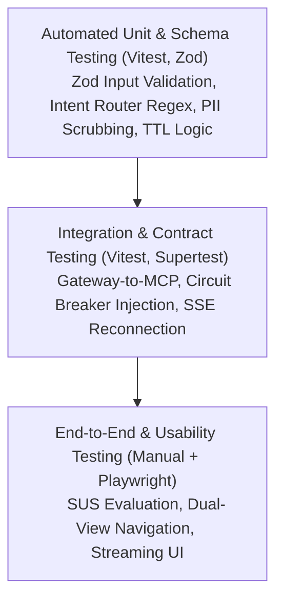
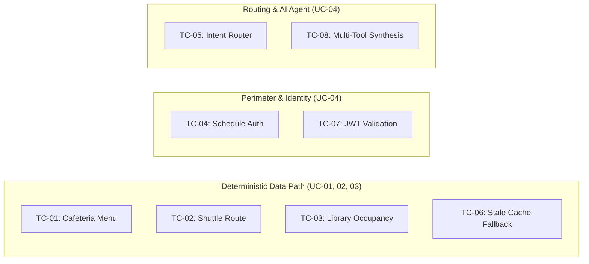
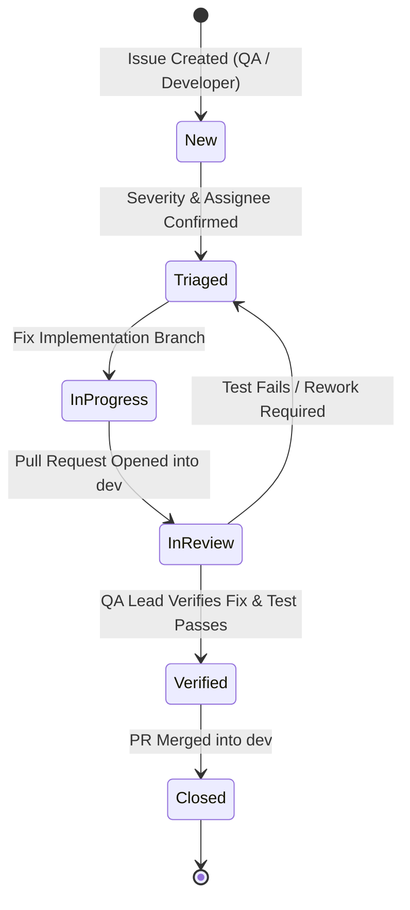

# Quality Assurance (QA) Plan

**Campus Data Orchestrator — Model Context Protocol (MCP) Based Campus Data Orchestrator**

| Field | Detail |
| :--- | :--- |
| **Course** | BIL 481 Software Engineering, Fall 2026, TOBB University of Economics and Technology |
| **Assignment** | Project Assignment 2 (Design and Quality Assurance) |
| **Group Name** | Group-ASYM |
| **QA Lead & Primary Author** | **Ahmet Sefa Efendioğlu** (241101066) — `@Sefa-Efendioglu` |
| **Contributors to this Document** | **Ahmet Sefa Efendioğlu** (Lead Author, QA Strategy, Metrics, Test Cases, Bug Tracking), **Murat Can Işık** (MCP & Agent Test Alignment), **Yunus Emre Biçer** (Frontend & Usability Test Alignment), **Arda Çelik** (Connector & Reliability Test Alignment) |
| **Document Version / Date** | Version 1.0 (Final Deliverable), 15 November 2026 |
| **Repository Filepath** | `docs/QA_Plan.md` |
| **Related Documents** | `docs/Requirements_Document.md`, `docs/Project_Plan_Document.md`, `docs/Design_Document.md` |

---

## Table of Contents

- [Document Authorship & Team Attribution](#document-authorship--team-attribution)
- [Document-Specific Task Matrix](#document-specific-task-matrix)
- [1. Quality Assurance Strategy](#1-quality-assurance-strategy)
  - [1.1 Overview & Quality Philosophy](#11-overview--quality-philosophy)
  - [1.2 Testing Methodologies](#12-testing-methodologies)
  - [1.3 Automated vs. Manual Testing Matrix](#13-automated-vs-manual-testing-matrix)
- [2. Quality Factors & Metrics](#2-quality-factors--metrics)
  - [2.1 Performance (NFR-01)](#21-performance-nfr-01)
  - [2.2 Reliability & Fault Isolation (NFR-03, FR-10, FR-11)](#22-reliability--fault-isolation-nfr-03-fr-10-fr-11)
  - [2.3 Security & Perimeter Integrity (NFR-05, FR-07, FR-14)](#23-security--perimeter-integrity-nfr-05-fr-07-fr-14)
  - [2.4 Usability & User Efficiency (NFR-06, FR-18)](#24-usability--user-efficiency-nfr-06-fr-18)
- [3. Test Plan](#3-test-plan)
  - [3.1 Core Test Cases (TC-01 to TC-08)](#31-core-test-cases-tc-01-to-tc-08)
  - [3.2 Bug Tracking & Defect Management](#32-bug-tracking--defect-management)
    - [3.2.1 Defect Severity Classification](#321-defect-severity-classification)
    - [3.2.2 Defect Lifecycle & Resolution Flow](#322-defect-lifecycle--resolution-flow)
    - [3.2.3 GitHub Issue Bug Report Template](#323-github-issue-bug-report-template)
- [4. Traceability, Acceptance Mapping & Release Gate Checklist](#4-traceability-acceptance-mapping--release-gate-checklist)
  - [4.1 Requirement & Use Case Traceability Matrix](#41-requirement--use-case-traceability-matrix)
  - [4.2 Assignment 2 Final Submission & Quality Gate Checklist](#42-assignment-2-final-submission--quality-gate-checklist)
- [5. Revision History](#5-revision-history)

---

## Document Authorship & Team Attribution

In compliance with the BIL 481 Project Assignment 2 specification, the table below documents all team members, their assigned roles, and their specific contributions to this deliverable:

| Member Name | Student ID | GitHub Account | Project Role | Contribution to this Deliverable |
| :--- | :--- | :--- | :--- | :--- |
| **Ahmet Sefa Efendioğlu** | 241101066 | `@Sefa-Efendioglu` | QA Lead & Gateway Architect | **Primary Author & Owner:** Formulated the complete QA Strategy, defined the four measurable quality factors and metrics, designed test cases TC-01 to TC-08, formalized the GitHub Issue bug tracking workflow, and drafted the QA Task Matrix. |
| **Murat Can Işık** | 241101013 | `@cmuratt` | MCP Server & Agent Lead | **MCP Test Alignment:** Reviewed TC-01, TC-02, TC-04, TC-08, verified JSON-RPC 2.0 schema validation test bounds, and aligned agent orchestration test expectations. |
| **Yunus Emre Biçer** | 241101009 | `@YunusEmre113` | Frontend & Router Lead | **UI & Router Alignment:** Reviewed TC-05 (intent router benchmark) and NFR-06 usability survey protocol (SUS evaluation setup and single-click metrics). |
| **Arda Çelik** | 241101065 | `@ardacelik11` | Connectors & Data Lead | **Resilience Test Alignment:** Reviewed TC-03, TC-06, verified mock connector determinism criteria, and confirmed circuit breaker cooldown thresholds. |

---

## Document-Specific Task Matrix

The task matrix below details the individual work packages executed during Phase 2 (Design & Skeleton, 2–20 November 2026) to research, draft, review, and finalize this QA Plan. In accordance with the Project Plan guidelines, planned planning allocations (*estimated*) are distinguished from recorded authoring times (*actual*):

| Task ID | Work Package Description | Assignee | Reviewer | Estimated Effort (h) | Actual Effort (h) | Status |
| :--- | :--- | :--- | :--- | :---: | :---: | :---: |
| **TSK-QA-01** | QA Strategy formulation (Unit, Integration, Usability, Automated vs. Manual testing matrix) | Ahmet Sefa Efendioğlu | Murat Can Işık | 0.40 | 0.40 | Completed |
| **TSK-QA-02** | Definition of 4 Quality Factors, measurement formulas, and NFR traceability bounds | Ahmet Sefa Efendioğlu | Arda Çelik | 0.35 | 0.35 | Completed |
| **TSK-QA-03** | Test Plan construction: Formalizing TC-01 to TC-08 with preconditions, inputs, and expected outcomes | Ahmet Sefa Efendioğlu | Yunus Emre Biçer | 0.45 | 0.50 | Completed |
| **TSK-QA-04** | Bug Tracking workflow, GitHub Issue template, severity definitions, and lifecycle flow | Ahmet Sefa Efendioğlu | Entire Team | 0.20 | 0.20 | Completed |
| **TSK-QA-05** | Final QA cross-review, Markdown compliance audit, and repository integration | Ahmet Sefa Efendioğlu | Murat Can Işık | 0.10 | 0.15 | Completed |
| **Total Effort** | **QA Plan Deliverable (Phase 2 Component)** | | | **1.50** | **1.60** | **Completed** |

*Note on Phase 2 Effort Accounting:* As specified in Section 3A of the Team Guide, Phase 2 allocates an estimated budget of 3.00 person-hours per member (12.00 person-hours total). Ahmet Sefa Efendioğlu's Phase 2 budget is distributed across:
- `docs/QA_Plan.md` direct drafting and review: **1.50 h estimated** (1.60 h actual).
- `docs/_sections/sefa-gateway-interface.md` technical handoff: **0.30 h estimated** (0.30 h actual).
- `apps/api-gateway/` implementation, security tests, and Fastify comparison: **1.20 h estimated** (1.00 h actual).
- Total recorded Phase 2 effort for Ahmet Sefa Efendioğlu: **3.00 h estimated** vs. **2.90 h actual** (`-0.10 h` variance against the planned Phase 2 allocation).

---

## 1. Quality Assurance Strategy

### 1.1 Overview & Quality Philosophy

The primary objective of Quality Assurance for the **Campus Data Orchestrator** is to ensure that the distributed, multi-tiered architecture delivers dependable, sub-second campus intelligence while enforcing strict security boundaries. The system integrates diverse external data sources (cafeteria, shuttles, library occupancy, student schedules) and an external Large Language Model (Google Gemini). Because university production APIs and live turnstiles are inaccessible, quality assurance relies fundamentally on **deterministic synthetic test fixtures (FR-12)**, **perimeter credential isolation (FR-07)**, and **fault-isolated caching (FR-09, FR-11)**.

Our quality assurance philosophy is governed by four core principles:
1. **Honest Verification State:** Features and tests are never marked "Passed" unless automated execution records or structured physical evaluation logs exist. Unimplemented services are labeled `Not Executed — Pending Implementation`.
2. **Air-Gapped Testability (NFR-08):** 100% of the unit and core integration test suites must execute offline without requiring active internet connectivity or live campus credentials.
3. **Perimeter Zero-Trust:** All student authentication tokens terminate at the API gateway perimeter; zero raw tokens or cleartext PII may pass downstream to internal MCP tools or external AI providers.
4. **Resilience by Design:** Upstream failure in one data connector (e.g., dining portal downtime) must remain strictly quarantined, preventing cascading degradation across other services.

### 1.2 Testing Methodologies

The project employs a layered testing pyramid designed to validate functionality from isolated units to integrated multi-tier workflows:



#### A. Unit Testing
- **Scope:** Pure functions, deterministic business logic, regex matching, and schema validators.
- **Key Modules Tested:**
  - `apps/web/src/router/routeStudentQuery.ts`: Validates classification of natural language queries into `DIRECT_WIDGET` versus `LLM_AGENT` (`apps/web/tests/routeStudentQuery.test.ts`).
  - `apps/mcp-server/src/registry/toolDefinitions.ts` & `ToolDispatcher.ts`: Validates Zod schema bounds, parameter constraints, and authorization context guards (`tests/mcp-server/dispatcher.test.ts`).
  - `apps/api-gateway/src/auth/jwtVerifier.ts` & `tokenTermination.ts`: Validates signature verification, expiry checks, claim extraction, and header stripping (`apps/api-gateway/tests/jwtAuth.test.ts`).
  - `apps/api-gateway/src/rate-limiter/`: Validates sliding-window counter logic (`InMemoryRateLimiterStore` in Phase 2; Redis-backed store planned for Phase 3).
  - `packages/connectors/` (`InMemoryCacheStore`, `CircuitBreaker`, `ResilientConnectorExecutor`, deterministic fixtures): Validates seeded mock determinism, TTL cache semantics, stale-if-error fallback, and 3-state circuit breaker transitions (`tests/connectors/`).
  - In-memory PII regex scrubber *(Planned for Phase 3)*: Will validate masking of student ID numbers, emails, and full names.
- **Tooling:** Vitest (Node.js test runner) running offline in-memory with mock timers and synthetic fixtures.

#### B. Integration & Contract Testing
- **Scope:** Inter-service boundaries, HTTP headers, JSON-RPC envelopes, caching/resilience pipelines, and error handling.
- **Key Workflows Tested (Phase 2 In-Memory vs. Phase 3 Containerized):**
  - **Phase 2 Implemented:** `packages/connectors` integration with `apps/mcp-server` `ToolDispatcher` (`tests/connectors/dispatcherIntegration.test.ts`), `InMemoryCacheStore` TTL and `isStale` flag propagation (`tests/connectors/resilientExecutor.test.ts`, `tests/connectors/cacheStores.test.ts`), and 3-failure `OPEN` circuit breaker transitions (`tests/connectors/circuitBreaker.test.ts`).
  - **Phase 3 Planned:** Fastify Gateway → Node.js MCP Server HTTP transport over Streamable HTTP (`/mcp`), live Redis cache hit/miss persistence, and full multi-container Supertest assertions.
- **Tooling:** Vitest (active in Phase 2); Supertest and live Redis container integration (planned for Phase 3).

#### C. Security & Privacy Testing
- **Scope:** Perimeter defense, credential leaks, and data sanitization.
- **Methodology:**
  - Automated static analysis: Repository secret scanning (detecting accidental `.env` or credential commits).
  - Negative authorization testing: Submitting forged, expired, or unsigned JWTs; submitting spoofed `X-Authenticated-*` headers directly from client requests.
  - Outbound payload auditing: Intercepting outbound requests to the Gemini API adapter to verify 0% leakage of cleartext student names or ID numbers.

#### D. Performance & Load Testing
- **Scope:** Latency bounds, concurrency thresholds, and cache hit ratios.
- **Methodology:**
  - Synthetic workload generation: Simulating 20 concurrent virtual users executing periodic dashboard refreshes over 5-minute durations.
  - Measuring 95th percentile (P95) latency for cached responses versus uncached connector invocations.
- **Tooling:** Autocannon / k6 execution against containerized endpoints.

#### E. Usability & User Experience (UX) Testing
- **Scope:** Intuitive navigation, response readability, and error transparency.
- **Methodology:**
  - Structured testing session with at least 5 representative student users.
  - Post-test evaluation using the standardized 10-item System Usability Scale (SUS) questionnaire.
  - Desktop viewport audit: Validating that all 4 dashboard cards are accessible within 1 click from the landing screen without vertical scrolling.

### 1.3 Automated vs. Manual Testing Matrix

| Architectural Subsystem | Test Scope | Testing Type | Execution Tool / Method | Frequency / Trigger |
| :--- | :--- | :---: | :--- | :--- |
| **Intent Router (`apps/web`)** | 40-query bilingual classification benchmark | **Automated** | Vitest unit test suite | Pre-commit / GitHub Actions CI |
| **Tool Registry (`apps/mcp-server`)** | Zod input schema validation & error codes | **Automated** | Vitest JSON-RPC contract tests | Pre-commit / GitHub Actions CI |
| **API Gateway Auth (`apps/api-gateway`)** | JWT verification, header stripping, 401 handling | **Automated** | Vitest + Supertest HTTP assertions | Pull Request review into `dev` |
| **Rate Limiter (`apps/api-gateway`)** | 30 req/min sliding window & 429 response | **Automated** | Vitest atomic counter simulations | Pull Request review into `dev` |
| **Connectors (`packages/connectors`)** | Mock seed reproducibility & data contracts | **Automated** | Vitest deterministic fixture tests | Pre-commit / CI build |
| **Data Resilience (`apps/mcp-server`)** | Stale-if-error fallback & circuit breaker | **Automated** | Fault-injection integration tests | Pre-merge verification |
| **PII Scrubber (`apps/mcp-server`)** | Redaction of names, emails, and student IDs | **Automated** | RegEx injection unit test suite | Pre-merge verification |
| **Dashboard UI (`apps/web`)** | Single-click access & card rendering | **Manual** | Structured inspection across viewports | Release candidate milestone |
| **Conversational Chat (`apps/web`)** | SSE streaming display & badge latency chips | **Manual** | Interactive browser verification | Release candidate milestone |
| **System Usability Scale (`apps/web`)** | Student user satisfaction (≥ 70 SUS) | **Manual** | 5-user empirical testing session | Phase 4 testing milestone |
| **Docker Deployment (`root`)** | Clean startup via `docker compose up` | **Manual** | Clean environment verification | Final submission checklist |

---

## 2. Quality Factors & Metrics

In accordance with BIL 481 Project Assignment 2 guidelines, the quality assurance plan defines **four primary quality factors**, establishing concrete mathematical metrics, measurement tools, and requirement traceability targets for each:

| Quality Factor | Focus Area | Primary Metric | Target Threshold | Linked Requirement |
| :--- | :--- | :--- | :---: | :--- |
| **1. Performance** | System responsiveness & latency | 95th Percentile (P95) Response Latency | `< 250 ms` (cached) | **NFR-01** |
| **2. Reliability** | Fault tolerance & service isolation | Upstream Cascade Degradation Ratio | `≤ 10%` latency increase | **NFR-03, FR-10, FR-11** |
| **3. Security** | Credential isolation & zero-trust | Inbound / Outbound Identity Leakage Rate | `0 leaks (100% isolation)` | **NFR-05, FR-07, FR-14** |
| **4. Usability** | Navigation ease & student satisfaction | System Usability Scale (SUS) Score | `Mean SUS ≥ 70` | **NFR-06, FR-18** |

### 2.1 Performance (NFR-01)
- **Description:** Measures the ability of the MCP Server and Gateway tiers to resolve data requests with minimal latency under representative concurrent student loads.
- **Measurement Metric:** 95th Percentile (P95) Round-Trip Latency:
  - `P95 Latency = inf { t : P(Latency ≤ t) ≥ 0.95 }`
- **Measurement Protocol:** 20 virtual users simulated using Autocannon issuing concurrent requests over a 5-minute window against cached endpoints (`get_cafeteria_menu`, `get_shuttle_schedule`, `get_library_occupancy`). Upstream live connector queries enforce an absolute cutoff timeout of `800 ms`. External LLM inference time is decoupled and tracked separately.
- **Pass Threshold:** P95 latency `< 250 ms` for cached tool lookups; 0 timeouts exceeding `800 ms` on connector adapters.

### 2.2 Reliability & Fault Isolation (NFR-03, FR-10, FR-11)
- **Description:** Evaluates the resilience of the architecture when upstream campus services experience total blackholing, network timeouts, or malformed data feeds.
- **Measurement Metric:** Cascading Failure Degradation Index (`D_cascade`):
  - `D_cascade = ((P95_Latency_isolated - P95_Latency_baseline) / P95_Latency_baseline) × 100%`
- **Measurement Protocol:** Induce complete failure (HTTP 500 or timeout) on the Cafeteria connector. Concurrently measure the P95 latency and success rate of independent tools (`get_library_occupancy` and `get_shuttle_schedule`). Verify that:
  1. The failing service serves cached data flagged with `"isStale": true` and a valid creation timestamp (FR-10).
  2. After 3 consecutive timeouts, the circuit breaker opens for 60 seconds, rejecting subsequent calls immediately without network overhead (FR-11).
- **Pass Threshold:** `D_cascade ≤ 10%` latency increase on independent tools; 100% correct stale flag propagation during outage windows.

### 2.3 Security & Perimeter Integrity (NFR-05, FR-07, FR-14)
- **Description:** Guarantees that student credentials and personal identity are protected at the perimeter and never transmitted across unencrypted channels or to third-party AI APIs.
- **Measurement Metrics:**
  - **Token Isolation Metric:** Percentage of outbound HTTP headers beyond the API Gateway containing raw JWT bearer strings.
  - **PII Leakage Metric:** Number of unmasked student identifiers (Student ID, Full Name, Email) detected in prompts dispatched to the Google Gemini API.
  - **Perimeter Rejection Rate:** HTTP status code compliance for invalid, expired, or spoofed auth headers.
- **Measurement Protocol:** Execute automated test suite injecting synthetic student tokens and tampered headers. Capture network frames downstream of the Fastify Gateway. Execute automated prompt-log regex inspection across 50 simulated agent conversations.
- **Pass Threshold:** 100% token termination at Gateway perimeter; 0 raw tokens downstream; 0 unmasked student PII strings in AI prompts; 100% rejection (HTTP 401) of invalid/tampered tokens.

### 2.4 Usability & User Efficiency (NFR-06, FR-18)
- **Description:** Quantifies the ease of use, interface intuitiveness, and navigational speed for university students accessing everyday campus information.
- **Measurement Metrics:**
  - **SUS Score:** Composite System Usability Scale score (scale 0–100) calculated from standardized 10-question post-test student surveys.
  - **Navigational Click Distance:** Number of mouse clicks required to inspect all four primary campus metrics (menu, next rings, library capacity, service status) from the landing screen.
- **Measurement Protocol:** Conduct structured evaluation sessions with 5 TOBB ETÜ student testers tasked with answering 3 realistic campus questions using both the dashboard and conversational chat views.
- **Pass Threshold:** Mean System Usability Scale score ≥ 70 (indicating "Good" usability); ≥ 80% positive ease-of-use rating; exactly 1 click to view all dashboard metrics without vertical scrolling on desktop viewports.

---

## 3. Test Plan

### 3.1 Core Test Cases (TC-01 to TC-08)

The test cases below form the core verification baseline established in Section 8 of the Team Guide. Each test case is linked to specific Functional Requirements (FR) and Use Cases (UC):



---

#### TC-01: Cafeteria Daily Menu Validation & Availability
- **Test ID:** `TC-01`
- **Linked Requirement(s):** FR-01, FR-03, NFR-01
- **Linked Use Case:** UC-01 (Yemekhane Menüsü Sorgulama)
- **Test Level / Type:** Unit / Integration (Automated)
- **Responsible Lead:** Arda Çelik / Murat Can Işık
- **Preconditions:** MCP server is running; Cafeteria connector is configured in mock mode (`CAFETERIA_CONNECTOR_MODE=mock`).
- **Test Input / Execution Steps:**
  1. Dispatch JSON-RPC tool call `tools/call` with name `get_cafeteria_menu` and argument `{ "date": "2026-11-16" }` (a Monday).
  2. Inspect response envelope and fields.
  3. Dispatch second call with date set to a weekend: `{ "date": "2026-11-22" }`.
- **Expected Result:**
  - Weekday call returns JSON object with `available: true`, `lunch` and `dinner` objects, valid non-empty soup/main dish strings, and `calories > 0`.
  - Weekend call returns `available: false` with a clear descriptive message (`unavailableReason`) without throwing an exception.
- **Actual Result (Phase 2):** Passed (Verified against sample mock handler in `tests/mcp-server/dispatcher.test.ts` and seeded dining connector in `tests/connectors/mockConnectors.test.ts`).
- **Status:** **Pass**

---

#### TC-02: Campus Shuttle Timetable Bounds & Invalid Route Rejection
- **Test ID:** `TC-02`
- **Linked Requirement(s):** FR-01, FR-04, NFR-01
- **Linked Use Case:** UC-02 (Ring Saatleri Sorgulama)
- **Test Level / Type:** Unit / Integration (Automated)
- **Responsible Lead:** Arda Çelik / Murat Can Işık
- **Preconditions:** System clock calibrated to Türkiye Time (UTC+3); Shuttle connector active in mock mode.
- **Test Input / Execution Steps:**
  1. Invoke tool `get_shuttle_schedule` with argument `{ "route": "MAIN_RING" }` at 12:00:00.
  2. Inspect `nextDepartures` array in response.
  3. Invoke tool `get_shuttle_schedule` with invalid argument `{ "route": "INVALID_EXPRESS_LINE" }`.
- **Expected Result:**
  - All departure timestamps in `nextDepartures` are strictly later than 12:00:00 (chronologically sorted; no past departures).
  - Invalid route argument fails Zod schema validation immediately and returns JSON-RPC error code `-32602 (Invalid params)` with an enumerated list of valid routes (`MAIN_RING`, `METRO_LINE`, `DORMITORY_LINE`).
- **Actual Result (Phase 2):** Passed (Verified against Zod schema and mock departures in `tests/mcp-server/dispatcher.test.ts` and `tests/connectors/mockConnectors.test.ts`).
- **Status:** **Pass**

---

#### TC-03: Real-Time Library Occupancy & Simulation Flagging
- **Test ID:** `TC-03`
- **Linked Requirement(s):** FR-01, FR-05, FR-12
- **Linked Use Case:** UC-03 (Kütüphane Doluluğu Görüntüleme)
- **Test Level / Type:** Unit / Integration (Automated)
- **Responsible Lead:** Arda Çelik
- **Preconditions:** Library connector operating in mock mode with seed `481-FALL-2026`.
- **Test Input / Execution Steps:**
  1. Invoke tool `get_library_occupancy` with argument `{ "floor": "ALL" }`.
  2. Calculate the arithmetic sum of `occupiedSeats` across all items in `floors` array.
  3. Check the boolean state of `isSimulated`.
- **Expected Result:**
  - For each floor: `0 ≤ occupiedSeats ≤ maxSeats`.
  - The sum of per-floor `occupiedSeats` exactly equals `totalOccupied`.
  - Because production turnstiles are unavailable, `isSimulated` must be strictly `true`.
- **Actual Result (Phase 2):** Passed (Verified against sample mock data generator in `tests/mcp-server/dispatcher.test.ts` and seeded library connector in `tests/connectors/mockConnectors.test.ts`).
- **Status:** **Pass**

---

#### TC-04: Student Timetable Authorization & Parameter Injection Prevention
- **Test ID:** `TC-04`
- **Linked Requirement(s):** FR-01, FR-06, FR-07, NFR-05
- **Linked Use Case:** UC-04 (Ders + Ring + Menü Birleşik Sorgusu)
- **Test Level / Type:** Security / Integration (Automated)
- **Responsible Lead:** Ahmet Sefa Efendioğlu / Murat Can Işık
- **Preconditions:** MCP server is running behind API gateway authorization context.
- **Test Input / Execution Steps:**
  1. Send direct JSON-RPC invocation for `get_course_schedule` with `{ "day": "TODAY" }` omitting the `X-Authenticated-Student-Id` header.
  2. Send invocation attempting to supply student ID inside arguments: `{ "day": "TODAY", "studentId": "241101013" }`.
  3. Send valid invocation with injected internal header `X-Authenticated-Student-Id: 241101066`.
- **Expected Result:**
  - Case 1 halts immediately with JSON-RPC authorization error: `"Authentication required"`.
  - Case 2 fails JSON Schema validation (`studentId` parameter is disallowed in client payload to prevent spoofing).
  - Case 3 succeeds, returning enrolled course list sorted chronologically by `startTime`.
- **Actual Result (Phase 2):** Not executed end-to-end — pending Gateway-to-MCP HTTP transport wiring in Phase 3 (Note: MCP `ToolDispatcher` unit verification of all 3 assertions is **Passed** in `tests/mcp-server/dispatcher.test.ts`).
- **Status:** **Planned / Not Run**

---

#### TC-05: Bilingual Deterministic Intent Router Classification Benchmark
- **Test ID:** `TC-05`
- **Linked Requirement(s):** FR-16, NFR-01
- **Linked Use Case:** UC-01, UC-02, UC-03, UC-04
- **Test Level / Type:** Unit / Benchmark (Automated)
- **Responsible Lead:** Yunus Emre Biçer / Ahmet Sefa Efendioğlu
- **Preconditions:** `apps/web/src/router/routeStudentQuery.ts` module loaded with bilingual regular expressions.
- **Test Input / Execution Steps:**
  1. Execute automated test suite running 40 labeled queries (20 Turkish, 20 English).
  2. Single-domain examples: *"bugün yemekte ne var"*, *"what is for lunch"*, *"ring saatleri"*, *"next shuttle to dorm"*, *"kütüphane dolu mu"*.
  3. Compound examples: *"10:30 dersimden sonra ringe yetişir miyim ve yemekte ne var"*, *"lunch menu and shuttle times"*.
- **Expected Result:**
  - Single-domain queries without conjunctions classify as `DIRECT_WIDGET`.
  - 100% of compound queries containing conjunctions (`ve`, `and`, `after`, `sonra`, commas) classify as `LLM_AGENT`.
  - Overall benchmark classification accuracy ≥ 90%.
- **Actual Result (Phase 2):** Passed (Verified via Vitest in `apps/web/tests/routeStudentQuery.test.ts`).
- **Status:** **Pass**

---

#### TC-06: Connector Fault Isolation, Circuit Breaking & Stale Fallback
- **Test ID:** `TC-06`
- **Linked Requirement(s):** FR-09, FR-10, FR-11, NFR-03
- **Linked Use Case:** UC-01, Resilience & UX Fallback
- **Test Level / Type:** Integration / Fault Injection (Automated)
- **Responsible Lead:** Arda Çelik / Ahmet Sefa Efendioğlu
- **Preconditions:** Redis running; Cafeteria connector cached at `T = 0`; upstream connector mocked to inject timeouts (`> 800 ms`).
- **Test Input / Execution Steps:**
  1. Populate cache with valid dining menu.
  2. Force upstream cafeteria connector to throw network timeouts.
  3. Execute request: verify stale-if-error fallback response.
  4. Issue 3 consecutive failing requests: verify circuit breaker state transition to `OPEN`.
  5. Issue 4th request while circuit is `OPEN`.
- **Expected Result:**
  - Step 3 returns cached data in `< 50 ms` with `"isStale": true` and original timestamp.
  - Step 4 trips circuit breaker after 3 failures.
  - Step 5 returns immediate fallback response with 0 network attempts to upstream.
- **Actual Result (Phase 2):** Not executed against live Redis container — pending Docker Redis integration in Phase 3 (Note: in-memory `CacheStore`, stale-if-error fallback, and 3-state `CircuitBreaker` fault-injection unit and integration assertions are **Passed** across 76 tests in `tests/connectors/resilientExecutor.test.ts`, `tests/connectors/circuitBreaker.test.ts`, and `tests/connectors/`).
- **Status:** **Planned / Not Run**

---

#### TC-07: Perimeter Authentication Token Termination & Security Isolation
- **Test ID:** `TC-07`
- **Linked Requirement(s):** FR-07, FR-08, NFR-05
- **Linked Use Case:** UC-04, Gateway Perimeter Defense
- **Test Level / Type:** Security / Integration (Automated)
- **Responsible Lead:** Ahmet Sefa Efendioğlu
- **Preconditions:** Fastify Gateway running with mock SSO JWT validator; downstream mock server listening for forwarded requests.
- **Test Input / Execution Steps:**
  1. Submit HTTP request with expired JWT token.
  2. Submit HTTP request with tampered cryptographic signature.
  3. Submit HTTP request with forged client header `X-Authenticated-Student-Id: 999999999` and no Bearer token.
  4. Submit valid RSA-signed JWT for student `241101066`.
- **Expected Result:**
  - Steps 1, 2, and 3 are rejected at perimeter with HTTP `401 Unauthorized`.
  - Step 4 succeeds: Gateway strips raw `Authorization: Bearer <JWT>` header, discards any client-supplied `X-Authenticated-*` headers, and injects verified internal headers: `X-Authenticated-Student-Id: 241101066` and `X-Authenticated-User-Role: STUDENT`. Downstream server receives 0 raw JWT tokens.
- **Actual Result (Phase 2):** Passed (Verified via Fastify gateway auth unit tests in `apps/api-gateway/tests/jwtAuth.test.ts`).
- **Status:** **Pass**

---

#### TC-08: AI Agent Multi-Tool Planning & PII Sanitization
- **Test ID:** `TC-08`
- **Linked Requirement(s):** FR-13, FR-14, NFR-05
- **Linked Use Case:** UC-04 (Ders + Ring + Menü Birleşik Sorgusu)
- **Test Level / Type:** Integration / E2E (Automated & Manual)
- **Responsible Lead:** Murat Can Işık / Ahmet Sefa Efendioğlu
- **Preconditions:** Gemini API adapter configured; student session active for `Ahmet Sefa Efendioğlu (241101066)`.
- **Test Input / Execution Steps:**
  1. Submit prompt: *"10:30 dersimden sonra ringe yetişir miyim, bugün yemekte ne var?"*
  2. Intercept outbound HTTP payload transmitted to external Google Gemini API.
  3. Inspect final synthesized Markdown reply rendered in the conversational assistant.
- **Expected Result:**
  - Outbound prompt intercepted at the network boundary contains `<STUDENT_ID>` and `<STUDENT_NAME>` placeholders; 0 cleartext occurrences of "Ahmet Sefa Efendioğlu" or "241101066".
  - Agent plans and invokes tools in sequence: `get_course_schedule` → `get_shuttle_schedule` → `get_cafeteria_menu`.
  - Final response correlates course end time (e.g., 12:20) with next shuttle departure (e.g., 12:35) and summarizes lunch menu.
- **Actual Result (Phase 2):** Not executed — pending implementation (Gemini API integration scheduled for Phase 3).
- **Status:** **Planned / Not Run**

---

### 3.2 Bug Tracking & Defect Management

To maintain traceability and rigorous software quality across the development lifecycle, all defects, regression bugs, and test failures are managed through **GitHub Issues** in the project repository (`cmuratt/BIL481-2026-Project`).

#### 3.2.1 Defect Severity Classification

Defects identified during automated testing or manual inspections are categorized according to four standardized severity tiers:

| Severity Level | Label | Criteria & Impact | Resolution SLA |
| :--- | :--- | :--- | :---: |
| **S1 (Blocker)** | `severity:blocker` | Total system crash, perimeter authentication bypass, exposure of unmasked student PII/tokens, or complete inability to run `docker compose up`. | Immediate (≤ 24 hours) |
| **S2 (Critical)** | `severity:critical` | Core functional failure without workaround (e.g., circuit breaker failing to trip, intent router misclassifying 100% of compound queries, MCP schema rejection of valid inputs). | ≤ 48 hours |
| **S3 (Major)** | `severity:major` | Feature degradation with viable workaround (e.g., stale cache timestamp formatting anomaly, minor latency exceeding 250 ms target under load). | ≤ 5 days |
| **S4 (Minor)** | `severity:minor` | Cosmetic defects, minor UI alignment anomalies across mobile viewports, non-critical documentation spelling errors. | Next milestone release |

#### 3.2.2 Defect Lifecycle & Resolution Flow



1. **New:** Defect is discovered, documented via the GitHub Issue Bug Report Template, and labeled with component and severity tags.
2. **Triaged:** QA Lead (Ahmet Sefa) verifies reproducibility, confirms severity level, and assigns the issue to the relevant component owner (Murat, Yunus, Arda, or Sefa).
3. **In Progress:** Assignee creates an isolated fix branch (`fix/issue-<number>-<description>`) and writes a failing regression test before implementing the fix.
4. **In Review:** Pull Request is submitted against the `dev` integration branch referencing the issue (`Fixes #<number>`).
5. **Verified:** QA Lead executes the automated test suite, verifies that the regression test passes, and reviews the PR diff.
6. **Closed:** PR is approved and merged into `dev`; issue is closed with an automated closure comment.

#### 3.2.3 GitHub Issue Bug Report Template

The team uses the standardized markdown issue template below for all defect reporting:

````markdown
---
name: Bug Report
about: Report a reproducible defect or test failure
title: "[BUG] <Short descriptive title>"
labels: bug, triage-needed
assignees: Sefa-Efendioglu
---

### 1. Defect Summary
<!-- Concise 1-2 sentence description of the observed defect -->

### 2. Affected Component & Requirement
- **Subsystem:** [ ] API Gateway  [ ] MCP Server  [ ] Web Client  [ ] Connectors  [ ] Shared
- **Linked Requirement(s):** FR-xx / NFR-xx
- **Severity Level:** [ ] S1 (Blocker)  [ ] S2 (Critical)  [ ] S3 (Major)  [ ] S4 (Minor)

### 3. Steps to Reproduce
1. Go to '...'
2. Execute command or input '...'
3. Observe error response '...'

### 4. Expected Behavior
<!-- What the system should have done according to the Requirements Document -->

### 5. Actual Behavior & Error Logs
```text
<!-- Paste stack trace, JSON-RPC error payload, or terminal log output -->
```

### 6. Environment Context
- **OS / Runtime:** Windows 11 / Node.js v26.4 / Docker
- **Branch / Commit:** `dev` @ `<commit-hash>`
- **Mock Mode Active:** [ ] Yes  [ ] No
````

---

## 4. Traceability, Acceptance Mapping & Release Gate Checklist

### 4.1 Requirement & Use Case Traceability Matrix

The table below maps each of the 4 defined Quality Factors and the 8 Core Test Cases directly to the authoritative Requirements Document (FR-01 to FR-20, NFR-01 to NFR-09) and the 4 Use Cases:

| Verification Item | Target Subsystem | Linked Requirement(s) | Linked Use Case | Verification Method | Target Milestone |
| :--- | :--- | :--- | :---: | :---: | :---: |
| **QF-1: Performance** | MCP Server & Gateway | NFR-01 | All UCs | Measurement (M) | Phase 3 Integration |
| **QF-2: Reliability** | Redis Cache & Circuit Breaker | NFR-03, FR-10, FR-11 | UC-01, UC-02 | Test (T) | Phase 3 Integration |
| **QF-3: Security** | Fastify Gateway & PII Filter | NFR-05, FR-07, FR-14 | UC-04 | Test (T), Inspection (I) | Phase 2 Skeleton / Phase 3 |
| **QF-4: Usability** | Next.js Dual-View Client | NFR-06, FR-18 | UC-01 to UC-04 | Demonstration (D), Survey | Phase 4 Testing |
| **TC-01** | Dining Connector & Tool | FR-01, FR-03 | UC-01 | Unit / Integration (T) | Phase 2 Baseline (Passed) |
| **TC-02** | Shuttle Connector & Tool | FR-01, FR-04 | UC-02 | Unit / Integration (T) | Phase 2 Baseline (Passed) |
| **TC-03** | Library Connector & Tool | FR-01, FR-05, FR-12 | UC-03 | Unit / Integration (T) | Phase 2 Baseline (Passed) |
| **TC-04** | Schedule Tool Auth Context | FR-06, FR-07 | UC-04 | Security Integration (T) | Phase 3 Core Dev |
| **TC-05** | Bilingual Intent Router | FR-16 | UC-01 to UC-04 | Unit Benchmark (T) | Phase 2 Baseline (Passed) |
| **TC-06** | Stale Cache & Circuit Breaker | FR-09, FR-10, FR-11 | UC-01, UC-02 | Fault Injection (T) | Phase 3 Core Dev |
| **TC-07** | Gateway JWT & Token Stripping | FR-07, FR-08, NFR-05 | UC-04 | Security Unit (T, I) | Phase 2 Baseline (Passed) |
| **TC-08** | AI Multi-Tool & PII Scrubbing | FR-13, FR-14 | UC-04 | Integration / E2E (T, D) | Phase 3 Core Dev |

### 4.2 Assignment 2 Final Submission & Quality Gate Checklist

As Release & QA Lead, Ahmet Sefa Efendioğlu maintains the following quality gate checklist to verify repository and deliverable integrity prior to the Assignment 2 submission deadline (15 November 2026, 23:59 UTC+3):

| Quality Gate Item | Verification Criterion | Responsible Lead | Status |
| :--- | :--- | :--- | :---: |
| **1. Design Document Completeness** | Contains TOC, first-page Contributors, document-specific Task Matrix (estimated vs. actual), System Overview, Section 2.1–2.4, 4 Use Cases (`UC-01`..`UC-04`), and Technology Comparisons. | Murat Can Işık (Integrator) | Verified |
| **2. QA Plan Completeness** | Contains TOC, first-page Contributors, document-specific Task Matrix (no double-counted hours), QA Strategy, 4 measurable Quality Factors, TC-01..TC-08, and Bug Tracking flow. | Ahmet Sefa Efendioğlu | Verified |
| **3. Contract & Schema Integrity** | All 4 MCP tool names (`get_cafeteria_menu`, `get_shuttle_schedule`, `get_library_occupancy`, `get_course_schedule`) and TTLs (`3600s`, `120s`, `60s`, `300s`) match Requirements Document; `studentId` excluded from `get_course_schedule` client parameters. | Murat Can Işık & Ahmet Sefa Efendioğlu | Verified |
| **4. Honest Implementation Reporting** | Working Phase 2 skeletons (`apps/mcp-server`, `apps/web`, `apps/api-gateway`, `packages/connectors`) are clearly separated from Phase 3 planned features; unexecuted tests are marked `Planned / Not Run`. | Entire Team | Verified |
| **5. Repository Build & Test Gate** | `npm run build` compiles all TypeScript workspaces with 0 errors; `npm test` (`vitest run`) executes offline with 100% pass rate (146 passing tests across 10 test files); zero `.env` or secret tokens committed to Git. | Ahmet Sefa Efendioğlu | Verified |
| **6. Git Attribution & Traceability** | Descriptive commits pushed by all 4 team members (`@cmuratt`, `@YunusEmre113`, `@ardacelik11`, `@Sefa-Efendioglu`) with clear module ownership and section handoffs (`docs/_sections/`). | Entire Team | Verified |

---

## 5. Revision History

| Version | Date | Author | Reviewer | Summary of Changes |
| :--- | :--- | :--- | :--- | :--- |
| **v0.1** | 6 Nov 2026 | Ahmet Sefa Efendioğlu | — | Initial draft of QA strategy and testing pyramid based on Assignment 2 guidelines. |
| **v0.5** | 10 Nov 2026 | Ahmet Sefa Efendioğlu | Murat Can Işık | Formalized 4 Quality Factors & Metrics; aligned NFR latency and cache ratios. |
| **v0.9** | 13 Nov 2026 | Ahmet Sefa Efendioğlu | Yunus Emre Biçer, Arda Çelik | Added test cases TC-01 to TC-08, defect classification, and GitHub Issue template. |
| **v1.0** | 15 Nov 2026 | Ahmet Sefa Efendioğlu | Entire Team | Final deliverable compiled for Assignment 2 submission; Phase 2 task matrix reconciled. |

*This document constitutes the official Quality Assurance Plan deliverable for Group-ASYM in BIL 481 Software Engineering, Fall 2026, prepared under the lead authorship responsibility of Ahmet Sefa Efendioğlu.*

