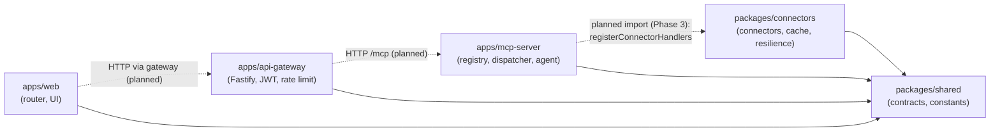
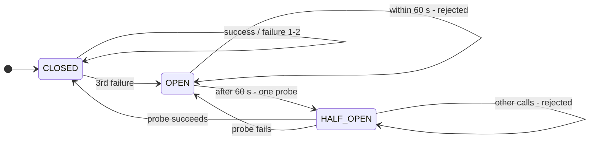
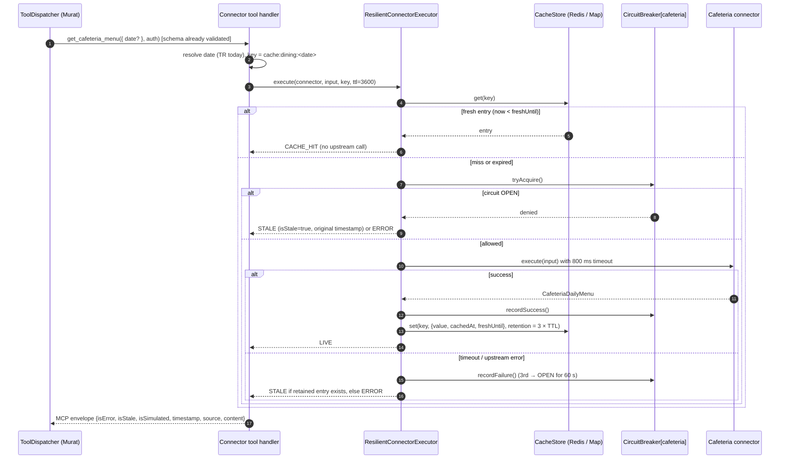

# Section: Codebase Structure, Connector & Cache Tier, and Design Decisions

| Field | Detail |
| :--- | :--- |
| **Component Lead & Author** | **Arda Çelik** (241101065) — `@ardacelik11` |
| **Role & Responsibilities** | Connector & Data Lead: campus data connectors, deterministic mock data, cache adapters, stale-if-error fallback, circuit breaker; editor of Design Decisions |
| **Contributors to this section** | **Arda Çelik** (author of 2.1, 2.2, 2.3 connector/cache content and 4.1, editor of Section 4); **Ahmet Sefa Efendioğlu** (source material for 4.2 Fastify vs Express, from `comparisons/Fastify-vs-Express/` and `docs/_sections/sefa-gateway-interface.md`) |
| **Project Assignment** | BIL 481 Software Engineering — Project Assignment 2 (Design & Quality Assurance) |
| **Design Document targets** | 2.1 Codebase Structure · 2.2 Key Implementations (connector/cache part) · 2.3 Component Interfaces (connector/cache part) · 4 Design Decisions (Technology Comparisons) |
| **Associated code** | `packages/connectors/`, `tests/connectors/`, `comparisons/Redis-vs-memory/` (branch `feat/connectors`) |
| **Requirements covered** | Implementation lead for FR-03, FR-04, FR-05, FR-06, FR-09, FR-10, FR-11, FR-12 and coordinating lead for NFR-02 and NFR-03 (Project Plan §11.1–11.2); contributes to NFR-01, NFR-04 and NFR-08 |
| **Status date** | 15 November 2026 |

> **Integration note for Murat:** this file is Arda's handoff. Sections 2.1, 2.2 and 2.3 are written to be merged into the matching sections of `docs/Design_Document.md`. Section 4 is the complete Design Decisions (Technology Comparisons) section. The integration checklist is at the end of this file.

---

## Table of Contents

- [2.1 Codebase Structure](#21-codebase-structure)
  - [2.1.1 Repository Layout and Ownership](#211-repository-layout-and-ownership)
  - [2.1.2 Package Dependencies](#212-package-dependencies)
  - [2.1.3 Build, Test and Branch Conventions](#213-build-test-and-branch-conventions)
  - [2.1.4 Inside packages/connectors](#214-inside-packagesconnectors)
- [2.2 Key Implementations — Connectors, Cache and Resilience](#22-key-implementations--connectors-cache-and-resilience)
  - [2.2.1 Responsibilities of the Connector Tier](#221-responsibilities-of-the-connector-tier)
  - [2.2.2 Connector Contract and Mode Switching (FR-12)](#222-connector-contract-and-mode-switching-fr-12)
  - [2.2.3 Deterministic Synthetic Data (FR-03 – FR-06, FR-12)](#223-deterministic-synthetic-data-fr-03--fr-06-fr-12)
  - [2.2.4 TTL Cache and Cache Keys (FR-09)](#224-ttl-cache-and-cache-keys-fr-09)
  - [2.2.5 Stale-If-Error Fallback and Timeout (FR-10)](#225-stale-if-error-fallback-and-timeout-fr-10)
  - [2.2.6 Circuit Breaker (FR-11)](#226-circuit-breaker-fr-11)
  - [2.2.7 Resilience Data Flow](#227-resilience-data-flow)
  - [2.2.8 Error Handling Rules](#228-error-handling-rules)
  - [2.2.9 Implemented vs. Planned](#229-implemented-vs-planned)
  - [2.2.10 Test Evidence](#2210-test-evidence)
- [2.3 Component Interfaces — Connectors and Cache](#23-component-interfaces--connectors-and-cache)
- [4. Design Decisions (Technology Comparisons)](#4-design-decisions-technology-comparisons)
  - [4.1 Redis vs. Process In-Memory Map](#41-redis-vs-process-in-memory-map)
  - [4.2 Fastify vs. Express](#42-fastify-vs-express)
- [Handoff and Integration Notes](#handoff-and-integration-notes)
- [Task Matrix — Arda's Contribution to the Design Document](#task-matrix--ardas-contribution-to-the-design-document)

---

## 2.1 Codebase Structure

### 2.1.1 Repository Layout and Ownership

The repository is a single **npm workspaces** monorepo written in **TypeScript (strict mode, `module: NodeNext`)**. The layout follows the team's agreed repository contract. Status reflects the repository on 15 November 2026: "in `dev`" means merged into `dev`; "on branch" means committed on a feature branch and not yet merged into `dev`; "planned" means not created yet.

```text
BIL481-2026-Project/
├── README.md                  # group name and members                                       (in dev)
├── package.json               # npm workspaces root: apps/*, packages/*; scripts build/test   (Murat, in dev)
├── package-lock.json          # locked dependency tree                                        (in dev)
├── tsconfig.base.json         # shared strict compiler options                                (Murat, in dev)
├── vitest.config.mts          # one test runner for the whole repo (tests/**, apps/**)        (Murat, in dev)
├── .env.example               # all runtime variables; no secrets                             (Murat, in dev)
├── .gitignore                 # ignores .env, node_modules/, dist/, coverage/                 (in dev)
├── f26_assignment1.pdf        # course template handout                                       (in dev)
├── packages/
│   ├── shared/                # shared contracts: domain types, tool inputs, MCP types,       (Murat, in dev)
│   │                          # ICampusConnector, TOOL_NAMES, CACHE_TTL
│   └── connectors/            # 4 connectors, mock data, cache adapters, resilience,         (Arda, on branch
│                              # MCP tool handlers                                              feat/connectors)
├── apps/
│   ├── mcp-server/            # MCP server: tool registry, ToolDispatcher, transports,        (Murat, in dev)
│   │                          # agent skeleton, temporary sample handlers
│   ├── web/                   # bilingual intent router (+ Next.js UI planned)                (Yunus, in dev)
│   └── api-gateway/           # Fastify gateway: JWT verification, token termination,        (Sefa, in dev)
│                              # rate limiting
├── tests/
│   ├── mcp-server/            # dispatcher and registry tests                                 (Murat, in dev)
│   └── connectors/            # connector, cache, circuit breaker, integration tests          (Arda, on branch
│                              #                                                                feat/connectors)
├── comparisons/
│   ├── Redis-vs-memory/       # Design Decision 4.1 code                                      (Arda, on branch
│   │                          #                                                                feat/connectors)
│   └── Fastify-vs-Express/    # Design Decision 4.2 code                                      (Sefa, in dev)
└── docs/
    ├── Concept Notes.pdf      # Assignment 0                                                  (in dev)
    ├── Project_Definition_Document.md, Requirements_Document.md,
    │   Project_Plan_Document.md, PA-1-01-11-2026/ (PDFs)                                      (Assignment 1, in dev)
    ├── Design_Document.md     # merged Design Document                                        (Murat, planned)
    ├── QA_Plan.md             # QA Plan                                                       (Sefa, in dev)
    ├── _sections/             # per-member handoffs: murat-design.md, yunus-usecases-ui.md,
    │                          # sefa-gateway-interface.md (in dev);
    │                          # arda-data-decisions.md (on branch docs/arda-data-decisions)
    └── wireframes/            # dashboard and assistant wireframes                            (Yunus, in dev)
```

**Ownership rule:** each member commits mainly inside their own folders, following the requirement owners in Project Plan §11.1; all members use traceable GitHub commits and peer-reviewed pull requests (Project Plan §11.3), so contributions are visible per member in the Git history. Shared contracts change only in `packages/shared` and are owned by Murat. Other packages import them and do not redefine them.

### 2.1.2 Package Dependencies



- Solid arrows are TypeScript package dependencies. Dotted arrows are runtime calls or planned imports.
- `packages/connectors` depends only on `packages/shared`. It does **not** import `apps/mcp-server`; instead it accepts any object with a `registerHandler(name, handler)` method (structural typing). This prevents a circular dependency.

### 2.1.3 Build, Test and Branch Conventions

| Topic | Convention |
| :--- | :--- |
| Language / compiler | TypeScript 5.4, `strict`, `noUncheckedIndexedAccess`, `noUnusedLocals/Parameters`, `NodeNext` modules (relative imports end in `.js`) |
| Package build | `tsc` per workspace into `dist/` (git-ignored); `packages/shared` must be built before packages that import it (see Handoff note H-3) |
| Tests | Vitest 5, one root config; tests in `tests/<module>/` or `apps/**/tests`; all tests run offline in mock mode (NFR-08) |
| Secrets | Only in `.env` (git-ignored); `.env.example` holds placeholders |
| Git flow | Feature branch from up-to-date `dev` → pull request to `dev` → review and merge by another member → integration/QA → reviewed `dev → main` PR merged by Sefa (QA/release) |
| Commit messages | Conventional style, e.g. `feat(connectors): …`, `docs(design): …` |

### 2.1.4 Inside `packages/connectors`

```text
packages/connectors/src/
├── index.ts                     # public API (re-exports)
├── types.ts                     # ConnectorMode, ConnectorName, ManagedCampusConnector, CampusConnectorSet, Clock
├── errors.ts                    # caller errors vs upstream errors
├── config.ts                    # env → modes, TTLs, seed, timeout; FR-09/10/11 constants
├── factory.ts                   # createCampusConnectors(), checkConnectorHealth()
├── runtime.ts                   # createConnectorRuntime(): one-call bootstrap for the MCP server
├── handlers.ts                  # MCP tool handlers + registerConnectorHandlers()
├── connectors/                  # MockCafeteria/Shuttle/Library/CourseSchedule, UnavailableLiveConnector
├── mock/                        # seededRandom.ts, turkeyTime.ts, fixtures/ (dishes, timetables, floors, courses)
├── cache/                       # CacheStore, InMemoryCacheStore, RedisCacheStore, cacheKeys
├── resilience/                  # CircuitBreaker, withTimeout, ResilientConnectorExecutor
└── testing/                     # FaultInjectingConnector (tests/demos only)
```

---

## 2.2 Key Implementations — Connectors, Cache and Resilience

### 2.2.1 Responsibilities of the Connector Tier

The connector tier answers one question for each MCP tool: *"Give me this campus data now, or the best honest answer you have."* It is split into three layers:

1. **Connectors** produce domain objects (`CafeteriaDailyMenu`, `ShuttleRouteData`, `LibraryOccupancyReport`, `StudentClassEntry[]`) behind one interface (FR-03 – FR-06, FR-12).
2. **`ResilientConnectorExecutor`** wraps every connector call with:
   - a TTL cache (FR-09);
   - an 800 ms timeout (NFR-01);
   - a stale-if-error fallback (FR-10);
   - a per-connector circuit breaker (FR-11).
3. **Tool handlers** connect this to the MCP `ToolDispatcher`. They resolve default arguments, build cache keys, keep the student-identity boundary, and return MCP envelopes. Every answer produced by a mock connector carries `isSimulated: true`, so synthetic data is never presented as real campus data (Project Definition §4.3).

Out of scope for this tier (owned elsewhere):
- JSON-schema validation of tool arguments (Murat, dispatcher);
- JWT verification (Sefa, gateway);
- PII scrubbing for the LLM (Murat, agent);
- UI rendering of stale/error states (Yunus).

### 2.2.2 Connector Contract and Mode Switching (FR-12)

Every connector implements the shared contract `ICampusConnector<TInput, TOutput>` from `packages/shared` without changes (`execute(input, context?)`). The connector tier adds management metadata in `ManagedCampusConnector`:
- `name`
- `mode`
- `isMock`
- `healthCheck()`, whose result is intended for the dashboard's service-status card (FR-18).

**Mode switching algorithm (`loadConnectorConfig` + `createCampusConnectors`):**

1. At startup, read `CAFETERIA_CONNECTOR_MODE`, `SHUTTLE_CONNECTOR_MODE`, `LIBRARY_CONNECTOR_MODE`, `SCHEDULE_CONNECTOR_MODE` (the names already in `.env.example`).
2. Missing value → `mock` (safe default). `mock`/`live` (case- and space-insensitive) → accepted. Anything else → `ConnectorConfigError` at startup (fail fast instead of guessing).
3. For each connector: `mock` → the deterministic mock class; `live` → `UnavailableLiveConnector`.
4. Switching therefore needs only an environment change and a restart, with **zero code changes** (FR-12 acceptance).

**Live mode honesty:** the Project Definition (§4.3) lists the cafeteria page and shuttle timetable as *planned*, and the library feed, SIS and SSO as *unavailable*. No live connector is therefore implemented. `UnavailableLiveConnector` makes every call fail with `ConnectorUnavailableError`; that failure then goes through the normal resilience pipeline (stale data or a structured error, never a crash). Its health probe reports `DOWN` with the reason. When access to a source is confirmed, only that connector class is replaced.

### 2.2.3 Deterministic Synthetic Data (FR-03 – FR-06, FR-12)

All synthetic values come from a seeded PRNG: the 32-bit FNV-1a hash of `seed | connector | context…` seeds **Mulberry32**. The default seed is `481-FALL-2026` (`CONNECTOR_MOCK_SEED`). `Math.random()` is never used. The same seed and the same inputs/instant therefore always produce identical data on every machine, which is the FR-12 acceptance criterion. All "today/now/weekday" decisions use **Türkiye time (UTC+3)** through `toTurkeyLocalTime`, so the results do not depend on the server's time zone (e.g. UTC inside Docker).

| Connector | Input handling | Generation rule | Guarantees (tested) |
| :--- | :--- | :--- | :--- |
| **Cafeteria** (FR-03) | `date` defaults to today (TR); impossible dates (e.g. `2026-02-30`) → `ConnectorInputError` | Weekend or listed public holiday → `available: false` + bilingual reason. Weekday → lunch {soup, main, vegetarian, side} and dinner {soup, main, side} picked from fixture lists by PRNG(seed, date); calories = sum of dish calories; allergens = union of dish allergens | Weekday: all fields present, calories > 0; dinner never repeats lunch soup/main; weekend: no exception; same seed + date → identical menu |
| **Shuttle** (FR-04) | `route` defaults to `MAIN_RING`; unknown route → error listing `MAIN_RING, METRO_LINE, DORMITORY_LINE` | Expand weekday/weekend timetable (first, last, interval) → keep departures **strictly later** than now (second precision) → first 3. `activeVehicles` = PRNG(seed, route, date, hour) within 1…peak (peak − 1 on weekends); 0 after the last departure | Sorted ascending, ≤ 3 items, never a past time (checked for every 7th minute of a day on all routes); empty list after service hours |
| **Library** (FR-05) | `floor` defaults to `ALL`; one floor → only that floor and its own totals | occupancy = clamp(hour curve × weekend factor + quiet-floor bonus ± 8 % noise), noise from PRNG(seed, floor, date, 15-minute bucket); 0 outside 08:00–24:00; floors/capacities identical to Murat's temporary sample (100/120/80) | 0 ≤ occupied ≤ max for all 96 buckets of a weekday and a weekend day; totals = exact sums; `isSimulated: true` always; stable within a 15-minute bucket |
| **Course schedule** (FR-06) | identity **only** from `context.studentId` (gateway-verified); missing/blank → `ConnectorAuthenticationError`; `day` = `TODAY` (default) or `MONDAY…SUNDAY`, case-insensitive; otherwise → error listing valid values | Each student: BIL 481 + 4 electives chosen by PRNG(seed, studentId) with an overlap check; filter by day; sort by `startTime`. Course data is fictional ("Instructor A (synthetic)") | Sorted by start time; no overlapping classes; different students → different but stable schedules; weekend → `[]`; every student has BIL 481 (Tuesday 08:30–10:20 and Thursday 13:30–15:20), so a UC-04 demo on a Tuesday or Thursday always has a class to ask about |

### 2.2.4 TTL Cache and Cache Keys (FR-09)

The cache is **cache-aside** behind a small `CacheStore` interface with two implementations:
- `InMemoryCacheStore` (process Map): tests, offline development, and the runtime default until Redis is wired;
- `RedisCacheStore` (production target; see Decision 4.1).

Each entry stores `{ value, cachedAt, freshUntil }`:
- `freshUntil = cachedAt + TTL` decides whether the value may be served as fresh;
- the store keeps the entry physically for **3 × TTL** (`PX` in Redis), so that it remains available as stale fallback.

| Tool | TTL (shared `CACHE_TTL`) | Physical retention | Cache key (resolved arguments) |
| :--- | ---: | ---: | :--- |
| `get_cafeteria_menu` | 3600 s | 10 800 s | `cache:dining:<YYYY-MM-DD>` (FR-03 format) |
| `get_shuttle_schedule` | 120 s | 360 s | `cache:shuttle:<ROUTE>` |
| `get_library_occupancy` | 60 s | 180 s | `cache:library:<FLOOR\|ALL>` |
| `get_course_schedule` | 300 s | 900 s | `cache:schedule:<first 16 hex of sha256("campus-cache:" + studentId)>:<WEEKDAY>` |

Design details:
- **Keys use resolved values.** An omitted `date` is replaced by today's date before the key is built, so "today" and the explicit same date share one entry.
- **No plain student ID in keys.** A truncated SHA-256 hash is used. This is *pseudonymisation*: a 9-digit student number could be found by brute force, so a secret-keyed HMAC is listed as a Phase 3 improvement.
- **Shuttle freshness after caching.** A cached shuttle answer can contain a departure that has passed during the 120 s TTL. The handler removes passed departures before returning cached or stale shuttle data, so FR-04 ("strictly later than now") also holds on cache hits.
- **TTL overrides.** TTLs can be overridden with the existing `CACHE_TTL_*` variables; defaults come from `packages/shared`.

### 2.2.5 Stale-If-Error Fallback and Timeout (FR-10)

1. Every upstream call is raced against a timer of `UPSTREAM_TIMEOUT_MS` (default **800 ms**). The timer is always cleared.
2. On an **upstream** failure (unavailable, timeout, circuit open, or any unexpected exception):
   - if a retained entry exists → return it with `isStale: true` and `timestamp` = the **original** `cachedAt`, plus a user-readable reason (`failure.message`);
   - if none exists → return a structured `ERROR` with a user-readable message and no stack trace or internal detail.
3. **Caller** errors (invalid input, missing identity) are **not** upstream failures. They are re-thrown, never served from stale cache, and never counted by the circuit breaker.
4. **Cache outage.** A failing cache never fails a tool call: a read error counts as a miss and a write error is skipped.

Envelope returned to the dispatcher (passes through unchanged). It follows FR-10's output example and also sets top-level `isStale`/`timestamp`, as used by Yunus's UI types:

```json
{
  "isError": false,
  "source": "STALE",
  "isStale": true,
  "isSimulated": true,
  "timestamp": "2026-11-16T09:00:00.000Z",
  "content": [{ "type": "json", "data": { "...": "..." }, "isStale": true, "isSimulated": true, "timestamp": "2026-11-16T09:00:00.000Z", "source": "STALE" }]
}
```

`source` ∈ `CACHE_HIT | LIVE | STALE | ERROR` is identical to `AgentTelemetryBadge.status` (apps/mcp-server) and `ToolBadgeStatus` (Yunus's UI handoff). The tool badges can therefore show it directly.

### 2.2.6 Circuit Breaker (FR-11)

One `CircuitBreaker` exists per connector name, so the failures of one connector never block another (NFR-03).



- **Threshold and cooldown.** The threshold is 3 consecutive failures; the cooldown is 60 000 ms (`CIRCUIT_FAILURE_THRESHOLD`, `CIRCUIT_COOLDOWN_MS`).
- **Clock.** Time comes from an injectable clock, so the 60 s cooldown is tested exactly without waiting.
- **Caller errors during a probe.** If a probe ends with a caller error, `releaseWithoutResult()` frees the probe slot and the circuit stays half-open.

### 2.2.7 Resilience Data Flow

The flow of one tool call through the connector tier (example: cafeteria during an outage):



### 2.2.8 Error Handling Rules

| Situation | Where detected | Result returned to the dispatcher | Counts for circuit? | Stale fallback? |
| :--- | :--- | :--- | :---: | :---: |
| Invalid enum / extra field / `studentId` argument | Dispatcher schema (Murat) | JSON-RPC `-32602` (connector never called) | No | No |
| Impossible date, unknown day name | Connector tier | Envelope `isError: true, code: -32602` | No | No |
| Missing verified student ID | Dispatcher first (`AuthenticationRequiredError`), connector again (defence in depth) | Exception / envelope `AUTHENTICATION_REQUIRED` | No | No |
| Upstream unavailable (incl. live placeholder) | Executor | `STALE` or `ERROR` (`UPSTREAM_UNAVAILABLE`) | Yes | Yes |
| Upstream slower than 800 ms | Executor timeout | `STALE` or `ERROR` (`UPSTREAM_TIMEOUT`) | Yes | Yes |
| Circuit open | Executor | `STALE` or `ERROR` (`CIRCUIT_OPEN`), zero upstream calls | — | Yes |
| Cache read/write failure | Executor | Treated as miss / write skipped; call continues | No | — |
| Invalid `*_CONNECTOR_MODE`, `UPSTREAM_TIMEOUT_MS`, `CACHE_TTL_*` | Startup | `ConnectorConfigError` (process does not start with a wrong config) | — | — |

### 2.2.9 Implemented vs. Planned

| Component | FR / NFR | Implemented (15 Nov 2026) | Planned / Blocked |
| :--- | :--- | :--- | :--- |
| Connector contract + mode switching | FR-12 | Implemented and tested | — |
| 4 deterministic mock connectors | FR-03 – FR-06, FR-12 | Implemented and tested | — |
| Live connectors | FR-12 | Placeholder only (`UnavailableLiveConnector`) | **Blocked** until upstream access is confirmed; cafeteria scraper is the first candidate |
| TTL cache-aside, 3 × TTL retention | FR-09 | Implemented and tested with `InMemoryCacheStore` | Redis wiring (Phase 3) |
| `RedisCacheStore` adapter | FR-09 | Implemented; tested with a fake client | **Not yet run against a live Redis**; `redis` dependency and Docker service planned |
| Stale-if-error + 800 ms timeout | FR-10, NFR-01 | Implemented and tested | — |
| Per-connector circuit breaker | FR-11, NFR-03 | Implemented and tested | — |
| MCP tool handlers | FR-03 – FR-06 | Implemented; tested inside the real `ToolDispatcher` | Replacing `registerSampleMockHandlers` in `apps/mcp-server` (Murat, Phase 3) |
| Health probes for service-status card | FR-18 | Implemented (`checkConnectorHealth`) | UI card (Yunus) |
| Telemetry rows per tool call | FR-20 | — | Planned (`durationMs` and `source` are already returned for it) |
| Timing targets: cache hit < 15 ms (FR-09), stale answer < 50 ms (FR-10), cached P95 < 250 ms (NFR-01), hit ratio ≥ 90 % (NFR-02), ≤ 10 % P95 increase during a fault (NFR-03) | FR-09, FR-10, NFR-01/02/03 | Behaviour tested functionally (no timing assertions) | **Not measured** (Phase 4 load and fault-injection tests) |
| HMAC for student hash in cache keys | Privacy | SHA-256 pseudonym | Planned |

### 2.2.10 Test Evidence

All tests below were **executed** on 15 November 2026 with `npx vitest run` (Vitest 5.1.0, Node.js 22). They run fully offline in mock mode, use an injectable clock, and need no network or Redis.

| Test file (`tests/connectors/`) | Tests | What it verifies | QA Plan link |
| :--- | ---: | :--- | :--- |
| `mockConnectors.test.ts` | 28 | FR-03 weekday/weekend/holiday/invalid date/determinism; FR-04 strictly-future, sorted, ≤ 3, weekend timetable, invalid route; FR-05 sums, bounds, single floor, every 15-min bucket; FR-06 auth required, sorting, no overlaps, per-student determinism, invalid day | TC-01, TC-02, TC-03, TC-04 (connector level) |
| `configAndFactory.test.ts` | 7 | Env variable names, defaults (3600/120/60/300 s, 800 ms), fail-fast config, mode switching, live placeholder, health, same-seed reproducibility across all connectors | FR-12 |
| `cacheStores.test.ts` | 8 | Key formats, student-ID hashing, Map retention, Redis adapter (`PX`, JSON, corrupted value, `DEL`) with a fake client | FR-09 |
| `circuitBreaker.test.ts` | 6 | 3 failures → open, success resets, 60 s cooldown, single half-open probe, failed probe re-opens | FR-11 |
| `resilientExecutor.test.ts` | 12 | Cache hit without upstream call, TTL expiry, 3 × TTL retention, stale with original timestamp, structured error without cache, 800 ms timeout (fake timers), cache outage tolerance, zero upstream calls while open, isolation of library/shuttle, caller errors bypass circuit | TC-06, FR-09, FR-10, FR-11, NFR-03 (functional) |
| `dispatcherIntegration.test.ts` | 13 | Handlers inside Murat's real `ToolDispatcher`: UC-01/02/03/04 calls, cache hit, `isSimulated: true` on all mock answers, passed departures removed from cached shuttle data, `-32602` paths, guest refused, `studentId` argument rejected, stale envelope, live-mode degradation | UC-01 – UC-04, TC-04, TC-06 |
| `redisVsMemory.demo.test.ts` | 2 | Decision 4.1 demonstration (upstream call counts, fallback after restart) | Decision 4.1 |
| **Total** | **76** | **All passed**. With `feat/connectors` merged onto the current `dev` (which includes the API gateway), the full repository suite also passes: 146 / 146 | |

- **Line coverage of `packages/connectors/src`:** 98.1 % (414 / 422 lines), measured on 15 Nov 2026 with `@vitest/coverage-v8` 5.1.0, which was installed temporarily and is not added to the repository dependencies. The NFR-08 target is ≥ 70 %. Statement coverage is 98.16 %, branch 87.56 %, function 97.5 %.
- **Type check:** `tsc --noEmit` passes for `packages/connectors` and for the test files.
- **Not tested here:** performance metrics such as P95 latency, hit ratio, and latency impact during a fault. These are **not measured** and are planned for Phase 4.

---

## 2.3 Component Interfaces — Connectors and Cache

The signatures below are copied from `packages/connectors/src` (branch `feat/connectors`). Types from `@campus-orchestrator/shared` (`ICampusConnector`, `AuthContext`, `MCPToolResponse`, domain models and tool inputs) are Murat's contracts. They are used unchanged and are not repeated here.

#### 1. Connector contract (`types.ts`)

```typescript
export type ConnectorMode = 'mock' | 'live';
export type ConnectorName = 'cafeteria' | 'shuttle' | 'library' | 'courseSchedule';
export type Clock = () => Date;

export interface ConnectorHealth {
  connector: ConnectorName;
  mode: ConnectorMode;
  status: 'UP' | 'DOWN';
  checkedAt: string;
  detail?: string;
}

export interface ManagedCampusConnector<TInput = unknown, TOutput = unknown>
  extends ICampusConnector<TInput, TOutput> {          // execute(input, context?) from packages/shared
  readonly name: ConnectorName;
  readonly mode: ConnectorMode;
  readonly isMock: boolean;
  healthCheck(): Promise<ConnectorHealth>;
}

export type CafeteriaConnector      = ManagedCampusConnector<GetCafeteriaMenuInput, CafeteriaDailyMenu>;
export type ShuttleConnector        = ManagedCampusConnector<GetShuttleScheduleInput, ShuttleRouteData>;
export type LibraryConnector        = ManagedCampusConnector<GetLibraryOccupancyInput, LibraryOccupancyReport>;
export type CourseScheduleConnector = ManagedCampusConnector<GetCourseScheduleInput, StudentClassEntry[]>;

export interface CampusConnectorSet {
  cafeteria: CafeteriaConnector;
  shuttle: ShuttleConnector;
  library: LibraryConnector;
  courseSchedule: CourseScheduleConnector;
}
```

#### 2. Connector classes (`connectors/`)

```typescript
export class MockCafeteriaConnector implements CafeteriaConnector {
  constructor(seed: string, clock?: Clock);
  execute(input: GetCafeteriaMenuInput): Promise<CafeteriaDailyMenu>;            // FR-03
  healthCheck(): Promise<ConnectorHealth>;
}
export class MockShuttleConnector implements ShuttleConnector {
  constructor(seed: string, clock?: Clock);
  execute(input: GetShuttleScheduleInput): Promise<ShuttleRouteData>;            // FR-04
  healthCheck(): Promise<ConnectorHealth>;
}
export class MockLibraryConnector implements LibraryConnector {
  constructor(seed: string, clock?: Clock);
  execute(input: GetLibraryOccupancyInput): Promise<LibraryOccupancyReport>;     // FR-05
  healthCheck(): Promise<ConnectorHealth>;
}
export class MockCourseScheduleConnector implements CourseScheduleConnector {
  constructor(seed: string, clock?: Clock);
  enrolledCourses(studentId: string): CourseFixture[];
  execute(input: GetCourseScheduleInput, context?: AuthContext): Promise<StudentClassEntry[]>;  // FR-06
  healthCheck(): Promise<ConnectorHealth>;
}
export class UnavailableLiveConnector<TInput, TOutput> implements ManagedCampusConnector<TInput, TOutput> {
  constructor(name: ConnectorName, clock?: Clock);
  execute(input: TInput, context?: AuthContext): Promise<TOutput>;               // always ConnectorUnavailableError
  healthCheck(): Promise<ConnectorHealth>;                                       // status: 'DOWN'
}
export function resolveScheduleDay(day: string | undefined, now: Date): WeekdayName;
```

#### 3. Configuration and factory (`config.ts`, `factory.ts`, `runtime.ts`)

```typescript
export interface ConnectorRuntimeConfig {
  modes: Record<ConnectorName, ConnectorMode>;
  ttlSeconds: Record<ConnectorName, number>;     // default 3600 / 120 / 60 / 300
  mockSeed: string;                              // default '481-FALL-2026'
  upstreamTimeoutMs: number;                     // default 800
}
export function loadConnectorConfig(env?: Record<string, string | undefined>): ConnectorRuntimeConfig;
export function resolveConnectorMode(name: ConnectorName, env: Record<string, string | undefined>): ConnectorMode;
export function createCampusConnectors(config: Pick<ConnectorRuntimeConfig, 'modes' | 'mockSeed'>, clock?: Clock): CampusConnectorSet;
export function checkConnectorHealth(connectors: CampusConnectorSet): Promise<ConnectorHealth[]>;

export interface ConnectorRuntime extends ConnectorHandlerDeps { config: ConnectorRuntimeConfig; cache: CacheStore; }
export function createConnectorRuntime(options?: { env?: Record<string, string | undefined>; cache?: CacheStore; clock?: Clock }): ConnectorRuntime;

export const CACHE_RETENTION_MULTIPLIER = 3;
export const CIRCUIT_FAILURE_THRESHOLD = 3;
export const CIRCUIT_COOLDOWN_MS = 60_000;
export const DEFAULT_UPSTREAM_TIMEOUT_MS = 800;
```

#### 4. Cache adapter (`cache/`)

```typescript
export interface CacheEntry<T> { value: T; cachedAt: string; freshUntil: string; }

export interface CacheStore {
  get<T>(key: string): Promise<CacheEntry<T> | null>;
  set<T>(key: string, entry: CacheEntry<T>, retentionSeconds: number): Promise<void>;
  delete(key: string): Promise<void>;
}

export class InMemoryCacheStore implements CacheStore { constructor(clock?: Clock); size(): number; /* + CacheStore */ }

export interface RedisLikeClient {                                   // matches node-redis v4+
  get(key: string): Promise<string | null>;
  set(key: string, value: string, options: { PX: number }): Promise<unknown>;
  del(key: string): Promise<unknown>;
}
export class RedisCacheStore implements CacheStore { constructor(client: RedisLikeClient); /* + CacheStore */ }

export function cafeteriaCacheKey(isoDate: string): string;                       // cache:dining:<date>
export function shuttleCacheKey(route: string): string;                           // cache:shuttle:<route>
export function libraryCacheKey(floor: string): string;                           // cache:library:<floor>
export function courseScheduleCacheKey(studentId: string, weekday: string): string; // cache:schedule:<hash>:<day>
export function hashStudentId(studentId: string): string;
```

#### 5. Resilience (`resilience/`)

```typescript
export type CircuitState = 'CLOSED' | 'OPEN' | 'HALF_OPEN';
export class CircuitBreaker {
  constructor(name: string, options?: { failureThreshold?: number; cooldownMs?: number; clock?: Clock });
  tryAcquire(): boolean;
  recordSuccess(): void;
  recordFailure(): void;
  releaseWithoutResult(): void;
  snapshot(): { state: CircuitState; consecutiveFailures: number; retryAt: string | null };
}

export function withTimeout<T>(operation: Promise<T>, timeoutMs: number): Promise<T>;   // ConnectorTimeoutError

export type ResultSource = 'CACHE_HIT' | 'LIVE' | 'STALE' | 'ERROR';
export interface ResilientResult<T> {
  source: ResultSource;
  data: T | null;
  isStale: boolean;
  timestamp: string;                     // original cachedAt when STALE
  failure?: { code: ConnectorErrorCode | 'UPSTREAM_ERROR'; message: string };
  durationMs: number;
}
export interface ResilientExecuteRequest<TInput, TOutput> {
  connectorName: ConnectorName;
  connector: ICampusConnector<TInput, TOutput>;
  input: TInput;
  context?: AuthContext;
  cacheKey: string;
  ttlSeconds: number;
}
export class ResilientConnectorExecutor {
  constructor(options: { cache: CacheStore; clock?: Clock; timeoutMs?: number; retentionMultiplier?: number;
                         breaker?: { failureThreshold?: number; cooldownMs?: number } });
  execute<TInput, TOutput>(request: ResilientExecuteRequest<TInput, TOutput>): Promise<ResilientResult<TOutput>>;
  getBreaker(name: ConnectorName): CircuitBreaker;
  circuitSnapshot(name: ConnectorName): CircuitSnapshot;
}
```

#### 6. Errors (`errors.ts`)

```typescript
export type ConnectorErrorCode =
  'INVALID_INPUT' | 'AUTHENTICATION_REQUIRED' | 'UPSTREAM_UNAVAILABLE' | 'UPSTREAM_TIMEOUT' | 'CIRCUIT_OPEN';
export class ConnectorInputError extends ConnectorError {}            // caller error
export class ConnectorAuthenticationError extends ConnectorError {}   // caller error
export class ConnectorUnavailableError extends ConnectorError {}      // upstream error
export class ConnectorTimeoutError extends ConnectorError {}          // upstream error
export class CircuitOpenError extends ConnectorError {}               // upstream error (no call made)
export function isCallerError(err: unknown): boolean;
```

#### 7. MCP tool handlers (`handlers.ts`)

```typescript
export interface ConnectorToolResponse<T = unknown> extends MCPToolResponse<T> {
  source: ResultSource;
  isSimulated?: boolean;             // true when the data comes from a mock connector; absent on errors
  durationMs?: number;
  code?: number | string;            // -32602 for invalid input, or a ConnectorErrorCode
  message?: string;
}
export type ConnectorToolHandler = (args: any, auth: AuthContext) => Promise<ConnectorToolResponse>;  // = ToolHandler shape

export interface ConnectorHandlerDeps {
  connectors: CampusConnectorSet;
  executor: ResilientConnectorExecutor;
  ttlSeconds: Record<ConnectorName, number>;
  clock?: Clock;
}
export function createConnectorToolHandlers(deps: ConnectorHandlerDeps): Record<ToolName, ConnectorToolHandler>;
export interface HandlerRegistry { registerHandler(name: string, handler: ConnectorToolHandler): void; }  // ToolDispatcher fits
export function registerConnectorHandlers(registry: HandlerRegistry, deps: ConnectorHandlerDeps): void;
```

#### 8. Tool-to-connector contract summary

| MCP tool | Handler input (after schema validation) | Connector call | Output `data` | Cache key / TTL | FR |
| :--- | :--- | :--- | :--- | :--- | :--- |
| `get_cafeteria_menu` | `{ date?: 'YYYY-MM-DD' }` | `cafeteria.execute({ date })` | `CafeteriaDailyMenu` | `cache:dining:<date>` / 3600 s | FR-03, FR-09 |
| `get_shuttle_schedule` | `{ route?: ShuttleRoute }` | `shuttle.execute({ route })` | `ShuttleRouteData` (future departures only) | `cache:shuttle:<route>` / 120 s | FR-04, FR-09 |
| `get_library_occupancy` | `{ floor?: LibraryFloor }` | `library.execute({ floor })` | `LibraryOccupancyReport` (`isSimulated: true`) | `cache:library:<floor>` / 60 s | FR-05, FR-09 |
| `get_course_schedule` | `{ day?: string }` + `auth.studentId` (gateway-verified) | `courseSchedule.execute({ day }, auth)` | `StudentClassEntry[]` sorted by `startTime` | `cache:schedule:<hash>:<day>` / 300 s | FR-06, FR-09 |

#### 9. Test support (`testing/FaultInjectingConnector.ts`, tests and demos only)

```typescript
export class FaultInjectingConnector<TInput, TOutput> implements ManagedCampusConnector<TInput, TOutput> {
  constructor(inner: ManagedCampusConnector<TInput, TOutput>);
  readonly upstreamCalls: number;
  failNext(count: number, fault?: 'error' | 'hang'): void;
  failAlways(fault?: 'error' | 'hang'): void;
  recover(): void;
}
```

---

## 4. Design Decisions (Technology Comparisons)

Each decision below lists:
- the alternatives,
- the selection criteria (linked to requirements),
- the advantages and disadvantages,
- why one option was chosen,
- where the comparison code is committed.

Figures from third parties are cited as such. **No performance figure in this section was measured by the team.**

### 4.1 Redis vs. Process In-Memory Map

*Author: Arda Çelik. Code: [`comparisons/Redis-vs-memory/`](../../comparisons/Redis-vs-memory/README.md), demonstration test `tests/connectors/redisVsMemory.demo.test.ts`.*

**Problem.** Where do cached MCP tool results live? They must:
- respect per-tool TTLs (FR-09);
- survive long enough to act as stale fallback (FR-10);
- serve several stateless MCP server instances (NFR-04);
- reach a hit ratio of at least 90 % (NFR-02).

**Selection criteria:** sharing across instances, persistence across restarts, native expiry, memory isolation from the Node.js process, per-lookup cost, infrastructure cost, offline testability.

| Criterion | Process in-memory `Map` | Redis 7 (single instance) — **selected** |
| :--- | :--- | :--- |
| Shared by all MCP instances (NFR-04, NFR-02) | ✗ each instance has its own cache | ✓ one cache |
| Stale fallback survives restart (FR-10) | ✗ lost on restart | ✓ kept outside the process |
| Expiry of 3 × TTL (FR-09) | Hand-written, lazy | Native `SET … PX` |
| Memory isolation | Inside the Node.js heap | Separate process with its own limit |
| Per-lookup cost (NFR-01) | In-process call | One local network round trip (not measured) |
| Extra infrastructure (NFR-09) | None | One container, which the gateway's rate limiter (FR-08) needs anyway |
| Offline unit tests (NFR-08) | Trivial | Needs a fake client (done) |

**Advantages of Redis:**
- correct behaviour with several instances;
- fallback data survives redeploys;
- built-in expiry;
- infrastructure is reused from FR-08.

**Disadvantages:**
- one more container and one network hop;
- the application must tolerate Redis outages. This is handled: a cache error counts as a miss or a skipped write and never fails a tool call.

**Advantages of the `Map`:** zero setup, fastest possible lookup, ideal for tests.

**Disadvantages of the `Map`:** per process and volatile, so it conflicts with NFR-04 and weakens FR-10.

**Executed demonstration.** It uses the real connector code with two instances and the same query:
- `Map` → 2 upstream calls, and after a restart during an outage → `ERROR`;
- shared store → 1 upstream call (second instance `CACHE_HIT`), and after the restart → `STALE` with `isStale: true`.

The shared store in the test is a fake Redis client, so this shows semantics, not speed.

**Decision.**
- **Redis** is the production cache.
- The **Map** stays behind the same `CacheStore` interface for tests and offline development. It is the runtime default only until Redis is wired in Phase 3.
- Switching is one argument: `createConnectorRuntime({ cache: new RedisCacheStore(client) })`.

### 4.2 Fastify vs. Express

*Evaluation and code: Ahmet Sefa Efendioğlu (`comparisons/Fastify-vs-Express/`, `apps/api-gateway/`). Edited for this section by Arda Çelik.*

**Problem.** The API gateway sits on every request path. It must:
- strip spoofed `X-Authenticated-*` headers and verify the JWT (FR-07);
- apply rate limits (FR-08);
- validate request bodies;
- add little overhead so that the cached-call P95 stays under 250 ms (NFR-01).

**Selection criteria:** framework overhead, built-in request validation, request lifecycle hooks for security steps, async error handling, TypeScript support, testability without opening sockets.

| Criterion | Fastify 4 — **selected** | Express 4 |
| :--- | :--- | :--- |
| Framework overhead | Published "hello world" benchmark in Fastify's README: Fastify 4.0.0 ≈ 77 193 req/s vs Express 4.17.3 ≈ 14 200 req/s (third-party synthetic figure, see source below) | Higher overhead in the same benchmark |
| Request validation | JSON Schema per route, compiled once at startup into validator functions (Ajv) | None built in; needs extra middleware or manual checks |
| Lifecycle for security steps | Typed hooks (`onRequest`, `preHandler`, …), so token termination runs before every handler | Linear `next()` middleware chain |
| Async errors | Rejected promises in handlers and hooks are handled by the framework | Express 4 needs explicit `try/catch` + `next(err)` (or a wrapper) |
| TypeScript | Generic route typing (`FastifyRequest<{ Body: T }>`) | Request extensions need declaration merging or casts |
| Testing | `app.inject()` simulates HTTP without opening a port | Usually `supertest`, which starts a server |

**Advantages of Fastify:**
- lower overhead;
- validation and typed hooks out of the box, which fits FR-07's "strip and inject" step;
- socket-free tests for the security cases (QA TC-07).

**Disadvantages:**
- a smaller ecosystem and less team familiarity than Express;
- the plugin/encapsulation model has a learning curve.

**Decision.** **Fastify** is used in `apps/api-gateway` (dependency `fastify@^4.28.1`). The Express sample in `comparisons/Fastify-vs-Express/` shows the extra manual validation and error forwarding that Express 4 would need.

**Source:** Fastify README, *Benchmarks* section (autocannon `-c 100 -d 40 -p 10`, single "hello world" route; the README gives no date): <https://cdn.jsdelivr.net/npm/fastify@5.12.5/README.md>, see also <https://www.fastify.dev/benchmarks/>. These are framework-overhead figures from the Fastify project, not measurements of our gateway. The gateway's own latency is measured only in the Phase 4 load test (NFR-01).

> **Consistency note for Sefa (QA):**
> - `comparisons/Fastify-vs-Express/README.md` gives "≈ 65 000 – 75 000 vs ≈ 25 000 – 30 000 req/sec" without a source. This section uses the cited figures above instead. Please align the README or add its source.
> - In `docs/_sections/sefa-gateway-interface.md`, the wording "compiled C-level schemas" should read "compiled JavaScript validation functions (Ajv)". Ajv generates JavaScript code; it does not generate C code.

---

## Handoff and Integration Notes

**For Murat (Design Document integration and MCP server):**

- **H-1 — Placement in `docs/Design_Document.md`:**
  - §2.1 Codebase Structure → *2.1* (whole subsection);
  - §2.2.1 – 2.2.10 → *2.2 Key Implementations*, as the "Connectors, Cache and Resilience" part;
  - §2.3 → *2.3 Component Interfaces*, as the "Connectors and Cache" part;
  - §4 → *4 Design Decisions (Technology Comparisons)* (complete; 4.2 credits Sefa);
  - the Task Matrix row below → the Design Document Task Matrix.
- **H-2 — Replacing the temporary sample handlers (Phase 3, your code):**
  1. add `"@campus-orchestrator/connectors": "*"` to `apps/mcp-server/package.json`;
  2. add the alias `'@campus-orchestrator/connectors': path.resolve(__dirname, 'packages/connectors/src/index.ts')` to `vitest.config.mts`;
  3. in `server.ts`, replace `registerSampleMockHandlers(dispatcher)` with `registerConnectorHandlers(dispatcher, createConnectorRuntime())`.

  `tests/connectors/dispatcherIntegration.test.ts` already proves that this works with the current `ToolDispatcher`; no dispatcher change is needed.
- **H-3 — Build order (observed on `dev`, 15 Nov 2026, also after the gateway merge):**
  - On a fresh clone, `npm run build` fails with `TS2307: Cannot find module '@campus-orchestrator/shared'`. npm builds `apps/*` before `packages/*`, so `packages/shared/dist` does not exist yet. `packages/connectors` would hit the same problem, because it sorts before `shared`.
  - Suggested fix in the root `package.json`: `"build": "npm run build -w @campus-orchestrator/shared && npm run build --workspaces --if-present"`. TypeScript project references would also work.
  - This change was not made because the root file is shared.
- **H-4 — Small contract suggestions** (no action is required for the connectors to work):
  - `courseScheduleInputSchema.day` is a free string. An enum (`TODAY`, `MONDAY` … `SUNDAY`) would reject wrong days with `-32602` at the schema level; today the connector rejects them with a structured `-32602` envelope instead.
  - `MCPToolResponse` has no `source` field. The connector handlers return it via `ConnectorToolResponse extends MCPToolResponse`. Adding `source?: 'CACHE_HIT' | 'LIVE' | 'STALE' | 'ERROR'` to `packages/shared` would make it part of the shared contract.
  - `.env.example` could gain `CONNECTOR_MOCK_SEED=481-FALL-2026` (the default is used when it is missing).

**For Sefa (QA Plan):**
- Connector-level automated tests now exist for TC-01, TC-02, TC-03, TC-04 (identity boundary at dispatcher and connector) and TC-06 (stale fallback, empty cache, circuit breaker). They were executed and passed on 15 Nov 2026; file names and counts are in §2.2.10. End-to-end versions through the gateway are still not executed.
- See the consistency note in §4.2.

**For Yunus (UI):**
- The tool envelope carries `isStale`, `isSimulated`, `timestamp` (the original fetch time for stale data) and `source`. These map directly to your `DataCardState.isStale`, `DataCardState.isSimulated` and `ToolBadgeStatus`.
- Library data always has `isSimulated: true`.
- An empty `nextDepartures` array means "no more departures today".
- Your handoff waits for the owner to publish `ConnectorHealth`. It is now defined in `packages/connectors` (`types.ts`): `{ connector, mode, status: 'UP' | 'DOWN', checkedAt, detail? }`, returned by `checkConnectorHealth()` for the service-status card.

---

## Task Matrix — Arda's Contribution to the Design Document

This matrix lists only document work. Code work is recorded separately (team rule: no double counting). Estimated hours come from the team's Phase 2 budget: Arda 1.5 h documentation + 1.5 h code = 3.0 h, which matches Arda's 3 h design-phase estimate in Project Plan §10.2–10.3. Actual hours are reported only where they were recorded.

| Task ID | Task (document) | Responsible | Reviewer | Estimated (h) | Actual (h) | Status |
| :--- | :--- | :--- | :--- | ---: | ---: | :--- |
| TSK-DD-A1 | 2.1 Codebase Structure (layout, ownership, dependencies, conventions) | Arda Çelik | Murat Can Işık | 0.30 | Not recorded | Completed |
| TSK-DD-A2 | 2.2 Connector/cache key implementations, resilience data flow, error rules, implemented vs planned, test evidence | Arda Çelik | Murat Can Işık | 0.50 | Not recorded | Completed |
| TSK-DD-A3 | 2.3 Connector, cache, resilience and handler interfaces | Arda Çelik | Murat Can Işık | 0.30 | Not recorded | Completed |
| TSK-DD-A4 | 4 Design Decisions (4.1 Redis vs Map; editing of 4.2 Fastify vs Express) | Arda Çelik | Ahmet Sefa Efendioğlu | 0.40 | Not recorded | Completed |
| | **Document subtotal** | | | **1.50** | **Not recorded** | |

**Separate code work log (not part of the Design Document total):**

| Task ID | Code task | Responsible | Estimated (h) | Actual (h) | Status |
| :--- | :--- | :--- | ---: | ---: | :--- |
| TSK-CODE-A1 | `packages/connectors` (connectors, cache, resilience, handlers) + `tests/connectors` | Arda Çelik | 1.20 | Not recorded | Implemented, 76 tests passing |
| TSK-CODE-A2 | `comparisons/Redis-vs-memory` snippets, README and demonstration test | Arda Çelik | 0.30 | Not recorded | Implemented |
| | **Code subtotal** | | **1.50** | **Not recorded** | |
