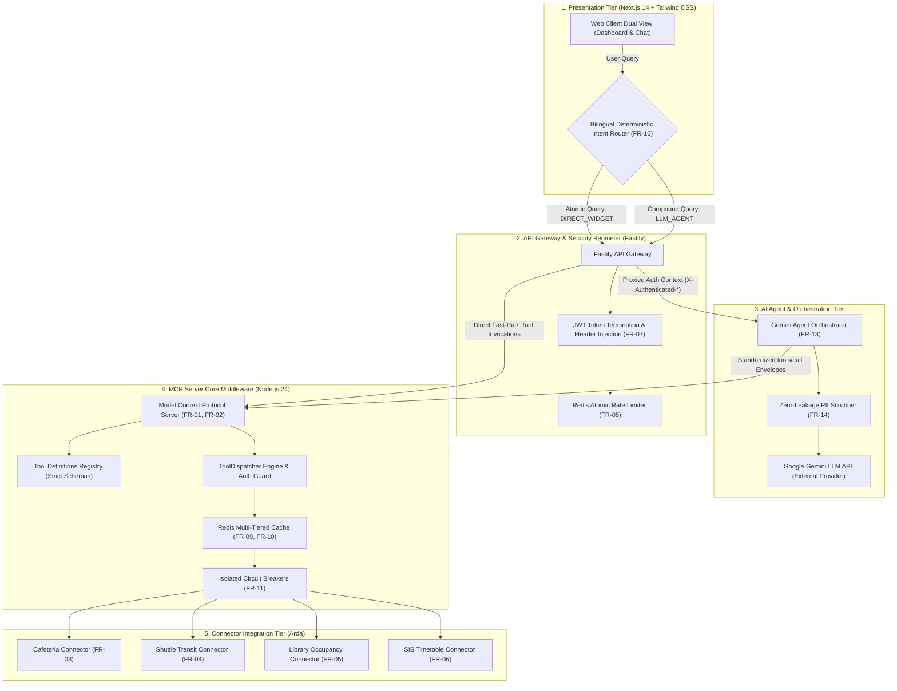

# Section: MCP Server Core, Tool Registry & AI Agent Architecture

| Field | Detail |
| :--- | :--- |
| **Component Lead & Author** | **Murat Can Işık** (241101013) — `@cmuratt` |
| **Role & Responsibilities** | MCP Server Architecture, Tool Dispatcher, Shared Contracts, AI Agent Orchestrator |
| **Project Assignment** | BIL 481 Software Engineering — Project Assignment 2 (Design & Skeleton) |
| **Associated Repositories** | `packages/shared/`, `apps/mcp-server/`, `tests/mcp-server/` |
| **Status** | Completed Phase 2 Baseline Design & Implementation Skeleton |

---

## 1. System Overview

### 1.1 Brief Project Description

**Campus Data Orchestrator** is an open-standard integration platform built on the **Model Context Protocol (MCP)** over JSON-RPC 2.0. In modern universities, everyday student operations are digitally fragmented across isolated silos: cafeteria menus reside on external catering web portals, course schedules are locked inside proprietary Student Information Systems (SIS), campus shuttle ("ring") schedules are hosted on transit trackers, and study space availability is recorded on disconnected turnstile IoT hardware feeds. Answering simple everyday inquiries (such as *"What is for lunch today, and can I catch a ring after my 10:30 class?"*) forces students to switch between multiple portals and manually synthesize contradictory information.

The Campus Data Orchestrator solves this fragmentation by placing a stateless, high-throughput MCP middleware server between campus data feeds and end users. It exposes four core campus services as strictly validated MCP tools, providing two complementary consumption pathways: a **Campus at a Glance Dashboard** that serves frequently requested telemetry (menus, shuttles, library occupancy) instantly from cache without invoking an AI model, and an **Autonomous Conversational Assistant** powered by a Large Language Model (Google Gemini) that plans multi-tool reasoning sequences and synthesizes unified responses. The system enforces strict perimeter identity isolation to prevent student credentials from leaking to external LLM providers and maintains fault isolation through Redis caching, circuit breaking, and synthetic mock fallback.

### 1.2 System Architecture

The system is organized into a **5-tier decoupled architecture**, separating presentation, security perimeter enforcement, agentic reasoning, protocol dispatching, and upstream campus connectors:

1. **Presentation Tier (Next.js 14):** Hosts the dual-view web application (Fast-Access Dashboard and Streaming Conversational Assistant) paired with a client-side **Bilingual Deterministic Intent Router (FR-16)** that classifies incoming natural language queries into either direct widget or agent paths.
2. **API Gateway & Security Tier (Fastify):** Enforces zero-trust perimeter security, verifies JWTs issued by a local mock SSO authority, strips raw credentials to ensure 100% token isolation, enforces per-identity tiered rate limiting (FR-07, FR-08), and injects verified internal identity headers (`X-Authenticated-Student-Id`, `X-Authenticated-User-Role`).
3. **AI Agent & MCP Client Tier:** Orchestrates multi-step reasoning plans using Google Gemini (behind a Provider Adapter), applies an in-memory regex pipeline to scrub student Personally Identifiable Information (PII) before external prompt dispatch (FR-14), and invokes MCP tools via standardized JSON-RPC envelopes (FR-13).
4. **MCP Server Core Middleware (Node.js & TypeScript):** The central stateless coordination engine developed by Murat. It implements the Model Context Protocol specification over Streamable HTTP and stdio transports (FR-01, FR-02), registers four strictly validated tools, executes input validation via Zod schemas, enforces perimeter authorization context, and coordinates Redis caching (FR-09), stale-if-error fallback (FR-10), and circuit breaking (FR-11).
5. **Connector Integration Tier (`ICampusConnector`):** Implements pluggable data adapters developed by Arda. Each connector implements a unified interface supporting both live scraping/APIs and deterministic synthetic mock fixtures (FR-12) for air-gapped automated testing.

#### Dual Data Flow Pathways

The architecture supports two distinct execution paths based on query complexity:

- **Path A: Direct Fast-Path (`DIRECT_WIDGET`):** Simple, single-domain queries (e.g., *"yemekte ne var"*, *"next ring to metro"*, *"library floor 2 occupancy"*) contain no conjunctions or inter-service dependencies. The client-side intent router identifies the target service and bypasses the AI Agent tier entirely, dispatching a direct query to the MCP tool endpoint. Responses resolve in `< 25 ms` from Redis cache, consuming zero LLM tokens.
- **Path B: Agentic Orchestration Path (`LLM_AGENT`):** Compound, multi-service, or ambiguous inquiries (e.g., *"Can I eat lunch and catch the ring after my morning lecture?"*) are routed to the AI Agent. The agent extracts temporal constraints, plans multiple tool invocations (`get_course_schedule` → `get_cafeteria_menu` → `get_shuttle_schedule`), invokes the MCP Server via `tools/call`, and synthesizes a unified Markdown response with live execution telemetry badges.



### 1.3 Technology Stack

The complete system utilizes open-source, reproducible technologies designed for local execution within Docker Compose:

| Architectural Tier | Technology / Library | Version / Baseline | Justification & Responsibility |
| :--- | :--- | :--- | :--- |
| **Presentation Tier** | Next.js, React, Tailwind CSS | Next.js 14, React 18 | Dual-view responsive interface, Server-Sent Events (SSE) streaming, deterministic regex router (FR-15–FR-19). |
| **API Gateway Tier** | Fastify, `@fastify/jwt`, `@fastify/rate-limit` | Fastify 4.x | High-throughput perimeter gateway, OAuth2/JWT token stripping, Redis-backed rate limiting (FR-07, FR-08). |
| **MCP Server Core** | Node.js, TypeScript, `@modelcontextprotocol/sdk` | Node.js v24, TS 5.4, MCP SDK 1.32 | Stateless JSON-RPC 2.0 protocol implementation, streamable HTTP and stdio transports, tool dispatching (FR-01, FR-02). |
| **Schema Validation** | Zod | Zod 3.23.8 | Strict schema validation (`additionalProperties: false`, `.strict()`) for all incoming MCP tool payloads. |
| **AI / LLM Integration** | Google Gemini API, Google Gen AI SDK | Gemini 1.5 Flash / 2.0 | Multi-tool autonomous planning, function calling, contextual synthesis, and provider abstraction (FR-13). |
| **Caching & Resilience** | Redis | Redis 7.2 (Alpine) | Granular TTL storage (60s–3600s), stale-if-error fallback cache, distributed rate limiting counters (FR-09–FR-11). |
| **Persistence & Telemetry** | PostgreSQL, Prisma ORM | PostgreSQL 16, Prisma 5.x | Cryptographically hashed student audit records, tool execution latency telemetry, and error logging (FR-20). |
| **Testing & Quality** | Vitest, Supertest | Vitest 5.1.0 | Offline/mock unit and integration testing suite achieving `< 1s` execution for air-gapped CI/CD (NFR-08). |

---

## 2.2 Key Implementations — MCP Server & AI Agent

Murat is solely responsible for developing the core MCP server middleware, tool registry, tool dispatcher, transport layers, and agent orchestration boundary.

### 2.2.1 Component Architecture & Working Principles

#### 1. Tool Registry & Strict Schemas (`apps/mcp-server/src/registry/toolDefinitions.ts`)
The tool registry provides the authoritative definitions for all four MCP tools. Each tool is declared with a descriptive purpose and a strict JSON Schema adhering to the Model Context Protocol specification:
- **`additionalProperties: false`:** Configured across all tool definitions and paired with Zod `.strict()` validation. Any unexpected parameters sent by an LLM or client are rejected before reaching business logic.
- **`validateToolArguments<T>(toolName, args)`:** A strongly-typed helper function that validates untrusted inputs against the tool's registered Zod schema, returning either `{ success: true, data: T }` or structured error details.

#### 2. Tool Dispatcher (`apps/mcp-server/src/dispatcher/ToolDispatcher.ts`)
The `ToolDispatcher` acts as the single entrypoint for executing registered tools. Its operational workflow follows a strict 5-stage pipeline:
1. **Tool Resolution:** Matches the incoming tool name against `TOOL_DEFINITIONS`. If unrecognized, returns JSON-RPC `-32601 (Method not found)`.
2. **Perimeter Authorization Verification:** When `get_course_schedule` is requested, it checks `auth.studentId`. If the request lacks a verified student identity, execution halts immediately with an `AuthenticationRequiredError`.
3. **Strict Parameter Validation:** Executes `validateToolArguments(name, args)`. If validation fails, halts execution and returns standard JSON-RPC error code `-32602 (Invalid params)` without invoking backend services.
4. **Handler Lookup:** Checks whether a handler has been registered via `registerHandler(name, handler)`. If no handler is attached, returns a structured `NOT_IMPLEMENTED` error response.
5. **Execution & Envelope Wrapping:** Invokes the registered handler, formatting the output into a standardized `MCPToolResponse` envelope with timestamps and error flags.

#### 3. Dual Transport Layer & Server Entrypoint (`apps/mcp-server/src/server.ts` & `src/index.ts`)
Implements official MCP transport protocols to support both desktop AI assistants and web gateways (FR-02):
- **Streamable HTTP (SSE):** Built using native Node.js `http.createServer` and `SSEServerTransport`. Exposes:
  - `GET /health`: Diagnostic health check returning service status, uptime, and registered tool counts.
  - `GET /mcp` (or `/sse`): Initiates an HTTP Server-Sent Events stream for real-time bidirectional messaging.
  - `POST /mcp/messages?sessionId=...`: Handles incoming JSON-RPC post messages for active SSE sessions.
  - `POST /mcp`: Direct JSON-RPC HTTP POST endpoint for API Gateway proxies, parsing `X-Authenticated-Student-Id` headers into `AuthContext`.
  - Full Cross-Origin Resource Sharing (CORS) headers on all endpoints.
- **Stdio Transport:** Leverages `StdioServerTransport` for local command-line integrations (e.g., Claude Desktop, MCP Inspector). All diagnostics are isolated to `process.stderr` so that `process.stdout` remains dedicated to JSON-RPC messages.

#### 4. Temporary Deterministic Mock Flow (`apps/mcp-server/src/mocks/sampleMockHandlers.ts`)
To allow immediate end-to-end testing and demonstration in Phase 2 before Arda's `packages/connectors` module is finalized:
- **`sampleCafeteriaHandler`:** Analyzes the ISO date string. If the date falls on a weekend, returns `{ available: false, unavailableReason: '...', lunch: null, dinner: null }`. On weekdays, returns a complete menu with calories and allergen tags.
- **`sampleLibraryHandler`:** Returns study floor occupancies across three floors marked with `isSimulated: true`.
- **`sampleShuttleHandler`:** Returns chronological departures for `MAIN_RING`, `METRO_LINE`, and `DORMITORY_LINE`.
- **`sampleCourseScheduleHandler`:** Returns synthetic course timetables bound to the authenticated `auth.studentId`.

#### 5. AI Agent Orchestrator Skeleton (`apps/mcp-server/src/agent/AgentOrchestrator.ts`)
Defines the architectural contract and dependency injection boundaries for FR-13 multi-tool planning. It implements `IAgentOrchestrator` and accepts `ToolDispatcher` in its constructor. Rather than fabricating a simulated response, its `executePlan` method throws a clear `NOT_IMPLEMENTED` error, explicitly stating that live Gemini LLM adapter integration is scheduled for Phase 3.

---

### 2.2.2 Core Error Handling & Validation Rules

The MCP server enforces predictable, standardized error semantics across all operational scenarios:

| Failure Condition | Triggering Event | Error Format / Code | System Behavior |
| :--- | :--- | :--- | :--- |
| **Invalid Tool Parameters** | Malformed date, invalid enum, extra unexpected keys (e.g., external `studentId`). | JSON-RPC `-32602` (`Invalid params`) | Immediate rejection during Zod validation. Connector or cache is never invoked. |
| **Unauthenticated Private Access** | `get_course_schedule` invoked with guest role or missing `auth.studentId`. | `AuthenticationRequiredError` (HTTP 401 equivalent) | Throws explicit `"Authentication required"` error before argument parsing or connector execution. |
| **Unregistered Connector Handler** | Tool is defined in schema but has no active handler registered in dispatcher. | `code: "NOT_IMPLEMENTED"` | Returns structured error envelope stating the handler is not yet registered. |
| **Unknown Tool Invocation** | Client calls an unlisted tool name. | JSON-RPC `-32601` (`Method not found`) | Returns standard method-not-found error with unrecognized tool identifier. |
| **Upstream Connector Crash** | Unhandled exception inside connector handler. | JSON-RPC `-32603` (`Internal error`) | Catches exception, preserves server uptime, and returns structured internal error. |

---

### 2.2.3 Status of Implementation: Implemented vs. Planned

To maintain strict academic integrity and engineering transparency, the table below delineates the actual operational code delivered in Phase 2 from the components planned for Phase 3:

| Architectural Component | FR / NFR ID | Phase 2 Skeleton Status (**Implemented**) | Phase 3 Core Development Status (**Planned**) |
| :--- | :--- | :--- | :--- |
| **MCP Protocol Compliance** | FR-01 | **Implemented:** Strict JSON Schemas for 4 tools with `additionalProperties: false` via Zod. | Integration with live MCP client frontends. |
| **Transport Layer** | FR-02 | **Implemented:** Stdio (`StdioServerTransport`) and Streamable HTTP (`/mcp`, `/health`, SSE) working. | Production HTTPS/TLS certificate binding. |
| **Tool Dispatcher** | FR-01, FR-06 | **Implemented:** Central dispatcher, `-32602` error mapping, perimeter studentId guard, handler registration. | Connection to official connector classes. |
| **Temporary Mock Handlers** | FR-03–FR-06 | **Implemented:** Deterministic sample mocks for dining, shuttles, library, and SIS courses. | **To be replaced** by Arda's `packages/connectors`. |
| **AI Agent Orchestrator** | FR-13 | **Implemented:** TypeScript interfaces (`IAgentOrchestrator`, `AgentSynthesisResult`, telemetry badges). | **Planned:** Google Gemini API client integration and autonomous multi-turn planning adapter. |
| **Prompt PII Scrubbing** | FR-14 | **Planned:** Architectural boundary defined; regex sanitizer not yet active. | **Planned:** In-memory regex pipeline scrubbing student names, IDs, and emails before LLM dispatch. |
| **Redis TTL Caching** | FR-09 | **Planned:** Constants (`CACHE_TTL`) defined in `packages/shared`. | **Planned:** Redis client integration, cache hit verification, and key serialization. |
| **Stale-If-Error Fallback** | FR-10 | **Planned:** `isStale` flag defined in `MCPToolResponse`. | **Planned:** 800ms connector timeout cutoff and fallback cache retrieval. |
| **Isolated Circuit Breaking**| FR-11 | **Planned:** Architectural boundaries documented. | **Planned:** 3-failure threshold, 60s cooldown state machine per connector. |
| **Telemetry & Latency Audit**| FR-20 | **Planned:** Interfaces defined. | **Planned:** PostgreSQL Prisma client persisting hashed student audit logs. |

---

## 2.3 Component Interfaces — MCP Server & AI Agent

The contracts below are taken directly from the TypeScript source code established in `packages/shared/` and `apps/mcp-server/`.

### 2.3.1 Shared Domain & Architectural Types (`packages/shared/src/types/`)

#### 1. Domain Entities (`packages/shared/src/types/domain.ts`)

```typescript
export interface CafeteriaLunchMenu {
  soup: string;
  mainDish: string;
  vegOption: string;
  sideDish: string;
  calories: number;
  allergens?: string[];
}

export interface CafeteriaDinnerMenu {
  soup: string;
  mainDish: string;
  sideDish: string;
  calories: number;
}

export interface CafeteriaDailyMenu {
  date: string;
  lunch: CafeteriaLunchMenu | null;
  dinner: CafeteriaDinnerMenu | null;
  available: boolean;
  unavailableReason?: string;
}

export interface ShuttleRouteData {
  routeId: string;
  routeName: string;
  nextDepartures: string[];
  activeVehicles: number;
  lastUpdated: string;
}

export interface LibraryFloorOccupancy {
  floorId: string;
  name: string;
  occupiedSeats: number;
  maxSeats: number;
  isQuietArea: boolean;
}

export interface LibraryOccupancyReport {
  timestamp: string;
  isSimulated: boolean;
  totalCapacity: number;
  totalOccupied: number;
  floors: LibraryFloorOccupancy[];
}

export interface StudentClassEntry {
  courseCode: string;
  courseTitle: string;
  instructor: string;
  classroom: string;
  day?: string;
  startTime: string;
  endTime: string;
}
```

#### 2. Protocol & Architecture Contracts (`packages/shared/src/types/mcp.ts`)

```typescript
export type UserRole = 'STUDENT' | 'FACULTY' | 'GUEST';

export interface AuthContext {
  studentId?: string;
  role: 'STUDENT' | 'FACULTY' | 'GUEST';
}

export interface MCPContentBlock {
  type: string;
  text?: string;
  data?: unknown;
  [key: string]: unknown;
}

export interface MCPToolResponse<T = unknown> {
  isError: boolean;
  content: MCPContentBlock[] | T;
  isStale?: boolean;
  timestamp?: string;
}

export interface ICampusConnector<TInput = unknown, TOutput = unknown> {
  readonly isMock?: boolean;
  execute(input: TInput, context?: AuthContext): Promise<TOutput>;
}
```

#### 3. MCP Tool Input Parameter Contracts (`packages/shared/src/types/tools.ts`)

```typescript
export interface GetCafeteriaMenuInput {
  date?: string;
}

export type ShuttleRoute = 'MAIN_RING' | 'METRO_LINE' | 'DORMITORY_LINE';

export interface GetShuttleScheduleInput {
  route?: ShuttleRoute;
}

export type LibraryFloor = 'FLOOR_1' | 'FLOOR_2' | 'FLOOR_3' | 'ALL';

export interface GetLibraryOccupancyInput {
  floor?: LibraryFloor;
}

/**
 * CRITICAL RULE / SECURITY ENFORCEMENT:
 * Do NOT add `studentId` here. Student identity is strictly sourced
 * from the perimeter authentication context (X-Authenticated-Student-Id)
 * and must never be exposed or accepted as an LLM/client tool input.
 */
export interface GetCourseScheduleInput {
  day?: string;
}
```

---

### 2.3.2 Concrete Component & Class Signatures (`apps/mcp-server/src/`)

#### 1. ToolDispatcher Signatures (`apps/mcp-server/src/dispatcher/ToolDispatcher.ts`)

```typescript
export type ToolHandler<TInput = any, TOutput = any> = (
  args: TInput,
  auth: AuthContext
) => Promise<TOutput>;

export interface DispatcherResult<T = unknown> {
  isError: boolean;
  code?: number | string;
  message?: string;
  error?: {
    code: number | string;
    message: string;
    data?: unknown;
  };
  content: Array<{ type: string; text?: string; data?: unknown; [key: string]: unknown }> | T;
  isStale?: boolean;
  timestamp?: string;
}

export class ToolDispatcher {
  public registerHandler<TInput = any, TOutput = any>(
    name: string,
    handler: ToolHandler<TInput, TOutput>
  ): void;

  public hasHandler(name: string): boolean;

  public async dispatch(
    name: string,
    args: unknown,
    auth: AuthContext
  ): Promise<DispatcherResult>;
}
```

#### 2. AgentOrchestrator Signatures (`apps/mcp-server/src/agent/AgentOrchestrator.ts`)

```typescript
export interface AgentPlanStep {
  toolName: string;
  parameters: Record<string, unknown>;
  reasoning?: string;
}

export interface AgentTelemetryBadge {
  toolName: string;
  status: 'CACHE_HIT' | 'LIVE' | 'STALE' | 'ERROR';
  durationMs: number;
}

export interface AgentSynthesisResult {
  text: string;
  toolsInvoked: string[];
  badges: AgentTelemetryBadge[];
  isComplete: boolean;
}

export interface IAgentOrchestrator {
  executePlan(query: string, auth: AuthContext): Promise<AgentSynthesisResult>;
}

export class AgentOrchestrator implements IAgentOrchestrator {
  constructor(dispatcher: ToolDispatcher);
  public getDispatcher(): ToolDispatcher;
  public async executePlan(query: string, auth: AuthContext): Promise<AgentSynthesisResult>;
}
```

---

### 2.3.3 MCP Registered Tool Contracts

The four tools exposed by the MCP Server strictly comply with the parameters, schemas, cache TTLs, and requirements defined in the Requirements Document:

| Tool Name (`TOOL_NAMES`) | Input Parameters | Schema Validation Constraints | Cache TTL | Linked Requirement | Operational Summary |
| :--- | :--- | :--- | :--- | :--- | :--- |
| **`get_cafeteria_menu`** | `date?: string` | `pattern: ^\d{4}-\d{2}-\d{2}$`, `additionalProperties: false` | **3600 s** (1 hour) | FR-01, FR-03 | Daily lunch/dinner menu, calorie counts, allergen indicators, and weekend availability. |
| **`get_shuttle_schedule`**| `route?: string` | `enum: [MAIN_RING, METRO_LINE, DORMITORY_LINE]`, `additionalProperties: false` | **120 s** (2 minutes) | FR-01, FR-04 | Upcoming ring departures sorted chronologically, route names, and active fleet count. |
| **`get_library_occupancy`**| `floor?: string` | `enum: [FLOOR_1, FLOOR_2, FLOOR_3, ALL]`, `additionalProperties: false` | **60 s** (1 minute) | FR-01, FR-05 | Real-time seat occupancy and capacity broken down by study floor (`isSimulated: true`). |
| **`get_course_schedule`** | `day?: string` | String day filter (`TODAY`, `MONDAY`, etc.), `additionalProperties: false` | **300 s** (5 minutes) | FR-01, FR-06 | Personal student class schedule sorted by `startTime`. Accessible only with verified student ID. |

---

### 2.3.4 Security Rule: Identity Boundary & Parameter Isolation

> [!CAUTION]
> **Zero-Trust Identity Isolation Rule (FR-06, FR-07, FR-14):**
> 1. Under **no circumstances** shall `studentId` be declared as an input parameter in `GetCourseScheduleInput` or in the MCP tool's JSON Schema.
> 2. Student identity is strictly terminated and verified at the API Gateway perimeter. The gateway extracts claims from the incoming SSO JWT, strips the raw bearer token, and injects verified internal headers: `X-Authenticated-Student-Id` and `X-Authenticated-User-Role`.
> 3. The MCP server reads identity exclusively from the request's internal `AuthContext`.
> 4. If a malicious client or compromised LLM attempts to forge or pass `studentId` inside tool arguments (`{ "day": "MONDAY", "studentId": "241101999" }`), the request is immediately rejected with JSON-RPC error `-32602 (Invalid params)` due to `additionalProperties: false` enforcement.

---

## Phase 2 Handoff & Effort Allocation Note

> [!NOTE]
> **Phase 2 Deliverable Handoff Notice (Murat Can Işık - 241101013):**
> This design section captures the complete architectural baseline and implementation state of the MCP Server, Tool Dispatcher, Shared Contracts, and Agent Orchestrator skeleton. It is ready for direct incorporation into the collaborative `docs/Design_Document.md` during Phase 3.
>
> **Design Document Task Matrix Entry (Assignment 2 Documentation Effort):**
> - **Section 2.2 & 2.3 Authoring (`docs/_sections/murat-design.md`):** Estimated: 1.5 h | Actual: 1.0 h
> *(Note: Software implementation effort for the repository skeleton, shared contracts, and MCP core skeleton in `packages/shared/` and `apps/mcp-server/` [Estimated: 1.5 h] is tracked separately under Phase 2 development allocations to avoid double-counting within the document-specific task matrix).*
>
> All tool schemas and interface contracts documented herein are frozen as baseline specifications for Phase 3 integration.
