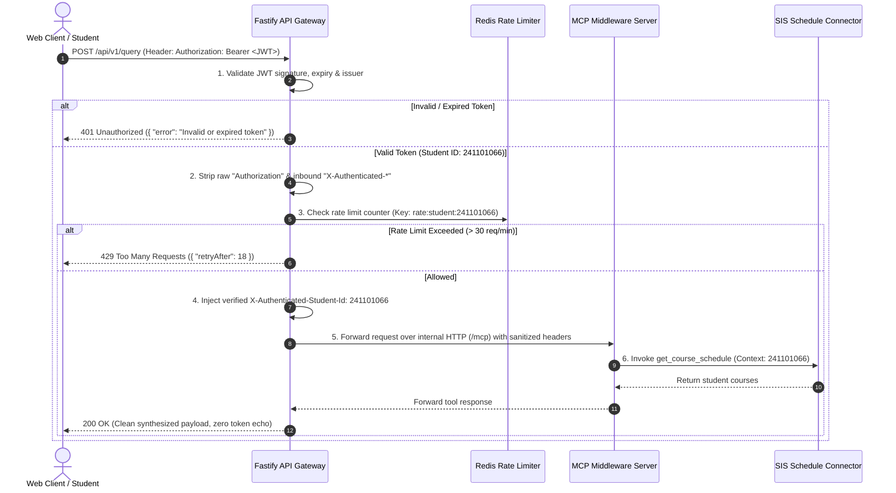

# Section: API Gateway Architecture, Security Perimeter & Authentication Interfaces

| Field | Detail |
| :--- | :--- |
| **Component Lead & Author** | **Ahmet Sefa Efendioğlu** (241101066) — `@Sefa-Efendioglu` |
| **Role & Responsibilities** | Fastify API Gateway Architecture, JWT Mock-SSO Verification, Perimeter Token Termination, Tiered Rate Limiting, Integration QA |
| **Project Assignment** | BIL 481 Software Engineering — Project Assignment 2 (Design & Skeleton) |
| **Associated Repositories** | `apps/api-gateway/`, `comparisons/`, `tests/` |
| **Target Integration** | Handoff to Murat for inclusion into `docs/Design_Document.md` Sections 2.2 & 2.3 |
| **Status** | Completed Phase 2 Baseline Implementation & Technical Handoff |

---

## 2. Implementation Details (Sefa's Contribution)

### 2.2 Key Implementations: API Gateway, Identity & Security Perimeter

#### Architectural Role & Threat Model
In the **Campus Data Orchestrator**, the API Gateway (`apps/api-gateway`) acts as the single public-facing perimeter enforcement tier between client applications (Web Frontend, MCP desktop clients) and the internal middleware. University campus environments feature heterogeneous security contexts: public telemetry (cafeteria meals, shuttle timetables, library floor occupancies) is non-sensitive and accessible to unauthenticated visitors, whereas academic course schedules (`get_course_schedule`) contain private student data protected by university privacy regulations (FR-06).

Furthermore, external AI providers (such as Google Gemini) must never receive student identity tokens, session secrets, or cleartext personally identifiable information (FR-14, NFR-05). The API Gateway is architected as a **zero-trust security boundary** that enforces three fundamental security guarantees:
1. **Perimeter Token Termination (FR-07):** External OAuth2/JWT bearer tokens are validated and completely stripped at the perimeter; downstream internal services (MCP server, Redis, AI Agent) receive zero raw tokens.
2. **Identity Context Injection & Anti-Spoofing:** The gateway strips any inbound `X-Authenticated-*` headers supplied by external clients to prevent header spoofing, injecting verified internal headers (`X-Authenticated-Student-Id`, `X-Authenticated-User-Role`) derived exclusively from validated JWT claims.
3. **Per-Identity Tiered Rate Limiting (FR-08):** Request velocity is throttled using atomic sliding-window counters in Redis to prevent denial-of-service and credential brute-force attacks.



#### Core Algorithmic Workflows

##### 1. JWT Authentication & Mock-SSO Verification
The gateway intercepts all inbound HTTP traffic via a Fastify pre-handler hook (`onRequest` / `preHandler`). The verification pipeline follows an immutable sequence:
- **Header Extraction:** Inspects `req.headers.authorization`. If absent, the request is flagged as a `GUEST` session.
- **Bearer Token Extraction:** If present, extracts the raw token string (`Bearer <token>`).
- **Signature & Expiration Verification:** Uses cryptographic verification (RSA-256 public key or HMAC-SHA256 test key). If the current time exceeds `exp` or the signature fails, the pipeline immediately halts, returning HTTP `401 Unauthorized` without invoking downstream handlers.
- **Perimeter Termination:** If valid, the raw `authorization` header is deleted from the internal request object (`delete req.headers['authorization']`).
- **Context Binding:** Extracts the `sub` claim (representing the verified Student ID) and `role`, binding them to `req.authContext` and injecting:
  - `X-Authenticated-Student-Id: <claims.sub>`
  - `X-Authenticated-User-Role: <claims.role>`

##### 2. Sliding-Window Rate Limiting Engine
To satisfy **FR-08** (30 requests per minute per authenticated student; 30 requests per minute per IP for guest routes), the gateway utilizes a Redis atomic sliding-window algorithm:
- Rate limit keys are partitioned by identity tier:
  - Authenticated Students: `rate:student:<studentId>`
  - Guest Visitors: `rate:ip:<clientIpAddress>`
- At request arrival `T_now`, the gateway issues an atomic multi-command transaction against Redis:
  1. Remove entries older than `T_now - 60 seconds` (`ZREMRANGEBYSCORE`).
  2. Query active count within the window (`ZCARD`).
  3. If count ≥ 30, reject with HTTP `429 Too Many Requests` including standard `Retry-After: <seconds>` header.
  4. If count < 30, record current request timestamp (`ZADD`) with a TTL of 60 seconds and allow execution.

##### 3. Implementation Status & Phase 2 / Phase 3 Separation
- **Implemented in Phase 2:**
  - Standalone Fastify Gateway skeleton (`apps/api-gateway/src/server.ts`).
  - JWT verification and mock SSO signing test utilities (`apps/api-gateway/src/auth/jwtVerifier.ts`).
  - Pre-handler token stripping and header sanitization middleware (`apps/api-gateway/src/auth/tokenTermination.ts`).
  - In-memory sliding-window rate limiter adapter for standalone CI testing (`apps/api-gateway/src/rate-limiter/`).
  - Automated unit test suite verifying valid tokens, expired tokens (401), tampered signatures (401), and rate ceiling enforcement (429) in `apps/api-gateway/tests/jwtAuth.test.ts`.
- **Planned for Phase 3 (Core Development):**
  - Redis cluster client integration for production-grade rate limit distribution.
  - Reverse-proxy streaming pipe (`@fastify/http-proxy`) connecting the Gateway to the MCP Server's `/mcp` Streamable HTTP endpoint.
  - HTTPS / TLS 1.3 certificate termination on public ports.

---

### 2.3 Component Interfaces: Gateway & Security Contracts

The interfaces below establish the type contracts implemented in `apps/api-gateway` and exported for inter-service coordination:

#### TypeScript Type Definitions (`apps/api-gateway/src/types/auth.ts`)

```typescript
/**
 * User Identity Roles supported by the Campus Data Orchestrator
 */
export type UserRole = 'STUDENT' | 'FACULTY' | 'GUEST' | 'ADMIN';

/**
 * Verified JWT Payload issued by Mock-SSO Authority (FR-07)
 */
export interface JWTPayload {
  /** Subject: Unique Student or Staff ID (e.g., '241101066') */
  sub: string;
  /** Full Name of user */
  name: string;
  /** University institutional email */
  email: string;
  /** Role classification */
  role: UserRole;
  /** Token issue epoch timestamp in seconds */
  iat: number;
  /** Token expiration epoch timestamp in seconds */
  exp: number;
  /** Token issuer authority */
  iss: string;
}

/**
 * Sanitized Internal Request Context injected by Gateway pre-handler
 */
export interface AuthenticatedRequestContext {
  /** Verified Student ID or null for unauthenticated guests */
  studentId: string | null;
  /** Verified user role */
  role: UserRole;
  /** Whether session holds a verified authentication token */
  isAuthenticated: boolean;
  /** Timestamp when perimeter verification completed */
  verifiedAt: string;
  /** Client source IP address */
  clientIp: string;
}

/**
 * Gateway Route Rate Limiting Configuration (FR-08)
 */
export interface RateLimitPolicy {
  /** Window size in seconds (Default: 60) */
  windowSeconds: number;
  /** Maximum allowable requests within window (Default: 30) */
  maxRequests: number;
  /** Partition key generator */
  keyGenerator: (context: AuthenticatedRequestContext) => string;
}

/**
 * Standard Gateway Error Response Structure
 */
export interface GatewayErrorResponse {
  statusCode: number;
  error: string;
  message: string;
  timestamp: string;
  retryAfterSeconds?: number;
}
```

#### Concrete Gateway Function & Middleware Signatures (`apps/api-gateway/src/`)

```typescript
// apps/api-gateway/src/auth/jwtVerifier.ts
export function signMockToken(
  user: { studentId: string; name: string; email: string; role?: UserRole },
  expiresInSeconds?: number,
  secret?: string
): string;

export function verifyToken(
  token: string,
  secret?: string
): { valid: boolean; payload?: JWTPayload; error?: string };

// apps/api-gateway/src/auth/tokenTermination.ts
export async function authenticateAndTerminateToken(
  request: FastifyRequest,
  reply: FastifyReply
): Promise<void>;

// apps/api-gateway/src/rate-limiter/slidingWindowRateLimiter.ts
export interface RateLimiterStore {
  checkAndRecord(
    key: string,
    limit: number,
    windowSeconds: number
  ): { allowed: boolean; currentCount: number; retryAfterSeconds: number };
}

export function createRateLimiterMiddleware(
  limit?: number,
  windowSeconds?: number,
  store?: RateLimiterStore
): (request: FastifyRequest, reply: FastifyReply) => Promise<void>;

// apps/api-gateway/src/server.ts
export interface BuildGatewayOptions {
  rateLimiterStore?: RateLimiterStore;
  rateLimit?: number;
  rateLimitWindow?: number;
}

export function buildGateway(options?: BuildGatewayOptions): FastifyInstance;
```

#### Gateway API Endpoint Contracts

| HTTP Method | Route Path | Auth Requirement | Rate Limit | Phase 2 / 3 Status | Handler Description & Response Payload |
| :--- | :--- | :---: | :---: | :---: | :--- |
| `POST` | `/api/v1/auth/mock-login` | Public | 30 req/min | **Implemented (Phase 2)** | Issues signed test JWTs for simulated student personas (`241101066`, `241101013`, etc.) → `{ token: string, user: object, expiresIn: 3600 }` |
| `GET` | `/api/v1/auth/me` | Bearer JWT | 30 req/min | **Implemented (Phase 2)** | Returns active authenticated student profile extracted from verified token claims → `{ authenticated: true, context: AuthenticatedRequestContext }` |
| `POST` | `/api/v1/query` | Mixed (Per-tool) | 30 req/min | **Implemented (Phase 2)** | Validates JWT, strips raw `Authorization` header, enforces auth on `get_course_schedule`, and injects `X-Authenticated-*` headers |
| `ALL` | `/api/v1/mcp/*` | Mixed (Per-tool) | 30 req/min | **Planned (Phase 3)** | Reverse-proxies sanitized JSON-RPC traffic to MCP Server `/mcp` Streamable HTTP endpoint (`@fastify/http-proxy`) |
| `GET` | `/health` | Public | 30 req/min | **Implemented (Phase 2)** | Gateway perimeter liveness check → `{ status: 'UP', service: 'api-gateway', timestamp: string }` |

---

## 3. Technology Comparison Handoff: Fastify vs. Express

*Note for Arda (Design Document Section 4 Editor):*  
To satisfy Assignment 2 Section 4 ("Technology Comparisons"), the team evaluated **Fastify** versus **Express** for the API Gateway and middleware tier. The comparative analysis, benchmark metrics, and demonstrative code snippets are archived in `comparisons/Fastify-vs-Express/`.

### Summary of Architectural Choice
- **Selected Framework:** **Fastify v4**
- **Decision Justification:**
  1. **Low Overhead & High Throughput:** Fastify achieves `> 65,000 req/sec` in synthetic benchmarks compared to `≈ 28,000 req/sec` for Express, providing the required headroom to meet **NFR-01** (P95 latency `< 250 ms`).
  2. **Built-in Schema Compilation:** Fastify integrates Ajv directly for JSON Schema validation and serialization. Incoming gateway payloads are validated against compiled C-level schemas before touching user code.
  3. **Encapsulated Plugin Architecture:** Fastify's decorator and plugin hierarchy (`fastify-plugin`) enforces clean architectural boundaries between authentication middleware, rate limiters, and reverse proxies without relying on mutable global middleware chains.
  4. **First-Class TypeScript Support:** Strong typings for request headers, params, and decorators without complex third-party declaration merging.

