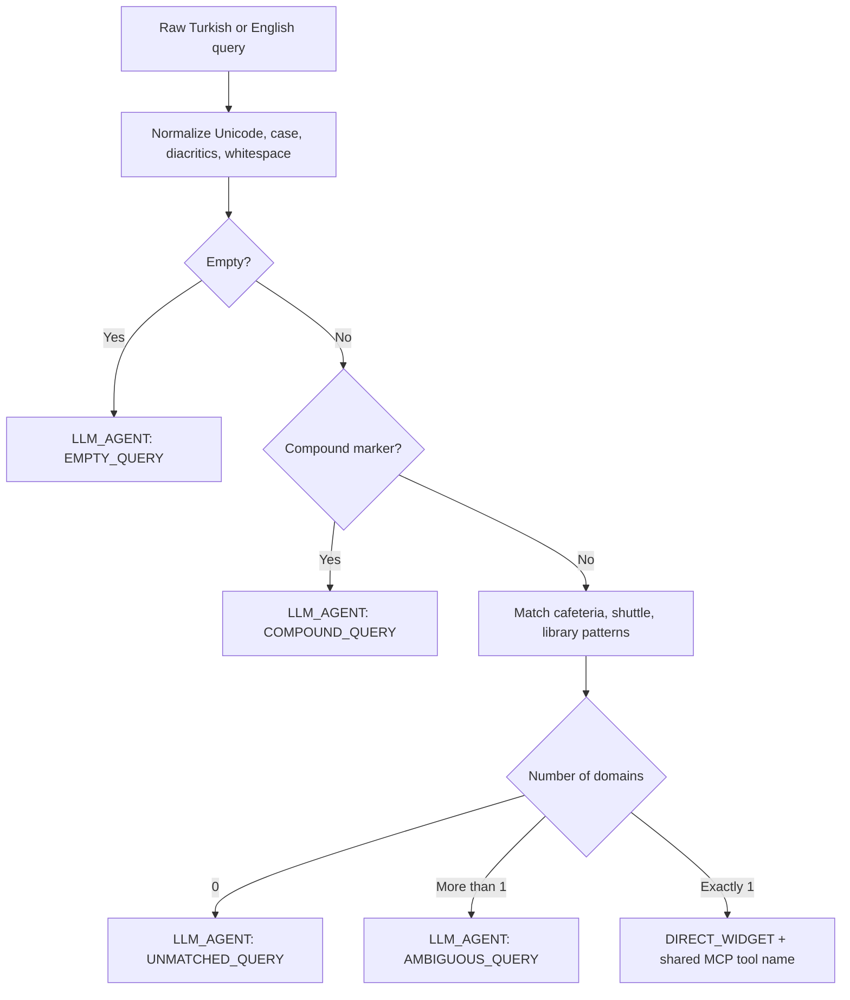
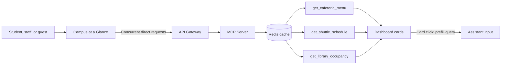
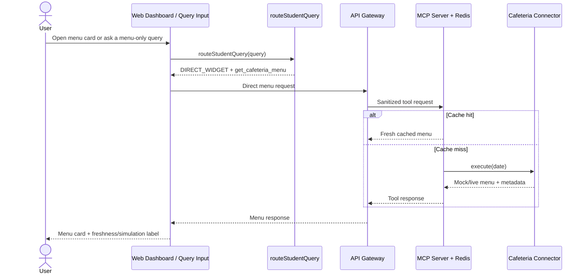
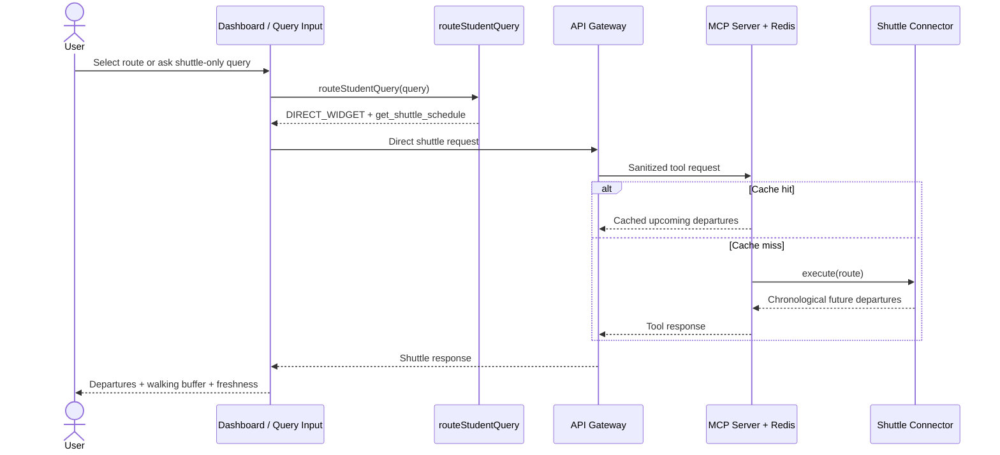
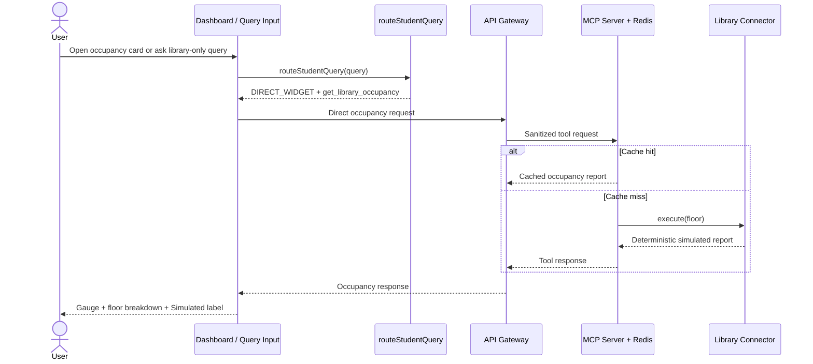

# Section: Web Client, Intent Router, Visual Interfaces & Use Cases

| Field | Detail |
| :--- | :--- |
| **Component Lead & Author** | **Yunus Emre Biçer** (241101009) — `@YunusEmre113` |
| **Role & Responsibilities** | Web client design, bilingual deterministic intent routing, UI wireframes, and use-case design |
| **Project Assignment** | BIL 481 Software Engineering — Project Assignment 2 (Design & Skeleton) |
| **Associated Paths** | `apps/web/`, `docs/wireframes/`, `docs/_sections/yunus-usecases-ui.md` |
| **Implementation Status** | Intent router and automated tests implemented; Next.js views, data fetching, and SSE integration planned |

> **Integration note:** This file is Yunus's component handoff. Its Sections 2.2 and 2.3 are intended to be merged into the corresponding shared sections of `docs/Design_Document.md`; Sections 2.4 and 3 provide the visual-interface and four-use-case content required by Assignment 2.

---

## 2.2 Frontend and Router Key Implementations

### 2.2.1 Presentation-Tier Responsibilities

The presentation tier provides two complementary user experiences:

1. **Campus at a Glance Dashboard:** Direct access to cafeteria, shuttle, library, and connector-health information without an LLM call (FR-18).
2. **Conversational Assistant:** A chat view for compound questions, streamed responses, tool-execution badges, and connection/error feedback (FR-17, FR-19).

The client-side router is the boundary between these experiences. It sends only clear, single-domain cafeteria, shuttle, or library queries to the direct path. Compound, ambiguous, empty, and unmatched queries fail safely to the agent path. Both paths still cross the API Gateway; `DIRECT_WIDGET` bypasses the LLM Agent, not the security perimeter.

### 2.2.2 Implemented: Bilingual Deterministic Intent Router (FR-16)

The implemented router lives at `apps/web/src/router/routeStudentQuery.ts`. It has no network or LLM dependency and therefore remains deterministic and fully testable offline.

#### Routing algorithm

```text
INPUT: raw query string

1. Normalize Unicode, Turkish characters, letter case, and whitespace.
2. If the normalized query is empty, return LLM_AGENT / EMPTY_QUERY.
3. If it contains a compound marker, return LLM_AGENT / COMPOUND_QUERY.
4. Match cafeteria, shuttle, and library keyword groups.
5. If no domain matches, return LLM_AGENT / UNMATCHED_QUERY.
6. If more than one domain matches, return LLM_AGENT / AMBIGUOUS_QUERY.
7. Otherwise, return DIRECT_WIDGET with the shared MCP tool name.
```

Compound markers include the required English and Turkish terms (`and`, `then`, `after`, `ve`, `sonra`, and commas) plus conservative equivalents such as `before`, `with`, `ile`, `önce`, and `ardından`. This conservative rule prevents a multi-step query from being incorrectly sent to a single widget.



#### Direct mapping

| Intent | MCP tool | Example query |
| :--- | :--- | :--- |
| `CAFETERIA` | `get_cafeteria_menu` | "Bugünün menüsünü göster" |
| `SHUTTLE` | `get_shuttle_schedule` | "When is the next shuttle?" |
| `LIBRARY` | `get_library_occupancy` | "Kütüphanede boş yer var mı?" |

Course-schedule queries are not routed directly. They require authenticated student context and therefore go to `LLM_AGENT`; the client never accepts or adds a `studentId` tool argument.

#### Verification evidence

- A labeled benchmark contains exactly **40 acceptance queries**: 20 Turkish and 20 English.
- Additional cases cover empty, unmatched, multi-domain, normalization, and compound-marker behavior.
- The web suite completed with **45/45 passing tests**.
- The complete repository suite completed with **63/63 passing tests** after this component was integrated into `dev`.
- `@campus-orchestrator/shared` supplies the MCP tool names; the web package does not duplicate protocol strings.

### 2.2.3 Planned: Dashboard Data Flow (FR-18)

The dashboard will request the three public information domains concurrently through Gateway-managed direct routes. The fourth card displays connector health. A card click will prefill a related query in the assistant input, as required by FR-18.



The exact HTTP endpoint paths are not frozen in this handoff because the Gateway owner has not yet published those contracts. The client will consume the approved Gateway interface once it is available rather than inventing a parallel API.

### 2.2.4 Planned: Conversational Streaming and Recovery (FR-17, FR-19)

The assistant view will:

- preserve the user's input until the request is accepted;
- render one telemetry badge per invoked tool;
- stream answer text over SSE;
- show a processing message after 5 seconds;
- cancel at 20 seconds and expose a retry action;
- retry a dropped SSE connection at 1, 2, and 4 seconds, at most three times;
- keep typed input visible during reconnection;
- render stale, simulated, empty, and error states without presenting mock data as live data.

These behaviors are design commitments, not implemented claims. The current `apps/web` package contains routing logic and tests only.

### 2.2.5 Implementation Status Summary

| Component | Status at Assignment 2 | Evidence / next step |
| :--- | :--- | :--- |
| Bilingual query normalization | **Implemented** | `normalizeStudentQuery`; covered by automated tests |
| Deterministic route classification | **Implemented** | `routeStudentQuery`; 40-query bilingual benchmark |
| Shared MCP tool-name mapping | **Implemented** | Imports `TOOL_NAMES` from `packages/shared` |
| Dashboard React/Next.js components | **Planned / not implemented** | Wireframe and component boundaries defined below |
| Gateway data client | **Planned / blocked on interface** | Await Sefa's approved Gateway endpoints |
| SSE chat stream and reconnection | **Planned / not implemented** | State model and UI behavior defined below |
| Mock SSO session UI | **Planned / not implemented** | Must integrate with the Gateway auth contract |

---

## 2.3 Frontend Component Interfaces

### 2.3.1 Implemented Router Contract

The following public contract is implemented and exported from `apps/web/src/index.ts`:

```typescript
export type QueryRoute = 'DIRECT_WIDGET' | 'LLM_AGENT';
export type DirectIntent = 'CAFETERIA' | 'SHUTTLE' | 'LIBRARY';

export interface DirectWidgetRoute {
  route: 'DIRECT_WIDGET';
  intent: DirectIntent;
  toolName:
    | 'get_cafeteria_menu'
    | 'get_shuttle_schedule'
    | 'get_library_occupancy';
  normalizedQuery: string;
}

export type AgentRoutingReason =
  | 'EMPTY_QUERY'
  | 'COMPOUND_QUERY'
  | 'AMBIGUOUS_QUERY'
  | 'UNMATCHED_QUERY';

export interface AgentRoute {
  route: 'LLM_AGENT';
  reason: AgentRoutingReason;
  normalizedQuery: string;
}

export type StudentQueryRoute = DirectWidgetRoute | AgentRoute;

export function normalizeStudentQuery(query: string): string;
export function routeStudentQuery(query: string): StudentQueryRoute;
```

The tool-name union is derived from `TOOL_NAMES` in the source implementation. It is expanded above only to make the document readable; the code does not maintain a second list.

### 2.3.2 Planned View-State Contracts

The following signatures define the intended component boundary. They are design proposals for the later Next.js implementation and are **not present in the repository yet**.

```typescript
type LoadStatus = 'IDLE' | 'LOADING' | 'SUCCESS' | 'EMPTY' | 'ERROR';

interface DataCardState<T> {
  status: LoadStatus;
  data?: T;
  errorMessage?: string;
  isStale: boolean;
  isSimulated: boolean;
  lastUpdated?: string;
}

interface DashboardProps {
  cafeteria: DataCardState<CafeteriaDailyMenu>;
  shuttles: DataCardState<ShuttleRouteData[]>;
  library: DataCardState<LibraryOccupancyReport>;
  connectorHealth: DataCardState<ConnectorHealth[]>;
  onCardQuery(query: string): void;
  onRefresh(card: DashboardCard): void;
}
```

The final names for `ConnectorHealth` and `DashboardCard` must follow the shared contracts once their owners publish them.

```typescript
type ToolBadgeStatus = 'CACHE_HIT' | 'LIVE' | 'STALE' | 'ERROR';
type StreamStatus =
  | 'IDLE'
  | 'CONNECTING'
  | 'STREAMING'
  | 'RECONNECTING'
  | 'COMPLETE'
  | 'ERROR';

interface ToolExecutionBadge {
  toolName: string;
  status: ToolBadgeStatus;
  durationMs: number;
}

interface ChatMessage {
  id: string;
  role: 'USER' | 'ASSISTANT';
  markdown: string;
  badges: ToolExecutionBadge[];
  createdAt: string;
}

interface ConversationalAssistantProps {
  messages: ChatMessage[];
  streamStatus: StreamStatus;
  draft: string;
  onDraftChange(value: string): void;
  onSubmit(query: string): void;
  onRetry(): void;
  onCancel(): void;
}
```

### 2.3.3 Security and Ownership Boundaries

- The web client may send a session credential to the Gateway but must never forward that raw credential to an MCP tool or the external LLM.
- The client must not add `studentId` to `get_course_schedule` parameters. Verified identity comes only from Gateway-created `AuthContext` (FR-06, FR-07).
- `apps/web` owns presentation state and query classification; it does not own JWT verification, cache policy, connector retry behavior, or MCP schema validation.
- Gateway endpoint paths and payload envelopes must be integrated from Sefa's handoff rather than independently defined here.

---

## 2.4 Visual Interfaces

The two committed visuals are low-fidelity wireframes, not screenshots and not evidence of completed UI implementation:

1. [Campus at a Glance Dashboard wireframe](../wireframes/dashboard-wireframe.svg)
2. [Conversational Assistant wireframe](../wireframes/conversational-assistant-wireframe.svg)

### 2.4.1 Dashboard Layout Intent

The dashboard places all primary campus metrics on the initial desktop viewport. The first row prioritizes menu and shuttle timing; the second row shows library occupancy and connector health. Each card includes freshness/simulation metadata and an action that can prefill the assistant.

### 2.4.2 Conversational Assistant Layout Intent

The assistant keeps routing transparent: users see whether a request is being handled directly or by the agent, which tools were invoked, and whether each result came from live, cached, stale, or simulated data. Connection-state banners remain visible without deleting the draft input.

### 2.4.3 Responsive Behavior

| Viewport | Planned behavior |
| :--- | :--- |
| 375–767 px | Single-column cards; compact navigation; full-width chat; badges wrap |
| 768–1023 px | Two-column dashboard; collapsible chat history |
| 1024–1920 px | Two-column dashboard grid; persistent assistant/history panel where space permits |

No layout may introduce horizontal scrolling between 375 px and 1920 px (NFR-07).

---

## 3. Use Case Support in Design

### 3.1 Selected Use Cases and Traceability

| Use case | User goal | Functional requirements |
| :--- | :--- | :--- |
| **UC-01 — View Cafeteria Menu** | View the selected day's lunch/dinner menu | FR-01, FR-03, FR-09, FR-12, FR-16, FR-18 |
| **UC-02 — View Shuttle Schedule** | View upcoming departures for a route | FR-01, FR-04, FR-09, FR-12, FR-16, FR-18 |
| **UC-03 — View Library Occupancy** | View total and floor-level seat occupancy | FR-01, FR-05, FR-09, FR-12, FR-16, FR-18 |
| **UC-04 — Ask a Combined Course, Shuttle, and Menu Question** | Receive one answer synthesized from personal schedule and public campus data | FR-01, FR-06, FR-07, FR-13, FR-14, FR-16, FR-17; FR-19 for errors |

These four use cases are the fixed team selection for Assignment 2 and the final demonstration. Their identifiers must remain consistent across Design, QA, implementation, and demo artifacts.

### 3.2 UC-01 — View Cafeteria Menu

| Field | Design |
| :--- | :--- |
| **Primary actor** | Student, faculty/staff member, or guest |
| **Trigger** | User opens the dashboard/menu card or asks a single-domain menu question |
| **Preconditions** | Web client is reachable; no authentication is required for public menu data |
| **Postconditions** | Menu state records freshness and simulation status; no LLM request is generated |
| **Participating layers** | Web UI, intent router, API Gateway direct route, MCP server/cache, cafeteria connector |
| **Implementation status** | Router path implemented; UI/data integration planned |

#### Main flow

1. The user opens the dashboard or enters a query such as *"Bugün yemekte ne var?"*.
2. `routeStudentQuery` returns `DIRECT_WIDGET` with `get_cafeteria_menu`.
3. The client sends a direct data request through the Gateway, bypassing the LLM Agent.
4. The MCP server checks the one-hour cafeteria cache (FR-09).
5. On a miss, the cafeteria connector returns mock or authorized live data (FR-03, FR-12).
6. The UI renders Lunch/Dinner tabs, calorie/allergen metadata, `lastUpdated`, and simulation/freshness labels.

#### Alternative and error flows

- **Weekend/no menu:** Render an explicit unavailable/empty state rather than an empty card.
- **Upstream failure with cache:** Render cached data with an amber stale notice and timestamp (FR-10, FR-19).
- **Failure without cache:** Render a retryable error state; do not invent menu content.
- **Compound query:** If the menu is combined with another domain, route to UC-04's agent path.



### 3.3 UC-02 — View Shuttle Schedule

| Field | Design |
| :--- | :--- |
| **Primary actor** | Student, faculty/staff member, or guest |
| **Trigger** | User selects a route or asks a shuttle-only question |
| **Preconditions** | Web client is reachable; route is omitted or one of the shared route enum values |
| **Postconditions** | Upcoming departures are displayed in chronological order; no past departure is shown |
| **Participating layers** | Web UI, intent router, API Gateway direct route, MCP server/cache, shuttle connector |
| **Implementation status** | Router path implemented; UI/data integration planned |

#### Main flow

1. The user selects a route or enters *"Metro servisi ne zaman?"*.
2. The router returns `DIRECT_WIDGET` with `get_shuttle_schedule`.
3. The client requests shuttle data through the Gateway without invoking the LLM.
4. The MCP server serves a cache hit or invokes the shuttle connector with a two-minute TTL.
5. The UI lists future departures, route identity, last update time, and a walking-time buffer indicator.

#### Alternative and error flows

- **No active departures:** Render a clear "No more departures today" state.
- **Invalid route:** Show a validation message and preserve the selected input.
- **Stale schedule:** Render the timestamp prominently; never present stale departures as live.
- **Multiple-domain question:** Route to `LLM_AGENT` instead of selecting only the shuttle portion.



### 3.4 UC-03 — View Library Occupancy

| Field | Design |
| :--- | :--- |
| **Primary actor** | Student, faculty/staff member, or guest |
| **Trigger** | User opens the library card, selects a floor, or asks a library-only question |
| **Preconditions** | Web client is reachable; floor is `FLOOR_1`, `FLOOR_2`, `FLOOR_3`, `ALL`, or omitted |
| **Postconditions** | Total and floor-level occupancy are displayed with an explicit simulation label |
| **Participating layers** | Web UI, intent router, API Gateway direct route, MCP server/cache, library connector |
| **Implementation status** | Router path implemented; UI/data integration planned |

#### Main flow

1. The user opens the library card or asks *"Kütüphanede boş yer var mı?"*.
2. The router returns `DIRECT_WIDGET` with `get_library_occupancy`.
3. The client requests occupancy through the Gateway without an LLM call.
4. The MCP server uses its 60-second library cache or invokes the deterministic mock connector.
5. The UI renders a total-capacity gauge and per-floor occupied/available counts.
6. `isSimulated: true` is rendered visibly because no real library feed is available.

#### Alternative and error flows

- **Unknown floor:** Reject the selection locally or display the Gateway/MCP validation response.
- **Temporarily unavailable feed:** Use stale data only with timestamp and warning.
- **Inconsistent totals:** Treat as an error; the displayed total must equal the sum of floor data.
- **Empty response:** Display a structured no-data state rather than a zero-occupancy claim.



### 3.5 UC-04 — Ask a Combined Course, Shuttle, and Menu Question

| Field | Design |
| :--- | :--- |
| **Primary actor** | Authenticated student |
| **Trigger** | Student asks a compound question involving personal schedule and public campus services |
| **Preconditions** | Student has a valid mock-SSO session; Gateway and agent path are reachable |
| **Postconditions** | One grounded response is displayed with one badge per tool call; no raw token or clear-text PII reaches Gemini |
| **Participating layers** | Chat UI, intent router, API Gateway/auth boundary, Agent/PII scrubber, MCP server, course/shuttle/cafeteria tools |
| **Implementation status** | Compound classification implemented; auth, agent, SSE UI, and full integration planned |

#### Main flow

1. The student asks: *"10:30 dersimden sonra ringe yetişir miyim, bugün yemekte ne var?"*.
2. The client router detects compound markers and multiple domains, returning `LLM_AGENT`.
3. The client sends the query and session credential to the API Gateway.
4. The Gateway verifies the JWT, removes the raw token and any spoofed identity headers, and creates trusted internal `AuthContext`.
5. The PII filter sanitizes LLM-bound context; the agent plans calls to `get_course_schedule`, `get_shuttle_schedule`, and `get_cafeteria_menu`.
6. `get_course_schedule` receives the verified context separately; `studentId` is never included in tool arguments.
7. The agent relates class end time to future shuttle departures and combines that result with the menu.
8. The UI streams the grounded answer and renders one status/duration badge per invoked tool.

#### Alternative and error flows

- **Guest/expired token:** Gateway returns `401`; UI requests sign-in while public widgets remain available.
- **Spoofed identity header:** Gateway discards it and uses only verified token claims.
- **Dropped SSE connection:** UI retries after 1, 2, and 4 seconds without clearing the draft (FR-19).
- **Slow request:** Show "Still processing..." after 5 seconds; cancel with retry at 20 seconds.
- **One tool unavailable:** Use correctly labeled stale data when available; otherwise explain which part could not be answered.
- **LLM unavailable:** Preserve the query and show a retryable error; do not fabricate a combined answer.

```mermaid
sequenceDiagram
    actor Student
    participant UI as Conversational Assistant
    participant Router as routeStudentQuery
    participant Gateway as API Gateway / Auth Boundary
    participant Agent as Agent + PII Scrubber
    participant MCP as MCP Server
    participant Course as Course Tool
    participant Shuttle as Shuttle Tool
    participant Menu as Cafeteria Tool

    Student->>UI: Compound course + shuttle + menu question
    UI->>Router: routeStudentQuery(query)
    Router-->>UI: LLM_AGENT / COMPOUND_QUERY
    UI->>Gateway: Query + session credential
    Gateway->>Gateway: Verify JWT; strip token/spoofed headers
    Gateway->>Agent: Query + trusted AuthContext
    Agent->>Agent: Scrub PII and plan tool calls
    Agent->>MCP: tools/call get_course_schedule (no studentId argument)
    MCP->>Course: execute(day, AuthContext)
    Course-->>Agent: Student's class times
    par Public data calls
        Agent->>MCP: tools/call get_shuttle_schedule
        MCP->>Shuttle: execute(route)
        Shuttle-->>Agent: Future departures
    and
        Agent->>MCP: tools/call get_cafeteria_menu
        MCP->>Menu: execute(date)
        Menu-->>Agent: Daily menu
    end
    Agent-->>Gateway: Grounded streamed synthesis + telemetry
    Gateway-->>UI: SSE events
    UI-->>Student: Combined answer + one badge per tool
```

### 3.6 Cross-Use-Case UI State Rules

| State | Required presentation behavior | Related requirements |
| :--- | :--- | :--- |
| Simulated | Clearly label synthetic connector data | FR-12, FR-18 |
| Stale | Amber notice with source timestamp and unavailable service | FR-10, FR-19 |
| Empty | Explain that no result exists; do not show a generic failure | FR-19 |
| Loading > 5 s | Show "Still processing..." | FR-19 |
| Timeout at 20 s | Cancel and provide retry | FR-19 |
| SSE reconnect | Show attempt state; preserve draft; retry 1 s, 2 s, 4 s | FR-19 |
| Tool execution | Exactly one badge per tool call with status and duration | FR-17 |
| Authentication required | Prompt sign-in without hiding public cards | FR-15 |

### 3.7 Final-Demo Obligation

Assignment 2 requires these four use cases to structure the design, and the final project presentation requires all four to be fully implemented and demonstrated. At this Assignment 2 checkpoint, only the deterministic router portion is implemented in Yunus's module. The wireframes and remaining component contracts define planned work and must not be presented as completed application screens.

---

## Phase 2 Handoff and Task-Matrix Input

| Work item | Owner | Reviewer / integration partner | Status | Actual effort |
| :--- | :--- | :--- | :--- | :--- |
| Bilingual deterministic router and benchmark tests | Yunus Emre Biçer | Murat Can Işık (agent handoff) | Implemented and merged to `dev` via PR #6 | To be reported by contributor |
| Frontend implementation/interface handoff (Sections 2.2–2.3) | Yunus Emre Biçer | Murat Can Işık (Design integration) | Completed in this section file | To be reported by contributor |
| Dashboard and assistant wireframes (Section 2.4) | Yunus Emre Biçer | Design Document reviewer | Completed as low-fidelity SVG designs | To be reported by contributor |
| Four use-case designs and FR mappings (Section 3) | Yunus Emre Biçer | Murat Can Işık / QA cross-check | Completed in this section file | To be reported by contributor |

Actual effort is intentionally left unreported until Yunus records measured time. The final Design Document Task Matrix must not treat the Phase 2 estimate as actual work or count the router implementation time twice.
