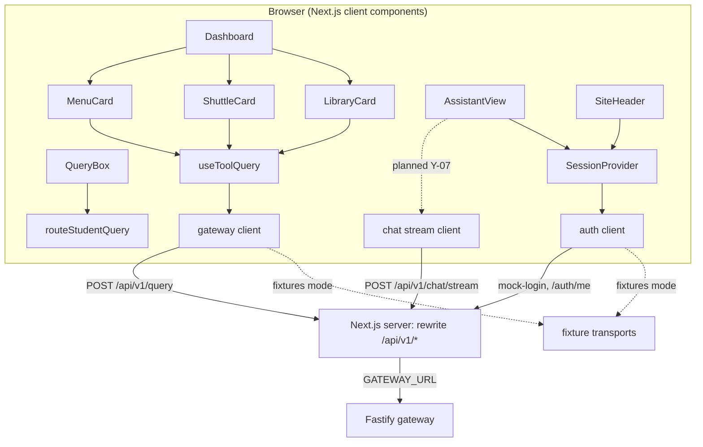

# Handover — Web Client (Yunus Emre Biçer)

| Field | Detail |
| :--- | :--- |
| **Author** | Yunus Emre Biçer (241101009) — `@YunusEmre113` |
| **Component** | `apps/web` — Next.js web client, intent router, dashboard, login, chat stream client |
| **For** | Murat Can Işık: Design Document update (M-11) and traceability matrix (M-12). Also useful for Sefa (Deployment Plan, Test Results) |
| **Version / Date** | 1.0, 20 November 2026 |
| **State described** | `dev` at `6ae34ef` (PRs #15, #16, #19 merged) plus open PRs #18 (Docker) and #20 (login). Items from open PRs are marked **(PR #n, open)** |
| **Team guide task** | Y-13 |

> **How to use this note.** Section 2 lists every change the Design Document needs for the web client, as *section → what is there now → what it should say*. Section 3 gives ready-made traceability rows. Section 4 gives the current TypeScript signatures for Design Document §2.3.3. Everything here reflects code that exists; planned items are labelled as planned.

---

## Contents

1. [Current state at a glance](#1-current-state-at-a-glance)
2. [Requested Design Document updates](#2-requested-design-document-updates)
3. [Traceability rows (web-owned requirements)](#3-traceability-rows-web-owned-requirements)
4. [Current interfaces for Design Document §2.3.3](#4-current-interfaces-for-design-document-233)
5. [Component structure](#5-component-structure)
6. [Decisions and deviations from the Assignment 2 design](#6-decisions-and-deviations-from-the-assignment-2-design)
7. [Open items and dependencies on other members](#7-open-items-and-dependencies-on-other-members)

---

## 1. Current state at a glance

| Area | Status | Where |
| :--- | :--- | :--- |
| Intent router (FR-16) | Implemented; measured on unseen queries; one new routing reason | `apps/web/src/router/routeStudentQuery.ts` |
| Next.js application | Implemented: Next.js 16.4.6 App Router, React 19.3.1, CSS Modules, Turkish UI | `apps/web/src/app/` |
| Gateway client for `POST /api/v1/query` | Implemented against API Contract v1.1 §3.2/§3.4 | `apps/web/src/lib/gateway/` |
| Dashboard cards UC-01..03 (FR-18) | Implemented: menu, shuttle, library | `apps/web/src/components/cards/` |
| Connector-health card (FR-18 card D) | **Not implemented in PA3** (team decision 19 Nov 2026) | — |
| Fixture mode | Implemented: local contract-shaped data with a visible banner | `apps/web/src/lib/gateway/fixtureTransport.ts` |
| Chat stream client (FR-17, FR-19 part) | Implemented, **not yet wired into the assistant page** | `apps/web/src/lib/chat/` |
| Mock-SSO login / sign-out (FR-15) | Implemented **(PR #20, open)** | `apps/web/src/lib/auth/`, `apps/web/src/components/SessionProvider.tsx` |
| Chat UI with streaming and badges (Y-07) | **Planned**; builds on the chat client and PR #20 | — |
| Docker image, `/healthz` (NFR-09, web part) | Implemented **(PR #18, open)**; `docker build` not yet run by the team | `apps/web/Dockerfile` |
| Tests | 98 web tests on `dev` (199 in the repository); +13 with PR #20 | `apps/web/tests/` |

End-to-end status: the cards have only been exercised with fixtures, because the gateway's real MCP proxy (S-01) and the MCP connector wiring (M-02) are not on `dev` yet. Login was exercised in the browser against the real gateway on `dev`.

---

## 2. Requested Design Document updates

Each item names the Design Document section, what it says now and what it should say. Wording can be adapted; the facts should not change.

### 2.1 §1.2 "Implementation Maturity Separation" and §1.3 Technology Stack

- **Now:** Presentation UI listed as *Planned (Phase 3)*: "Next.js 14 App Router, React 18, and Tailwind CSS".
- **Should say:** *Implemented (Phase 3)*: **Next.js 16.4.6 (App Router), React 19.3.1, CSS Modules** (no Tailwind; team decision 19 Nov 2026). Dashboard cards, login (PR #20) and the chat stream client exist; the chat UI is planned.
- **Test count:** "146 tests across 10 files" is the Assignment 2 baseline; on `dev` at `6ae34ef` it is 199 (web: 98).

### 2.2 §2.1.1 Monorepo layout

- Add under `apps/web/`: `src/app` (pages `/`, `/asistan`, `/giris` (PR #20), `/healthz` (PR #18)), `src/components`, `src/lib/{gateway,chat,auth}`, `src/router`, `tests/`, `Dockerfile` (PR #18).
- Add `docs/assignment3/` (acceptance tests, evidence, handovers).

### 2.3 §2.2.2 Frontend & Bilingual Deterministic Intent Router

1. **Dual-view UX:** "four responsive cards (Cafeteria, Shuttles, Library, Service Health)" → **three cards** (Cafeteria, Shuttles, Library). The service-health card is not implemented in PA3 (no gateway endpoint in API Contract v1.1; not covered by AT-01..AT-04). `checkConnectorHealth()` exists in `packages/connectors` for later use.
2. **Router algorithm:** insert a step between steps 3 and 4:
   > *Step 3b:* If the query contains a personal-timetable word (`ders…`, `sınav…`, `laboratuvar…`, `class(es)`, `lecture(s)`, `course(s)`, `exam(s)`), route to `LLM_AGENT (PERSONAL_QUERY)`, even if it also names a cafeteria, shuttle or library keyword.
3. **Keyword matching:** Turkish keywords now accept suffixes (`servis\w*`, `kutuphane\w*`, `ring\w*`, `metro\w*` …); English plurals and `bus`, `eat` were added.
4. **Router verification** (replace "100 % … 45 passing tests"):
   > The original 40-query benchmark (written together with the patterns) still passes. On a **held-out set of 40 unseen queries** the router scored **82.5 %** (compound → agent 7/10) and on a further **20-query validation set 65 %** (3/4) — below the FR-16 targets. After a category-based fix (suffixes, plurals, personal-timetable words) both sets reach 100 % (10/10 and 4/4 compound). The validation result is optimistic because the set was written after the error categories were known. Evidence: `docs/assignment3/evidence/fr16-router/`.
5. **Implementation Status table:** Dashboard UI → *Implemented (three cards, gateway client, fixture mode)*; SSE Chat Stream → *Client implemented (`fetch` + incremental SSE parser); chat UI planned*.

### 2.4 §2.3.3 Frontend Router & View State Contracts

- Add `'PERSONAL_QUERY'` to `AgentRoutingReason`.
- Add the gateway client, chat stream client and session signatures from Section 4 of this note.

### 2.5 §2.4 Visual Interfaces (dashboard and assistant layout)

| Design Document says | Implemented | Reason |
| :--- | :--- | :--- |
| Card A: *tabbed* Lunch/Dinner | Lunch and dinner shown **together**, plus a **date picker** (default: today in Türkiye time) | Both meals fit; the date picker lets AT-01 check weekends through the UI |
| Card B: countdowns *with walking-time buffer* | Countdowns ("12 dk sonra") and a route selector (Ana Ring / Metro / Yurtlar); **no walking buffer** | No walking-time data in the shuttle contract |
| Card C: *circular gauge* | Large percentage + per-floor **bars**, floor selector | Simpler, accessible (`role="meter"`) |
| Card D: connector telemetry | **Not implemented** | See 2.3 (1) |
| Clicking a card pre-fills the assistant input | **Not implemented**; the dashboard query box offers example questions instead | Not needed by AT-01..AT-04; listed as a gap |
| Header "[Name – Auth]" | Guest + "Giriş yap", or name + student number + "Çıkış" **(PR #20, open)** | FR-15 |
| Badges for simulated / cache / stale | Every card shows a "Sentetik veri" badge (from `meta.isSimulated`) **separately** from the source badge (`meta.source`), a stale warning with the original cache time, error state with retry, last-updated time and refresh | API Contract v1.1 §1 (source and simulation not conflated) |
| Mobile: collapsed chat drawer; desktop > 1440 px: side-by-side assistant | Dashboard and assistant are **separate pages** (`/` and `/asistan`); cards use a responsive grid (1 column on phones); no horizontal scroll checked at 375 px | Simpler navigation for PA3 |

Additional UI element not in the design: a **fixture-mode banner** ("Örnek veri modu") so screenshots taken with fixtures are never mistaken for end-to-end evidence.

### 2.6 §3.5 UC-04 and §3.6 Cross-Use-Case UI State Rules — SSE reconnect

- **Now:** "SSE Connection Drop: Client automatically retries connection with backoff (1s, 2s, 4s)" (§3.5) and "Reconnecting banner with exponential backoff" (§3.6).
- **Conflict:** API Contract v1.1 §3.3 forbids automatically resuming an already-running tool chain without server replay support.
- **Implemented (follows the contract):** no automatic reconnect or resend. On a dropped stream the turn ends with `STREAM_INTERRUPTED`, the partial answer and the typed draft are kept, and the user retries explicitly.
- **Should say:** "SSE connection drop: the partial answer is kept and an explicit *Tekrar dene* (retry) is offered; no automatic reconnect, to avoid running the tool chain twice (API Contract v1.1 §3.3)."
- **Also:** "EventSource listener" → the browser reads the `fetch()` response stream (EventSource cannot send a POST body or an `Authorization` header).
- **Latency rule as implemented:** "still processing" after 5 s without answer text; cancellation after **20 s without any data** (idle timeout), so a long answer that keeps streaming is not cut off.

### 2.7 §3.2 – §3.4 UC-01..03 sequence diagrams

- The browser calls the **web app's own origin**; Next.js rewrites `/api/v1/*` to the gateway (`GATEWAY_URL`, API Contract v1.1 §1, §7). A `Next.js server (rewrite)` participant can be added between UI and Gateway. No CORS is needed in the gateway.

---

## 3. Traceability rows (web-owned requirements)

For `docs/assignment3/traceability.md` (M-12). "Tests" lists automated suites; acceptance tests are in `docs/assignment3/Acceptance_Tests_and_Criteria.md` (PR #17).

| Requirement | Design component | Code | Automated tests | Acceptance test | Status |
| :--- | :--- | :--- | :--- | :--- | :--- |
| FR-15 | Session provider, login page, header | `apps/web/src/lib/auth/`, `src/components/SessionProvider.tsx`, `LoginForm.tsx`, `SiteHeader.tsx` | `apps/web/tests/auth.test.ts` | AT-01 (guest access), AT-04 steps 1–2 | Implemented (PR #20, open) |
| FR-16 | Intent router, query box | `apps/web/src/router/routeStudentQuery.ts`, `src/components/QueryBox.tsx` | `routeStudentQuery.test.ts`, `routeStudentQuery.heldout.test.ts` | AT-01..AT-04 (routing steps) | Implemented |
| FR-17 | Chat stream client (parser, events, reducer) | `apps/web/src/lib/chat/` | `sseParser.test.ts`, `chatStreamClient.test.ts` | AT-04 steps 3–4 | Client implemented; UI planned (Y-07) |
| FR-18 | Dashboard, three cards, gateway client | `src/components/Dashboard.tsx`, `src/components/cards/`, `src/lib/gateway/` | `gatewayClient.test.ts`, `format.test.ts` | AT-01, AT-02, AT-03 | Implemented except card D and card-click prefill |
| FR-19 | Card states (stale, empty, error, retry), chat latency flags | `src/components/cards/CardParts.tsx`, `src/lib/chat/chatStreamClient.ts` | `gatewayClient.test.ts`, `chatStreamClient.test.ts` | AT-02 step 8, AT-03 step 7, AT-04 step 10 (all conditional) | Cards implemented; chat states in client, UI planned |
| NFR-07 | Responsive layout | `src/app/globals.css`, `*.module.css` | — (manual) | AT-01 step 9 | Chromium: 375 / 768 / 1440 / 1920 px, keyboard, headings, labels and contrast checked (`evidence/y10-responsive/`); Firefox visual check passed; Safari not yet (Y-10) |
| NFR-09 (web part) | Web Docker image | `apps/web/Dockerfile`, `src/app/healthz/route.ts` | — | Deployment Plan | Implemented (PR #18, open); `docker build` not yet run |

---

## 4. Current interfaces for Design Document §2.3.3

```typescript
// apps/web/src/router/routeStudentQuery.ts
export type AgentRoutingReason =
  | 'EMPTY_QUERY' | 'COMPOUND_QUERY' | 'PERSONAL_QUERY' | 'AMBIGUOUS_QUERY' | 'UNMATCHED_QUERY';
export function routeStudentQuery(query: string): StudentQueryRoute; // unchanged otherwise

// apps/web/src/lib/gateway/client.ts — POST /api/v1/query (contract §3.2)
export function createGatewayClient(options: { transport: Transport; baseUrl?: string; timeoutMs?: number }): GatewayClient;
interface GatewayClient {
  query<T extends ToolName>(toolName: T, parameters: ToolParams<T>,
    options?: { token?: string | null; signal?: AbortSignal }): Promise<QueryResult<T>>;
}
type QueryResult<T> =
  | { ok: true; toolName: T; data: ToolData<T>; meta: ResponseMeta }   // meta: isSimulated, isStale, source, timestamp, durationMs?
  | { ok: false; code: GatewayErrorCode | ClientErrorCode; message: string; status?: number; retryAfterSeconds?: number };
// A studentId parameter is refused before any request (identity only from the JWT).

// apps/web/src/lib/chat/chatStreamClient.ts — POST /api/v1/chat/stream (contract §3.3)
export function createChatStreamClient(options: {
  transport: ChatTransport; baseUrl?: string; processingNoticeMs?: number /* 5000 */; idleTimeoutMs?: number /* 20000 */;
}): { send(message: string, options: { token: string | null | undefined; signal?: AbortSignal;
        onUpdate?: (state: ChatTurnState) => void }): Promise<ChatTurnState> };
interface ChatTurnState {
  phase: 'connecting' | 'streaming' | 'done' | 'error';
  text: string;                    // streamed chunks, then the authoritative done.answer
  tools: { toolName: string; status: 'LIVE' | 'CACHE_HIT' | 'STALE' | 'ERROR'; durationMs: number }[]; // one per tool event
  toolsInvoked: string[] | null; isComplete: boolean; slow: boolean; error: ChatError | null;
}

// apps/web/src/lib/auth/ and src/components/SessionProvider.tsx (PR #20, open)
export function createAuthClient(options: { transport: AuthTransport }): {
  login(user: SessionUser): Promise<LoginResult>;      // POST /api/v1/auth/mock-login
  verify(token: string): Promise<'valid' | 'invalid' | 'unreachable'>; // GET /api/v1/auth/me
};
export function useSession(): {
  state: { status: 'loading' } | { status: 'guest'; endReason: 'expired' | 'invalid' | null }
       | { status: 'authenticated'; session: { token: string; user: SessionUser; expiresAt: number } };
  login(personaId: string): Promise<LoginResult>; logout(): void; reportUnauthorized(): void;
};
```

---

## 5. Component structure



---

## 6. Decisions and deviations from the Assignment 2 design

| Decision | Date | Rationale | Recorded in |
| :--- | :--- | :--- | :--- |
| Chat requires login for every compound query | 19 Nov 2026 | Contract §3.3 requires a JWT; the agent can always assume a verified identity | API Contract v1.1 §1 |
| Browser stays on its own origin; Next.js rewrites to the gateway | 19 Nov 2026 | No CORS, gateway address not exposed | API Contract v1.1 §1, §7 |
| JWT in `sessionStorage` only | 19 Nov 2026 | Cleared when the tab closes; never in localStorage, cookies, URLs or logs | API Contract v1.1 §1 |
| CSS Modules instead of Tailwind; Turkish UI | 19 Nov 2026 | Fewer dependencies; target users are TOBB ETÜ students | this note |
| No connector-health card in PA3 | 19 Nov 2026 | No endpoint in the contract; not in AT-01..AT-04 | this note, AT document §7 |
| Login with two fixed synthetic personas | 20 Nov 2026 | No real data can be typed in; two personas support the cross-student isolation check (AC-04.8) | PR #20 |
| No automatic SSE reconnect | 20 Nov 2026 | Contract §3.3; avoids running tools twice | Section 2.6 |
| `GATEWAY_URL` and `NEXT_PUBLIC_WEB_DATA_SOURCE` are build-time values | 20 Nov 2026 | Next.js bakes rewrites and public env into the build; Docker passes them as build arguments | `apps/web/README.md` (PR #18) |

---

## 7. Open items and dependencies on other members

| Item | Owner | Needed for | Status |
| :--- | :--- | :--- | :--- |
| Real `/api/v1/query` proxy to MCP (S-01) | Sefa | Cards end to end (AT-01..03) | In progress (not on `dev`) |
| Gateway error bodies in contract §3.4 format | Sefa | Consistent error handling (web already accepts both formats) | Not blocking |
| Gateway port: `.env.example` says `GATEWAY_PORT=3000`, code reads `PORT` (default 4000) | Sefa | Compose / web rewrite target (contract §7) | Open |
| MCP uses connector handlers instead of sample handlers (M-02) | Murat | Real connector data and cache metadata in the cards | Open |
| Agent stream in contract §3.3 format (M-04, M-08) and `/api/v1/chat/stream` proxy (S-03) | Murat, Sefa | AT-04; the expected frames are documented in PR #19 | Open |
| `CONNECTOR_FIXED_NOW` for reproducible acceptance runs | Arda | AT-02 step 8, time-dependent checks | Proposed (contract §8 Q3) |
| Chat UI (Y-07), chat states (rest of Y-08), responsive and browser checks (Y-10) | Yunus | AT-04, NFR-07 | Planned |
| First real `docker build` of the web image | whoever has Docker (Sefa for Compose) | NFR-09, Deployment Plan | Open |
