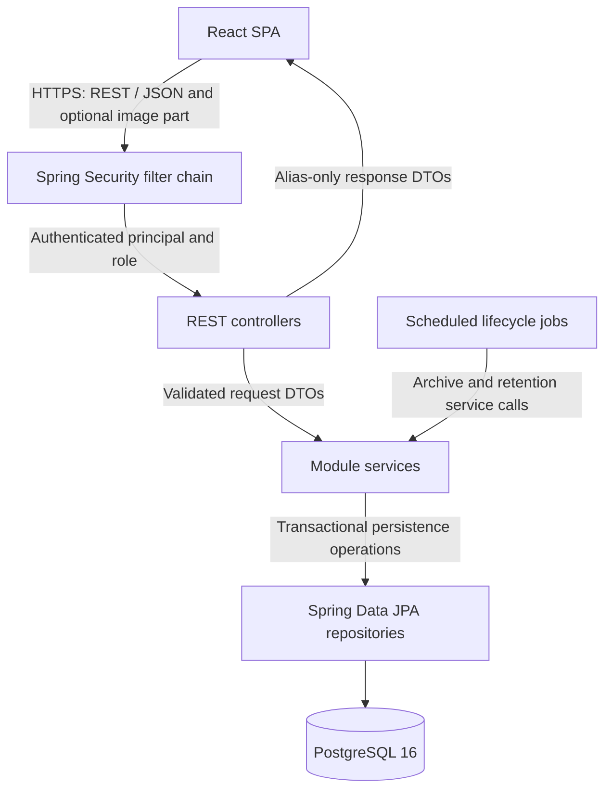
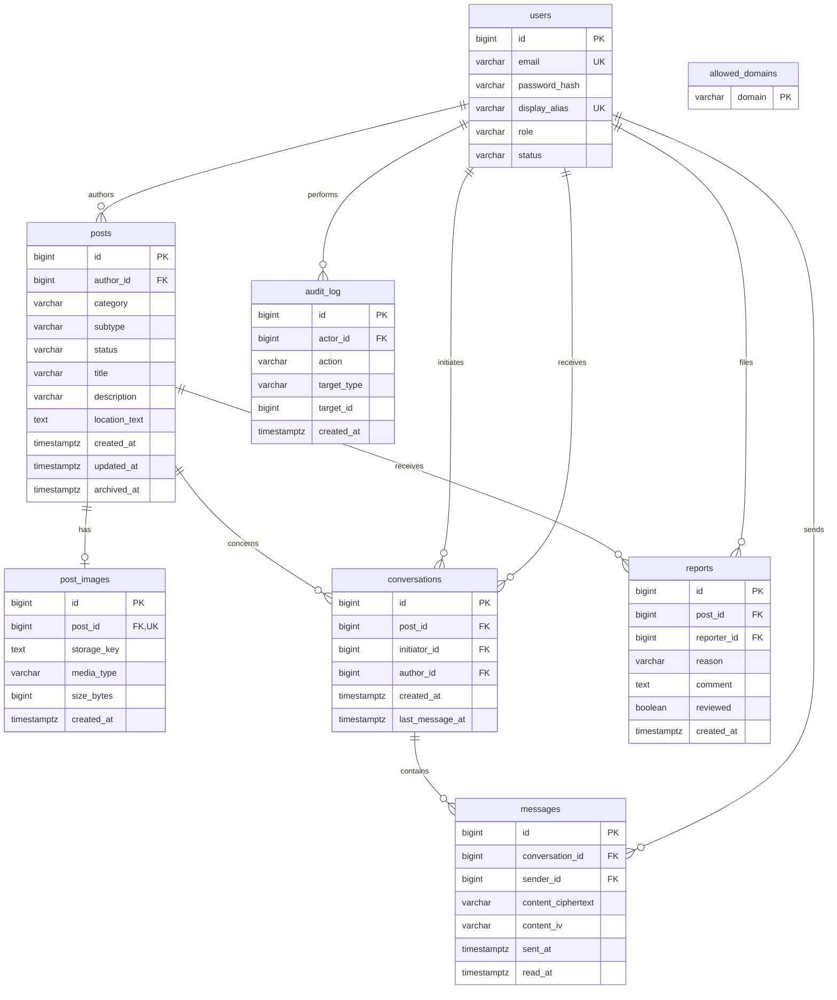
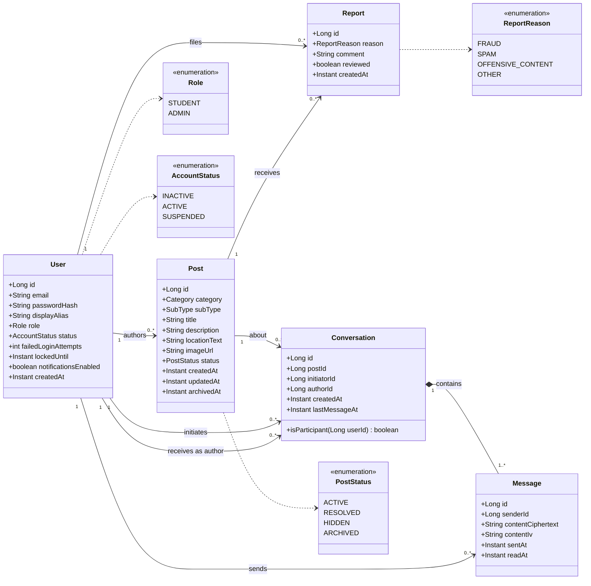
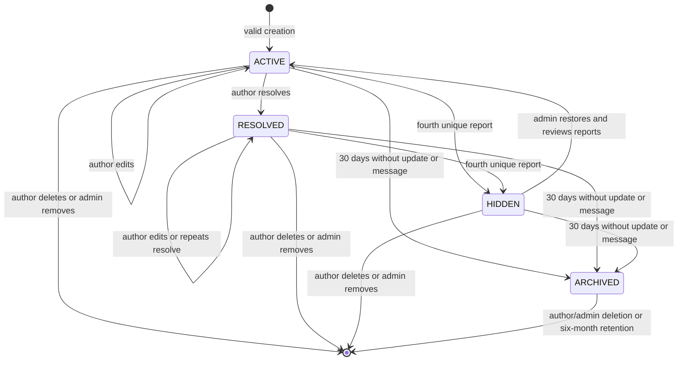
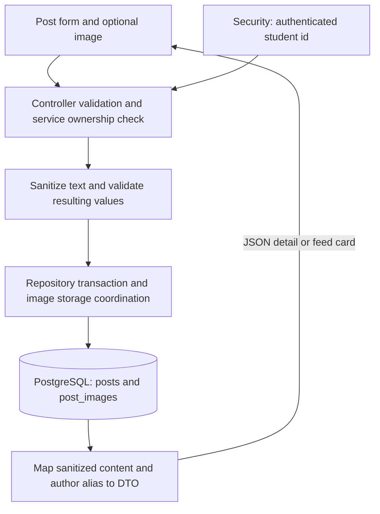
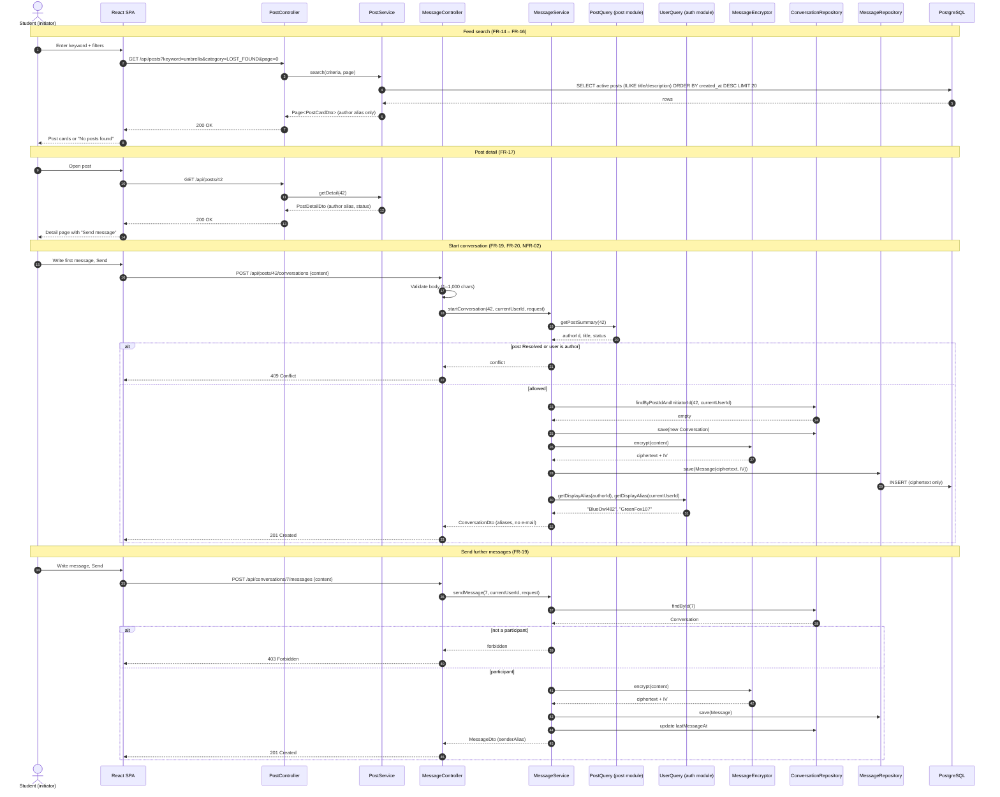
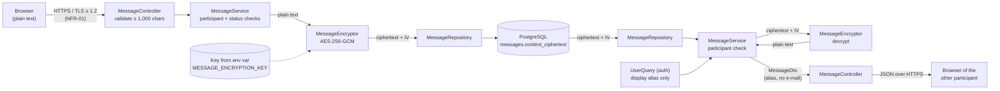

# UniHelp — Design Document

| | |
|---|---|
| **Course** | BIL 481 Software Engineering — Project Assignment 2 |
| **Project** | UniHelp — Campus Helping Platform |
| **Document** | Design Document |
| **Version** | 0.1 (draft) |
| **Due date** | 15-11-2026 |

## Contributors

<!-- TODO: Taha — finalize the contributors list (name, role, sections written) for the first page. -->

| Name | Role |
|---|---|
| Furkan Yılmaz | |
| Efe Deniz Kahvecioğlu | |
| Enis Talha Öztepe | |
| Muhammed Taha Kaya | |

## Table of Contents

<!-- TODO: Taha — finalize the table of contents after all sections are written. -->

1. [System Overview](#1-system-overview)
   1. [Description](#11-description)
   2. [Architecture](#12-architecture)
   3. [Technology Stack](#13-technology-stack)
   4. [UML Overview](#14-uml-overview)
2. [Implementation Details](#2-implementation-details)
   1. [Codebase Structure](#21-codebase-structure)
   2. [Key Implementations](#22-key-implementations)
   3. [Component Interfaces & API Endpoints](#23-component-interfaces--api-endpoints)
   4. [Visual Interfaces](#24-visual-interfaces)
3. [Use Case Support](#3-use-case-support)
   1. [Use Case Selection & Requirement Mapping](#31-use-case-selection--requirement-mapping)
   2. [UC1 Design — Register, verify & log in](#32-uc1-design--register-verify--log-in-with-university-e-mail)
   3. [UC2 Design — Create and manage a post](#33-uc2-design--create-and-manage-a-post)
   4. [UC3 Design — Search the feed and contact the author anonymously](#34-uc3-design--search-the-feed-and-contact-the-author-anonymously)
   5. [UC4 Design — Report a post, auto-hide and admin review](#35-uc4-design--report-a-post-auto-hide-and-admin-review)
4. [Design Decisions](#4-design-decisions)
   1. [Technology Comparisons](#41-technology-comparisons)
   2. [Justifications](#42-justifications)
5. [Repository Artifacts](#5-repository-artifacts)
6. [Task Matrix](#task-matrix)

---

## 1. System Overview

### 1.1 Description

<!-- TODO: Furkan -->

### 1.2 Architecture

UniHelp is a **layered monolith**: one Spring Boot application and one PostgreSQL database serve a React SPA. This follows the PA-1 Project Definition §4 and Requirements NFR-10. Feature packages contain controller, service and repository layers; calls flow down these layers, while cross-module operations use service/query interfaces rather than another module's controller or private entities.



| Boundary | Responsibility / rule |
|---|---|
| SPA → API | JSON responses over HTTPS. Post writes use multipart form data containing a JSON `post` part and at most one optional `image` part. The SPA renders text as text, not executable HTML. |
| Security → controller | Spring Security authenticates the session and applies verified/active-account and ADMIN-role checks. User ids come from the security context, never from user-supplied author fields. Session/CSRF configuration belongs to `auth` (Furkan). |
| Controller → service | Request validation and HTTP mapping. Business authorization, sanitization and state rules stay in services, so scheduled and module calls cannot bypass them. |
| Service → repository | A transaction covers each logical change. Repository queries use bound parameters/specifications; no SQL is built by concatenating user input. Entities never become API responses. |
| Module → module | `PostQuery.getPostSummary(id)` supplies internal author id/title/status to messaging; `UserQuery.getDisplayAlias(id)` supplies aliases from auth. No public DTO contains another user's account id or e-mail. |
| Scheduler → service | At least daily, archive posts after 30 days without update or new message (FR-30); delete archived data after 6 months (FR-31). The jobs run inside the same monolith, owned by Efe. |

**PA-2 status:** this is the target architecture. The current skeleton wires MVC/JPA and module stubs. Security filters, business transactions, upload storage and scheduled jobs are implemented in the planned sprints, not claimed as working by this assignment.

#### 1.2.1 Database / ER Design



`allowed_domains` is a configuration lookup, checked during registration; it has no direct FK to users because the stored e-mail address includes the local part. The database design below is the contract for subsequent module implementations. Only `posts` and `post_images` are added by Enis's PA-2 code; existing conversation/message mappings remain Efe's. Logical cross-module FKs must be installed with the complete schema when `users`/`reports` are implemented; scalar ids alone in JPA do not enforce them.

| Table | Columns and PostgreSQL types | Keys and constraints |
|---|---|---|
| `users` | `id BIGINT`, `email VARCHAR(254)`, `password_hash VARCHAR(255)`, `display_alias VARCHAR(64)`, `role VARCHAR(16)`, `status VARCHAR(16)`, `failed_login_attempts INTEGER`, `locked_until TIMESTAMPTZ NULL`, `notifications_enabled BOOLEAN`, `created_at TIMESTAMPTZ` | Identity PK `id`; unique normalized `email` and `display_alias`; role STUDENT/ADMIN; status INACTIVE/ACTIVE/SUSPENDED; failed attempts ≥ 0. Real accounts require e-mail/hash/alias. The reserved anonymized record has no credentials or public identity (FR-08). Token/session persistence details belong to auth. |
| `posts` | `id BIGINT`, `author_id BIGINT`, `category VARCHAR(32)`, `subtype VARCHAR(16)`, `title VARCHAR(100)`, `description VARCHAR(2000)`, `location_text TEXT NULL`, `status VARCHAR(16)`, `created_at TIMESTAMPTZ`, `updated_at TIMESTAMPTZ`, `archived_at TIMESTAMPTZ NULL` | Identity PK; author FK → users; all except location/archive time NOT NULL. CHECK title length 5–100; description length ≤ 2,000. Category/subtype and status checks below. Archive timestamp is set when archived. |
| `post_images` | `id BIGINT`, `post_id BIGINT`, `storage_key TEXT`, `media_type VARCHAR(16)`, `size_bytes BIGINT`, `created_at TIMESTAMPTZ` | Identity PK; all NOT NULL; FK → posts ON DELETE CASCADE; **UNIQUE(post_id)** enforces one image in v1.0. CHECK media type IN ('image/jpeg','image/png'), size > 0 and ≤ 5,000,000 bytes (5 MB). File signature/type also checked in service. |
| `conversations` | `id BIGINT`, `post_id BIGINT`, `initiator_id BIGINT`, `author_id BIGINT`, `created_at TIMESTAMPTZ`, `last_message_at TIMESTAMPTZ` | Identity PK; all NOT NULL; post FK ON DELETE CASCADE; participant FKs → users; UNIQUE(post_id, initiator_id); CHECK initiator_id <> author_id. Service checks author_id equals post author. |
| `messages` | `id BIGINT`, `conversation_id BIGINT`, `sender_id BIGINT`, `content_ciphertext VARCHAR(4096)`, `content_iv VARCHAR(32)`, `sent_at TIMESTAMPTZ`, `read_at TIMESTAMPTZ NULL` | Identity PK; all except read_at NOT NULL; conversation FK ON DELETE CASCADE; sender FK → users. Only encrypted content and IV are stored; service checks sender participation. |
| `reports` | `id BIGINT`, `post_id BIGINT`, `reporter_id BIGINT`, `reason VARCHAR(32)`, `comment TEXT NULL`, `reviewed BOOLEAN DEFAULT FALSE`, `created_at TIMESTAMPTZ` | Identity PK; all except comment NOT NULL; post FK ON DELETE CASCADE; reporter FK → users; **UNIQUE(post_id, reporter_id)**; reason FRAUD/SPAM/OFFENSIVE_CONTENT/OTHER. |
| `allowed_domains` | `domain VARCHAR(253)` | PK `domain`, NOT NULL, normalized lowercase hostname without `@`; initially `etu.edu.tr`. Admin-managed allowlist (FR-01). |
| `audit_log` | `id BIGINT`, `actor_id BIGINT`, `action VARCHAR(64)`, `target_type VARCHAR(32)`, `target_id BIGINT`, `created_at TIMESTAMPTZ` | Identity PK; all NOT NULL; actor FK → users. `target_id` is an audit reference, not a cascading FK, so permanent removal does not remove evidence. Store who/what/when, without e-mail or post/message content (FR-29, Could). |

Planned database constraints for the post domain (in addition to NOT NULL/FKs):

```sql
CHECK (category IN ('LOST_FOUND', 'STUDENT_COOPERATION'))
CHECK ((category = 'LOST_FOUND' AND subtype IN ('LOST', 'FOUND'))
    OR (category = 'STUDENT_COOPERATION' AND subtype IN ('BOOK', 'ROOMMATE', 'OTHER')))
CHECK (status IN ('ACTIVE', 'RESOLVED', 'HIDDEN', 'ARCHIVED'))
CHECK ((status = 'ARCHIVED' AND archived_at IS NOT NULL)
    OR (status <> 'ARCHIVED' AND archived_at IS NULL))
```

- Index `posts(status, created_at DESC, id DESC)` supports the default feed; `posts(author_id)` supports My Posts. Evaluate `(status, category, subtype, created_at DESC)` for combined filters against the actual load workload before adding it.
- Index `messages(conversation_id, sent_at)` supports ordered conversation reads; index conversation participant/activity columns and report post/review columns for their module queries.
- FR-15 uses a case-insensitive **substring** of title OR description. Ordinary B-tree indexes do not make leading-wildcard searches efficient; the QA load test decides whether query/index tuning is necessary. No unplanned search engine is introduced.
- For FR-26, report insert, count of distinct reporters and status change are atomic under a post-row lock. The unique report constraint protects against duplicate/concurrent reports. The fourth unique report hides a post, not the third; admin restoration marks reports reviewed in the same transaction (Furkan's UC4 design completes the review workflow).
- Hard deletion of a post removes image metadata, conversations/messages and reports; image storage cleanup is coordinated by the deletion service. FR-31 runs this cleanup six months after archiving. FR-08 first reassigns references to the reserved anonymized user; any uniqueness collisions from collapsing reporter/initiator ids must be reconciled in that transaction before deleting the account. Efe owns the anonymization implementation; no identifying data is copied into audit records.
- The conceptual `Post.imageUrl` in §1.4 is a read-model convenience: physical image metadata is in `post_images`; the detail DTO derives one URL from it. Constraints listed as planned are not presented as database migrations already applied by this skeleton.

### 1.3 Technology Stack

All technologies below were selected in the PA-1 documents (Project Definition §8, Project Plan §5). Versions are the ones used in the repository skeleton.

| Layer | Technology | Version | Purpose | Related requirements |
|---|---|---|---|---|
| Frontend | React.js | 18.3 | Single-page application, all views | NFR-06, NFR-07, NFR-08 |
| Frontend | Vite | 6.4 | Dev server and production build of the SPA | — |
| Frontend | Responsive UI component library | TBD (Taha) | Consistent responsive components (360–1920 px) | NFR-07 |
| Backend | Java | 21 (LTS) | Backend language | — |
| Backend | Spring Boot (Web, Validation) | 3.5 | REST API, request validation, layered monolith | NFR-10 |
| Backend | Spring Security | 6.x (managed by Spring Boot) | Authentication, access control, BCrypt password hashing | FR-01–FR-07, NFR-02, NFR-03 |
| Backend | Spring Data JPA / Hibernate | 3.5 / 6.6 | Repository layer and ORM | NFR-10 |
| Backend | Java Cryptography Architecture (AES-256-GCM) | JDK 21 | Encryption of message contents at rest | NFR-02 |
| Database | PostgreSQL | 16 | Relational data store | NFR-11 |
| Build | Maven / npm | 3.9 / 10 | Backend and frontend builds, dependency management | — |
| DevOps | Docker, Docker Compose | — | Identical local environment (PostgreSQL + backend), portable deployment | — |
| DevOps | GitHub Actions | — | CI: build and test on every pull request | NFR-10 |
| Hosting | Free-tier cloud hosting, managed PostgreSQL, SMTP e-mail service | Provider chosen in P2 | Production deployment over HTTPS, verification/notification e-mails | NFR-01, NFR-09, FR-03, FR-22 |
| Testing | JUnit 5, Mockito, Spring Boot Test, H2 / Testcontainers | — | Unit and integration tests | NFR-10 |
| Testing | JaCoCo | 0.8 | Service-layer coverage report (≥ 70 %) | NFR-10 |
| Testing | React Testing Library | — | Frontend component tests | — |
| Testing | Postman | — | API tests and shared API collection | NFR-04 |
| Testing | k6 / JMeter | — | Performance and load tests | NFR-05, NFR-11 |
| Testing | OWASP ZAP | — | Security baseline scan | NFR-03 |
| Testing | Lighthouse | — | Accessibility audit | NFR-07 |
| Design | Figma, Mermaid, draw.io | — | Wireframes and diagrams | — |
| Collaboration | GitHub (Issues, Projects, PRs) | — | Task tracking, code review, bug tracking | NFR-10 |

### 1.4 UML Overview

#### 1.4.1 Use Case Diagram

The diagram shows the four use cases designed in this document and the actors that take part in them. An Administrator has all Student rights (Requirements §2).


| Use case | Primary actor | Secondary actors | Requirements |
|---|---|---|---|
| UC1 | Guest (becomes Student) | E-mail service | FR-01 – FR-05 |
| UC2 | Student (author) | — | FR-09 – FR-13 |
| UC3 | Student (searcher / initiator) | Student (post author) | FR-14 – FR-17, FR-19, FR-20 |
| UC4 | Student (reporter) | Administrator | FR-25 – FR-28 |

#### 1.4.2 Class Diagram — Main Entities

Conceptual domain model of the main entities. Column-level details (types, indexes, constraints) are defined in the database schema / ER diagram (§1.2). In code, the `message` module refers to users and posts by id only, so it does not depend on the `auth`/`post` entities and never loads e-mail addresses.



Key rules captured by the model:

- `User.displayAlias` is unique and is the only identity shown to other users (FR-04, FR-20); `User.email` never leaves the `auth` module (NFR-04).
- `Report` is unique per (post, reporter) (FR-25); more than 3 unique reports set `Post.status = HIDDEN` (FR-26).
- `Conversation` is unique per (post, initiator), so a student has at most one conversation per post with its author (FR-19).
- `Message` stores only ciphertext and IV, never plain text (NFR-02).

---

## 2. Implementation Details

### 2.1 Codebase Structure

#### 2.1.1 Backend

Source root: `backend/src/main/java/com/unihelp/`. Java 21, Maven and Spring Boot form one deployable application. Packages are grouped by feature, with layers inside each package.

```text
com.unihelp/
    UniHelpApplication.java
    auth/                 authentication, security, user/alias queries
    post/
        Post.java, PostImage.java
        PostCategory.java, PostSubtype.java, PostStatus.java
        PostRepository.java
        PostQuery.java, PostService.java, PostServiceImpl.java
        PostController.java
        dto/
            PostWriteRequest.java, PostSearchCriteria.java
            PostCardDto.java, PostDetailDto.java
    message/              conversations, messages, encryption, DTOs
    report/               reports and automatic hiding
    admin/                moderation decisions and audit records
    lifecycle/            scheduled archiving, retention, anonymization
    common/               shared configuration and error mapping
```

| Module / path | Responsibility | Owner / implementation status |
|---|---|---|
| `auth` | University allowlist, registration/verification/login, session and role checks; expose current-user id and alias-only queries | Furkan; package placeholder until his PA-2 step |
| `post` | Post CRUD, owner checks, resolve, sanitization, image metadata, feed/search/filter contracts | Enis; entities/enums, repository, DTOs, query/service interfaces and controller/service stubs |
| `message` | Private post-linked conversations, participant checks, encrypted messages, alias-only responses | Efe; entities/repositories and interfaces, implementation stubs |
| `report` | Unique reports, threshold detection and hidden-post alert workflow | Furkan; package placeholder |
| `admin` | ADMIN-only report review, restore/remove, suspend/unsuspend and audit log | Enis; package placeholder, design contract in §2.2.4/§2.3.4 |
| `lifecycle` | FR-08 anonymization and daily FR-30/31 retention work through service boundaries | Efe; package placeholder |
| `common` | Shared configuration and consistent HTTP error responses; no business ownership decisions | Shared; package placeholder |
| `backend/src/main/resources/application.yml` | Environment-based PostgreSQL connection and application settings | Existing skeleton |
| `backend/src/test/` | Context test with H2 in PostgreSQL mode and contract/privacy tests | Efe's baseline plus module tests as implemented |
| `backend/pom.xml`, `backend/Dockerfile` | Dependency/build/coverage setup and container build | Efe's baseline |

Controllers depend on services, services on repository interfaces; no frontend code is stored in the backend. `docs/design/tech-comparison/` deliberately sits outside Maven source roots: rejected MongoDB examples cannot become runtime dependencies.

#### 2.1.2 Frontend

<!-- TODO: Taha -->

### 2.2 Key Implementations

#### 2.2.1 `auth` module

<!-- TODO: Furkan -->

#### 2.2.2 `post` module

Package `com.unihelp.post` (owner: Enis). `PostController` → `PostService` → `PostRepository`; the same service boundary owns post state changes initiated by messaging, moderation and lifecycle work.

| Component | Design / key rule | Requirement |
|---|---|---|
| `Post`, enums | Internal author id, category/subtype, sanitized title/description/location, status and timestamps. Initial state ACTIVE. No entity serialization. | FR-09, NFR-04 |
| `PostImage` | Optional separate metadata entity, unique post id; actual JPEG/PNG signature and ≤ 5 MB size verified before storage. A replacement is coordinated with old-file cleanup. | FR-10 |
| `PostWriteRequest` | Bean Validation checks title 5–100 and description ≤ 2,000; service checks LOST_FOUND → LOST/FOUND or STUDENT_COOPERATION → BOOK/ROOMMATE/OTHER. | FR-09 |
| Ownership | Load post, compare stored author id to authenticated current-user id, then mutate. A different student gets **403** for edit/delete/resolve; no write or image upload occurs. Hidden/archived visibility does not bypass this author comparison. | FR-11, FR-12 |
| Sanitization | Treat all post text as plain text. Before storage, normalize/neutralize HTML markup and script content in title, description and location with a reviewed allowlist-based sanitizer; validate resulting lengths again. Do not use ad-hoc regex as an HTML sanitizer. Render returned strings as text in React. | FR-13, NFR-03 |
| Resolve | In a transaction the author changes ACTIVE → RESOLVED; repeated resolve on RESOLVED returns the existing detail (idempotent); incompatible hidden/archived states return 409. Messaging checks status before every new message. | FR-12 |
| Feed/search | ACTIVE default; only ACTIVE or RESOLVED accepted as a public status filter; combine optional keyword, category, subtype and creation-date range. Title OR description literal substring, case-insensitive. Stable newest-first order; 20 records per zero-based page. | FR-14–FR-17 |
| DTO mapping | `PostCardDto` / `PostDetailDto` use only `authorAlias` from auth; no author account id, real identity, e-mail or User object. | FR-04, FR-20, NFR-04 |
| `PostQuery` | Internal `getPostSummary(id)` supplies author id/title/status to the message module, without loading contact information. | FR-19, FR-12 |

**PA-2 status:** validation annotations, persistence metadata, method signatures and wiring are committed. `PostServiceImpl` and current-user lookup deliberately return **501 Not Implemented**; ownership, sanitization, file validation/storage, query composition and transactions above are contracts for T3.2/T3.5, not completed functionality. The selected sanitizer library is an implementation decision for that sprint; none is added here. QA TC-03 becomes executable when ownership logic is implemented.

#### 2.2.3 `message` module

Package `com.unihelp.message` (owner: Efe). It follows the layered architecture (NFR-10): `MessageController` → `MessageService` → `ConversationRepository` / `MessageRepository`.

| Class | Layer | Responsibility |
|---|---|---|
| `Conversation` | Entity | Private conversation about one post between its author and one initiator. Unique on (`post_id`, `initiator_id`). `isParticipant(userId)` is the single access-control check (FR-19). |
| `Message` | Entity | One message. Stores `contentCiphertext` + `contentIv` (Base64), `senderId`, `sentAt`, `readAt` (null = unread, FR-21). |
| `ConversationRepository` | Repository | `findByPostIdAndInitiatorId` (reuse instead of duplicate), `findAllForParticipant` (newest activity first). |
| `MessageRepository` | Repository | `findByConversationIdOrderBySentAtAsc`, `findFirstByConversationIdOrderBySentAtDesc`, `countUnread`. |
| `MessageEncryptor` / `AesGcmMessageEncryptor` | Service helper | AES-256-GCM `encrypt` / `decrypt` of message contents (NFR-02). |
| `MessageService` / `MessageServiceImpl` | Service | Business rules: participant check, Resolved posts reject messages (FR-12), blocking (FR-24), alias-only DTO mapping (FR-20). |
| `MessageController` | Controller | REST endpoints (§2.3.3); validates request bodies with Bean Validation. |
| `dto.*` | DTO | Java records returned by the API. **No DTO has an e-mail field** (FR-20, NFR-04); this is checked by `MessageDtoPrivacyTest` (QA Plan TC-04). |

Implementation notes:

- **Dependencies on other modules.** The service needs the post's author, title and status, and the users' display aliases. It reads them through the `post` and `auth` module services (interfaces in §2.3.1 and §2.3.2); it never reads the `User` entity directly, so the e-mail address is never loaded into the messaging code path.
- **Encryption** is done in the service layer right before saving and right after loading; controllers and repositories only see DTOs or ciphertext. Details in §3.4.4.
- **Current status (PA-2):** entities and repositories are complete; `MessageServiceImpl`, `AesGcmMessageEncryptor` and the controller's current-user lookup are stubs that throw `UnsupportedOperationException`. They are implemented in Sprint 2 (task T3.6).

#### 2.2.4 `report` and `admin` modules

<!-- TODO: Furkan (report) -->

**Admin design contribution (Enis).** `admin` is a service boundary inside the monolith, not a separate application. Controllers require ADMIN in Spring Security, and service entry points repeat authorization for non-HTTP callers. A review transaction locks the post, reads its reports, then either restores it to ACTIVE and marks reports reviewed or permanently removes it and its dependent data (FR-27). Suspension/unsuspension changes the target user's account state through auth; suspended accounts cannot authenticate (FR-28). Each administrator action records actor id, action, target and time in `audit_log` (FR-29, Could), without copying personal contact data. Furkan owns UC4's report/threshold scenario; this paragraph defines Enis's admin boundary. Implementation is T3.10, not PA-2.

### 2.3 Component Interfaces & API Endpoints

#### 2.3.1 `auth` module

<!-- TODO: Furkan -->

#### 2.3.2 `post` module

**Service interface** (`backend/src/main/java/com/unihelp/post/PostService.java`):

```java
public interface PostService extends PostQuery {
    PostDetailDto create(Long currentUserId, PostWriteRequest request, MultipartFile image);
    PostDetailDto getDetail(Long postId, Long currentUserId);
    PostDetailDto update(Long postId, Long currentUserId, PostWriteRequest request, MultipartFile image);
    void delete(Long postId, Long currentUserId);
    PostDetailDto resolve(Long postId, Long currentUserId);
    Page<PostCardDto> search(PostSearchCriteria criteria, Pageable page);
}
public interface PostQuery {
    PostSummary getPostSummary(Long postId);
    record PostSummary(Long id, Long authorId, String title, PostStatus status) { }
}
```

`PostSummary` is an **internal** module contract, never an API response. Current-user ids are trusted only when obtained from auth. `search` has an authenticated controller boundary; cross-module callers must apply the same account precondition. Only a post's author can see its own hidden/archived detail; other students receive 404 for those detail reads. A nonexistent id returns 404; an existing post owned by someone else returns 403 for mutation attempts (TC-03).

| DTO | Fields / validation |
|---|---|
| `PostWriteRequest` | category and subtype required; title required, 5–100 chars; description non-null, ≤ 2,000 chars; optional locationText. No author id or status is writable. |
| `PostSearchCriteria` | keyword, category, subtype, status, from, to; status defaults ACTIVE; from/to are inclusive ISO-8601 UTC creation timestamps. Reject from > to or HIDDEN/ARCHIVED feed filters with 400. |
| `PostCardDto` | id, title, descriptionSnippet, category, subtype, status, createdAt, authorAlias |
| `PostDetailDto` | id, title, description, category, subtype, status, locationText, imageUrl, authorAlias, createdAt, updatedAt |

**Controller signatures** (`PostController.java`, base `/api/posts`):

```java
PostDetailDto create(PostWriteRequest request, MultipartFile image);
PostDetailDto getDetail(Long postId);
PostDetailDto update(Long postId, PostWriteRequest request, MultipartFile image);
void delete(Long postId);
PostDetailDto resolve(Long postId);
Page<PostCardDto> search(String keyword, PostCategory category, PostSubtype subtype,
                        PostStatus status, Instant from, Instant to, int page);
```

| Method & path | Request / meaning | Intended success | Intended errors |
|---|---|---|---|
| `POST /api/posts` | multipart: JSON `post` part + optional single `image` file | 201 + PostDetailDto | 400 invalid text/category/subtype/image; 413 file > 5 MB; 415 unsupported request media type |
| `GET /api/posts/{id}` | Detail, with alias only | 200 + PostDetailDto | 404 missing or not visible |
| `PUT /api/posts/{id}` | Same multipart parts; absent image retains the existing image | 200 + PostDetailDto | 400/413 invalid input; **403 non-author**; 404 missing; 409 incompatible state |
| `DELETE /api/posts/{id}` | Permanently delete author's post and coordinate dependent/file cleanup | 204, no body | **403 non-author**; 404 missing |
| `PATCH /api/posts/{id}/resolve` | No request body; author resolves the post | 200 + PostDetailDto | **403 non-author**; 404 missing; 409 hidden/archived |
| `GET /api/posts?keyword&category&subtype&status&from&to&page` | Combined filters; defaults status=ACTIVE, page=0; fixed size 20 and createdAt DESC, id DESC | 200 + Page<PostCardDto>; empty content means “No posts found” in SPA | 400 invalid enum/date/range/page or hidden/archived feed filter |

All endpoints require a verified, active authenticated account: intended 401 for no/expired session, 403 for an authenticated account without required access. Multipart total-request limits must allow the JSON part in addition to the 5 MB file; the service independently checks file size/type. These are final HTTP contracts; the committed PA-2 service/auth stubs currently return 501.

Example JSON `post` part (Content-Type `application/json`):

```json
{
  "category": "LOST_FOUND",
  "subtype": "LOST",
  "title": "Lost blue umbrella",
  "description": "Left near the library entrance.",
  "locationText": "Library"
}
```

The SPA supplies no author identity. A response includes `authorAlias: "BlueOwl482"`; ownership is determined server-side.

#### 2.3.3 `message` module

**Service interface** (`backend/src/main/java/com/unihelp/message/MessageService.java`):

```java
public interface MessageService {

    /** Starts (or reuses) a conversation with the post's author and stores the first message. */
    ConversationDto startConversation(Long postId, Long currentUserId, StartConversationRequest request);

    /** Lists the current user's conversations with the unread counter, newest activity first (FR-21). */
    List<ConversationSummaryDto> listConversations(Long currentUserId);

    /** Sends a text message (1 – 1,000 characters) into an existing conversation. */
    MessageDto sendMessage(Long conversationId, Long currentUserId, SendMessageRequest request);
}
```

```java
public interface MessageEncryptor {
    EncryptedContent encrypt(String plainText);
    String decrypt(EncryptedContent content);
    record EncryptedContent(String ciphertext, String iv) { }
}
```

**DTOs** (Java records in `com.unihelp.message.dto`):

| DTO | Fields |
|---|---|
| `StartConversationRequest` | `content` (required, ≤ 1,000 chars) |
| `SendMessageRequest` | `content` (required, ≤ 1,000 chars) |
| `ConversationDto` | `id`, `postId`, `postTitle`, `counterpartAlias`, `createdAt`, `firstMessage` |
| `ConversationSummaryDto` | `id`, `postId`, `postTitle`, `counterpartAlias`, `lastMessagePreview`, `lastMessageAt`, `unreadCount` |
| `MessageDto` | `id`, `conversationId`, `senderAlias`, `sentByMe`, `content`, `sentAt` |

**REST endpoints** (all require an authenticated Student; base path `/api`):

| Method & path | Description | Request body | Success | Errors |
|---|---|---|---|---|
| `POST /api/posts/{id}/conversations` | Start a conversation with the author of post `{id}` and send the first message. If the user already has a conversation for this post, the message is added to it. | `StartConversationRequest` | `201 Created` + `ConversationDto` | `400` invalid content · `404` post not found / not visible · `409` post is Resolved or user is the author · `403` user is blocked by the author (FR-24) |
| `GET /api/conversations` | List the current user's conversations, newest activity first, with unread counter. | — | `200 OK` + `ConversationSummaryDto[]` | `401` not logged in |
| `POST /api/conversations/{id}/messages` | Send a message into conversation `{id}`. | `SendMessageRequest` | `201 Created` + `MessageDto` | `400` invalid content · `403` not a participant or blocked · `404` conversation not found · `409` post is Resolved |

Example — `POST /api/posts/42/conversations`:

```json
// request
{ "content": "Hi, I think I found your blue umbrella in the library." }

// 201 Created
{
  "id": 7,
  "postId": 42,
  "postTitle": "Lost blue umbrella",
  "counterpartAlias": "BlueOwl482",
  "createdAt": "2026-11-20T10:15:00Z",
  "firstMessage": {
    "id": 31,
    "conversationId": 7,
    "senderAlias": "GreenFox107",
    "sentByMe": true,
    "content": "Hi, I think I found your blue umbrella in the library.",
    "sentAt": "2026-11-20T10:15:00Z"
  }
}
```

#### 2.3.4 `report` and `admin` modules

<!-- TODO: Furkan (report) -->

**Planned admin interface (Enis, T3.10).** `AdminService` operations are `listReportedPosts(page)`, `restorePost(postId, adminId)`, `removePost(postId, adminId)`, `setSuspended(userId, suspended, adminId)` and `listAuditLog(page)`. These are design signatures, not new compiled classes in this step.

| Method & path | Operation / result | Authorization and errors |
|---|---|---|
| `GET /api/admin/posts` | Paginated reported/hidden posts and reports, 200 | ADMIN only; 401 unauthenticated, 403 non-admin |
| `PATCH /api/admin/posts/{id}/restore` | Restore ACTIVE and mark reports reviewed, 200 | ADMIN; 404 missing, 409 incompatible state |
| `DELETE /api/admin/posts/{id}` | Permanent removal with dependent-data/image cleanup, 204 | ADMIN; 404 missing |
| `PATCH /api/admin/users/{id}/suspension` | Body `{ "suspended": true/false }`; update account state, 204 | ADMIN; 400 invalid body, 404 missing |
| `GET /api/admin/audit-log` | Paginated who/what/when metadata, 200 (FR-29, Could) | ADMIN only |

Each mutation is attributed to the authenticated admin id, never a body field. Post/report views use display aliases; moderation does not require returning e-mail addresses. Furkan's UC4 defines report submission, duplicate-report responses and auto-hide behaviour.

### 2.4 Visual Interfaces

<!-- TODO: Taha — wireframes are stored in docs/design/wireframes/ -->

---

## 3. Use Case Support

### 3.1 Use Case Selection & Requirement Mapping

<!-- TODO: Taha -->

### 3.2 UC1 Design — Register, verify & log in with university e-mail

<!-- TODO: Furkan (FR-01 – FR-05) -->

### 3.3 UC2 Design — Create and manage a post

**Requirements:** FR-09–FR-13 · **Actor:** verified, active Student (author) · **Modules:** post, auth; message/report/lifecycle consume the post state contract.

**Scenario:** the student selects category/subtype, enters title/description and optional location/image, then submits. The API validates the request, sanitizes every text field, verifies the optional image and saves an ACTIVE post attributed to the authenticated student. The returned detail shows the display alias. Later the same student can edit, delete or resolve the post. A different student's edit/delete attempt is rejected with 403 without changes.

```mermaid
sequenceDiagram
    autonumber
    participant UI as React SPA
    participant PC as PostController
    participant PS as PostService
    participant PR as PostRepository
    participant DB as PostgreSQL
    Note over UI,PC: Spring Security validates session before every request
    UI->>PC: POST /api/posts (post JSON, optional image)
    PC->>PS: create(currentUserId, request, image)
    PS->>PS: Validate pair and image, sanitize text, revalidate lengths
    PS->>PR: save(ACTIVE post with authenticated author)
    PR->>DB: INSERT post and optional image metadata in transaction
    DB-->>PR: Stored post
    PR-->>PS: Post
    Note over PS: Resolve author alias through auth; never return entity
    PS-->>PC: PostDetailDto
    PC-->>UI: 201 Created (alias only)
    UI->>PC: PUT or DELETE /api/posts/{id}
    PC->>PS: update/delete(id, currentUserId, ...)
    PS->>PR: findById(id)
    PR->>DB: SELECT post
    DB-->>PS: Stored author and state
    alt current user is not author
        PS-->>PC: Forbidden; no write or upload
        PC-->>UI: 403 Forbidden
    else current user is author
        PS->>PS: Check state; sanitize edited text and validate image
        PS->>PR: Save update or delete and coordinate cleanup
        PR->>DB: Commit mutation and dependent records
        PS-->>PC: Detail or no content
        PC-->>UI: 200 or 204
    end
    UI->>PC: PATCH /api/posts/{id}/resolve
    PC->>PS: resolve(id, currentUserId)
    PS->>PR: Load post, verify author, save RESOLVED
    PR->>DB: UPDATE status in transaction
    PS-->>PC: PostDetailDto (RESOLVED)
    PC-->>UI: 200; Resolved badge, messaging disabled
```

**Alternative/error flows:** bad title/description or category/subtype → 400; unsupported image → 400, image > 5 MB → 413; missing post → 404; non-author mutations → 403. Sanitize then validate again so stripped/neutralized input cannot evade the text limits. On failure there is no persisted change; temporary uploaded bytes are discarded. Authorization is checked before storing an image. Existing RESOLVED posts may be edited without reopening or accepting new messages; hidden/archived edits/resolution return 409. Deletion is a separate permanent operation, not an extra status.

#### 3.3.1 Post State Machine



ACTIVE is the default feed state. RESOLVED is visible only through explicit filtering/detail and accepts no new messages (FR-12). HIDDEN is absent from feed/search until admin restoration (FR-26/27). ARCHIVED is absent from feed/search but visible in the author's My Posts (FR-30). Inactivity is measured from the later of `posts.updated_at` and the latest related `conversations.last_message_at`, or creation when neither has advanced. Archiving sets `archived_at`; changing out of ARCHIVED is not offered by v1.0. Auto-hide is a moderation override even for a resolved post; admin restoration explicitly returns ACTIVE under FR-27.

#### 3.3.2 Data Flow



Create/update data comes from the form, identity from the session, and the alias from auth. A post id in a URL is only a lookup key, never proof of ownership. Reads exclude hidden/archived posts for other students; no entity or contact data crosses the API boundary. Resolve changes status, which both feed filtering and messaging authorization read.

### 3.4 UC3 Design — Search the feed and contact the author anonymously

**Requirements:** FR-14, FR-15, FR-16, FR-17, FR-19, FR-20 · NFR-01, NFR-02, NFR-04
**Primary actor:** Student (initiator) · **Secondary actor:** Student (post author)
**Modules:** `post` (feed, search, detail — Enis), `message` (conversations, messages — Efe), `auth` (current user, display aliases — Furkan)

#### 3.4.1 Scenario

1. The student opens the feed; active posts are shown newest first, 20 per page (FR-14).
2. The student enters a keyword and optional filters (category, sub-type, date range, status) (FR-15, FR-16). If nothing matches, “No posts found” is shown.
3. The student opens a post detail page with the full description, image, location and a **Send message** button (FR-17). The author is shown by display alias only.
4. The student writes a first message and presses **Send**. A private conversation between the student and the author is created (FR-19).
5. Both participants exchange messages (up to 1,000 characters each). Only the two participants can read the conversation; both see only each other's display alias (FR-20).

**Alternative flows**

- 3a. The post is Resolved: the **Send message** button is disabled; the API rejects new messages with `409` (FR-12).
- 4a. The student already has a conversation for this post: the message is added to the existing conversation instead of creating a new one.
- 4b. The student is the author of the post: the button is not shown; the API returns `409`.
- 5a. A user who is not a participant calls `POST /api/conversations/{id}/messages`: `403 Forbidden`.

#### 3.4.2 Sequence Diagram

The feed and post endpoints belong to the `post` module (Enis, §2.3.2); their exact paths may change there. `PostQuery` / `UserQuery` stand for the read operations the `message` module needs from the `post` and `auth` modules.



#### 3.4.3 Data Flow



- Plain text exists only in memory (request → service → encryptor, and decryptor → DTO → response). It is never written to the database or to logs.
- The data that leaves the server about another user is limited to the display alias (FR-20).

#### 3.4.4 Privacy and Security Design

**E-mail privacy — alias-only responses (FR-20, NFR-04)**

| Measure | How it is enforced |
|---|---|
| No e-mail field in any messaging DTO | DTOs are explicit Java records with alias fields only (§2.3.3). Entities are never serialized directly. |
| E-mail never loaded in the messaging path | `Conversation` / `Message` store user ids only; the service gets aliases through `UserQuery.getDisplayAlias(id)`, which returns a `String` alias and nothing else. |
| Same rule for feed and detail responses | Post cards and detail pages show the author's alias only (FR-14, FR-17) — `post` module DTOs (Enis). |
| Verified by tests | `MessageDtoPrivacyTest` (unit, already in CI) and QA Plan **TC-04** (API test: no `@` e-mail pattern or `email` key in any conversation/message response). |

The system never adds e-mail or other contact information to messages. Content typed by the users themselves is not scanned in v1.0.

**Access control (FR-19)** — every read and write checks `Conversation.isParticipant(currentUserId)`; other users get `403 Forbidden`. The current user id comes from the authenticated session (UC1), never from the request body.

**Encryption at rest (NFR-02)**

| Aspect | Decision |
|---|---|
| Algorithm | AES-256 in GCM mode (`AES/GCM/NoPadding`, JDK 21 JCA) — confidentiality and integrity (tampered ciphertext fails to decrypt). |
| Key | 256-bit key, Base64, read from the `MESSAGE_ENCRYPTION_KEY` environment variable at startup; not stored in the database or in Git. The application fails to start if the key is missing or not 32 bytes. |
| IV | 12 random bytes from `SecureRandom` for every message, stored in `messages.content_iv`. |
| Tag | 128-bit authentication tag, appended to the ciphertext. |
| Stored columns | `content_ciphertext` (Base64), `content_iv` (Base64). No plain-text column exists. |
| Where | Encrypt/decrypt only inside `MessageService` via `MessageEncryptor`; controllers and repositories never see plain text together with the key. |
| In transit | HTTPS (TLS ≥ 1.2) between browser and server (NFR-01). |

### 3.5 UC4 Design — Report a post, auto-hide and admin review

<!-- TODO: Furkan (FR-25 – FR-28) -->

---

## 4. Design Decisions

### 4.1 Technology Comparisons

#### 4.1.1 PostgreSQL vs. MongoDB (Enis)

| Criterion | PostgreSQL + JPA | MongoDB + Spring Data MongoDB |
|---|---|---|
| UniHelp data shape | Users, posts, reports, conversations and messages have explicit relations and stable fields | Can embed/relate documents, but references between independent collections need application discipline |
| Integrity | Foreign keys, UNIQUE(post_id, reporter_id), unique image/conversation keys and CHECK constraints | Unique compound indexes can stop duplicate reports; cross-collection referential integrity needs service logic |
| Atomic moderation/deletion | One transaction can coordinate post, reports and dependent records | Single-document changes are atomic; multi-document workflows require transactions and appropriate deployment configuration |
| Feed/search expression | JPA specifications combine enum/date filters and literal case-insensitive substring predicates | Criteria combines fields with quoted case-insensitive regex; same logical predicate |
| Performance target | Must be measured at 20,000 posts / 50 concurrent users; substring scan may need tuning | Same measurement needed; unanchored case-insensitive regex may also scan |
| Team/scope/operations | Already specified in PA-1 and wired in Docker/JPA; one database | Adds a different runtime/schema approach and learning effort to the agreed PA-1 stack |
| Decision | **Selected: PostgreSQL** | Comparison only; no runtime dependency |

Committed comparable queries: [`JpaPostQuery.java`](tech-comparison/JpaPostQuery.java) and [`MongoPostQuery.java`](tech-comparison/MongoPostQuery.java), with workload/limitations in [`README.md`](tech-comparison/README.md). Both query the same title/description keyword and optional category/subtype/status/time range, newest first, 20 per page. This is a design comparison, not a measured database benchmark.

#### 4.1.2 Layered Monolith vs. Microservices (Enis)

| Criterion | Layered monolith | Microservices |
|---|---|---|
| Four-person team and deadline | One build, deployable and set of layer contracts; fits PA-1 plan | Service ownership/deployment/API coordination adds work beyond the current plan |
| Post/report consistency | Local transaction and direct service/query boundary | Distributed state changes need explicit cross-service consistency and failure recovery |
| Privacy/access control | One security boundary; DTO and service checks remain mandatory | Identity and authorization must remain consistent across each service boundary |
| Testing/debugging | One context/CI build and local end-to-end tests | Multiple service setups and inter-service contract/failure tests |
| Scaling/failure isolation | Scale the whole application; shares one failure/deployment boundary | Independent scaling/deployment and better process isolation, at higher operational cost |
| Free-tier operation | One backend + one database; Docker Compose already available | More processes, network calls and operational monitoring to maintain |
| Decision | **Selected: layered monolith** | No need for independent service scaling established by PA-1 targets |

The comparison uses the actual architecture in §1.2 and the module contracts in §2.3. It does not introduce messaging brokers, service discovery or a second deployment stack.

<!-- TODO: team — add only any remaining technology comparisons assigned to other members. -->

### 4.2 Justifications

**Database (Enis).** PostgreSQL matches the relational data and integrity rules in §1.2.1. Report uniqueness, post ownership references and transactional moderation are central to the selected use cases. Spring Data JPA is already in PA-1 and the repository skeleton; using it avoids changing the agreed stack. Feed/search latency remains an acceptance criterion to verify, not an assumed benefit of SQL.

**Architecture (Enis).** A layered monolith directly satisfies NFR-10 and PA-1's single-campus scope. It keeps post, report and message transactions local and gives the four-person team one deployment/CI path. Feature packages and interfaces retain clear module boundaries without separate services. The 5,000-user/20,000-post and 50-concurrent-user targets do not establish a requirement for independent services; k6 results will guide tuning within the selected architecture.

<!-- TODO: team — add justifications for choices owned by other members. -->

---

## 5. Repository Artifacts

**Enis's committed artifacts:**

| Artifact | Repository path |
|---|---|
| Post persistence, enum types and repository | `backend/src/main/java/com/unihelp/post/{Post,PostImage,PostCategory,PostSubtype,PostStatus,PostRepository}.java` |
| Post service/query interfaces and wiring stubs | `backend/src/main/java/com/unihelp/post/{PostQuery,PostService,PostServiceImpl,PostController}.java` |
| Post persistence mapping / single-image constraint tests | `backend/src/test/java/com/unihelp/post/PostPersistenceTest.java` |
| Alias-only post DTOs and request/search contracts | `backend/src/main/java/com/unihelp/post/dto/` |
| PostgreSQL/MongoDB comparison source snippets and README | `docs/design/tech-comparison/` |
| Architecture/ER, UC2 diagrams, post/admin API contracts, decision tables | This document §§1.2, 2.1.1, 2.2.2, 2.2.4, 2.3.2, 2.3.4, 3.3, 4 |
| Performance workload and ownership test case | `docs/qa/UniHelp_QA_Plan.md` §2.1 and TC-03 |

<!-- TODO: team — list remaining committed artifacts owned by other members. -->

---

## Task Matrix

R = Responsible (wrote the section), C = Contributed / reviewed.

| Section / task | Furkan Yılmaz | Efe Deniz Kahvecioğlu | Enis Talha Öztepe | Muhammed Taha Kaya |
|---|:-:|:-:|:-:|:-:|
| Document skeleton and structure | | R | C | |
| Contributors list and Table of Contents | | | | |
| 1.1 Description | | | | |
| 1.2 Architecture | | | R | |
| 1.3 Technology Stack | | R | C | |
| 1.4 UML Overview (use case and class diagrams) | | R | C | |
| 2.1 Codebase Structure — backend | | | R | |
| 2.1 Codebase Structure — frontend | | | | |
| 2.2 / 2.3 `auth` module | | | | |
| 2.2 / 2.3 `post` module | | | R | |
| 2.2 / 2.3 `message` module | | R | C | |
| 2.2 / 2.3 `report` and `admin` modules | | | C | |
| 2.4 Visual Interfaces (wireframes) | | | | |
| 3.1 Use Case Selection & Requirement Mapping | | | | |
| 3.2 UC1 Design | | | | |
| 3.3 UC2 Design | | | R | |
| 3.4 UC3 Design | | R | C | |
| 3.5 UC4 Design | | | | |
| 4.1 Technology Comparisons | | | R | |
| 4.2 Justifications | | | R | |
| 5 Repository Artifacts | | | R | |
| Code: repository skeleton, Docker Compose, CI | | R | C | |
| Code: `message` module interfaces and stubs | | R | | |
| Code: `post` entities, interfaces, DTOs and stubs | | | R | |
| Code: database comparison snippets | | | R | |
| Database schema / ER design | | | R | |
