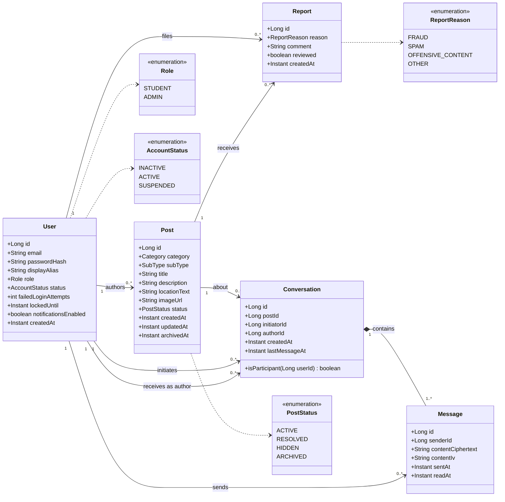
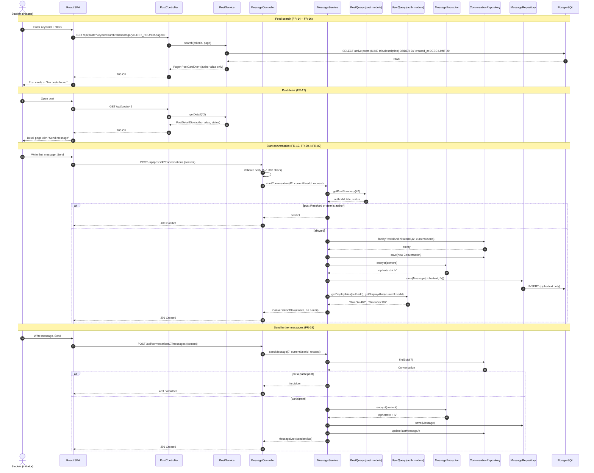
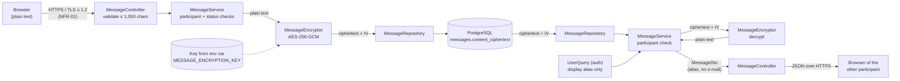

# UniHelp — Design Document

| | |
|---|---|
| **Course** | BIL 481 Software Engineering — Project Assignment 2 |
| **Project** | UniHelp — Campus Helping Platform |
| **Document** | Design Document |
| **Version** | 0.1 (draft) |
| **Due date** | 15-11-2026 |

## Contributors

<!-- TODO: Taha — finalize the contributors list (name, role, sections written) for the first page. -->

| Name | Role |
|---|---|
| Furkan Yılmaz | |
| Efe Deniz Kahvecioğlu | |
| Enis Talha Öztepe | |
| Muhammed Taha Kaya | |

## Table of Contents

<!-- TODO: Taha — finalize the table of contents after all sections are written. -->

1. [System Overview](#1-system-overview)
   1. [Description](#11-description)
   2. [Architecture](#12-architecture)
   3. [Technology Stack](#13-technology-stack)
   4. [UML Overview](#14-uml-overview)
2. [Implementation Details](#2-implementation-details)
   1. [Codebase Structure](#21-codebase-structure)
   2. [Key Implementations](#22-key-implementations)
   3. [Component Interfaces & API Endpoints](#23-component-interfaces--api-endpoints)
   4. [Visual Interfaces](#24-visual-interfaces)
3. [Use Case Support](#3-use-case-support)
   1. [Use Case Selection & Requirement Mapping](#31-use-case-selection--requirement-mapping)
   2. [UC1 Design — Register, verify & log in](#32-uc1-design--register-verify--log-in-with-university-e-mail)
   3. [UC2 Design — Create and manage a post](#33-uc2-design--create-and-manage-a-post)
   4. [UC3 Design — Search the feed and contact the author anonymously](#34-uc3-design--search-the-feed-and-contact-the-author-anonymously)
   5. [UC4 Design — Report a post, auto-hide and admin review](#35-uc4-design--report-a-post-auto-hide-and-admin-review)
4. [Design Decisions](#4-design-decisions)
   1. [Technology Comparisons](#41-technology-comparisons)
   2. [Justifications](#42-justifications)
5. [Repository Artifacts](#5-repository-artifacts)
6. [Task Matrix](#task-matrix)

---

## 1. System Overview

### 1.1 Description

<!-- TODO: Furkan -->

### 1.2 Architecture

<!-- TODO: Enis -->

### 1.3 Technology Stack

All technologies below were selected in the PA-1 documents (Project Definition §8, Project Plan §5). Versions are the ones used in the repository skeleton.

| Layer | Technology | Version | Purpose | Related requirements |
|---|---|---|---|---|
| Frontend | React.js | 18.3 | Single-page application, all views | NFR-06, NFR-07, NFR-08 |
| Frontend | Vite | 6.4 | Dev server and production build of the SPA | — |
| Frontend | Responsive UI component library | TBD (Taha) | Consistent responsive components (360–1920 px) | NFR-07 |
| Backend | Java | 21 (LTS) | Backend language | — |
| Backend | Spring Boot (Web, Validation) | 3.5 | REST API, request validation, layered monolith | NFR-10 |
| Backend | Spring Security | 6.x (managed by Spring Boot) | Authentication, access control, BCrypt password hashing | FR-01–FR-07, NFR-02, NFR-03 |
| Backend | Spring Data JPA / Hibernate | 3.5 / 6.6 | Repository layer and ORM | NFR-10 |
| Backend | Java Cryptography Architecture (AES-256-GCM) | JDK 21 | Encryption of message contents at rest | NFR-02 |
| Database | PostgreSQL | 16 | Relational data store | NFR-11 |
| Build | Maven / npm | 3.9 / 10 | Backend and frontend builds, dependency management | — |
| DevOps | Docker, Docker Compose | — | Identical local environment (PostgreSQL + backend), portable deployment | — |
| DevOps | GitHub Actions | — | CI: build and test on every pull request | NFR-10 |
| Hosting | Free-tier cloud hosting, managed PostgreSQL, SMTP e-mail service | Provider chosen in P2 | Production deployment over HTTPS, verification/notification e-mails | NFR-01, NFR-09, FR-03, FR-22 |
| Testing | JUnit 5, Mockito, Spring Boot Test, H2 / Testcontainers | — | Unit and integration tests | NFR-10 |
| Testing | JaCoCo | 0.8 | Service-layer coverage report (≥ 70 %) | NFR-10 |
| Testing | React Testing Library | — | Frontend component tests | — |
| Testing | Postman | — | API tests and shared API collection | NFR-04 |
| Testing | k6 / JMeter | — | Performance and load tests | NFR-05, NFR-11 |
| Testing | OWASP ZAP | — | Security baseline scan | NFR-03 |
| Testing | Lighthouse | — | Accessibility audit | NFR-07 |
| Design | Figma, Mermaid, draw.io | — | Wireframes and diagrams | — |
| Collaboration | GitHub (Issues, Projects, PRs) | — | Task tracking, code review, bug tracking | NFR-10 |

### 1.4 UML Overview

#### 1.4.1 Use Case Diagram

The diagram shows the four use cases designed in this document and the actors that take part in them. An Administrator has all Student rights (Requirements §2).


| Use case | Primary actor | Secondary actors | Requirements |
|---|---|---|---|
| UC1 | Guest (becomes Student) | E-mail service | FR-01 – FR-05 |
| UC2 | Student (author) | — | FR-09 – FR-13 |
| UC3 | Student (searcher / initiator) | Student (post author) | FR-14 – FR-17, FR-19, FR-20 |
| UC4 | Student (reporter) | Administrator | FR-25 – FR-28 |

#### 1.4.2 Class Diagram — Main Entities

Conceptual domain model of the main entities. Column-level details (types, indexes, constraints) are defined in the database schema / ER diagram (§1.2). In code, the `message` module refers to users and posts by id only, so it does not depend on the `auth`/`post` entities and never loads e-mail addresses.



Key rules captured by the model:

- `User.displayAlias` is unique and is the only identity shown to other users (FR-04, FR-20); `User.email` never leaves the `auth` module (NFR-04).
- `Report` is unique per (post, reporter) (FR-25); more than 3 unique reports set `Post.status = HIDDEN` (FR-26).
- `Conversation` is unique per (post, initiator), so a student has at most one conversation per post with its author (FR-19).
- `Message` stores only ciphertext and IV, never plain text (NFR-02).

---

## 2. Implementation Details

### 2.1 Codebase Structure

#### 2.1.1 Backend

<!-- TODO: Enis -->

#### 2.1.2 Frontend

<!-- TODO: Taha -->

### 2.2 Key Implementations

#### 2.2.1 `auth` module

<!-- TODO: Furkan -->

#### 2.2.2 `post` module

<!-- TODO: Enis -->

#### 2.2.3 `message` module

Package `com.unihelp.message` (owner: Efe). It follows the layered architecture (NFR-10): `MessageController` → `MessageService` → `ConversationRepository` / `MessageRepository`.

| Class | Layer | Responsibility |
|---|---|---|
| `Conversation` | Entity | Private conversation about one post between its author and one initiator. Unique on (`post_id`, `initiator_id`). `isParticipant(userId)` is the single access-control check (FR-19). |
| `Message` | Entity | One message. Stores `contentCiphertext` + `contentIv` (Base64), `senderId`, `sentAt`, `readAt` (null = unread, FR-21). |
| `ConversationRepository` | Repository | `findByPostIdAndInitiatorId` (reuse instead of duplicate), `findAllForParticipant` (newest activity first). |
| `MessageRepository` | Repository | `findByConversationIdOrderBySentAtAsc`, `findFirstByConversationIdOrderBySentAtDesc`, `countUnread`. |
| `MessageEncryptor` / `AesGcmMessageEncryptor` | Service helper | AES-256-GCM `encrypt` / `decrypt` of message contents (NFR-02). |
| `MessageService` / `MessageServiceImpl` | Service | Business rules: participant check, Resolved posts reject messages (FR-12), blocking (FR-24), alias-only DTO mapping (FR-20). |
| `MessageController` | Controller | REST endpoints (§2.3.3); validates request bodies with Bean Validation. |
| `dto.*` | DTO | Java records returned by the API. **No DTO has an e-mail field** (FR-20, NFR-04); this is checked by `MessageDtoPrivacyTest` (QA Plan TC-04). |

Implementation notes:

- **Dependencies on other modules.** The service needs the post's author, title and status, and the users' display aliases. It reads them through the `post` and `auth` module services (interfaces in §2.3.1 and §2.3.2); it never reads the `User` entity directly, so the e-mail address is never loaded into the messaging code path.
- **Encryption** is done in the service layer right before saving and right after loading; controllers and repositories only see DTOs or ciphertext. Details in §3.4.4.
- **Current status (PA-2):** entities and repositories are complete; `MessageServiceImpl`, `AesGcmMessageEncryptor` and the controller's current-user lookup are stubs that throw `UnsupportedOperationException`. They are implemented in Sprint 2 (task T3.6).

#### 2.2.4 `report` and `admin` modules

<!-- TODO: Furkan (report), Enis (admin) -->

### 2.3 Component Interfaces & API Endpoints

#### 2.3.1 `auth` module

<!-- TODO: Furkan -->

#### 2.3.2 `post` module

<!-- TODO: Enis -->

#### 2.3.3 `message` module

**Service interface** (`backend/src/main/java/com/unihelp/message/MessageService.java`):

```java
public interface MessageService {

    /** Starts (or reuses) a conversation with the post's author and stores the first message. */
    ConversationDto startConversation(Long postId, Long currentUserId, StartConversationRequest request);

    /** Lists the current user's conversations with the unread counter, newest activity first (FR-21). */
    List<ConversationSummaryDto> listConversations(Long currentUserId);

    /** Sends a text message (1 – 1,000 characters) into an existing conversation. */
    MessageDto sendMessage(Long conversationId, Long currentUserId, SendMessageRequest request);
}
```

```java
public interface MessageEncryptor {
    EncryptedContent encrypt(String plainText);
    String decrypt(EncryptedContent content);
    record EncryptedContent(String ciphertext, String iv) { }
}
```

**DTOs** (Java records in `com.unihelp.message.dto`):

| DTO | Fields |
|---|---|
| `StartConversationRequest` | `content` (required, ≤ 1,000 chars) |
| `SendMessageRequest` | `content` (required, ≤ 1,000 chars) |
| `ConversationDto` | `id`, `postId`, `postTitle`, `counterpartAlias`, `createdAt`, `firstMessage` |
| `ConversationSummaryDto` | `id`, `postId`, `postTitle`, `counterpartAlias`, `lastMessagePreview`, `lastMessageAt`, `unreadCount` |
| `MessageDto` | `id`, `conversationId`, `senderAlias`, `sentByMe`, `content`, `sentAt` |

**REST endpoints** (all require an authenticated Student; base path `/api`):

| Method & path | Description | Request body | Success | Errors |
|---|---|---|---|---|
| `POST /api/posts/{id}/conversations` | Start a conversation with the author of post `{id}` and send the first message. If the user already has a conversation for this post, the message is added to it. | `StartConversationRequest` | `201 Created` + `ConversationDto` | `400` invalid content · `404` post not found / not visible · `409` post is Resolved or user is the author · `403` user is blocked by the author (FR-24) |
| `GET /api/conversations` | List the current user's conversations, newest activity first, with unread counter. | — | `200 OK` + `ConversationSummaryDto[]` | `401` not logged in |
| `POST /api/conversations/{id}/messages` | Send a message into conversation `{id}`. | `SendMessageRequest` | `201 Created` + `MessageDto` | `400` invalid content · `403` not a participant or blocked · `404` conversation not found · `409` post is Resolved |

Example — `POST /api/posts/42/conversations`:

```json
// request
{ "content": "Hi, I think I found your blue umbrella in the library." }

// 201 Created
{
  "id": 7,
  "postId": 42,
  "postTitle": "Lost blue umbrella",
  "counterpartAlias": "BlueOwl482",
  "createdAt": "2026-11-20T10:15:00Z",
  "firstMessage": {
    "id": 31,
    "conversationId": 7,
    "senderAlias": "GreenFox107",
    "sentByMe": true,
    "content": "Hi, I think I found your blue umbrella in the library.",
    "sentAt": "2026-11-20T10:15:00Z"
  }
}
```

#### 2.3.4 `report` and `admin` modules

<!-- TODO: Furkan (report), Enis (admin) -->

### 2.4 Visual Interfaces

<!-- TODO: Taha — wireframes are stored in docs/design/wireframes/ -->

---

## 3. Use Case Support

### 3.1 Use Case Selection & Requirement Mapping

<!-- TODO: Taha -->

### 3.2 UC1 Design — Register, verify & log in with university e-mail

<!-- TODO: Furkan (FR-01 – FR-05) -->

### 3.3 UC2 Design — Create and manage a post

<!-- TODO: Enis (FR-09 – FR-13) -->

### 3.4 UC3 Design — Search the feed and contact the author anonymously

**Requirements:** FR-14, FR-15, FR-16, FR-17, FR-19, FR-20 · NFR-01, NFR-02, NFR-04
**Primary actor:** Student (initiator) · **Secondary actor:** Student (post author)
**Modules:** `post` (feed, search, detail — Enis), `message` (conversations, messages — Efe), `auth` (current user, display aliases — Furkan)

#### 3.4.1 Scenario

1. The student opens the feed; active posts are shown newest first, 20 per page (FR-14).
2. The student enters a keyword and optional filters (category, sub-type, date range, status) (FR-15, FR-16). If nothing matches, “No posts found” is shown.
3. The student opens a post detail page with the full description, image, location and a **Send message** button (FR-17). The author is shown by display alias only.
4. The student writes a first message and presses **Send**. A private conversation between the student and the author is created (FR-19).
5. Both participants exchange messages (up to 1,000 characters each). Only the two participants can read the conversation; both see only each other's display alias (FR-20).

**Alternative flows**

- 3a. The post is Resolved: the **Send message** button is disabled; the API rejects new messages with `409` (FR-12).
- 4a. The student already has a conversation for this post: the message is added to the existing conversation instead of creating a new one.
- 4b. The student is the author of the post: the button is not shown; the API returns `409`.
- 5a. A user who is not a participant calls `POST /api/conversations/{id}/messages`: `403 Forbidden`.

#### 3.4.2 Sequence Diagram

The feed and post endpoints belong to the `post` module (Enis, §2.3.2); their exact paths may change there. `PostQuery` / `UserQuery` stand for the read operations the `message` module needs from the `post` and `auth` modules.



#### 3.4.3 Data Flow



- Plain text exists only in memory (request → service → encryptor, and decryptor → DTO → response). It is never written to the database or to logs.
- The data that leaves the server about another user is limited to the display alias (FR-20).

#### 3.4.4 Privacy and Security Design

**E-mail privacy — alias-only responses (FR-20, NFR-04)**

| Measure | How it is enforced |
|---|---|
| No e-mail field in any messaging DTO | DTOs are explicit Java records with alias fields only (§2.3.3). Entities are never serialized directly. |
| E-mail never loaded in the messaging path | `Conversation` / `Message` store user ids only; the service gets aliases through `UserQuery.getDisplayAlias(id)`, which returns a `String` alias and nothing else. |
| Same rule for feed and detail responses | Post cards and detail pages show the author's alias only (FR-14, FR-17) — `post` module DTOs (Enis). |
| Verified by tests | `MessageDtoPrivacyTest` (unit, already in CI) and QA Plan **TC-04** (API test: no `@` e-mail pattern or `email` key in any conversation/message response). |

The system never adds e-mail or other contact information to messages. Content typed by the users themselves is not scanned in v1.0.

**Access control (FR-19)** — every read and write checks `Conversation.isParticipant(currentUserId)`; other users get `403 Forbidden`. The current user id comes from the authenticated session (UC1), never from the request body.

**Encryption at rest (NFR-02)**

| Aspect | Decision |
|---|---|
| Algorithm | AES-256 in GCM mode (`AES/GCM/NoPadding`, JDK 21 JCA) — confidentiality and integrity (tampered ciphertext fails to decrypt). |
| Key | 256-bit key, Base64, read from the `MESSAGE_ENCRYPTION_KEY` environment variable at startup; not stored in the database or in Git. The application fails to start if the key is missing or not 32 bytes. |
| IV | 12 random bytes from `SecureRandom` for every message, stored in `messages.content_iv`. |
| Tag | 128-bit authentication tag, appended to the ciphertext. |
| Stored columns | `content_ciphertext` (Base64), `content_iv` (Base64). No plain-text column exists. |
| Where | Encrypt/decrypt only inside `MessageService` via `MessageEncryptor`; controllers and repositories never see plain text together with the key. |
| In transit | HTTPS (TLS ≥ 1.2) between browser and server (NFR-01). |

### 3.5 UC4 Design — Report a post, auto-hide and admin review

<!-- TODO: Furkan (FR-25 – FR-28) -->

---

## 4. Design Decisions

### 4.1 Technology Comparisons

<!-- TODO: team — comparison code snippets are stored in docs/design/tech-comparison/ -->

### 4.2 Justifications

<!-- TODO: team -->

---

## 5. Repository Artifacts

<!-- TODO: team — list the committed artifacts (code skeleton, interfaces, wireframes, comparison snippets) with paths. -->

---

## Task Matrix

R = Responsible (wrote the section), C = Contributed / reviewed.

| Section / task | Furkan Yılmaz | Efe Deniz Kahvecioğlu | Enis Talha Öztepe | Muhammed Taha Kaya |
|---|:-:|:-:|:-:|:-:|
| Document skeleton and structure | | R | | |
| Contributors list and Table of Contents | | | | |
| 1.1 Description | | | | |
| 1.2 Architecture | | | | |
| 1.3 Technology Stack | | R | | |
| 1.4 UML Overview (use case and class diagrams) | | R | | |
| 2.1 Codebase Structure — backend | | | | |
| 2.1 Codebase Structure — frontend | | | | |
| 2.2 / 2.3 `auth` module | | | | |
| 2.2 / 2.3 `post` module | | | | |
| 2.2 / 2.3 `message` module | | R | | |
| 2.2 / 2.3 `report` and `admin` modules | | | | |
| 2.4 Visual Interfaces (wireframes) | | | | |
| 3.1 Use Case Selection & Requirement Mapping | | | | |
| 3.2 UC1 Design | | | | |
| 3.3 UC2 Design | | | | |
| 3.4 UC3 Design | | R | | |
| 3.5 UC4 Design | | | | |
| 4.1 Technology Comparisons | | | | |
| 4.2 Justifications | | | | |
| 5 Repository Artifacts | | | | |
| Code: repository skeleton, Docker Compose, CI | | R | | |
| Code: `message` module interfaces and stubs | | R | | |
