# UniHelp — Design Document

| | |
|---|---|
| **Course** | BIL 481 Software Engineering — Project Assignment 2 |
| **Project** | UniHelp — Campus Helping Platform |
| **Document** | Design Document |
| **Version** | 1.0 (Final) |
| **Due date** | 15-11-2026 |

## Contributors

| Name | Role | GitHub | Sections Written |
|---|---|---|---|
| Furkan Yılmaz | Project Manager, Backend Developer (Authentication, Security, Reporting, Notifications) | `@furylmz` | §§1.1, 2.2.1, 2.2.4, 2.3.1, 2.3.4, 3.2, 3.5, 4.1.3, 4.2, 5 |
| Efe Deniz Kahvecioğlu | QA / Test Lead, DevOps Engineer, Backend Developer (Messaging, Data Lifecycle) | `@efed3n1z` | §§1.3, 1.4, 2.2.3, 2.3.3, 3.4 |
| Enis Talha Öztepe | Software Architect, Backend Developer (Posts, Search, Admin, Database) | `@enisoztepe` | §§1.2, 2.1.1, 2.2.2, 2.2.4, 2.3.2, 2.3.4, 3.3, 4.1.1, 4.1.2, 4.2, 5 |
| Muhammed Taha Kaya | Requirements Analyst, UI/UX Designer, Frontend Developer | `@mt-kaya` | §§2.1.2, 2.3.5, 2.4, 3.1, 4.1.4, 4.2, 5, Wireframes, ToC & Final Review |

## Table of Contents

1. [System Overview](#1-system-overview)
   1. [Description](#11-description)
   2. [Architecture](#12-architecture)
   3. [Technology Stack](#13-technology-stack)
   4. [UML Overview](#14-uml-overview)
2. [Implementation Details](#2-implementation-details)
   1. [Codebase Structure](#21-codebase-structure)
   2. [Key Implementations](#22-key-implementations)
   3. [Component Interfaces & API Endpoints](#23-component-interfaces--api-endpoints)
   4. [Visual Interfaces](#24-visual-interfaces)
3. [Use Case Support](#3-use-case-support)
   1. [Use Case Selection & Requirement Mapping](#31-use-case-selection--requirement-mapping)
   2. [UC1 Design — Register, verify & log in](#32-uc1-design--register-verify--log-in-with-university-e-mail)
   3. [UC2 Design — Create and manage a post](#33-uc2-design--create-and-manage-a-post)
   4. [UC3 Design — Search the feed and contact the author anonymously](#34-uc3-design--search-the-feed-and-contact-the-author-anonymously)
   5. [UC4 Design — Report a post, auto-hide and admin review](#35-uc4-design--report-a-post-auto-hide-and-admin-review)
4. [Design Decisions](#4-design-decisions)
   1. [Technology Comparisons](#41-technology-comparisons)
   2. [Justifications](#42-justifications)
5. [Repository Artifacts](#5-repository-artifacts)
6. [Task Matrix](#task-matrix)

---

## 1. System Overview

### 1.1 Description

UniHelp is a responsive web application where students of one university campus help each other with two everyday problems: **lost and found** items, and **student cooperation** such as lending or borrowing books and finding a roommate. Lost-item announcements are scattered across WhatsApp groups, social-media pages and notice boards today, and students who want to cooperate have no trusted channel that is limited to their campus. UniHelp puts both needs in one searchable feed. Students create posts with a category, a sub-type, a description and an optional image. Other students search and filter the feed, and contact the author through private in-app messages. When the problem is solved, the author marks the post as Resolved (PA-1 Project Definition §2, §6).

Trust and privacy shape the design. Only students with a verified university e-mail address (initially `@etu.edu.tr`) can register. Every user is shown under an automatically generated display alias, and e-mail addresses are never visible to other users. Passwords are stored as BCrypt hashes and message contents are encrypted at rest. A community reporting mechanism automatically hides a post after more than three unique reports and sends it to administrators, who can restore or remove posts and suspend accounts. Inactive posts are archived after 30 days and deleted six months after archiving. The system is a single Spring Boot monolith with a PostgreSQL database and a React single-page application, built by a team of four within the Fall 2026 semester for one campus (PA-1 Project Definition §3–§4).

### 1.2 Architecture

UniHelp is a **layered monolith**: one Spring Boot application and one PostgreSQL database serve a React SPA. This follows the PA-1 Project Definition §4 and Requirements NFR-10. Feature packages contain controller, service and repository layers; calls flow down these layers, while cross-module operations use service/query interfaces rather than another module's controller or private entities.

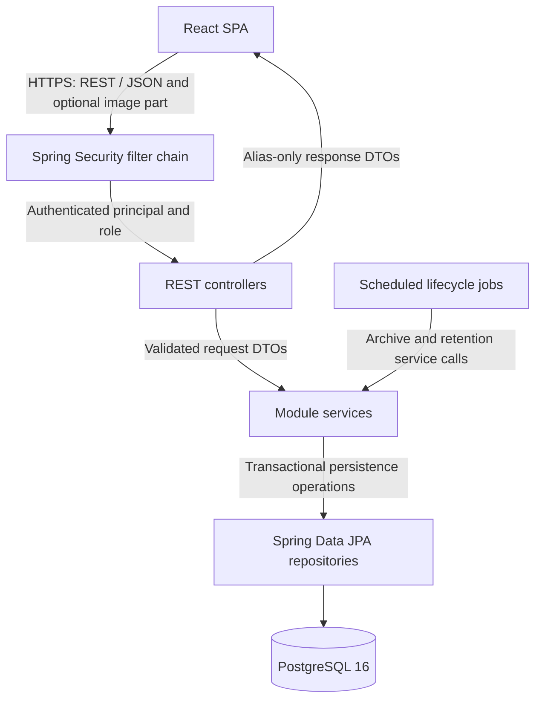

| Boundary | Responsibility / rule |
|---|---|
| SPA → API | JSON responses over HTTPS. Post writes use multipart form data containing a JSON `post` part and at most one optional `image` part. The SPA renders text as text, not executable HTML. |
| Security → controller | Spring Security authenticates the session and applies verified/active-account and ADMIN-role checks. User ids come from the security context, never from user-supplied author fields. Session/CSRF configuration belongs to `auth` (Furkan). |
| Controller → service | Request validation and HTTP mapping. Business authorization, sanitization and state rules stay in services, so scheduled and module calls cannot bypass them. |
| Service → repository | A transaction covers each logical change. Repository queries use bound parameters/specifications; no SQL is built by concatenating user input. Entities never become API responses. |
| Module → module | `PostQuery.getPostSummary(id)` supplies internal author id/title/status to messaging; `UserQuery.getDisplayAlias(id)` supplies aliases from auth. No public DTO contains another user's account id or e-mail. |
| Scheduler → service | At least daily, archive posts after 30 days without update or new message (FR-30); delete archived data after 6 months (FR-31). The jobs run inside the same monolith, owned by Efe. |

**PA-2 status:** this is the target architecture. The current skeleton wires MVC/JPA and module stubs. Security filters, business transactions, upload storage and scheduled jobs are implemented in the planned sprints, not claimed as working by this assignment.

#### 1.2.1 Database / ER Design

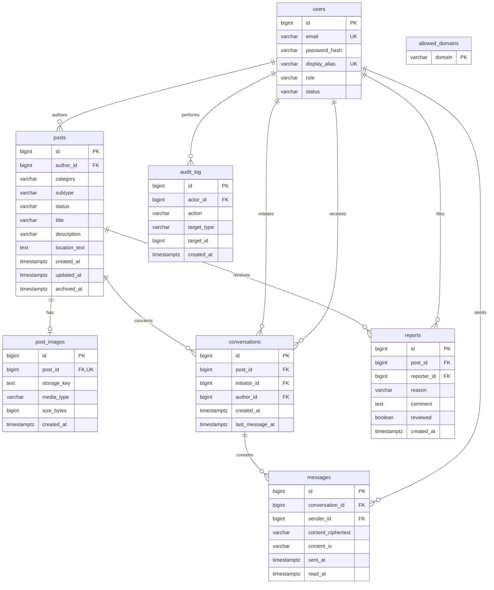

`allowed_domains` is a configuration lookup, checked during registration; it has no direct FK to users because the stored e-mail address includes the local part. The database design below is the contract for subsequent module implementations. Only `posts` and `post_images` are added by Enis's PA-2 code; existing conversation/message mappings remain Efe's. Logical cross-module FKs must be installed with the complete schema when `users`/`reports` are implemented; scalar ids alone in JPA do not enforce them.

| Table | Columns and PostgreSQL types | Keys and constraints |
|---|---|---|
| `users` | `id BIGINT`, `email VARCHAR(254)`, `password_hash VARCHAR(255)`, `display_alias VARCHAR(64)`, `role VARCHAR(16)`, `status VARCHAR(16)`, `failed_login_attempts INTEGER`, `locked_until TIMESTAMPTZ NULL`, `notifications_enabled BOOLEAN`, `created_at TIMESTAMPTZ` | Identity PK `id`; unique normalized `email` and `display_alias`; role STUDENT/ADMIN; status INACTIVE/ACTIVE/SUSPENDED; failed attempts ≥ 0. Real accounts require e-mail/hash/alias. The reserved anonymized record has no credentials or public identity (FR-08). Token/session persistence details belong to auth. |
| `posts` | `id BIGINT`, `author_id BIGINT`, `category VARCHAR(32)`, `subtype VARCHAR(16)`, `title VARCHAR(100)`, `description VARCHAR(2000)`, `location_text TEXT NULL`, `status VARCHAR(16)`, `created_at TIMESTAMPTZ`, `updated_at TIMESTAMPTZ`, `archived_at TIMESTAMPTZ NULL` | Identity PK; author FK → users; all except location/archive time NOT NULL. CHECK title length 5–100; description length ≤ 2,000. Category/subtype and status checks below. Archive timestamp is set when archived. |
| `post_images` | `id BIGINT`, `post_id BIGINT`, `storage_key TEXT`, `media_type VARCHAR(16)`, `size_bytes BIGINT`, `created_at TIMESTAMPTZ` | Identity PK; all NOT NULL; FK → posts ON DELETE CASCADE; **UNIQUE(post_id)** enforces one image in v1.0. CHECK media type IN ('image/jpeg','image/png'), size > 0 and ≤ 5,000,000 bytes (5 MB). File signature/type also checked in service. |
| `conversations` | `id BIGINT`, `post_id BIGINT`, `initiator_id BIGINT`, `author_id BIGINT`, `created_at TIMESTAMPTZ`, `last_message_at TIMESTAMPTZ` | Identity PK; all NOT NULL; post FK ON DELETE CASCADE; participant FKs → users; UNIQUE(post_id, initiator_id); CHECK initiator_id <> author_id. Service checks author_id equals post author. |
| `messages` | `id BIGINT`, `conversation_id BIGINT`, `sender_id BIGINT`, `content_ciphertext VARCHAR(4096)`, `content_iv VARCHAR(32)`, `sent_at TIMESTAMPTZ`, `read_at TIMESTAMPTZ NULL` | Identity PK; all except read_at NOT NULL; conversation FK ON DELETE CASCADE; sender FK → users. Only encrypted content and IV are stored; service checks sender participation. |
| `reports` | `id BIGINT`, `post_id BIGINT`, `reporter_id BIGINT`, `reason VARCHAR(32)`, `comment TEXT NULL`, `reviewed BOOLEAN DEFAULT FALSE`, `created_at TIMESTAMPTZ` | Identity PK; all except comment NOT NULL; post FK ON DELETE CASCADE; reporter FK → users; **UNIQUE(post_id, reporter_id)**; reason FRAUD/SPAM/OFFENSIVE_CONTENT/OTHER. |
| `allowed_domains` | `domain VARCHAR(253)` | PK `domain`, NOT NULL, normalized lowercase hostname without `@`; initially `etu.edu.tr`. Admin-managed allowlist (FR-01). |
| `audit_log` | `id BIGINT`, `actor_id BIGINT`, `action VARCHAR(64)`, `target_type VARCHAR(32)`, `target_id BIGINT`, `created_at TIMESTAMPTZ` | Identity PK; all NOT NULL; actor FK → users. `target_id` is an audit reference, not a cascading FK, so permanent removal does not remove evidence. Store who/what/when, without e-mail or post/message content (FR-29, Could). |

Planned database constraints for the post domain (in addition to NOT NULL/FKs):

```sql
CHECK (category IN ('LOST_FOUND', 'STUDENT_COOPERATION'))
CHECK ((category = 'LOST_FOUND' AND subtype IN ('LOST', 'FOUND'))
    OR (category = 'STUDENT_COOPERATION' AND subtype IN ('BOOK', 'ROOMMATE', 'OTHER')))
CHECK (status IN ('ACTIVE', 'RESOLVED', 'HIDDEN', 'ARCHIVED'))
CHECK ((status = 'ARCHIVED' AND archived_at IS NOT NULL)
    OR (status <> 'ARCHIVED' AND archived_at IS NULL))
```

- Index `posts(status, created_at DESC, id DESC)` supports the default feed; `posts(author_id)` supports My Posts. Evaluate `(status, category, subtype, created_at DESC)` for combined filters against the actual load workload before adding it.
- Index `messages(conversation_id, sent_at)` supports ordered conversation reads; index conversation participant/activity columns and report post/review columns for their module queries.
- FR-15 uses a case-insensitive **substring** of title OR description. Ordinary B-tree indexes do not make leading-wildcard searches efficient; the QA load test decides whether query/index tuning is necessary. No unplanned search engine is introduced.
- For FR-26, report insert, count of distinct reporters and status change are atomic under a post-row lock. The unique report constraint protects against duplicate/concurrent reports. The fourth unique report hides a post, not the third; admin restoration marks reports reviewed in the same transaction (Furkan's UC4 design completes the review workflow).
- Hard deletion of a post removes image metadata, conversations/messages and reports; image storage cleanup is coordinated by the deletion service. FR-31 runs this cleanup six months after archiving. FR-08 first reassigns references to the reserved anonymized user; any uniqueness collisions from collapsing reporter/initiator ids must be reconciled in that transaction before deleting the account. Efe owns the anonymization implementation; no identifying data is copied into audit records.
- The conceptual `Post.imageUrl` in §1.4 is a read-model convenience: physical image metadata is in `post_images`; the detail DTO derives one URL from it. Constraints listed as planned are not presented as database migrations already applied by this skeleton.

### 1.3 Technology Stack

All technologies below were selected in the PA-1 documents (Project Definition §8, Project Plan §5). Versions are the ones used in the repository skeleton.

| Layer | Technology | Version | Purpose | Related requirements |
|---|---|---|---|---|
| Frontend | React.js | 18.3 | Single-page application, all views | NFR-06, NFR-07, NFR-08 |
| Frontend | Vite | 6.4 | Dev server and production build of the SPA | — |
| Frontend | React Router + Custom CSS (Grid / Flexbox) | — | Client-side SPA routing and consistent responsive layout (360–1920 px) | NFR-07 |
| Backend | Java | 21 (LTS) | Backend language | — |
| Backend | Spring Boot (Web, Validation) | 3.5 | REST API, request validation, layered monolith | NFR-10 |
| Backend | Spring Security | 6.x (managed by Spring Boot) | Authentication, access control, BCrypt password hashing | FR-01–FR-07, NFR-02, NFR-03 |
| Backend | Spring Data JPA / Hibernate | 3.5 / 6.6 | Repository layer and ORM | NFR-10 |
| Backend | Java Cryptography Architecture (AES-256-GCM) | JDK 21 | Encryption of message contents at rest | NFR-02 |
| Database | PostgreSQL | 16 | Relational data store | NFR-11 |
| Build | Maven / npm | 3.9 / 10 | Backend and frontend builds, dependency management | — |
| DevOps | Docker, Docker Compose | — | Identical local environment (PostgreSQL + backend), portable deployment | — |
| DevOps | GitHub Actions | — | CI: build and test on every pull request | NFR-10 |
| Hosting | Free-tier cloud hosting, managed PostgreSQL, SMTP e-mail service | Provider chosen in P2 | Production deployment over HTTPS, verification/notification e-mails | NFR-01, NFR-09, FR-03, FR-22 |
| Testing | JUnit 5, Mockito, Spring Boot Test, H2 / Testcontainers | — | Unit and integration tests | NFR-10 |
| Testing | JaCoCo | 0.8 | Service-layer coverage report (≥ 70 %) | NFR-10 |
| Testing | React Testing Library | — | Frontend component tests | — |
| Testing | Postman | — | API tests and shared API collection | NFR-04 |
| Testing | k6 / JMeter | — | Performance and load tests | NFR-05, NFR-11 |
| Testing | OWASP ZAP | — | Security baseline scan | NFR-03 |
| Testing | Lighthouse | — | Accessibility audit | NFR-07 |
| Design | Figma, Mermaid, draw.io | — | Wireframes and diagrams | — |
| Collaboration | GitHub (Issues, Projects, PRs) | — | Task tracking, code review, bug tracking | NFR-10 |

### 1.4 UML Overview

#### 1.4.1 Use Case Diagram

The diagram shows the four use cases designed in this document and the actors that take part in them. An Administrator has all Student rights (Requirements §2).

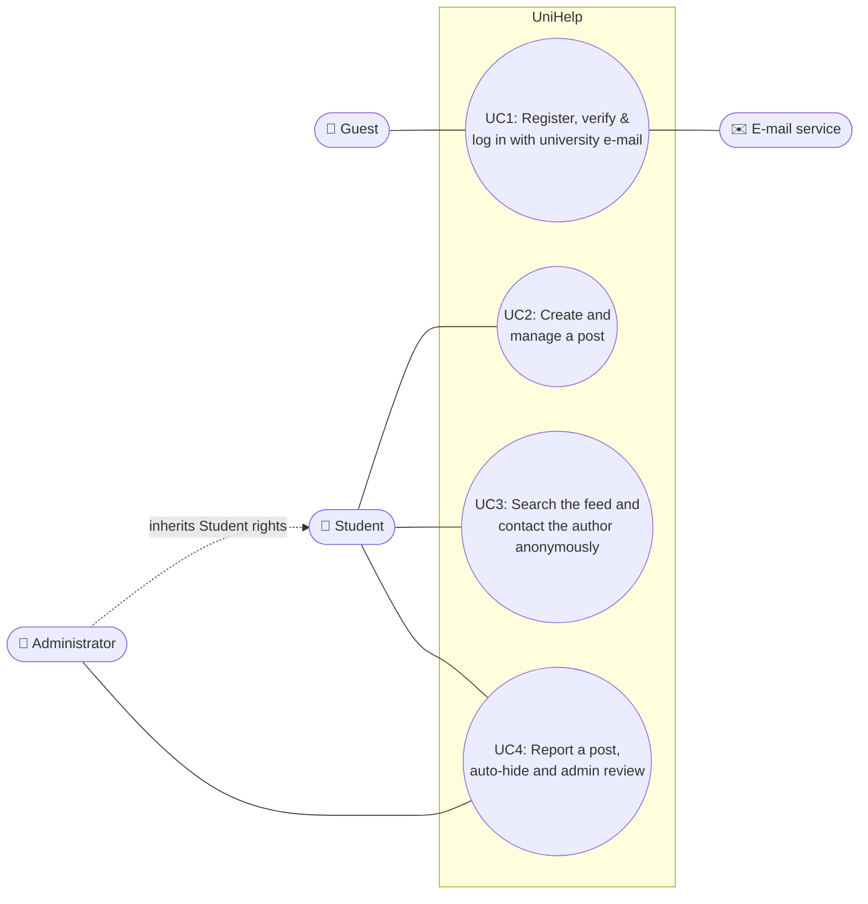

| Use case | Primary actor | Secondary actors | Requirements |
|---|---|---|---|
| UC1 | Guest (becomes Student) | E-mail service | FR-01 – FR-05 |
| UC2 | Student (author) | — | FR-09 – FR-13 |
| UC3 | Student (searcher / initiator) | Student (post author) | FR-14 – FR-17, FR-19, FR-20 |
| UC4 | Student (reporter) | Administrator | FR-25 – FR-28 |

#### 1.4.2 Class Diagram — Main Entities

Conceptual domain model of the main entities. Column-level details (types, indexes, constraints) are defined in the database schema / ER diagram (§1.2). In code, the `message` module refers to users and posts by id only, so it does not depend on the `auth`/`post` entities and never loads e-mail addresses.

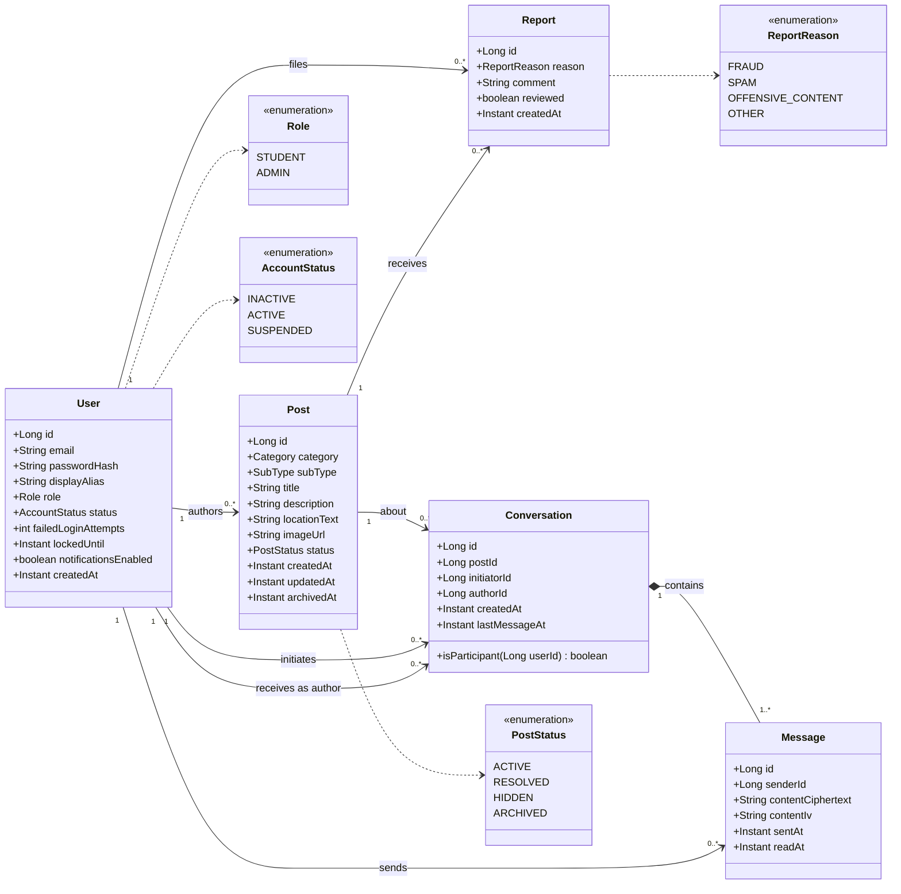

Key rules captured by the model:

- `User.displayAlias` is unique and is the only identity shown to other users (FR-04, FR-20); `User.email` never leaves the `auth` module (NFR-04).
- `Report` is unique per (post, reporter) (FR-25); more than 3 unique reports set `Post.status = HIDDEN` (FR-26).
- `Conversation` is unique per (post, initiator), so a student has at most one conversation per post with its author (FR-19).
- `Message` stores only ciphertext and IV, never plain text (NFR-02).

---

## 2. Implementation Details

### 2.1 Codebase Structure

#### 2.1.1 Backend

Source root: `backend/src/main/java/com/unihelp/`. Java 21, Maven and Spring Boot form one deployable application. Packages are grouped by feature, with layers inside each package.

```text
com.unihelp/
    UniHelpApplication.java
    auth/                 authentication, security, user/alias queries
    post/
        Post.java, PostImage.java
        PostCategory.java, PostSubtype.java, PostStatus.java
        PostRepository.java
        PostQuery.java, PostService.java, PostServiceImpl.java
        PostController.java
        dto/
            PostWriteRequest.java, PostSearchCriteria.java
            PostCardDto.java, PostDetailDto.java
    message/              conversations, messages, encryption, DTOs
    report/               reports and automatic hiding
    admin/                moderation decisions and audit records
    lifecycle/            scheduled archiving, retention, anonymization
    common/               shared configuration and error mapping
```

| Module / path | Responsibility | Owner / implementation status |
|---|---|---|
| `auth` | University allowlist, registration/verification/login, session and role checks; expose current-user id and alias-only queries | Furkan; `User` entity, enums, repository, `AuthService`/`UserQuery` interfaces, DTOs and controller/service stubs (§2.2.1) |
| `post` | Post CRUD, owner checks, resolve, sanitization, image metadata, feed/search/filter contracts | Enis; entities/enums, repository, DTOs, query/service interfaces and controller/service stubs |
| `message` | Private post-linked conversations, participant checks, encrypted messages, alias-only responses | Efe; entities/repositories and interfaces, implementation stubs |
| `report` | Unique reports, threshold detection and hidden-post alert workflow | Furkan; `Report` entity, repository, `ReportService` interface, DTOs and controller/service stubs (§2.2.4) |
| `admin` | ADMIN-only report review, restore/remove, suspend/unsuspend and audit log | Enis; package placeholder, design contract in §2.2.4/§2.3.4 |
| `lifecycle` | FR-08 anonymization and daily FR-30/31 retention work through service boundaries | Efe; package placeholder |
| `common` | Shared configuration and consistent HTTP error responses; no business ownership decisions | Shared; package placeholder |
| `backend/src/main/resources/application.yml` | Environment-based PostgreSQL connection and application settings | Existing skeleton |
| `backend/src/test/` | Context test with H2 in PostgreSQL mode and contract/privacy tests | Efe's baseline plus module tests as implemented |
| `backend/pom.xml`, `backend/Dockerfile` | Dependency/build/coverage setup and container build | Efe's baseline |

Controllers depend on services, services on repository interfaces; no frontend code is stored in the backend. `docs/design/tech-comparison/` deliberately sits outside Maven source roots: rejected MongoDB examples cannot become runtime dependencies.

#### 2.1.2 Frontend

Source root: `frontend/`. React 18.3 and Vite 6.4 form a standalone single-page application separated from the Spring Boot source tree. During local development (`vite.config.js`), `/api` calls are proxied to `http://localhost:8080`.

```text
frontend/
    index.html
    package.json
    vite.config.js
    src/
        main.jsx              BrowserRouter and root mount
        App.jsx               responsive navigation shell and route table
        styles.css            360–1920 px responsive Grid/Flexbox and focus styles (NFR-07)
        api/
            unihelpApi.js     typed fetch wrappers for all §2.3 REST endpoints
        components/
            PostCard.jsx      reusable alias-only feed card (FR-14, NFR-04)
            ReportDialog.jsx  accessible modal dialog for post reporting (FR-25)
        pages/
            LoginPage.jsx         university e-mail sign-in and lockout feedback (UC1)
            RegisterPage.jsx      campus registration and 24 h token verification (UC1)
            FeedPage.jsx          keyword search, combined filters, pagination (UC3)
            PostDetailPage.jsx    post detail, author actions, first message box (UC2, UC3)
            PostFormPage.jsx      create/edit post form with 5 MB image check (UC2)
            ConversationPage.jsx  inbox list and private alias-only message thread (UC3)
            AdminReportsPage.jsx  reported/auto-hidden queue and suspension controls (UC4)
```

| Path | Responsibility | Related requirements | PA-2 status |
|---|---|---|---|
| `src/api/unihelpApi.js` | Central HTTP client sending `credentials: 'include'`, echoing `XSRF-TOKEN` as `X-XSRF-TOKEN`, building multipart `post` + `image` payloads, and parsing RFC 9457 `detail` errors | FR-01–FR-05, FR-07, FR-09–FR-17, FR-19–FR-21, FR-25–FR-28, NFR-04 | Committed signatures; verified with `npm run build` |
| `src/pages/*` | Route-level views for authentication, post CRUD/resolve, feed search/filtering, anonymous messaging and admin moderation | UC1–UC4, FR-01–FR-28, NFR-06, NFR-07 | Committed page skeletons (`T3.3`, `T3.8`, `T3.12` add full state flows) |
| `src/components/*` | Shared `PostCard` and accessible `ReportDialog` (`role="dialog"`, `aria-modal="true"`) rendering plain escaped text only | FR-13, FR-14, FR-25, NFR-03, NFR-04, NFR-07 | Committed component skeletons |
| `src/App.jsx`, `src/styles.css` | Top navigation bar, `react-router-dom` route declarations, mobile-first `360 px` to `1920 px` responsive breakpoints and keyboard `:focus-visible` outlines | NFR-06, NFR-07, NFR-08 | Committed and production-bundled |

### 2.2 Key Implementations

#### 2.2.1 `auth` module

Package `com.unihelp.auth` (owner: Furkan). `AuthController` → `AuthService` → `UserRepository`. Spring Security (filter chain, session, CSRF, role checks) wraps every other module's controllers, as described in §1.2. The selected session approach is explained in §4.1.3.

| Component | Design / key rule | Requirement |
|---|---|---|
| `User`, `Role`, `AccountStatus` | Fields `email`, `passwordHash`, `displayAlias`, `role`, `status`, `failedAttempts` (column `failed_login_attempts`), `lockedUntil`, `notificationsEnabled`, `createdAt`. New accounts are STUDENT + PENDING. Never serialized. | FR-01–FR-05, FR-28 |
| `UserRepository` | `findByEmail`, `existsByEmail`, `existsByDisplayAlias`; e-mail is stored normalized (trimmed, lower-case) so the unique index is case-insensitive in practice. | FR-02, FR-04 |
| `AuthService` | register / verify / login / own account / suspension contract; extends `UserQuery`. | FR-01–FR-05, FR-28 |
| `UserQuery` | `getDisplayAlias(userId)` returns only a `String` alias. It is the only way the post, message, report and admin modules read user identity. | FR-04, FR-20, NFR-04 |
| DTOs | `RegisterRequest`, `LoginRequest`, `MessageResponse`, `AccountDto`. **Only `AccountDto` contains an e-mail address, and it is returned only as the caller's own profile** (login response). | NFR-04 |

**Core logic (T3.1):**

1. **Domain whitelist (FR-01).** The e-mail is trimmed and lower-cased; the part after the last `@` must be **exactly equal** to a row in `allowed_domains` (initially `etu.edu.tr`). Suffix matching is not used, so `etu.edu.tr.example.com` or `mail.etu.edu.tr` are rejected unless an administrator adds them. On rejection the service returns 400 with *"A verified university e-mail address is required"* **before** any repository write, so no user record exists.
2. **Password policy and BCrypt (FR-02, NFR-02).** Bean Validation on `RegisterRequest` enforces 8–72 characters with at least one uppercase letter and one digit (72 bytes is the BCrypt input limit). The password is hashed with Spring Security's `BCryptPasswordEncoder` (strength 12, random salt inside the hash). Plain passwords are never stored, logged or returned. A duplicate e-mail returns 409.
3. **Verification token, 24 hours (FR-03).** After the user row is saved as PENDING, the service creates 32 random bytes from `SecureRandom`, encodes them URL-safe Base64 for the link and stores only their **SHA-256 hash** with `expires_at = now + 24 h` and `used_at = null` in a `verification_tokens(id, user_id FK, token_hash UNIQUE, expires_at, used_at)` table. The mail with `…/verify?token=<raw>` is sent after the transaction commits. `verify` hashes the input, finds the row, rejects used (400) or expired (410) tokens, then sets `used_at` and the account to ACTIVE in one transaction. If a registration arrives for an e-mail that belongs only to a PENDING account with an expired token, that account is replaced, so a student who missed the link is not blocked forever.
4. **Alias generation (FR-04).** `adjective + animal + 3-digit number` from fixed English word lists with `SecureRandom` (e.g. `BlueOwl482`); never derived from the e-mail. The service retries while `existsByDisplayAlias` is true (at most 10 times, then a 4-digit number). The UNIQUE constraint on `display_alias` is the final guard: a rare race causes a retry, not a duplicate.
5. **Lockout, 5 failures → 15 minutes (FR-05).** Login loads the user by normalized e-mail and checks in this order: unknown e-mail → 401 with a generic *"Invalid e-mail or password"* (a dummy BCrypt check keeps timing similar); PENDING → 403 *"Please verify your e-mail address first"*; SUSPENDED → 403 *"Your account is suspended"* (FR-28); LOCKED with `lockedUntil > now` → 423, **even with the correct password**; LOCKED with an expired lock → back to ACTIVE with `failedAttempts = 0`, then continue. A wrong password increments `failedAttempts` and returns 401; the 5th consecutive failure sets LOCKED and `lockedUntil = now + 15 min` and returns 423, so the user learns about the lock. A correct password resets `failedAttempts` to 0. The counter update runs in its own transaction with a row lock, so parallel attempts cannot skip the limit.
6. **Session (FR-05, FR-07).** On success the controller stores the Spring Security context in a **new** server-side session (id rotated against session fixation), sent as an HttpOnly, Secure, SameSite=Lax cookie; the idle timeout is 60 minutes. Logout deletes the session. State-changing requests need a CSRF token. The authenticated user id and role come only from this session, never from request bodies.

**Status names.** `AccountStatus` is `PENDING, ACTIVE, LOCKED, SUSPENDED` in code. PENDING is the "inactive until verified" state of FR-03, so the value `INACTIVE` in §1.2.1 / §1.4.2 means the same state; LOCKED is the temporary FR-05 state that the earlier diagrams did not list.

**PA-2 status:** entity, enums, repository, interfaces, DTOs and wiring are committed; `AuthServiceImpl` and the logout endpoint return **501 Not Implemented**. Spring Security, the allow-list/verification-token tables, mail sending and the logic above are T3.1 work, not claimed as working.

#### 2.2.2 `post` module

Package `com.unihelp.post` (owner: Enis). `PostController` → `PostService` → `PostRepository`; the same service boundary owns post state changes initiated by messaging, moderation and lifecycle work.

| Component | Design / key rule | Requirement |
|---|---|---|
| `Post`, enums | Internal author id, category/subtype, sanitized title/description/location, status and timestamps. Initial state ACTIVE. No entity serialization. | FR-09, NFR-04 |
| `PostImage` | Optional separate metadata entity, unique post id; actual JPEG/PNG signature and ≤ 5 MB size verified before storage. A replacement is coordinated with old-file cleanup. | FR-10 |
| `PostWriteRequest` | Bean Validation checks title 5–100 and description ≤ 2,000; service checks LOST_FOUND → LOST/FOUND or STUDENT_COOPERATION → BOOK/ROOMMATE/OTHER. | FR-09 |
| Ownership | Load post, compare stored author id to authenticated current-user id, then mutate. A different student gets **403** for edit/delete/resolve; no write or image upload occurs. Hidden/archived visibility does not bypass this author comparison. | FR-11, FR-12 |
| Sanitization | Treat all post text as plain text. Before storage, normalize/neutralize HTML markup and script content in title, description and location with a reviewed allowlist-based sanitizer; validate resulting lengths again. Do not use ad-hoc regex as an HTML sanitizer. Render returned strings as text in React. | FR-13, NFR-03 |
| Resolve | In a transaction the author changes ACTIVE → RESOLVED; repeated resolve on RESOLVED returns the existing detail (idempotent); incompatible hidden/archived states return 409. Messaging checks status before every new message. | FR-12 |
| Feed/search | ACTIVE default; only ACTIVE or RESOLVED accepted as a public status filter; combine optional keyword, category, subtype and creation-date range. Title OR description literal substring, case-insensitive. Stable newest-first order; 20 records per zero-based page. | FR-14–FR-17 |
| DTO mapping | `PostCardDto` / `PostDetailDto` use only `authorAlias` from auth; no author account id, real identity, e-mail or User object. | FR-04, FR-20, NFR-04 |
| `PostQuery` | Internal `getPostSummary(id)` supplies author id/title/status to the message module, without loading contact information. | FR-19, FR-12 |

**PA-2 status:** validation annotations, persistence metadata, method signatures and wiring are committed. `PostServiceImpl` and current-user lookup deliberately return **501 Not Implemented**; ownership, sanitization, file validation/storage, query composition and transactions above are contracts for T3.2/T3.5, not completed functionality. The selected sanitizer library is an implementation decision for that sprint; none is added here. QA TC-03 becomes executable when ownership logic is implemented.

#### 2.2.3 `message` module

Package `com.unihelp.message` (owner: Efe). It follows the layered architecture (NFR-10): `MessageController` → `MessageService` → `ConversationRepository` / `MessageRepository`.

| Class | Layer | Responsibility |
|---|---|---|
| `Conversation` | Entity | Private conversation about one post between its author and one initiator. Unique on (`post_id`, `initiator_id`). `isParticipant(userId)` is the single access-control check (FR-19). |
| `Message` | Entity | One message. Stores `contentCiphertext` + `contentIv` (Base64), `senderId`, `sentAt`, `readAt` (null = unread, FR-21). |
| `ConversationRepository` | Repository | `findByPostIdAndInitiatorId` (reuse instead of duplicate), `findAllForParticipant` (newest activity first). |
| `MessageRepository` | Repository | `findByConversationIdOrderBySentAtAsc`, `findFirstByConversationIdOrderBySentAtDesc`, `countUnread`. |
| `MessageEncryptor` / `AesGcmMessageEncryptor` | Service helper | AES-256-GCM `encrypt` / `decrypt` of message contents (NFR-02). |
| `MessageService` / `MessageServiceImpl` | Service | Business rules: participant check, Resolved posts reject messages (FR-12), blocking (FR-24), alias-only DTO mapping (FR-20). |
| `MessageController` | Controller | REST endpoints (§2.3.3); validates request bodies with Bean Validation. |
| `dto.*` | DTO | Java records returned by the API. **No DTO has an e-mail field** (FR-20, NFR-04); this is checked by `MessageDtoPrivacyTest` (QA Plan TC-04). |

Implementation notes:

- **Dependencies on other modules.** The service needs the post's author, title and status, and the users' display aliases. It reads them through the `post` and `auth` module services (interfaces in §2.3.1 and §2.3.2); it never reads the `User` entity directly, so the e-mail address is never loaded into the messaging code path.
- **Encryption** is done in the service layer right before saving and right after loading; controllers and repositories only see DTOs or ciphertext. Details in §3.4.4.
- **Current status (PA-2):** entities and repositories are complete; `MessageServiceImpl`, `AesGcmMessageEncryptor` and the controller's current-user lookup are stubs that throw `UnsupportedOperationException`. They are implemented in Sprint 2 (task T3.6).

#### 2.2.4 `report` and `admin` modules

Package `com.unihelp.report` (owner: Furkan): `ReportController` → `ReportService` → `ReportRepository`. Package `com.unihelp.admin`: `AdminController` → `AdminService`, which uses the report repository, the post module and `AuthService.setSuspended`. The admin interface and controller stubs are committed with UC4 (Furkan); the admin boundary rules in Enis's paragraph below apply to them.

| Component | Design / key rule | Requirement |
|---|---|---|
| `Report`, `ReportReason` | Post id, reporter id, reason (FRAUD/SPAM/OFFENSIVE_CONTENT/OTHER), optional comment, `reviewed`, `createdAt`. **UNIQUE(post_id, reporter_id)**, so every stored row is a unique report. Never serialized. | FR-25 |
| `ReportRepository` | `existsByPostIdAndReporterId`, `countByPostIdAndReviewedFalse`, `findByPostIdOrderByCreatedAtAsc`. | FR-25–FR-27 |
| `ReportService` | `submitReport(postId, reporterId, request)`; constant `HIDE_THRESHOLD = 3`. | FR-25, FR-26 |
| `AdminService` | `listReportedPosts`, `moderatePost(postId, RESTORE/REMOVE, adminId)`, `setSuspension(userId, suspended, adminId)`. | FR-27, FR-28 |
| DTOs | `CreateReportRequest`, `ReportResponse`; admin `ReportedPostDto`, `ReportEntryDto`, `ModeratePostRequest`, `SuspensionRequest`, `AccountStatusDto`. All alias-only, no e-mail (checked by `AuthDtoPrivacyTest`). | NFR-04 |

**Core logic — unique reports and auto-hide (T3.9).** One transaction per report:

1. The reporter id comes from the session. The post must exist and be visible to the reporter (ACTIVE or RESOLVED), otherwise 404. The post row is locked (`SELECT … FOR UPDATE` through the post module), so parallel reports on the same post are counted one after another.
2. If `existsByPostIdAndReporterId` is true → 409 *"You have already reported this post."* (FR-25). A concurrent duplicate that passes the check is stopped by the UNIQUE constraint and mapped to the same 409.
3. The comment is sanitized like post text, then the report is saved.
4. `count = countByPostIdAndReviewedFalse(postId)`. If **`count > 3`** (the 4th unique report, not the 3rd) and the post is not already HIDDEN, the post status becomes HIDDEN through a post-module moderation operation (to be added to the post service boundary in T3.9/T3.10; the current `PostService` has no such method). HIDDEN posts are excluded from feed, search and other students' detail reads by the post module (FR-26).
5. **Admin alert:** the post appears in the admin queue with `alert = true` (HIDDEN and with unreviewed reports), sorted first. This flag is derived from stored data, so no alert is lost if the server restarts. It ends when the administrator restores or removes the post.

Only **unreviewed** reports count. After an administrator restores a post, its reports are marked reviewed and the counter starts again from 0. Earlier reporters still cannot report the same post again because of the UNIQUE constraint. The response to the reporter never shows the report count or whether the post was hidden, so the threshold cannot be probed.

**Core logic — admin review and suspension (T3.10).** Restore sets HIDDEN → ACTIVE and marks all reports of the post reviewed in one transaction. Restore on a post that is not HIDDEN but has open reports only marks them reviewed (dismiss). Remove deletes the post with its dependent data (see Enis's paragraph). Suspension calls `AuthService.setSuspended`: ACTIVE/LOCKED → SUSPENDED, and every open session of that user is deleted immediately (§4.1.3). Unsuspension sets SUSPENDED → ACTIVE with `failedAttempts = 0`. Repeating the current state is a no-op (200). Each action is attributed to the admin id from the session and written to `audit_log` (FR-29, Could). It also triggers the FR-22 notification e-mail to the affected user (T3.7).

**PA-2 status:** entities, repository, interfaces, DTOs and controller/service stubs are committed; the stubs return **501 Not Implemented**.

**Admin design contribution (Enis).** `admin` is a service boundary inside the monolith, not a separate application. Controllers require ADMIN in Spring Security, and service entry points repeat authorization for non-HTTP callers. A review transaction locks the post, reads its reports, then either restores it to ACTIVE and marks reports reviewed or permanently removes it and its dependent data (FR-27). Suspension/unsuspension changes the target user's account state through auth; suspended accounts cannot authenticate (FR-28). Each administrator action records actor id, action, target and time in `audit_log` (FR-29, Could), without copying personal contact data. Furkan owns UC4's report/threshold scenario; this paragraph defines Enis's admin boundary. Implementation is T3.10, not PA-2.

### 2.3 Component Interfaces & API Endpoints

#### 2.3.1 `auth` module

**Service interfaces** (`backend/src/main/java/com/unihelp/auth/`):

```java
public interface AuthService extends UserQuery {
    int MAX_FAILED_ATTEMPTS = 5;
    Duration LOCK_DURATION = Duration.ofMinutes(15);
    Duration VERIFICATION_TOKEN_TTL = Duration.ofHours(24);

    MessageResponse register(RegisterRequest request);
    MessageResponse verify(String token);
    AccountDto login(LoginRequest request);
    AccountDto getOwnAccount(Long currentUserId);
    AccountStatus setSuspended(Long userId, boolean suspended);   // used by admin (FR-28)
}

public interface UserQuery {
    String getDisplayAlias(Long userId);                          // alias only, never e-mail
}
```

| DTO | Fields / validation |
|---|---|
| `RegisterRequest` | `email` (required, e-mail format, ≤ 254); `password` (required, 8–72 chars, ≥ 1 uppercase and ≥ 1 digit) |
| `LoginRequest` | `email` (required, ≤ 254); `password` (required, ≤ 72) |
| `MessageResponse` | `message` (confirmation text, no personal data) |
| `AccountDto` | `email`, `displayAlias`, `role`, `status`, `notificationsEnabled`. **Own profile only.** |

**Controller signatures** (`AuthController.java`, base `/api/auth`):

```java
MessageResponse register(RegisterRequest request);
MessageResponse verify(String token);
AccountDto login(LoginRequest request);
void logout();
```

| Method & path | Request | Success | Errors |
|---|---|---|---|
| `POST /api/auth/register` | `{ "email", "password" }` | **201** + `{ "message": "Verification e-mail sent. Please check your inbox." }`; account PENDING | **400** domain not allowed: *"A verified university e-mail address is required"*, no user created (FR-01) · **400** invalid e-mail/password policy (FR-02) · **409** e-mail already registered (FR-02) |
| `GET /api/auth/verify?token=` | Raw token from the e-mail link | **200** + `{ "message": "E-mail verified. You can now log in." }`; PENDING → ACTIVE | **400** missing, unknown or already used token · **410** token older than 24 hours (FR-03) |
| `POST /api/auth/login` | `{ "email", "password" }` | **200** + `AccountDto` (own profile) and `Set-Cookie` with a new HttpOnly session cookie | **400** missing fields · **401** *"Invalid e-mail or password"* (also for unknown e-mail) · **403** *"Please verify your e-mail address first"* (PENDING) · **403** *"Your account is suspended"* (FR-28) · **423** *"Account locked. Try again in 15 minutes."* on the 5th consecutive failure and on every attempt during the lock (FR-05) |
| `POST /api/auth/logout` | No body; session cookie + CSRF token | **204**; session deleted, cookie cleared; repeated logout is also 204 | **403** missing/invalid CSRF token |

Register, verify and login are the only endpoints open to guests. All other `/api/**` endpoints return **401** without a valid session and **403** without the required role (§1.2). Errors use Spring's RFC 9457 Problem Details body; its `detail` field holds the message shown to the user. Example:

```json
// POST /api/auth/register  { "email": "ali@gmail.com", "password": "Secret123" }
// 400 Bad Request
{ "status": 400, "title": "Bad Request", "detail": "A verified university e-mail address is required" }

// POST /api/auth/login  { "email": "a.student@etu.edu.tr", "password": "Secret123" }
// 200 OK  (Set-Cookie: SESSION=…; HttpOnly; Secure; SameSite=Lax)
{ "email": "a.student@etu.edu.tr", "displayAlias": "BlueOwl482", "role": "STUDENT",
  "status": "ACTIVE", "notificationsEnabled": true }
```

#### 2.3.2 `post` module

**Service interface** (`backend/src/main/java/com/unihelp/post/PostService.java`):

```java
public interface PostService extends PostQuery {
    PostDetailDto create(Long currentUserId, PostWriteRequest request, MultipartFile image);
    PostDetailDto getDetail(Long postId, Long currentUserId);
    PostDetailDto update(Long postId, Long currentUserId, PostWriteRequest request, MultipartFile image);
    void delete(Long postId, Long currentUserId);
    PostDetailDto resolve(Long postId, Long currentUserId);
    Page<PostCardDto> search(PostSearchCriteria criteria, Pageable page);
}
public interface PostQuery {
    PostSummary getPostSummary(Long postId);
    record PostSummary(Long id, Long authorId, String title, PostStatus status) { }
}
```

`PostSummary` is an **internal** module contract, never an API response. Current-user ids are trusted only when obtained from auth. `search` has an authenticated controller boundary; cross-module callers must apply the same account precondition. Only a post's author can see its own hidden/archived detail; other students receive 404 for those detail reads. A nonexistent id returns 404; an existing post owned by someone else returns 403 for mutation attempts (TC-03).

| DTO | Fields / validation |
|---|---|
| `PostWriteRequest` | category and subtype required; title required, 5–100 chars; description non-null, ≤ 2,000 chars; optional locationText. No author id or status is writable. |
| `PostSearchCriteria` | keyword, category, subtype, status, from, to; status defaults ACTIVE; from/to are inclusive ISO-8601 UTC creation timestamps. Reject from > to or HIDDEN/ARCHIVED feed filters with 400. |
| `PostCardDto` | id, title, descriptionSnippet, category, subtype, status, createdAt, authorAlias |
| `PostDetailDto` | id, title, description, category, subtype, status, locationText, imageUrl, authorAlias, createdAt, updatedAt |

**Controller signatures** (`PostController.java`, base `/api/posts`):

```java
PostDetailDto create(PostWriteRequest request, MultipartFile image);
PostDetailDto getDetail(Long postId);
PostDetailDto update(Long postId, PostWriteRequest request, MultipartFile image);
void delete(Long postId);
PostDetailDto resolve(Long postId);
Page<PostCardDto> search(String keyword, PostCategory category, PostSubtype subtype,
                        PostStatus status, Instant from, Instant to, int page);
```

| Method & path | Request / meaning | Intended success | Intended errors |
|---|---|---|---|
| `POST /api/posts` | multipart: JSON `post` part + optional single `image` file | 201 + PostDetailDto | 400 invalid text/category/subtype/image; 413 file > 5 MB; 415 unsupported request media type |
| `GET /api/posts/{id}` | Detail, with alias only | 200 + PostDetailDto | 404 missing or not visible |
| `PUT /api/posts/{id}` | Same multipart parts; absent image retains the existing image | 200 + PostDetailDto | 400/413 invalid input; **403 non-author**; 404 missing; 409 incompatible state |
| `DELETE /api/posts/{id}` | Permanently delete author's post and coordinate dependent/file cleanup | 204, no body | **403 non-author**; 404 missing |
| `PATCH /api/posts/{id}/resolve` | No request body; author resolves the post | 200 + PostDetailDto | **403 non-author**; 404 missing; 409 hidden/archived |
| `GET /api/posts?keyword&category&subtype&status&from&to&page` | Combined filters; defaults status=ACTIVE, page=0; fixed size 20 and createdAt DESC, id DESC | 200 + Page<PostCardDto>; empty content means “No posts found” in SPA | 400 invalid enum/date/range/page or hidden/archived feed filter |

All endpoints require a verified, active authenticated account: intended 401 for no/expired session, 403 for an authenticated account without required access. Multipart total-request limits must allow the JSON part in addition to the 5 MB file; the service independently checks file size/type. These are final HTTP contracts; the committed PA-2 service/auth stubs currently return 501.

Example JSON `post` part (Content-Type `application/json`):

```json
{
  "category": "LOST_FOUND",
  "subtype": "LOST",
  "title": "Lost blue umbrella",
  "description": "Left near the library entrance.",
  "locationText": "Library"
}
```

The SPA supplies no author identity. A response includes `authorAlias: "BlueOwl482"`; ownership is determined server-side.

#### 2.3.3 `message` module

**Service interface** (`backend/src/main/java/com/unihelp/message/MessageService.java`):

```java
public interface MessageService {

    /** Starts (or reuses) a conversation with the post's author and stores the first message. */
    ConversationDto startConversation(Long postId, Long currentUserId, StartConversationRequest request);

    /** Lists the current user's conversations with the unread counter, newest activity first (FR-21). */
    List<ConversationSummaryDto> listConversations(Long currentUserId);

    /** Sends a text message (1 – 1,000 characters) into an existing conversation. */
    MessageDto sendMessage(Long conversationId, Long currentUserId, SendMessageRequest request);
}
```

```java
public interface MessageEncryptor {
    EncryptedContent encrypt(String plainText);
    String decrypt(EncryptedContent content);
    record EncryptedContent(String ciphertext, String iv) { }
}
```

**DTOs** (Java records in `com.unihelp.message.dto`):

| DTO | Fields |
|---|---|
| `StartConversationRequest` | `content` (required, ≤ 1,000 chars) |
| `SendMessageRequest` | `content` (required, ≤ 1,000 chars) |
| `ConversationDto` | `id`, `postId`, `postTitle`, `counterpartAlias`, `createdAt`, `firstMessage` |
| `ConversationSummaryDto` | `id`, `postId`, `postTitle`, `counterpartAlias`, `lastMessagePreview`, `lastMessageAt`, `unreadCount` |
| `MessageDto` | `id`, `conversationId`, `senderAlias`, `sentByMe`, `content`, `sentAt` |

**REST endpoints** (all require an authenticated Student; base path `/api`):

| Method & path | Description | Request body | Success | Errors |
|---|---|---|---|---|
| `POST /api/posts/{id}/conversations` | Start a conversation with the author of post `{id}` and send the first message. If the user already has a conversation for this post, the message is added to it. | `StartConversationRequest` | `201 Created` + `ConversationDto` | `400` invalid content · `401` not logged in · `404` post not found / not visible · `409` post is Resolved or user is the author · `403` user is blocked by the author (FR-24) |
| `GET /api/conversations` | List the current user's conversations, newest activity first, with unread counter. | — | `200 OK` + `ConversationSummaryDto[]` | `401` not logged in |
| `POST /api/conversations/{id}/messages` | Send a message into conversation `{id}`. | `SendMessageRequest` | `201 Created` + `MessageDto` | `400` invalid content · `401` not logged in · `403` not a participant or blocked · `404` conversation not found · `409` post is Resolved |

Example — `POST /api/posts/42/conversations`:

```json
// request
{ "content": "Hi, I think I found your blue umbrella in the library." }

// 201 Created
{
  "id": 7,
  "postId": 42,
  "postTitle": "Lost blue umbrella",
  "counterpartAlias": "BlueOwl482",
  "createdAt": "2026-11-20T10:15:00Z",
  "firstMessage": {
    "id": 31,
    "conversationId": 7,
    "senderAlias": "GreenFox107",
    "sentByMe": true,
    "content": "Hi, I think I found your blue umbrella in the library.",
    "sentAt": "2026-11-20T10:15:00Z"
  }
}
```

#### 2.3.4 `report` and `admin` modules

**Service interfaces** (`backend/src/main/java/com/unihelp/report/ReportService.java`, `…/admin/AdminService.java`):

```java
public interface ReportService {
    int HIDE_THRESHOLD = 3;                 // HIDDEN when unique reports > 3
    ReportResponse submitReport(Long postId, Long reporterId, CreateReportRequest request);
}

public interface AdminService {
    Page<ReportedPostDto> listReportedPosts(Pageable page);
    ReportedPostDto moderatePost(Long postId, ModerationAction action, Long adminId);  // RESTORE | REMOVE
    AccountStatusDto setSuspension(Long userId, boolean suspended, Long adminId);
}
```

| DTO | Fields / validation |
|---|---|
| `CreateReportRequest` | `reason` (required: FRAUD, SPAM, OFFENSIVE_CONTENT, OTHER); `comment` (optional, ≤ 500 chars). No reporter id is writable. |
| `ReportResponse` | `reportId`, `postId`, `reason`, `createdAt` (no count, no hidden flag) |
| `ReportedPostDto` | `postId`, `title`, `status`, `authorId`, `authorAlias`, `openReportCount`, `alert`, `reports[]` |
| `ReportEntryDto` | `reportId`, `reason`, `comment`, `reporterAlias`, `reviewed`, `createdAt` |
| `ModeratePostRequest` | `action` (required: RESTORE or REMOVE) |
| `SuspensionRequest` | `suspended` (required boolean) |
| `AccountStatusDto` | `userId`, `displayAlias`, `status` |

`authorId` is returned only on ADMIN endpoints, so an administrator can suspend the author. E-mail addresses are never returned.

| Method & path | Request | Success | Errors |
|---|---|---|---|
| `POST /api/posts/{id}/reports` | `CreateReportRequest` | **201** + `ReportResponse` | **400** missing/invalid reason or comment too long · **401** no session · **404** post missing, HIDDEN, ARCHIVED or otherwise not visible · **409** *"You have already reported this post."* (FR-25) |
| `GET /api/admin/reports?page=` | Zero-based page, 20 per page | **200** + `Page<ReportedPostDto>`: every HIDDEN post and every post with unreviewed reports; `alert = true` entries first, then by open report count and newest report | **401** · **403** not ADMIN · **400** invalid page |
| `PATCH /api/admin/posts/{id}` | `{ "action": "RESTORE" }` or `{ "action": "REMOVE" }` | RESTORE → **200** + `ReportedPostDto` (status ACTIVE, `openReportCount` 0, `alert` false). REMOVE → **204**, post and dependent data deleted | **400** invalid action · **401** · **403** · **404** post missing · **409** RESTORE on a post that is neither HIDDEN nor has open reports, or that is ARCHIVED |
| `PATCH /api/admin/users/{id}/suspension` | `{ "suspended": true }` or `{ "suspended": false }` | **200** + `AccountStatusDto`; suspend ends all the user's sessions; repeating the current state is a no-op | **400** missing body field · **401** · **403** · **404** user missing · **409** target is PENDING, an ADMIN account or the caller |

Example — fourth unique report on post 42, then admin review:

```json
// POST /api/posts/42/reports  (as the 4th different student)
{ "reason": "FRAUD", "comment": "Asks for a deposit before returning the item." }
// 201 Created
{ "reportId": 118, "postId": 42, "reason": "FRAUD", "createdAt": "2026-11-20T10:15:00Z" }

// GET /api/admin/reports?page=0  → 200 OK (content[0])
{ "postId": 42, "title": "Lost blue umbrella", "status": "HIDDEN", "authorId": 7,
  "authorAlias": "BlueOwl482", "openReportCount": 4, "alert": true, "reports": [ … ] }

// PATCH /api/admin/posts/42  { "action": "RESTORE" }  → 200 OK, status "ACTIVE", "alert": false
```

**Alignment with the planned admin table below.** The committed `AdminController` uses the endpoints above. `GET /api/admin/reports` covers the planned `GET /api/admin/posts`. `PATCH /api/admin/posts/{id}` with an `action` body covers the planned `PATCH …/restore` and `DELETE /api/admin/posts/{id}`. `GET /api/admin/audit-log` stays as planned (FR-29, Could). The suspension endpoint is the same, but it returns 200 with `AccountStatusDto` so the admin panel can show the new state.

**Planned admin interface (Enis, T3.10).** `AdminService` operations are `listReportedPosts(page)`, `restorePost(postId, adminId)`, `removePost(postId, adminId)`, `setSuspended(userId, suspended, adminId)` and `listAuditLog(page)`. These are design signatures, not new compiled classes in this step.

| Method & path | Operation / result | Authorization and errors |
|---|---|---|
| `GET /api/admin/posts` | Paginated reported/hidden posts and reports, 200 | ADMIN only; 401 unauthenticated, 403 non-admin |
| `PATCH /api/admin/posts/{id}/restore` | Restore ACTIVE and mark reports reviewed, 200 | ADMIN; 404 missing, 409 incompatible state |
| `DELETE /api/admin/posts/{id}` | Permanent removal with dependent-data/image cleanup, 204 | ADMIN; 404 missing |
| `PATCH /api/admin/users/{id}/suspension` | Body `{ "suspended": true/false }`; update account state, 204 | ADMIN; 400 invalid body, 404 missing |
| `GET /api/admin/audit-log` | Paginated who/what/when metadata, 200 (FR-29, Could) | ADMIN only |

Each mutation is attributed to the authenticated admin id, never a body field. Post/report views use display aliases; moderation does not require returning e-mail addresses. Furkan's UC4 defines report submission, duplicate-report responses and auto-hide behaviour.

#### 2.3.5 Frontend Component Interfaces, Routing & API Client

**Client-side route table** (`frontend/src/App.jsx`, `react-router-dom`):

| Route path | Target component | Access / actor | Supported UC & requirements |
|---|---|---|---|
| `/` | Redirect → `/feed` | Authenticated Student / Admin | FR-14 |
| `/login` | `LoginPage` | Guest | UC1 · FR-05, FR-28 |
| `/register` | `RegisterPage` | Guest | UC1 · FR-01, FR-02, FR-04 |
| `/verify` (`?token=`) | `RegisterPage` (verification mode) | Guest | UC1 · FR-03 |
| `/feed` | `FeedPage` | Student / Admin | UC3 · FR-14–FR-16 |
| `/posts/new` | `PostFormPage` (create mode) | Student / Admin | UC2 · FR-09, FR-10, FR-13 |
| `/posts/:id` | `PostDetailPage` | Student / Admin | UC2, UC3, UC4 · FR-11, FR-12, FR-17, FR-19, FR-25 |
| `/posts/:id/edit` | `PostFormPage` (edit mode) | Post Author | UC2 · FR-10, FR-11, FR-13 |
| `/conversations`, `/conversations/:id` | `ConversationPage` | Conversation Participant | UC3 · FR-19–FR-21, NFR-04 |
| `/admin/reports` | `AdminReportsPage` | Administrator (`ROLE_ADMIN`) | UC4 · FR-26–FR-28 |

**React page and component props interfaces** (`frontend/src/pages/`, `frontend/src/components/`):

| Component | Props signature | Contract & UI rules |
|---|---|---|
| `LoginPage` | `{ onLoginSuccess?: (account: AccountDto) => void }` | Submits `LoginRequest`; displays 401/403/423 `detail` alerts including 15-minute lockout and suspension messages (FR-05, FR-28). |
| `RegisterPage` | `{ onRegistered?: (res: MessageResponse) => void }` | Enforces client-side password pattern (`8–72` chars, ≥ 1 uppercase, ≥ 1 digit) and handles `?token=` verification via `verifyEmail(token)` (FR-01–FR-04). |
| `FeedPage` | `{ initialPosts?: PostCardDto[] }` | Manages keyword, category, subtype, status (`ACTIVE`/`RESOLVED`), UTC date range and 20-item pagination; renders `"No posts found"` when empty (FR-14–FR-16). |
| `PostDetailPage` | `{ post?: PostDetailDto, isAuthor?: boolean }` | Shows alias-only metadata, author `Edit`/`Mark as Resolved`/`Delete` controls, `ReportDialog` trigger, and disables first-message form when `status === 'RESOLVED'` (FR-11, FR-12, FR-17, FR-19). |
| `PostFormPage` | `{ initialValues?: PostDetailDto \| null, onSaved?: (post: PostDetailDto) => void }` | Restricts subtypes to the selected category (`LOST_FOUND` vs. `STUDENT_COOPERATION`) and rejects non-JPEG/PNG or `> 5 MB` files before upload (FR-09, FR-10). |
| `ConversationPage` | `{ conversations?: ConversationSummaryDto[], initialMessages?: MessageDto[] }` | Displays unread badges and 1–1,000 character message thread showing only `counterpartAlias` / `senderAlias`, never e-mails (FR-19–FR-21, NFR-04). |
| `AdminReportsPage` | `{ initialQueue?: ReportedPostDto[] }` | Sorts `alert = true` (`HIDDEN`, `> 3` unique reports) entries first; exposes `RESTORE`, `REMOVE`, and `Suspend`/`Unsuspend` actions (FR-26–FR-28). |
| `PostCard` | `{ post: PostCardDto, onReportClick?: (postId: number) => void }` | Renders escaped plain-text title/snippet, category/subtype/Resolved badges and `authorAlias` (FR-13, FR-14, NFR-04). |
| `ReportDialog` | `{ postId: number \| null, isOpen: boolean, onClose: () => void, onSubmit?: (postId: number, req: CreateReportRequest) => void }` | Accessible modal (`role="dialog"`, `aria-modal="true"`) with `FRAUD`, `SPAM`, `OFFENSIVE_CONTENT`, `OTHER` select and ≤ 500-char comment (FR-25). |

**Frontend API client signatures** (`frontend/src/api/unihelpApi.js`, matching §§2.3.1–2.3.4):

```javascript
// UC1 — Authentication & Verification (§2.3.1)
register(registerRequest)                        // POST /api/auth/register
verifyEmail(token)                               // GET  /api/auth/verify?token=...
login(loginRequest)                              // POST /api/auth/login
logout()                                         // POST /api/auth/logout

// UC2 & UC3 — Posts, Feed & Search (§2.3.2)
searchPosts({ keyword, category, subtype, status, from, to, page }) // GET /api/posts
getPostDetail(postId)                            // GET    /api/posts/{id}
createPost(postWriteRequest, imageFile)          // POST   /api/posts (multipart: post + image)
updatePost(postId, postWriteRequest, imageFile)  // PUT    /api/posts/{id} (multipart)
deletePost(postId)                               // DELETE /api/posts/{id}
resolvePost(postId)                              // PATCH  /api/posts/{id}/resolve

// UC3 — Anonymous Messaging (§2.3.3)
startConversation(postId, startConversationRequest) // POST /api/posts/{id}/conversations
listConversations()                                 // GET  /api/conversations
sendMessage(conversationId, sendMessageRequest)     // POST /api/conversations/{id}/messages

// UC4 — Reporting & Admin Moderation (§2.3.4)
submitReport(postId, createReportRequest)        // POST  /api/posts/{id}/reports
listReportedPosts(page)                          // GET   /api/admin/reports?page=...
moderatePost(postId, action)                     // PATCH /api/admin/posts/{id}
setUserSuspension(userId, suspended)             // PATCH /api/admin/users/{id}/suspension
```

All React views render user-supplied strings via JSX text nodes (`{post.title}`, `{msg.content}`) without `dangerouslySetInnerHTML`, complementing server-side sanitization (FR-13, NFR-03).

### 2.4 Visual Interfaces

Low-fidelity vector wireframes for all four use cases are committed under `docs/design/wireframes/`. Every wireframe pairs a **Desktop (`1280 px+`)** layout with a single-column **Mobile (`360 px`)** viewport adaptation to satisfy NFR-07 (`360 px – 1920 px` responsiveness and WCAG 2.1 Level AA labelled controls) while exposing only generated display aliases (`BlueOwl482`, `GreenFox107`) on shared screens (FR-04, FR-20, NFR-04).

#### 2.4.1 Register, E-mail Verification & Login Views (UC1 — FR-01–FR-05, NFR-07)


Covers `/register`, `/verify?token=...` and `/login`. Registration highlights the university domain policy (`@etu.edu.tr`), password rules (`8–72` characters, uppercase + digit) and automatic alias assignment; login surfaces inline `role="alert"` banners for domain rejection (`400`), unverified/suspended accounts (`403`) and the 15-minute lockout after 5 failed attempts (`423`).

#### 2.4.2 Post Creation & Editing View (UC2 — FR-09–FR-11, FR-13, NFR-07)


Covers post creation and editing. Category and sub-type selectors restrict options to valid pairs (`LOST_FOUND` → `LOST`/`FOUND`; `STUDENT_COOPERATION` → `BOOK`/`ROOMMATE`/`OTHER`); title enforces `5–100` characters, description allows up to `2,000` characters with server-side HTML/script sanitization (FR-13), and the file input restricts attachments to JPEG or PNG files under `5 MB` (FR-10).

#### 2.4.3 Feed Search, Filtering & Post Detail Views (UC2, UC3 — FR-12, FR-14–FR-17, NFR-07)


Covers the main feed and post detail page. The feed offers keyword substring search (FR-15), category/subtype/status filters, UTC date range selectors and 20-item pagination (FR-14, FR-16), rendering an accessible `"No posts found"` state when empty (FR-15, QA Plan TC-06). The post detail page displays the author alias only, optional image, and author controls (`Edit`, `Mark as Resolved`, `Delete`) or the anonymous `Send message` trigger, which is disabled when `status === 'RESOLVED'` (FR-12, FR-17).

#### 2.4.4 Anonymous Conversations Inbox & Thread Views (UC3 — FR-19–FR-21, NFR-02, NFR-04, NFR-07)


Covers `/conversations` inbox and active threads. The sidebar lists ongoing conversations with unread badges, ordered by newest activity first (FR-21). The message thread displays AES-256-GCM encrypted messages (NFR-02) mapped to `senderAlias` / `counterpartAlias`, ensuring real e-mails and account ids never appear in the UI or API payloads (FR-20, NFR-04).

#### 2.4.5 Report Post Modal Dialog (UC4 — FR-25, NFR-07)


Covers the accessible modal dialog (`role="dialog"`, `aria-modal="true"`) for flagging posts with reasons (`FRAUD`, `SPAM`, `OFFENSIVE_CONTENT`, `OTHER`) and optional comments (FR-25). Duplicate reports submitted by the same student are intercepted by client and server checks, returning `409` with `"You have already reported this post."` without revealing report counts.

#### 2.4.6 Administrator Moderation & Suspension Panel (UC4 — FR-26–FR-28, NFR-04, NFR-07)


Covers `/admin/reports`. The moderation queue displays reported and auto-hidden posts (`status = HIDDEN` when unique unreviewed reports exceed 3 under FR-26) sorted with active `alert = true` rows at the top. Administrators can expand report entries (display alias only, NFR-04), `RESTORE` or `REMOVE` posts (FR-27), and `Suspend` or `Unsuspend` abusive author accounts, which immediately terminates active sessions (FR-28).

## 3. Use Case Support

### 3.1 Use Case Selection & Requirement Mapping

To satisfy Project Assignment 2 requirements, UniHelp implements the complete core feature set across four foundational Use Cases (UC1–UC4). All requirements mapped to the four use cases are Must, except FR-10 (Should). The use cases cover the 8 key features outlined in PA-1 Project Definition §6, aligning directly with Sprints 1–3 in the Project Plan.

| Use Case ID | Primary Actor | Description & Scope | Associated Functional Requirements | Non-Functional Requirements | Priority & Sprint |
|---|---|---|---|---|---|
| **UC1** | Guest (becomes Student) | University e-mail registration, allow-list verification, BCrypt password hashing, verification link expiry, unique alias generation, secure sessions and lockout. | FR-01, FR-02, FR-03, FR-04, FR-05 | NFR-01, NFR-02, NFR-03, NFR-04 | Must · Sprint 1 |
| **UC2** | Student (Author) | Post creation and editing with category/subtype validation, title/description constraints, optional single image upload, author ownership enforcement, text sanitization, and Resolved status. | FR-09, FR-10, FR-11, FR-12, FR-13 | NFR-03, NFR-04, NFR-07 | Must · Sprint 1 |
| **UC3** | Student (Initiator / Searcher) | Feed browsing, keyword substring search, combined category/date/status filters, empty state feedback, post detail inspection, anonymous messaging creation, and encrypted message thread exchange. | FR-14, FR-15, FR-16, FR-17, FR-19, FR-20 | NFR-01, NFR-02, NFR-04, NFR-05, NFR-07 | Must · Sprint 2 |
| **UC4** | Student (Reporter) / Administrator | Community reporting with duplicate prevention, automatic post hiding upon exceeding 3 unique unreviewed reports, admin moderation queue review, post restore/remove, and account suspension. | FR-25, FR-26, FR-27, FR-28 | NFR-03, NFR-04, NFR-10 | Must · Sprint 3 |

#### 3.1.1 Traceability and Coverage Rationale
- **Traceability to PA-1:** The functional requirements of UC1–UC4 are traced to the test cases TC-01–TC-06 in the QA Plan (§3.1).
- **Scope Alignment:** By constraining UniHelp to a single campus model (`@etu.edu.tr`), the application maintains strong domain boundaries, eliminates distributed transaction overhead, and achieves secure, reliable session and message encryption management within a single Spring Boot and PostgreSQL architecture.

### 3.2 UC1 Design — Register, verify & log in with university e-mail

**Requirements:** FR-01–FR-05 · NFR-01, NFR-02, NFR-04 · **Primary actor:** Guest (becomes Student) · **Secondary actor:** E-mail service · **Modules:** `auth` (Furkan)

**Scenario:**

1. The guest opens the register page and enters a university e-mail address and a password.
2. The system checks the domain against the allow-list (FR-01) and the password policy and duplicate e-mail rule (FR-02). It stores a PENDING account with a BCrypt hash and a generated display alias (FR-04), then e-mails a verification link that is valid for 24 hours (FR-03).
3. The guest opens the link; the account becomes ACTIVE.
4. The student logs in with e-mail and password and gets a session; the app shows their display alias. The student can log out at any time (FR-05).

**Alternative flows:**

- 2a. Domain not allowed (e.g. `@gmail.com`): 400 *"A verified university e-mail address is required"*, no user record (FR-01, TC-01).
- 2b. Weak password: 400 with the policy message. E-mail already registered: 409 (FR-02).
- 3a. Link used again or unknown: 400. Link older than 24 hours: 410; the student registers again, which replaces the expired PENDING account.
- 4a. Login before verification: 403 *"Please verify your e-mail address first"* (FR-03).
- 4b. Wrong password: 401 and `failedAttempts + 1`. The 5th consecutive failure locks the account for 15 minutes and returns 423; during the lock every attempt returns 423, even with the correct password (FR-05, TC-02).
- 4c. Suspended account: 403 *"Your account is suspended"* (FR-28).

#### 3.2.1 Sequence Diagram

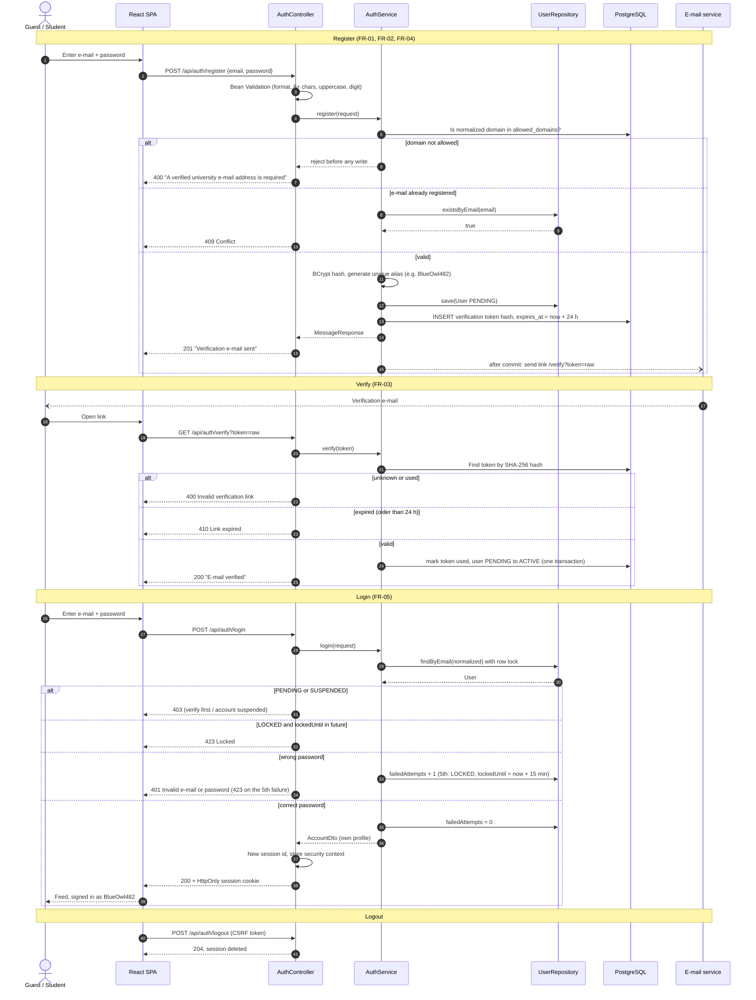

#### 3.2.2 Account State Machine

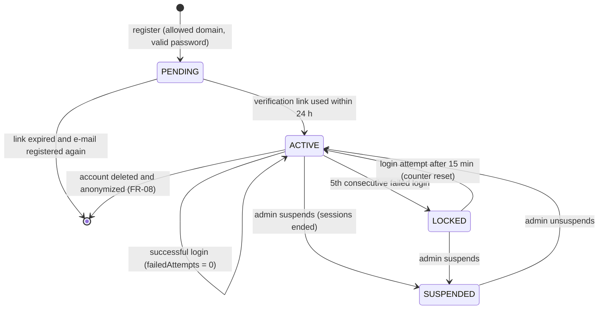

| State | Can log in? | Left by |
|---|---|---|
| PENDING | No: 403 "verify first" | Verification link (→ ACTIVE); expiry + re-registration |
| ACTIVE | Yes | 5 failed logins (→ LOCKED); suspension (→ SUSPENDED); account deletion |
| LOCKED | No: 423, even with the correct password | First login attempt after `lockedUntil` (→ ACTIVE); suspension |
| SUSPENDED | No: 403 "Your account is suspended" | Admin unsuspends (→ ACTIVE) |

A lock ends without a scheduled job: the next login attempt after `lockedUntil` moves the account back to ACTIVE before the password is checked.

#### 3.2.3 Data Flow and Security

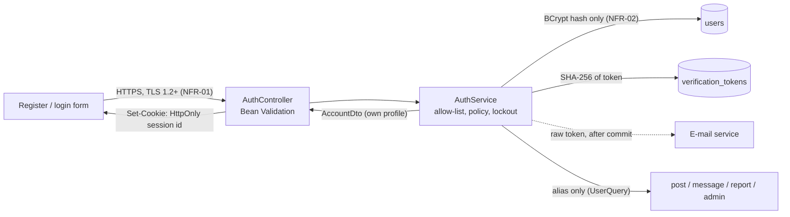

- The plain password exists only in memory during the request; it is never stored or logged. The raw verification token exists only in the e-mail.
- Other modules receive only `userId` from the session and the alias through `UserQuery`. The e-mail address appears in a response only in the user's own `AccountDto` (NFR-04).
- The same 401 message is returned for an unknown e-mail and a wrong password, so login cannot be used to test which e-mails exist. Registration must still reject duplicates (FR-02).

### 3.3 UC2 Design — Create and manage a post

**Requirements:** FR-09–FR-13 · **Actor:** verified, active Student (author) · **Modules:** post, auth; message/report/lifecycle consume the post state contract.

**Scenario:** the student selects category/subtype, enters title/description and optional location/image, then submits. The API validates the request, sanitizes every text field, verifies the optional image and saves an ACTIVE post attributed to the authenticated student. The returned detail shows the display alias. Later the same student can edit, delete or resolve the post. A different student's edit/delete attempt is rejected with 403 without changes.

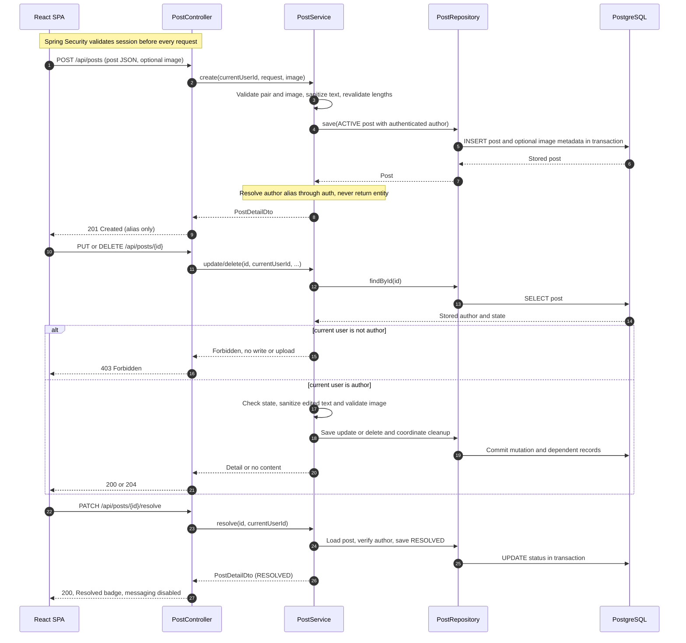

**Alternative/error flows:** bad title/description or category/subtype → 400; unsupported image → 400, image > 5 MB → 413; missing post → 404; non-author mutations → 403. Sanitize then validate again so stripped/neutralized input cannot evade the text limits. On failure there is no persisted change; temporary uploaded bytes are discarded. Authorization is checked before storing an image. Existing RESOLVED posts may be edited without reopening or accepting new messages; hidden/archived edits/resolution return 409. Deletion is a separate permanent operation, not an extra status.

#### 3.3.1 Post State Machine

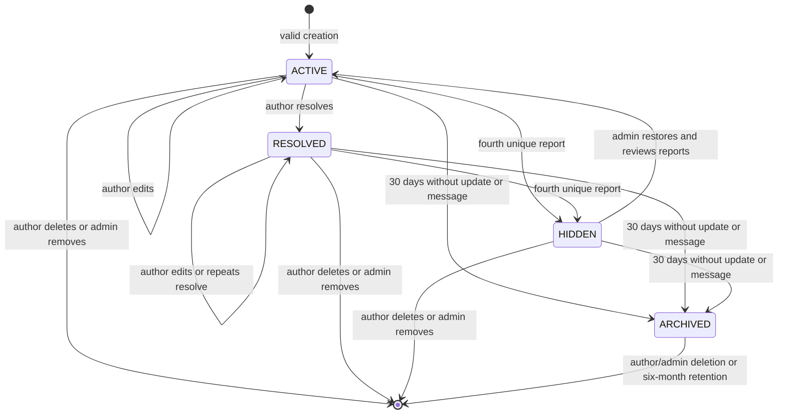

ACTIVE is the default feed state. RESOLVED is visible only through explicit filtering/detail and accepts no new messages (FR-12). HIDDEN is absent from feed/search until admin restoration (FR-26/27). ARCHIVED is absent from feed/search but visible in the author's My Posts (FR-30). Inactivity is measured from the later of `posts.updated_at` and the latest related `conversations.last_message_at`, or creation when neither has advanced. Archiving sets `archived_at`; changing out of ARCHIVED is not offered by v1.0. Auto-hide is a moderation override even for a resolved post; admin restoration explicitly returns ACTIVE under FR-27.

#### 3.3.2 Data Flow

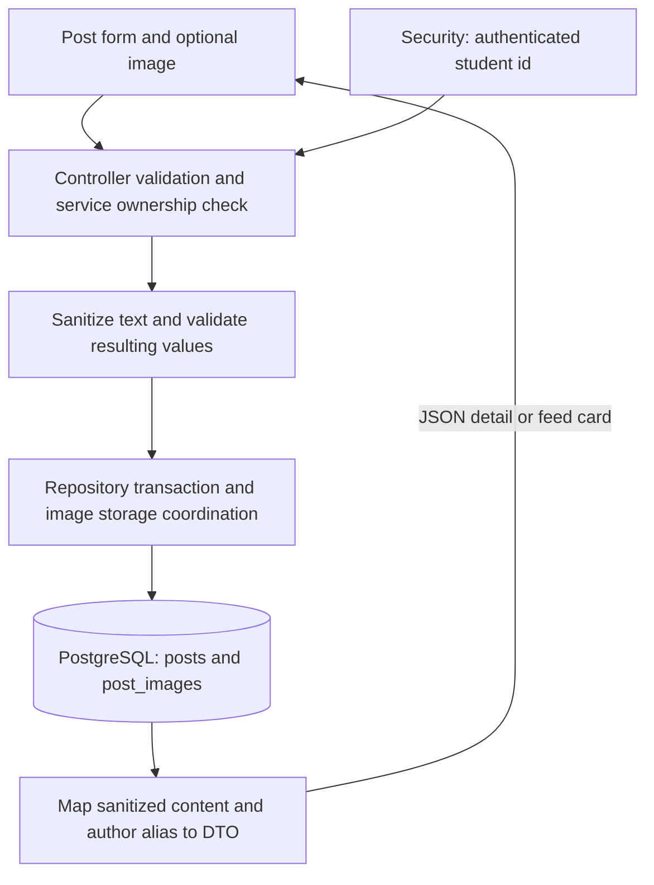

Create/update data comes from the form, identity from the session, and the alias from auth. A post id in a URL is only a lookup key, never proof of ownership. Reads exclude hidden/archived posts for other students; no entity or contact data crosses the API boundary. Resolve changes status, which both feed filtering and messaging authorization read.

### 3.4 UC3 Design — Search the feed and contact the author anonymously

**Requirements:** FR-14, FR-15, FR-16, FR-17, FR-19, FR-20 · NFR-01, NFR-02, NFR-04
**Primary actor:** Student (initiator) · **Secondary actor:** Student (post author)
**Modules:** `post` (feed, search, detail — Enis), `message` (conversations, messages — Efe), `auth` (current user, display aliases — Furkan)

#### 3.4.1 Scenario

1. The student opens the feed; active posts are shown newest first, 20 per page (FR-14).
2. The student enters a keyword and optional filters (category, sub-type, date range, status) (FR-15, FR-16). If nothing matches, “No posts found” is shown.
3. The student opens a post detail page with the full description, image, location and a **Send message** button (FR-17). The author is shown by display alias only.
4. The student writes a first message and presses **Send**. A private conversation between the student and the author is created (FR-19).
5. Both participants exchange messages (up to 1,000 characters each). Only the two participants can read the conversation; both see only each other's display alias (FR-20).

**Alternative flows**

- 3a. The post is Resolved: the **Send message** button is disabled; the API rejects new messages with `409` (FR-12).
- 4a. The student already has a conversation for this post: the message is added to the existing conversation instead of creating a new one.
- 4b. The student is the author of the post: the button is not shown; the API returns `409`.
- 5a. A user who is not a participant calls `POST /api/conversations/{id}/messages`: `403 Forbidden`.

#### 3.4.2 Sequence Diagram

The feed and post endpoints belong to the `post` module (Enis, §2.3.2); their exact paths may change there. `PostQuery` / `UserQuery` stand for the read operations the `message` module needs from the `post` and `auth` modules.

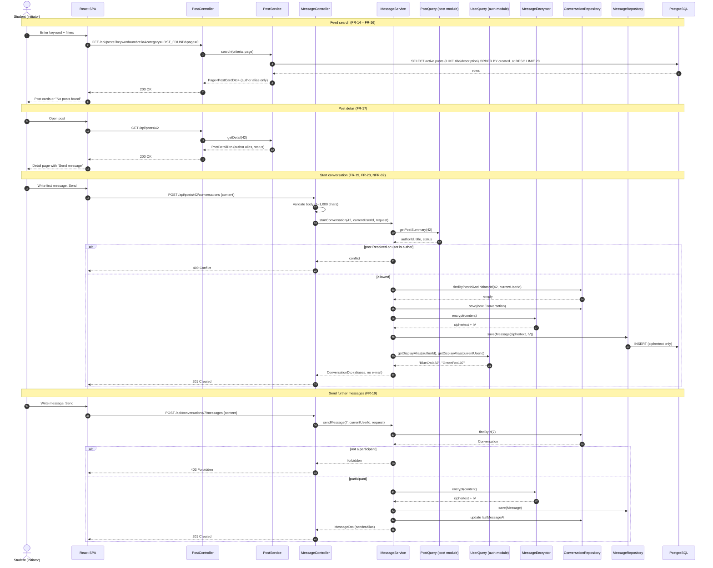

#### 3.4.3 Data Flow

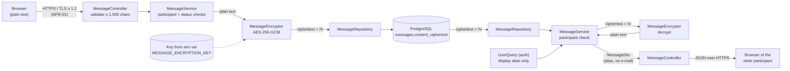

- Plain text exists only in memory (request → service → encryptor, and decryptor → DTO → response). It is never written to the database or to logs.
- The data that leaves the server about another user is limited to the display alias (FR-20).

#### 3.4.4 Privacy and Security Design

**E-mail privacy — alias-only responses (FR-20, NFR-04)**

| Measure | How it is enforced |
|---|---|
| No e-mail field in any messaging DTO | DTOs are explicit Java records with alias fields only (§2.3.3). Entities are never serialized directly. |
| E-mail never loaded in the messaging path | `Conversation` / `Message` store user ids only; the service gets aliases through `UserQuery.getDisplayAlias(id)`, which returns a `String` alias and nothing else. |
| Same rule for feed and detail responses | Post cards and detail pages show the author's alias only (FR-14, FR-17) — `post` module DTOs (Enis). |
| Verified by tests | `MessageDtoPrivacyTest` (unit, already in CI) and QA Plan **TC-04** (API test: no `@` e-mail pattern or `email` key in any conversation/message response). |

The system never adds e-mail or other contact information to messages. Content typed by the users themselves is not scanned in v1.0.

**Access control (FR-19)** — every read and write checks `Conversation.isParticipant(currentUserId)`; other users get `403 Forbidden`. The current user id comes from the authenticated session (UC1), never from the request body.

**Encryption at rest (NFR-02)**

| Aspect | Decision |
|---|---|
| Algorithm | AES-256 in GCM mode (`AES/GCM/NoPadding`, JDK 21 JCA) — confidentiality and integrity (tampered ciphertext fails to decrypt). |
| Key | 256-bit key, Base64, read from the `MESSAGE_ENCRYPTION_KEY` environment variable at startup; not stored in the database or in Git. The application fails to start if the key is missing or not 32 bytes. |
| IV | 12 random bytes from `SecureRandom` for every message, stored in `messages.content_iv`. |
| Tag | 128-bit authentication tag, appended to the ciphertext. |
| Stored columns | `content_ciphertext` (Base64), `content_iv` (Base64). No plain-text column exists. |
| Where | Encrypt/decrypt only inside `MessageService` via `MessageEncryptor`; controllers and repositories never see plain text together with the key. |
| In transit | HTTPS (TLS ≥ 1.2) between browser and server (NFR-01). |

### 3.5 UC4 Design — Report a post, auto-hide and admin review

**Requirements:** FR-25–FR-28 · NFR-03, NFR-04 · **Primary actor:** Student (reporter) · **Secondary actor:** Administrator · **Modules:** `report` (Furkan), `admin` (UC4 stubs Furkan, admin boundary Enis), `post` (status change and visibility, Enis), `auth` (suspension)

**Scenario:**

1. A student opens a post detail page, chooses **Report**, selects a reason (Fraud, Spam, Offensive content, Other) and optionally writes a comment (FR-25).
2. The system stores the report. When the post has **more than 3** unique unreviewed reports, the system sets it to HIDDEN, removes it from the feed and search results and raises an alert for administrators (FR-26).
3. An administrator opens the admin panel, sees the reported and hidden posts with their reports, and either **restores** the post (ACTIVE, reports reviewed) or **removes** it permanently (FR-27).
4. If the author is abusive, the administrator suspends the account; the author is logged out at once and cannot log in again until unsuspended (FR-28).

**Alternative flows:**

- 1a. The student already reported this post: 409 *"You have already reported this post."*; no second report is stored (FR-25, TC-05).
- 1b. The post is missing, HIDDEN or ARCHIVED: 404.
- 2a. 1–3 unique reports: the post stays visible; it appears in the admin list as reported, without an alert.
- 3a. A non-admin calls an admin endpoint: 403.
- 4a. A suspended user tries to log in: 403 *"Your account is suspended"*. The administrator unsuspends: the account returns to ACTIVE.

#### 3.5.1 Sequence Diagram — Report, Threshold and Admin Review

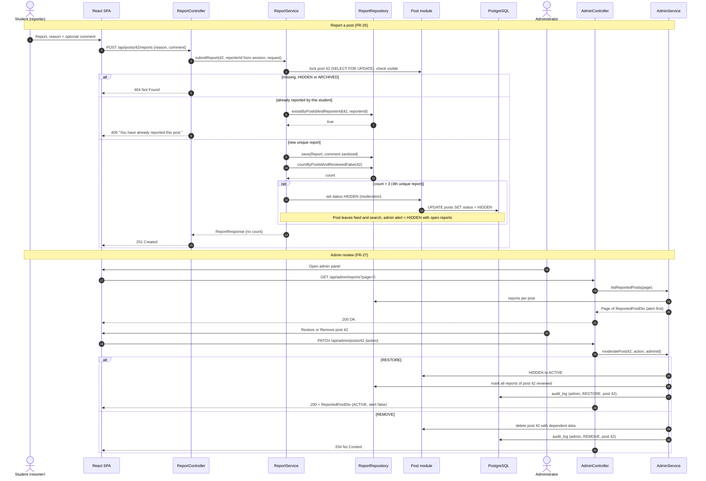

#### 3.5.2 Post Status Changes in UC4

UC4 uses only these transitions of the full post state machine in §3.3.1:

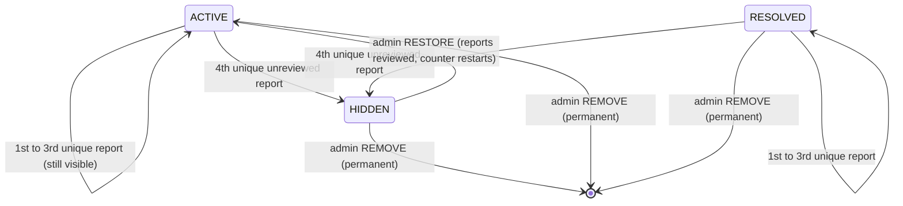

| Unreviewed unique reports | Post status | In feed / search? | In admin list? |
|---|---|---|---|
| 0 | ACTIVE / RESOLVED | Yes (by its normal rules) | No |
| 1–3 | unchanged | Yes | Yes, `alert = false` |
| 4 or more | HIDDEN | No | Yes, `alert = true`, sorted first |
| after RESTORE | ACTIVE, all reports reviewed | Yes | No, until new reports arrive |

#### 3.5.3 Admin Suspension Flow (FR-28)

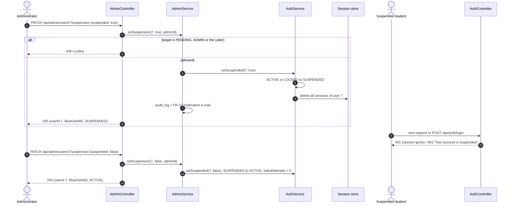

Suspension takes effect at once because sessions are stored on the server and deleted (§4.1.3). The suspended user's posts keep their state; the administrator can moderate them separately.

---

## 4. Design Decisions
### 4.1 Technology Comparisons

#### 4.1.1 PostgreSQL vs. MongoDB (Enis)

| Criterion | PostgreSQL + JPA | MongoDB + Spring Data MongoDB |
|---|---|---|
| UniHelp data shape | Users, posts, reports, conversations and messages have explicit relations and stable fields | Can embed/relate documents, but references between independent collections need application discipline |
| Integrity | Foreign keys, UNIQUE(post_id, reporter_id), unique image/conversation keys and CHECK constraints | Unique compound indexes can stop duplicate reports; cross-collection referential integrity needs service logic |
| Atomic moderation/deletion | One transaction can coordinate post, reports and dependent records | Single-document changes are atomic; multi-document workflows require transactions and appropriate deployment configuration |
| Feed/search expression | JPA specifications combine enum/date filters and literal case-insensitive substring predicates | Criteria combines fields with quoted case-insensitive regex; same logical predicate |
| Performance target | Must be measured at 20,000 posts / 50 concurrent users; substring scan may need tuning | Same measurement needed; unanchored case-insensitive regex may also scan |
| Team/scope/operations | Already specified in PA-1 and wired in Docker/JPA; one database | Adds a different runtime/schema approach and learning effort to the agreed PA-1 stack |
| Decision | **Selected: PostgreSQL** | Comparison only; no runtime dependency |

Committed comparable queries: [`JpaPostQuery.java`](tech-comparison/JpaPostQuery.java) and [`MongoPostQuery.java`](tech-comparison/MongoPostQuery.java), with workload/limitations in [`README.md`](tech-comparison/README.md). Both query the same title/description keyword and optional category/subtype/status/time range, newest first, 20 per page. This is a design comparison, not a measured database benchmark.

#### 4.1.2 Layered Monolith vs. Microservices (Enis)

| Criterion | Layered monolith | Microservices |
|---|---|---|
| Four-person team and deadline | One build, deployable and set of layer contracts; fits PA-1 plan | Service ownership/deployment/API coordination adds work beyond the current plan |
| Post/report consistency | Local transaction and direct service/query boundary | Distributed state changes need explicit cross-service consistency and failure recovery |
| Privacy/access control | One security boundary; DTO and service checks remain mandatory | Identity and authorization must remain consistent across each service boundary |
| Testing/debugging | One context/CI build and local end-to-end tests | Multiple service setups and inter-service contract/failure tests |
| Scaling/failure isolation | Scale the whole application; shares one failure/deployment boundary | Independent scaling/deployment and better process isolation, at higher operational cost |
| Free-tier operation | One backend + one database; Docker Compose already available | More processes, network calls and operational monitoring to maintain |
| Decision | **Selected: layered monolith** | No need for independent service scaling established by PA-1 targets |

The comparison uses the actual architecture in §1.2 and the module contracts in §2.3. It does not introduce messaging brokers, service discovery or a second deployment stack.

#### 4.1.3 Authentication: Stateless JWT vs. Server-Side Session (Furkan)

PA-1 fixes Spring Security and "session handling" (Project Definition §3, §8.2) and lists JWT as a learning topic (§8.5). This comparison decides how a logged-in user is recognized on each request.

| Criterion | Stateless JWT (bearer token) | Server-side session (Spring Security + Spring Session JDBC) |
|---|---|---|
| Logout (FR-05) | Token stays valid until `exp`; real logout needs a server-side denylist | Session deleted on the server; the cookie stops working at once |
| Suspension takes effect (FR-28) | Suspended user keeps access until the token expires, unless every request also checks the user's status in the database | All sessions of the user are deleted at suspension time (`findByPrincipalName` → delete) |
| 60-minute inactivity timeout (FR-07) | Needs short access tokens + rotating refresh tokens to emulate a sliding idle timeout | Built in: `server.servlet.session.timeout=60m`, renewed on each request |
| Storage in the browser / XSS | Token must be readable by JavaScript (memory or `localStorage`); an XSS bug can steal it | Opaque id in an HttpOnly, Secure, SameSite cookie; JavaScript cannot read it |
| CSRF | Not needed when sent in the `Authorization` header | Needed; Spring Security `CookieCsrfTokenRepository` with the SPA sending `X-XSRF-TOKEN` |
| Privacy (NFR-04) | Payload is only Base64; it must never contain the e-mail | Session id carries no data |
| Server state and scaling | No session store; any instance can verify the token | Session rows in the existing PostgreSQL; one instance (NFR-11 scale) needs no extra store, and sessions survive restarts of a free-tier host |
| Per-request cost | Signature check only | One indexed session look-up; not expected to matter at 50 concurrent users (to be confirmed by the k6 test) |
| Team effort and risk (Risk R1) | Key management, refresh-token flow, denylist: more custom security code | Mostly Spring Security defaults; less custom code to get wrong |
| Decision | Rejected | **Selected** |

**Result.** UniHelp is one monolith serving one campus, so the main advantage of JWT does not apply: no session store shared between many services or instances. The requirements that matter here are immediate logout and suspension, a 60-minute idle timeout and minimal exposure to XSS, and the server-side session handles all of them with Spring Security defaults. Sessions are kept in the existing PostgreSQL through Spring Session JDBC, so no new infrastructure is needed. The extra CSRF protection is a known, built-in Spring Security feature. Committed comparable snippets: [`SessionAuthConfig.java`](tech-comparison/SessionAuthConfig.java) and [`JwtAuthConfig.java`](tech-comparison/JwtAuthConfig.java), explained in [`README.md`](tech-comparison/README.md). They are design artifacts outside the Maven build; no latency was measured.

#### 4.1.4 Frontend Framework: React 18 vs. Vue 3 (Taha)

| Criterion | React 18 (with Vite) | Vue 3 |
|---|---|---|
| Component syntax | Function components written in JSX with hooks (`useState`, `useEffect`); markup and logic live in one JavaScript file | Single-file components with separate `<template>`, `<script>` and `<style>` blocks and the Composition API |
| Fit with the PA-1 stack | Selected in PA-1 and used in the repository skeleton (React 18.3, Vite, React Router) | Would replace the agreed stack and the existing frontend skeleton |
| Testing | Components can be tested with React Testing Library | Vue components would need Vue Test Utils, a different testing setup |
| Learning cost | Matches the React knowledge the team already has, so there is no training overhead during Sprints 1–3 | A new template syntax and tooling to learn for a four-person team with a fixed deadline |
| Decision | **Selected** | Rejected: no requirement is served better, and a change would cost time |

**Result.** React 18 is kept. Both frameworks can build the SPA views needed here, so the decision rests on fit with the PA-1 stack, testing with React Testing Library and the team's existing knowledge. Committed comparable snippets: [`PostCard.jsx`](tech-comparison/PostCard.jsx) and [`PostCard.vue`](tech-comparison/PostCard.vue), explained in [`README.md`](tech-comparison/README.md). They are design artifacts outside the frontend build.

### 4.2 Justifications

**Database (Enis).** PostgreSQL matches the relational data and integrity rules in §1.2.1. Report uniqueness, post ownership references and transactional moderation are central to the selected use cases. Spring Data JPA is already in PA-1 and the repository skeleton; using it avoids changing the agreed stack. Feed/search latency remains an acceptance criterion to verify, not an assumed benefit of SQL.

**Architecture (Enis).** A layered monolith directly satisfies NFR-10 and PA-1's single-campus scope. It keeps post, report and message transactions local and gives the four-person team one deployment/CI path. Feature packages and interfaces retain clear module boundaries without separate services. The 5,000-user/20,000-post and 50-concurrent-user targets do not establish a requirement for independent services; k6 results will guide tuning within the selected architecture.

**Backend framework: Spring Boot + Spring Security (Furkan).** Java 21 with Spring Boot and Spring Security was selected in the Concept Note and PA-1 (Requirements §5, Project Definition §8.2). It fits the design for these reasons:

- *Layering (NFR-10).* Spring MVC controllers, `@Service` classes and Spring Data repositories map directly onto the controller → service → repository rule. Constructor injection makes each service unit-testable with Mockito.
- *Security requirements are covered by maintained components, not custom code.* `BCryptPasswordEncoder` for NFR-02; the security filter chain for authentication and role checks (`/api/admin/**` → ADMIN); session-fixation protection, the 60-minute session timeout and CSRF tokens for FR-05/FR-07; Bean Validation for request limits. Risk R5 in PA-1 names "Spring Security defaults" as a mitigation.
- *Transactions.* `@Transactional` with JPA row locks covers the atomic parts of UC1 and UC4: the lockout counter, verification, and the report → count → hide sequence.
- *Testing and CI.* Spring Boot Test with MockMvc and H2/Testcontainers runs the TC-01/TC-02/TC-05 API tests inside `mvn verify` on GitHub Actions.
- *Team and deployment.* A single executable JAR in Docker is enough for free-tier hosting, and the Spring documentation is the main learning resource in PA-1 §8.5.

Alternatives such as Node.js/Express or Django would mean a different language and security stack from the agreed PA-1 plan and the existing skeleton, without helping any requirement. **Authentication** uses server-side sessions, as decided in §4.1.3.

**Messaging module (Efe).** Messaging is a separate `message` module in the layered monolith (controller – service – repository), so its access-control and privacy rules stay in one place. Conversations are linked to a post and limited to its two participants (FR-19). Message contents are encrypted at rest with AES-256-GCM using the JDK's built-in cryptography (no extra library): only the ciphertext and a per-message IV are stored, and the key comes from an environment variable, so a database leak does not expose message text (NFR-02). The module references users and posts by id and returns display aliases only, so e-mail addresses never reach messaging responses (FR-20, NFR-04).

**Frontend architecture & UI responsiveness (Taha).** React 18.3 was chosen over Vue 3 (§4.1.4) because it is the PA-1 stack, works with React Testing Library and matches the team's existing knowledge. Combined with Vite and responsive CSS grid/flexbox layouts, it implements the single-page application (NFR-06, NFR-07, NFR-08) across viewports from `360 px` to `1920 px`, with accessibility checks (WCAG 2.1 Level AA touch targets and focus visibility) and no e-mail exposure on shared visual components.

---

## 5. Repository Artifacts

**Enis's committed artifacts:**

| Artifact | Repository path |
|---|---|
| Post persistence, enum types and repository | `backend/src/main/java/com/unihelp/post/{Post,PostImage,PostCategory,PostSubtype,PostStatus,PostRepository}.java` |
| Post service/query interfaces and wiring stubs | `backend/src/main/java/com/unihelp/post/{PostQuery,PostService,PostServiceImpl,PostController}.java` |
| Post persistence mapping / single-image constraint tests | `backend/src/test/java/com/unihelp/post/PostPersistenceTest.java` |
| Alias-only post DTOs and request/search contracts | `backend/src/main/java/com/unihelp/post/dto/` |
| PostgreSQL/MongoDB comparison source snippets and README | `docs/design/tech-comparison/` |
| Architecture/ER, UC2 diagrams, post/admin API contracts, decision tables | This document §§1.2, 2.1.1, 2.2.2, 2.2.4, 2.3.2, 2.3.4, 3.3, 4 |
| Performance workload and ownership test case | `docs/qa/UniHelp_QA_Plan.md` §2.1 and TC-03 |

**Furkan's committed artifacts:**

| Artifact | Repository path |
|---|---|
| User entity, role/status enums, repository | `backend/src/main/java/com/unihelp/auth/{User,Role,AccountStatus,UserRepository}.java` |
| Auth service/query interfaces, controller and service stubs, DTOs | `backend/src/main/java/com/unihelp/auth/{AuthService,UserQuery,AuthServiceImpl,AuthController}.java`, `…/auth/dto/` |
| Report entity, reason enum, repository, service interface, controller and service stubs, DTOs | `backend/src/main/java/com/unihelp/report/`, `…/report/dto/` |
| Admin service interface, moderation action, controller and service stubs, DTOs | `backend/src/main/java/com/unihelp/admin/`, `…/admin/dto/` |
| No-e-mail check for auth/report/admin response DTOs | `backend/src/test/java/com/unihelp/auth/AuthDtoPrivacyTest.java` |
| JWT vs. session comparison snippets and README section | `docs/design/tech-comparison/{SessionAuthConfig,JwtAuthConfig}.java`, `README.md` |
| Description, auth/report/admin design and API, UC1/UC4 diagrams, auth decision, framework justification | This document §§1.1, 2.2.1, 2.2.4, 2.3.1, 2.3.4, 3.2, 3.5, 4.1.3, 4.2 |
| Security metrics and test cases TC-01, TC-02, TC-05 | `docs/qa/UniHelp_QA_Plan.md` §2.2, §3.1 |

**Efe Deniz Kahvecioğlu's committed artifacts:**

| Artifact | Repository path |
|---|---|
| Repository skeleton, Docker and Docker Compose configuration | `backend/pom.xml`, `backend/Dockerfile`, `docker-compose.yml`, `backend/src/main/resources/application.yml` |
| Message module entities, repositories and interfaces | `backend/src/main/java/com/unihelp/message/{Conversation,Message,ConversationRepository,MessageRepository,MessageService,MessageEncryptor}.java` |
| Message encryption interface/stub and DTOs | `backend/src/main/java/com/unihelp/message/AesGcmMessageEncryptor.java`, `…/message/dto/` |
| Message DTO privacy test suite | `backend/src/test/java/com/unihelp/message/MessageDtoPrivacyTest.java` |
| Test strategy, QA plan structure, maintainability metrics, bug tracking workflow | `docs/qa/UniHelp_QA_Plan.md` §§1, 2.4, 3.2 |
| Technology stack, UML diagrams, messaging design and data flow | This document §§1.3, 1.4, 2.2.3, 2.3.3, 3.4 |

**Muhammed Taha Kaya's committed artifacts:**

| Artifact | Repository path |
|---|---|
| React SPA root, router configuration and responsive layout shell | `frontend/src/{main.jsx,App.jsx,styles.css}`, `frontend/index.html`, `frontend/vite.config.js` |
| Frontend API client wrapper for all REST endpoints | `frontend/src/api/unihelpApi.js` |
| Reusable UI components (`PostCard`, accessible modal `ReportDialog`) | `frontend/src/components/{PostCard.jsx,ReportDialog.jsx}` |
| Route-level page views (Auth, Feed, Post Detail, Form, Conversations, Admin) | `frontend/src/pages/` |
| Low-fidelity vector wireframes for all four use cases (Desktop & Mobile) | `docs/design/wireframes/` |
| Frontend framework comparison (React vs. Vue) snippets and README section | `docs/design/tech-comparison/{PostCard.jsx,PostCard.vue}`, `README.md` |
| Use case selection and requirement mapping (§3.1), frontend interface specifications (§2.3.5), visual interface wireframe mapping (§2.4), usability metrics (§2.3 of QA plan), and TC-06 search test case | This document §2.3.5, §2.4, §3.1; `docs/qa/UniHelp_QA_Plan.md` §2.3, §3.1 (TC-06) |

---

## Task Matrix

R = Responsible (wrote the section), C = Contributed / reviewed.

| Section / task | Furkan Yılmaz | Efe Deniz Kahvecioğlu | Enis Talha Öztepe | Muhammed Taha Kaya |
|---|:-:|:-:|:-:|:-:|
| Document skeleton and structure | | R | C | |
| Contributors list and Table of Contents | | | | R |
| 1.1 Description | R | | | |
| 1.2 Architecture | | | R | |
| 1.3 Technology Stack | | R | C | |
| 1.4 UML Overview (use case and class diagrams) | | R | C | |
| 2.1 Codebase Structure — backend | | | R | |
| 2.1 Codebase Structure — frontend | | | | R |
| 2.2 / 2.3 `auth` module | R | | | |
| 2.2 / 2.3 `post` module | | | R | |
| 2.2 / 2.3 `message` module | | R | C | |
| 2.2 / 2.3 `report` and `admin` modules | R | | C | |
| 2.3.5 Frontend interfaces | | | | R |
| 2.4 Visual Interfaces (wireframes) | | | | R |
| 3.1 Use Case Selection & Requirement Mapping | | | | R |
| 3.2 UC1 Design | R | | | |
| 3.3 UC2 Design | | | R | |
| 3.4 UC3 Design | | R | C | |
| 3.5 UC4 Design | R | | | |
| 4.1 Technology Comparisons | R | | R | R |
| 4.2 Justifications | R | | R | R |
| 5 Repository Artifacts | C | | R | |
| Code: repository skeleton, Docker Compose, CI | | R | C | |
| Code: `message` module interfaces and stubs | | R | | |
| Code: `post` entities, interfaces, DTOs and stubs | | | R | |
| Code: database comparison snippets | | | R | |
| Code: `auth`, `report`, `admin` entities, interfaces, DTOs and stubs | R | | | |
| Code: authentication (JWT vs. session) comparison snippets | R | | | |
| Code: frontend pages, components, API client | | | | R |
| Code: wireframes (`docs/design/wireframes/`) | | | | R |
| Code: React vs. Vue comparison snippets | | | | R |
| Database schema / ER design | | | R | |
