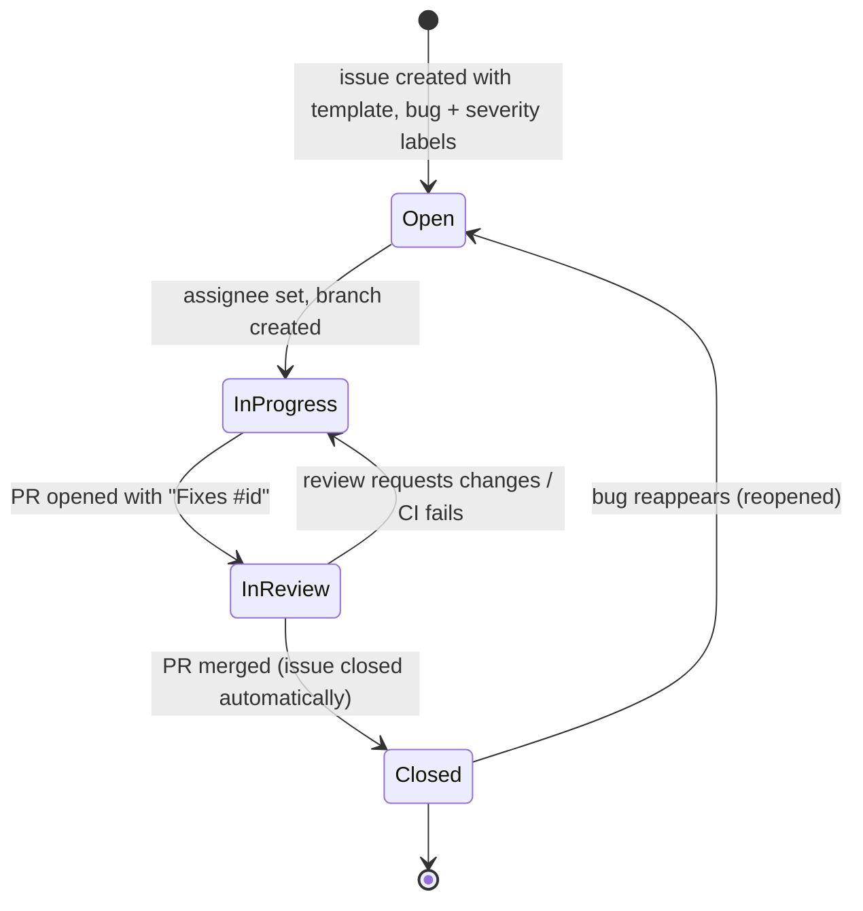

# UniHelp — Quality Assurance (QA) Plan

| | |
|---|---|
| **Course** | BIL 481 Software Engineering — Project Assignment 2 |
| **Project** | UniHelp — Campus Helping Platform |
| **Document** | Quality Assurance Plan |
| **Version** | 0.1 (draft) |
| **Due date** | 15-11-2026 |

## Contributors

<!-- TODO: Taha — finalize the contributors list (name, role, sections written) for the first page. -->

| Name | Role |
|---|---|
| Furkan Yılmaz | |
| Efe Deniz Kahvecioğlu | QA / Test Lead |
| Enis Talha Öztepe | |
| Muhammed Taha Kaya | |

## Table of Contents

<!-- TODO: Taha — finalize the table of contents after all sections are written. -->

1. [Quality Assurance Strategy](#1-quality-assurance-strategy)
   1. [Overview](#11-overview)
   2. [Testing Methodologies](#12-testing-methodologies)
   3. [Automated vs. Manual Testing](#13-automated-vs-manual-testing)
   4. [Continuous Integration](#14-continuous-integration)
2. [Quality Factors & Metrics](#2-quality-factors--metrics)
   1. [Performance](#21-performance)
   2. [Security](#22-security)
   3. [Usability](#23-usability)
   4. [Maintainability](#24-maintainability)
3. [Test Plan](#3-test-plan)
   1. [Test Cases](#31-test-cases)
   2. [Bug Tracking](#32-bug-tracking)
4. [Task Matrix](#task-matrix)

---

## 1. Quality Assurance Strategy

### 1.1 Overview

Quality assurance in UniHelp is continuous and requirement-driven:

- **Traceable.** Every test case refers to a use case (UC1–UC4) and to the requirement IDs (FR-xx, NFR-xx) of the Requirements Document. Every requirement in the Requirements Document has a “How it will be verified” method, and this plan turns those methods into concrete tests.
- **Shift-left.** Unit tests are written in the same sprint as the code they test (Project Plan T3.4, T3.6, T3.11); nothing is merged into `main` without passing CI and at least one review from another team member (NFR-10).
- **Test pyramid.** Most checks are fast automated unit tests on the service layer, a smaller set of integration and API tests covers the REST endpoints with a real database schema, and a few manual sessions cover usability, accessibility and cross-browser behaviour.
- **Risk-based.** Security and privacy (authentication, access control, e-mail privacy, message encryption) get the most test effort because they have the highest impact in the Project Plan risk table.
- **Release gate.** A release candidate (milestone M6, 03-01-2027) is accepted only when all automated tests pass, the four quality metrics in §2 meet their targets and there is no open critical/high bug (§3.2).

Roles: Efe (QA / Test Lead) owns this plan, unit/integration tests and the test report; Furkan leads security testing; Enis leads performance testing; Taha leads usability, accessibility and cross-browser testing (Project Plan §11).

### 1.2 Testing Methodologies

| Level / type | Technique and tools | Scope | Owner | Related requirements |
|---|---|---|---|---|
| Unit testing | **JUnit 5** + **Mockito**; repositories and collaborators are mocked; boundary-value and equivalence-class inputs (e.g. title 4/5/100/101 characters, message 1,000/1,001 characters) | Service-layer business rules of every module | Module owner, reviewed by Efe | NFR-10, all FRs |
| Integration testing | **Spring Boot Test** (`@SpringBootTest`, `@DataJpaTest`, MockMvc) with **H2** in PostgreSQL mode for fast runs and **Testcontainers** (PostgreSQL) for database-specific behaviour | Controller → service → repository → database; JPA mappings, queries, constraints | Efe | FR-01 – FR-28 |
| API testing | **Postman** collection (shared with the frontend) with assertions on status codes, response schemas and absence of personal data | All REST endpoints of the four use cases | Efe, Enis | FR-11, FR-19, FR-20, NFR-04 |
| Security testing | **OWASP ZAP** baseline scan; manual access-control tests (other user's post/conversation → 403); XSS and SQL injection payloads; HTTPS/TLS check | Whole application | Furkan | NFR-01, NFR-02, NFR-03, FR-13 |
| Performance testing | **k6** load scripts (50 concurrent users, seeded with 5,000 users / 20,000 posts) | Feed and search endpoints | Enis | NFR-05, NFR-11 |
| Usability testing | Moderated task-based sessions with at least 10 students (register, create a post, send a message) + short satisfaction survey | Main user flows | Taha | NFR-06 |
| Accessibility testing | **Lighthouse** audit and manual keyboard / screen-width checks (360–1920 px) | Main pages | Taha | NFR-07 |
| Cross-browser testing | Manual checklist on the latest two versions of Chrome, Firefox, Safari and Edge | Main user flows | Taha | NFR-08 |
| Frontend component testing | **React Testing Library** | Forms, validation messages, conditional UI (e.g. disabled “Send message” on Resolved posts) | Taha | FR-12, FR-17 |
| Static checks / code review | Pull-request review by another member; JaCoCo coverage and complexity report | Every change | All | NFR-10 |

### 1.3 Automated vs. Manual Testing

| Area | Automated | Manual | Reason |
|---|:-:|:-:|---|
| Service-layer business rules (validation, lockout, report threshold, permissions) | ✔ | | Deterministic, run on every PR |
| REST API contracts and status codes | ✔ (Spring Boot Test / MockMvc, Postman/Newman) | ✔ (exploratory with Postman) | Regressions must be caught automatically; exploratory testing finds missing cases |
| Database mappings, queries, constraints | ✔ (H2 / Testcontainers) | | Repeatable with a clean schema |
| E-mail privacy in API responses (FR-20, NFR-04) | ✔ (DTO unit test + API test, TC-04) | | Must never regress |
| Message encryption at rest (NFR-02) | ✔ (encrypt/decrypt unit tests) | ✔ (database inspection) | Inspection confirms no plain text is stored |
| E-mail verification / notification delivery | ✔ (mocked mail sender) | ✔ (real inbox on staging) | Delivery through the real SMTP provider can only be checked by hand |
| Security scan | ✔ (OWASP ZAP baseline) | ✔ (access-control and XSS attempts) | Tool finds common issues; logic flaws need a human |
| Performance | ✔ (k6 scripts) | | Load cannot be produced by hand |
| Usability | | ✔ | Requires real users and their judgement |
| Accessibility | ✔ (Lighthouse) | ✔ (keyboard, screen widths) | Lighthouse does not cover all WCAG 2.1 AA criteria |
| Cross-browser compatibility | | ✔ | Small number of browsers; manual checklist is cheaper |
| Scheduled jobs (archiving / deletion) | ✔ (job logic with a fixed clock) | | Time-based logic is tested by injecting the time |

### 1.4 Continuous Integration

- The GitHub Actions workflow `.github/workflows/ci.yml` runs on **every pull request** and on every push to `main`.
- It builds the backend with Java 21 and runs `mvn -B verify`, which compiles the code, runs all unit and integration tests and creates the JaCoCo coverage report (uploaded as the `jacoco-report` build artifact).
- A pull request can be merged only when the CI check is green and at least one other team member has approved it (branch protection on `main`, NFR-10).
- Frontend build and test steps are added to the workflow when the frontend views are implemented (Sprint 1).

---

## 2. Quality Factors & Metrics

| Quality factor | Description | Measurement metric | Target | Owner |
|---|---|---|---|---|
| Performance | <!-- TODO: Enis --> | | | Enis |
| Security | <!-- TODO: Furkan --> | | | Furkan |
| Usability | <!-- TODO: Taha --> | | | Taha |
| Maintainability | Ease of understanding, changing and testing the codebase | Service-layer line coverage (JaCoCo) and cyclomatic complexity per method | Coverage ≥ 70 %; complexity ≤ 10 per method | Efe |

### 2.1 Performance

<!-- TODO: Enis -->

### 2.2 Security

<!-- TODO: Furkan -->

### 2.3 Usability

<!-- TODO: Taha -->

### 2.4 Maintainability

**Related requirement:** NFR-10 (layered architecture, ≥ 70 % service-layer test coverage, all code merged through reviewed pull requests).

| Metric | Definition | Target | Tool / how measured | When |
|---|---|---|---|---|
| M1 — Service-layer line coverage | Covered lines ÷ total lines of all `*Service*` classes in `com.unihelp.*` | **≥ 70 %** | JaCoCo report produced by `mvn verify` (`backend/target/site/jacoco/`), uploaded by CI | Every PR; checked in review from Sprint 1, enforced as a build rule before M6 |
| M2 — Cyclomatic complexity | McCabe cyclomatic complexity of each method (number of independent paths) | **≤ 10 per method** | JaCoCo “Cxty” counter per method in the same report | Every PR; a method above 10 must be refactored or justified in the PR |
| M3 — Reviewed merges | Share of commits on `main` that arrived through an approved pull request | **100 %** | GitHub branch protection and PR history | Continuous |

Interpretation:

- Coverage below 70 % on the service layer means business rules are not protected against regressions; the PR author adds tests before merge.
- High complexity makes code hard to test and review; keeping methods at or below 10 keeps each rule testable with a small number of cases.
- Layering is checked in review: controllers do not call repositories directly, and entities are not returned from controllers (DTOs only).

---

## 3. Test Plan

### 3.1 Test Cases

#### 3.1.1 Test Case Template

Every test case uses the following fields:

| Field | Description |
|---|---|
| **ID** | `TC-xx`, unique |
| **Title** | Short description of what is verified |
| **Related UC / FR** | Use case (UC1–UC4) and requirement IDs (FR-xx, NFR-xx) |
| **Preconditions** | System state and data needed before the test |
| **Steps** | Numbered actions |
| **Test Data** | Concrete input values |
| **Expected Result** | Observable result that decides pass/fail |
| **Type** | Auto (JUnit / Spring Boot Test / Postman / k6 / ZAP / Lighthouse) or Manual |
| **Owner** | Team member responsible for writing and running it |

#### TC-01

<!-- TODO: owner to be assigned -->

#### TC-02

<!-- TODO: owner to be assigned -->

#### TC-03

<!-- TODO: owner to be assigned -->

#### TC-04 — No e-mail address in conversation and message API responses

| Field | Value |
|---|---|
| **ID** | TC-04 |
| **Title** | Conversation and message API responses contain only display aliases, never an e-mail address |
| **Related UC / FR** | UC3 · FR-19, FR-20, NFR-04 |
| **Preconditions** | 1. Two verified, active students exist: **A** (`a.student@etu.edu.tr`, alias `BlueOwl482`) and **B** (`b.student@etu.edu.tr`, alias `GreenFox107`). 2. A has an Active post (id = P). 3. B is logged in and has a valid session. |
| **Steps** | 1. As B, call `POST /api/posts/{P}/conversations` with the test message. 2. Record the conversation id C from the response. 3. As B, call `POST /api/conversations/{C}/messages` with a second message. 4. As B, call `GET /api/conversations`. 5. Log in as A and call `GET /api/conversations`. 6. For every response body of steps 1–5, search all keys and values recursively. |
| **Test Data** | Message 1: `"Hi, I think I found your umbrella."` · Message 2: `"I can bring it to the library at 14:00."` · E-mail regex: `[A-Za-z0-9._%+-]+@[A-Za-z0-9.-]+\.[A-Za-z]{2,}` |
| **Expected Result** | 1. Steps 1 and 3 return `201 Created`; steps 4 and 5 return `200 OK`. 2. No JSON key contains `email` or `mail` (case-insensitive). 3. No JSON value matches the e-mail regex; in particular `a.student@etu.edu.tr` and `b.student@etu.edu.tr` do not appear. 4. The other participant is shown only by alias: B sees `counterpartAlias = "BlueOwl482"`, A sees `counterpartAlias = "GreenFox107"`; `senderAlias` in message responses is an alias. 5. No user id of the other participant's account or other personal contact data is returned beyond the alias. |
| **Type** | Auto — (a) unit: `MessageDtoPrivacyTest` checks that no response DTO has an e-mail field (already in CI); (b) integration: Spring Boot Test + MockMvc scenario above (Sprint 2); (c) API: same checks as assertions in the Postman collection |
| **Owner** | Efe Deniz Kahvecioğlu |

#### TC-05

<!-- TODO: owner to be assigned -->

#### TC-06

<!-- TODO: owner to be assigned -->

### 3.2 Bug Tracking

**Tool.** Bugs are tracked as **GitHub Issues** in the project repository and shown on the GitHub Projects board, together with the development tasks.

**Reporting.** Anyone who finds a bug (team member, test user, course staff feedback) opens an issue with the **Bug report** template (`.github/ISSUE_TEMPLATE/bug_report.md`). The template asks for: summary, related UC / requirement / test case, environment, steps to reproduce, expected result, actual result, severity and attachments (screenshots, logs).

**Labels.** Every bug has the `bug` label and exactly one severity label:

| Label | Meaning | Example | Target fix time |
|---|---|---|---|
| `severity:critical` | Security/privacy breach, data loss, or the application cannot be used | E-mail address visible in an API response; login impossible for everyone | Immediately (same day) |
| `severity:high` | A Must requirement or a demo use case is broken, no workaround | Cannot start a conversation; reported post is not hidden after 4 reports | Within the current sprint (≤ 3 days) |
| `severity:medium` | Feature works incorrectly but a workaround exists | Wrong unread counter; filter combination ignored | Within the current or next sprint |
| `severity:low` | Cosmetic or minor issue | Typo, misaligned button | When capacity allows |

**Life cycle.**

| State | Meaning | Who moves it |
|---|---|---|
| Open | Reported, triaged, severity set | Reporter; QA lead checks severity in the weekly meeting |
| In Progress | Assigned developer is working on it | Assignee |
| In Review | Fix is in a pull request | Assignee |
| Closed | Fix merged into `main` and verified by the reporter or QA lead | Automatic on merge |

**Rules.**

- The fix PR description contains `Fixes #<issue-id>` so that GitHub links the PR and closes the issue on merge.
- Every critical/high bug fix includes a regression test (unit, integration or API) that fails without the fix.
- **No release while a `severity:critical` or `severity:high` bug is open** (Project Plan objective 5, milestone M6).
- Open bugs per severity are reviewed in every weekly meeting and reported in the test report.

---

## Task Matrix

R = Responsible (wrote the section), C = Contributed / reviewed.

| Section / task | Furkan Yılmaz | Efe Deniz Kahvecioğlu | Enis Talha Öztepe | Muhammed Taha Kaya |
|---|:-:|:-:|:-:|:-:|
| Document skeleton and structure | | R | | |
| Contributors list and Table of Contents | | | | |
| 1 QA Strategy (overview, methodologies, automated vs. manual, CI) | | R | | |
| 2.1 Performance | | | | |
| 2.2 Security | | | | |
| 2.3 Usability | | | | |
| 2.4 Maintainability | | R | | |
| 3.1 Test case template | | R | | |
| TC-01 | | | | |
| TC-02 | | | | |
| TC-03 | | | | |
| TC-04 | | R | | |
| TC-05 | | | | |
| TC-06 | | | | |
| 3.2 Bug Tracking (+ issue template) | | R | | |
